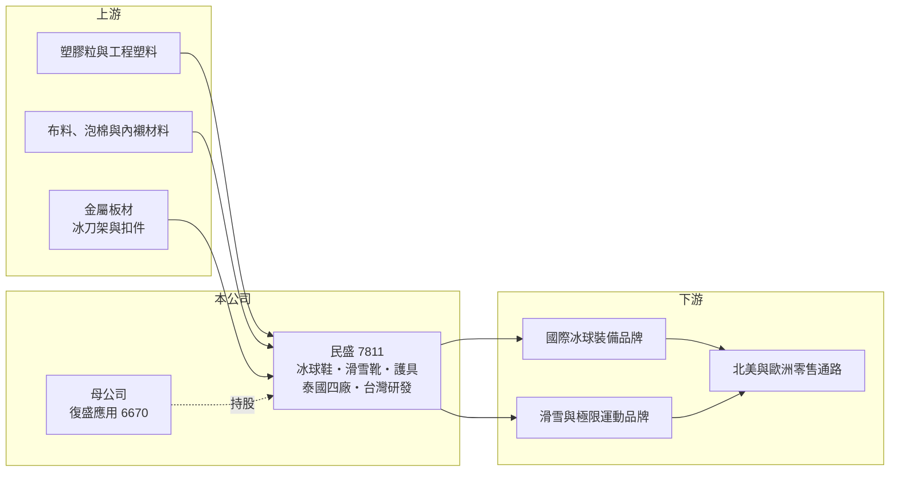

# 7811 民盛

> 上櫃｜[[產業索引-運動休閒|運動休閒]]｜上市（櫃）日期 2026/03/25

# 第一章：企業模式與商業藍圖

> [!info] 撰寫說明
> 精簡版，由 Claude 依公開資料整理，架構比照 [[2330台積電]]，資料截至 2026-10-08。來源：MoneyDJ 理財網財務比率年表（2021 至 2025 年）；經濟日報 2026 年 3 月上櫃報導（產品、製程、泰國基地、2023 至 2025 年營收與 EPS）；工商時報 2026 年 3 月報導（泰國四座工廠、2020 年被復盛應用收購）；櫃買中心開放資料快照（基本資料、2026 年上半年資產負債與損益、股利）。公開資料有限，客戶名稱與產品比重未查得。#待校對

民盛應用企業成立於 2020 年 8 月、2026 年 3 月 25 日以每股 93.33 元承銷價上櫃，總部在台北內湖，董事長許廷儀、總經理張端揆，創辦人為陳泰亨，實收資本額約 3.34 億元。民盛是高爾夫球頭代工龍頭 [[6670復盛應用]] 在 2020 年收購的子公司，專做冰上曲棍球鞋、滑雪靴與運動護具，是一個高度利基的運動裝備代工廠。

- **核心業務：** 民盛替國際運動品牌代工冰上曲棍球（冰球）溜冰鞋（[[冰球鞋]]）、專業滑雪靴與極限運動安全護具，產品線「從頭到腳」涵蓋功能鞋靴與身體護具，應用在冰球、越野機車、棒球與直排輪等運動。這些產品需要同時保護身體與維持運動表現，對材料、結構與合身度要求很高。
- **營收結構：** 各產品比重未查得。依經濟日報報導，民盛整合縫紉、[[塑膠射出]]與金屬沖壓三大核心製程，能在同一集團內完成鞋殼、內襯、冰刀架與護具等不同材質零件，這種跨製程整合是它承接整雙冰球鞋與滑雪靴的關鍵。客戶為國際一線運動品牌（名稱未揭露）。
- **營運據點：** 生產集中在泰國，共有四座工廠，台灣設有研發中心（工商時報）。泰國產地避開中國，在美國關稅與品牌分散供應鏈的趨勢下具有原產地優勢。
- **長期方向：** 公司表示未來擬透過併購同業擴大規模，延續母公司復盛應用以併購擴張運動裝備版圖的策略。冰球與滑雪是北美與歐洲的主流冬季運動，民盛的長期成長取決於能否在這些利基品類提高市占，並把三大製程延伸到更多防護型運動裝備。

# 第二章：護城河深度與競爭優勢

民盛的護城河是利基市場的專業製程與少數供應商格局，加上母公司集團的資源支持。

- **競爭優勢：** 冰球鞋與滑雪靴屬於小眾但高單價的專業裝備，全球需求集中在北美、北歐與阿爾卑斯地區，市場規模不足以吸引大量新進者，能同時做縫紉、射出與沖壓的代工廠很少。品牌客戶對安全護具有嚴格的測試與認證要求，一旦導入就傾向長期合作。母公司 [[6670復盛應用]] 在越南與自動化管理上的經驗，也能支援民盛的營運。
- **主要對手：** 冰球裝備品牌本身多委外生產，主要對手為中國與東南亞其他運動護具與鞋靴代工廠；滑雪靴則面對義大利、東歐的傳統製靴廠與品牌自有工廠（名單未查得）。台灣上市櫃中業務最接近的是母公司復盛應用旗下的溜冰鞋子公司奧博（未上市）。
- **觀察重點：** 2025 年營收成長 18% 到 30.75 億元，但 EPS 由 9.18 元降到 8.10 元，毛利率由 25.4% 降到 23.0%，顯示成長伴隨成本壓力。長期要看泰國產能擴充、客戶與品類拓展，以及上市後的併購能否帶來綜效。

# 第三章：財務體質與盈利規模

資料日期：2026-10-08，表格是撰寫當時的快照；最新月營收、毛利率、累計 EPS 由自動排程寫在本筆記的屬性欄位（月營收、毛利率、累計EPS 等）。#待校對

民盛的毛利率約 21% 至 28%、營業利益率約 7% 至 15%，2022 年獲利最高，2023 年後穩定在 EPS 6 至 9 元。

| 年度 | 營收（億元） | [[毛利率]] | [[營業利益率]] | EPS（元） | [[ROE]] |
|---|---|---|---|---|---|
| 2021 | 約 30.6（推算） | 21.10% | 7.41% | 6.67 | 未查得 |
| 2022 | 約 33.4（推算） | 27.77% | 15.13% | 17.99 | 42.42% |
| 2023 | 23.11 | 25.05% | 8.79% | 6.43 | 13.07% |
| 2024 | 26.05 | 25.39% | 10.67% | 9.18 | 17.10% |
| 2025 | 30.75 | 22.95% | 9.90% | 8.10 | 13.68% |

註：2023 至 2025 年營收來自經濟日報；2021、2022 年以每股營業額乘以約 2,980 萬股（由 2023 年營收與每股營業額回推）推算。

- **長期指標：** 2022 至 2025 年平均 ROE 約 21.6%（推算），但 2022 年特別高，2023 年後約 13% 至 17%。2023 至 2025 年營收年複合成長率約 15%（推算）。最近一年度每股股利約 5.67 元（櫃買中心本益比殖利率資料），約為 2025 年 EPS 的七成。每股現金流量 2022 至 2025 年皆為正。
- **[[ROIC]] 與 [[WACC]]：** 2025 年營業利益約 3.04 億元（營收 30.75 億元 × 9.9%），稅後約 2.44 億元（稅率 20%）。投入資本以 2026 年第二季權益總計 19.9 億元（含上櫃現金增資），加有息負債推估約 3 億元計算（負債總計 10.3 億元，官方快照未拆分），ROIC 約 10.7%（推算）。WACC 約 7%（推算：無風險利率 1.75%、市場風險溢酬 6%、β 取 0.9，股東權益成本 7.15%；負債比重低，稅率 20%）。ROIC 高於 WACC 約 3 至 4 個百分點，代表目前有在創造價值，但上市增資讓權益變大，若資金沒有投入高報酬的擴產或併購，ROIC 會被稀釋。
- **財務特色：** 2026 年第二季總資產 30.2 億元、負債 10.3 億元，負債比率約 34%，每股淨值 59.57 元。2026 年上半年營收 14.0 億元、毛利率約 20.3%、營業利益率約 4.6%、EPS 2.82 元，業外收入 0.50 億元占稅前淨利四成以上，本業獲利率較 2025 年下滑。

# 第四章：總體風險與地緣政治

民盛的風險在於利基市場規模有限、客戶集中，以及泰國單一產地。

- **產業週期：** 冰球與滑雪裝備屬於高單價可選消費，需求受北美與歐洲景氣、冬季氣候與參與人口影響；暖冬或雪季縮短會減少滑雪需求。品牌商的庫存調整也會放大代工訂單的波動，形成[[長鞭效應]]。
- **營運風險：** 利基市場的品牌數量少，客戶集中度推估偏高（名稱與比重未揭露），任一大客戶轉單影響大。生產集中在泰國四座工廠，當地工資上漲、勞動力短缺或政治變動都會影響營運。上市後擬以併購擴張，整合風險也隨之增加。
- **其他風險：** 營收以美元、歐元計價，成本有泰銖，匯率三角關係影響毛利；塑膠與金屬原料價格波動影響成本。母公司復盛應用持股比例高，關係人交易與公司治理是小型子公司上市後需要觀察的面向。

# 專有名詞解析

## 金融

- **[[長鞭效應]]**：終端需求的小幅變動，沿供應鏈往上游傳遞時被逐級放大，造成上游庫存與訂單劇烈波動。
- **[[ROIC]]**：投入資本報酬率，稅後營業利益除以股東權益加有息負債，衡量本業運用資本的效率。
- **[[WACC]]**：加權平均資金成本，股東與債權人要求報酬率的加權平均，是 ROIC 要超越的門檻。

## 產業

- **[[冰球鞋]]**：冰上曲棍球專用的溜冰鞋，結合硬殼鞋身、內襯與冰刀架，需兼顧保護、支撐與靈活度。
- **[[塑膠射出]]**：把加熱熔化的塑膠注入模具冷卻成型的製程，用於鞋殼、護具外殼等硬質零件。

# 核心供應鏈

- 上游：塑膠粒與工程塑料、布料與泡棉內襯、金屬板材（名單未查得）。
- 下游／客戶：國際冰球、滑雪與極限運動裝備品牌（名稱未揭露；冰球裝備市場主要品牌有 Bauer、CCM 等，是否為客戶待校對）。
- 同業：母公司 [[6670復盛應用]] 旗下的溜冰鞋子公司奧博；中國與東南亞運動護具代工廠。

## 最新新聞
<!-- news:start -->
<!-- news:end -->

## 相關連結
- [公開資訊觀測站](https://mopsov.twse.com.tw/mops/web/t05st03?step=1&firstin=1&co_id=7811)
- [Goodinfo](https://goodinfo.tw/tw/StockDetail.asp?STOCK_ID=7811)
- [Yahoo 股市](https://tw.stock.yahoo.com/quote/7811)
- [鉅亨網新聞](https://www.cnyes.com/twstock/7811/news)
