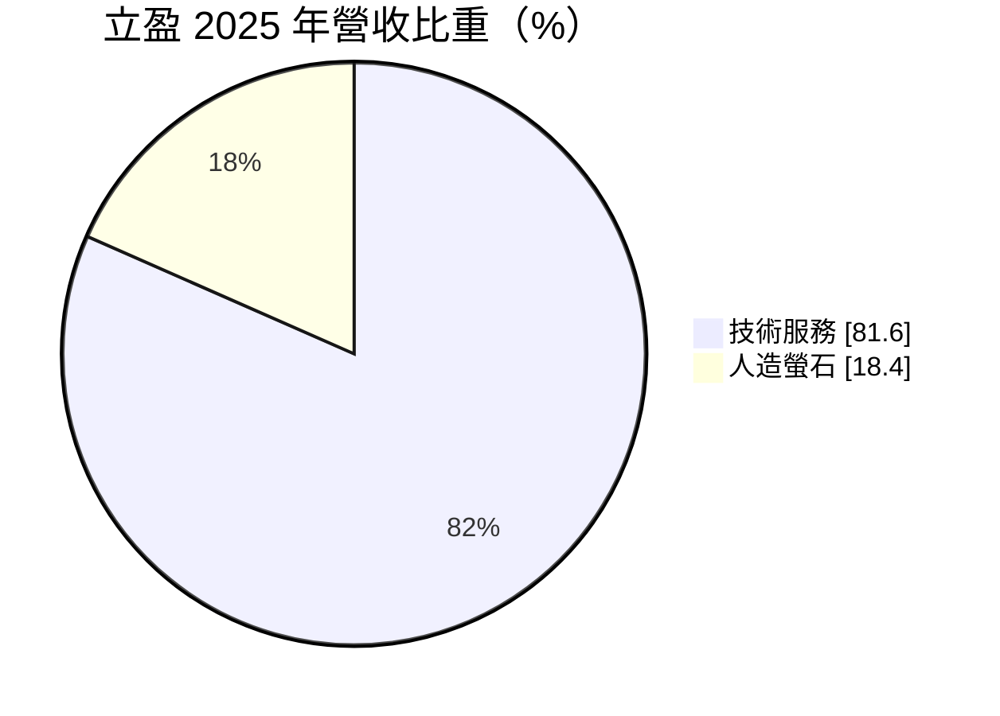
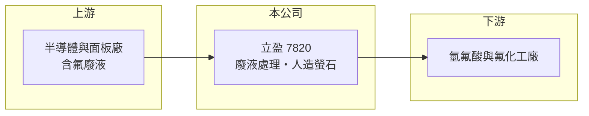

# 7820 立盈

> 上櫃｜[[產業索引-綠能環保|綠能環保]]｜上市（櫃）日期 2026/04/27

# 第一章：企業模式與商業藍圖

> [!info] 撰寫說明
> 精簡版，由 Claude 依公開資料整理，架構比照 [[2330台積電]]，資料截至 2026-10-08。創新板／新掛牌，公開資料有限（2026 年 4 月上櫃）。來源：櫃買中心開放資料快照（基本資料、2026 年第二季綜合損益與資產負債、每月營收）、Goodinfo 年度經營績效、MoneyDJ 基本資料（2025 年營收比重）、科技新報與優分析 2026 年 3 月上櫃前報導標題。技術服務的具體內容為整理性描述。#待校對

立盈環保科技（以下簡稱立盈）位於桃園平鎮，2026 年 4 月掛牌上櫃，專門處理半導體與電子業的含氟廢液，並把其中的氟轉化為[[人造螢石]]。本章說明這個把廢棄物變成原料的商業模式。

- **核心業務：** 半導體製程大量使用氫氟酸進行蝕刻與清洗，產生的含氟廢液必須處理後才能排放。立盈向產生廢液的工廠收取處理與技術服務費，並把廢液中的氟以化學方法沉澱成氟化鈣，也就是人造螢石，再賣給化工業作為製造氫氟酸的原料，形成[[循環經濟]]的閉環。
- **營收結構：** 依 MoneyDJ 資料，2025 年技術服務占營收 81.60%，人造螢石銷售占 18.40%。上櫃前報導亦以「高毛利服務占比逾 8 成」描述，代表公司主要靠處理服務收費，產品銷售是附加收入。

- **營運據點：** 公司位於桃園市平鎮區工業區，鄰近北部的半導體與面板聚落。廢液處理需要特定的許可與設施，據點分布決定能服務的客戶範圍。
- **長期方向：** 天然螢石是戰略礦產，主要產地集中在中國，各國都在尋找替代來源。半導體產能持續擴張使含氟廢液量增加，同時大廠追求 [[ESG]] 與資源再利用，這兩股力量讓「廢液處理＋人造螢石」的需求長期向上。

# 第二章：護城河深度與競爭優勢

環保處理業的護城河來自許可、技術與客戶認證。本章分析立盈的競爭位置。

- **競爭優勢：** 含氟廢液的處理要同時符合環保排放標準與半導體客戶的稽核要求，而把氟回收成符合工業規格的人造螢石，需要穩定的化學製程控制。能把處理與再利用一起做好的業者不多，這讓立盈的[[毛利率]]維持在五成以上。
- **主要對手：** 電子業廢液與化學品回收的台股同業包括 [[1727中華化]]、[[4755三福化]]、[[6894衛司特]]、[[8435鉅邁]] 等，其中部分業者也做[[電子級氫氟酸]]或廢酸回收。各家回收的化學品種類不同，直接競爭程度因產品而異。
- **觀察重點：** 一是處理量能擴充與新廠進度，二是人造螢石能否打入更多化工客戶、提高售價，三是客戶是否從單一區域擴大到中南部的半導體聚落。

# 第三章：財務體質與盈利規模

資料日期：2026-10-08，表格是撰寫當時的快照；最新月營收、毛利率、累計 EPS 由自動排程寫在本筆記的屬性欄位（月營收、毛利率、累計EPS 等）。#待校對

立盈的獲利率高且穩定，營收在 2025 年後加速成長。

| 年度 | 營收（億元） | [[毛利率]] | [[營業利益率]] | EPS（元） | [[ROE]] |
|---|---|---|---|---|---|
| 2021 | 1.58 | 51.6% | 38.5% | 1.34 | 14.5% |
| 2022 | 2.03 | 56.3% | 38.7% | 2.49 | 18.0% |
| 2023 | 1.73 | 49.3% | 23.2% | 1.08 | 6.3% |
| 2024 | 1.88 | 62.4% | 32.7% | 1.69 | 8.3% |
| 2025 | 2.98 | 53.7% | 26.9% | 1.76 | 8.7% |
| 2026 上半年 | 2.06 | 56.1% | 34.1% | 1.60 | 未查得 |

- **營收規模：** 營收從 2021 年 1.58 億元成長到 2025 年 2.98 億元，年複合成長率約 17%（推算）。2026 年 1 至 8 月累計營收 2.73 億元，較前一年同期成長約 44%，反映新增處理量能與客戶擴產。
- **獲利：** 2026 年上半年營業利益 0.70 億元、稅後淨利 0.57 億元，EPS 1.60 元，營業利益率回升到 34%。近五年平均 ROE 約 11%（推算），ROE 不算高，主要因為處理設施的資本投入大，股東權益基數高。Goodinfo 早期年度淨利率與淨利金額有不一致處，建議以財報核對。
- **財務特色：** 2026 年第二季底股東權益 12.42 億元（含上櫃募資），非流動負債 4.86 億元，可能為廠房設備的長期借款（推估）。非流動資產 8.0 億元，占總資產四成以上，屬於資本密集的處理業。股利紀錄未查得。
- **[[ROIC]] 與 [[WACC]]：** 官方快照未拆分有息負債，以非流動負債 4.86 億元作為有息負債近似值。2026 年上半年營業利益年化約 1.40 億元，扣除 20% 稅後約 1.12 億元，除以股東權益加非流動負債 17.3 億元，ROIC 約 6.5%（推算）；分母含上櫃募得的現金，實際營運資產的報酬率應較高。WACC 以 CAPM 推估：無風險利率 1.75%、市場風險溢酬 6%、β 假設 1.1（環保服務推估值），權益成本約 8.4%；負債成本假設 2.5%、稅後 2.0%，負債占比約 28%，WACC 約 6.6%（推算）。目前 ROIC 與 WACC 大致持平，募資資金投入新產能後能否拉高 ROIC，是判斷長期價值創造的關鍵。

# 第四章：總體風險與地緣政治

廢液處理業的需求穩定，但與半導體產能及法規高度連動。本章整理立盈的長期風險。

- **產業週期：** 含氟廢液量隨半導體與面板廠的產能利用率變動，景氣下行時處理量會減少；人造螢石價格則受天然螢石與氫氟酸市場影響。
- **營運風險：** 客戶集中在半導體與電子業，主要客戶若自建處理設施或改變製程，需求可能下降。處理設施若發生洩漏或違規，可能被停工並影響客戶信任。
- **其他風險：** 環保法規趨嚴會提高處理標準與成本，但也會淘汰不合規同業；中國對螢石的出口政策會影響人造螢石的市場價格，是雙向的變數。

# 專有名詞解析

## 產業

- **[[人造螢石]]**：從含氟廢液中沉澱回收的氟化鈣，可取代天然螢石作為製造氫氟酸的原料。
- **[[電子級氫氟酸]]**：高純度氫氟酸，用於晶圓蝕刻與清洗，是含氟廢液的主要來源。
- **[[循環經濟]]**：把廢棄物回收、處理後重新變成原料或產品，以減少資源消耗與最終處置量的經濟模式。
- **[[ESG]]**：環境、社會與公司治理三個面向的永續指標，大廠以此要求供應鏈。

# 核心供應鏈

- 上游：半導體、面板與電子廠產生的含氟廢液，是付費的料源，例如 [[2330台積電]] 等晶圓廠所在的聚落（實際客戶未查得）。
- 下游／客戶：氫氟酸與氟化工製造商，購買人造螢石作為原料。
- 同業：[[1727中華化]]、[[4755三福化]]、[[6894衛司特]]、[[8435鉅邁]]。

## 最新新聞
<!-- news:start（自動產生，請勿手動編輯此範圍） -->
- 2026-10-05 🏛️ 重訊 16:36｜公告本公司買回庫藏股執行完畢｜[觀測站](https://mops.twse.com.tw/mops/#/web/t05st01)

完整紀錄：[[7820立盈 新聞]]
<!-- news:end -->

## 相關連結
- [公開資訊觀測站](https://mopsov.twse.com.tw/mops/web/t05st03?step=1&firstin=1&co_id=7820)
- [Goodinfo](https://goodinfo.tw/tw/StockDetail.asp?STOCK_ID=7820)
- [Yahoo 股市](https://tw.stock.yahoo.com/quote/7820)
- [鉅亨網新聞](https://www.cnyes.com/twstock/7820/news)
