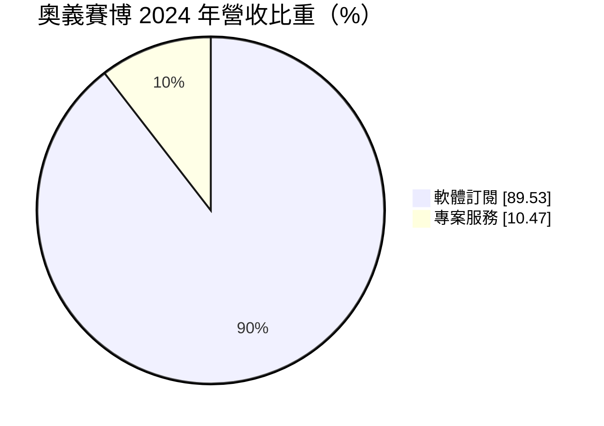
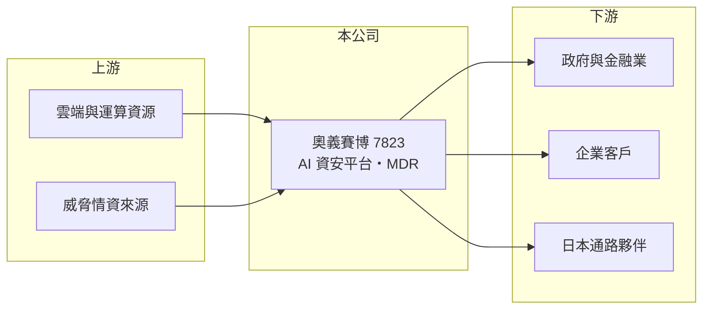

# 7823 奧義賽博-KY創

> 創新板｜[[產業索引-數位雲端|數位雲端]]｜上市（櫃）日期 2026/02/05

# 第一章：企業模式與商業藍圖

> [!info] 撰寫說明
> 精簡版，由 Claude 依公開資料整理，架構比照 [[2330台積電]]，資料截至 2026-10-08。創新板／新掛牌，公開資料有限。來源：證交所開放資料快照（基本資料、2026 年第二季綜合損益與資產負債、每月營收、股利）、Goodinfo 年度經營績效、MoneyDJ 基本資料（2024 年營收比重）、科技新報 2026 年 1 月上市前業績發表會報導、工商時報 2026 年 5 月報導標題。產品名稱與客戶類型部分憑記憶整理，標示待校對。#待校對

奧義賽博（以下簡稱奧義）是以 AI 技術做資安防護的軟體公司，對外品牌為 CyCraft，2026 年 2 月登上[[創新板]]，掛牌主體為開曼控股（KY），營運總部在新北市板橋。本章說明它的商業模式與成長策略。

- **核心業務：** 奧義開發以 AI 自動偵測與分析網路攻擊的[[資安]]平台，並提供[[MDR]]（託管偵測與回應）服務，替企業與政府單位全天候監控端點與網路，發現入侵後協助調查與處置。產品線據記憶包括 XCockpit 平台（待校對），以及 2026 年上市前報導提及的 LLM 安全產品 XecGuard（待校對）。
- **營收結構：** 依 MoneyDJ 資料，2024 年軟體訂閱占營收 89.53%，專案服務占 10.47%。[[訂閱制]]收入每年續約、可預測性高，是軟體公司估值的核心；高訂閱占比代表奧義已經從專案型顧問轉成平台型公司。

- **營運據點：** 營運總部在新北市板橋。依 2026 年 5 月報導，公司把進軍海外市場列為 2026 年重要目標，在日本已與 NTT Security 及 Future Secure Wave 合作，透過當地夥伴銷售。
- **長期方向：** 依 2026 年 1 月業績發表會，董事長吳明蔚提出成長三支箭：AI 自動化威脅偵測與分析、自主 [[LLM]] 模型安全技術、切入國防軍工與[[反無人機系統]]。這代表公司想從企業資安延伸到 AI 安全與國防兩個新市場。

# 第二章：護城河深度與競爭優勢

資安軟體的護城河來自技術、資料累積與客戶轉換成本。本章分析奧義的競爭位置。

- **競爭優勢：** 資安平台部署在客戶的端點與網路後，累積的偵測規則、事件資料與調查流程很難搬到其他平台，續約率通常很高。奧義 2026 年上半年[[毛利率]] 84.8%，符合軟體公司高毛利的特性；在台灣政府與金融業的實績（待校對），是本土資安公司的差異化來源。
- **主要對手：** 國際對手包括 CrowdStrike、Palo Alto Networks、趨勢科技等大型資安公司；台股資安同業包括 [[6690安碁資訊]]、[[7765中華資安]]、[[6865偉康科技]]、[[2471資通]] 等，業務多偏向資安服務與代理。奧義的特色是自有 AI 偵測技術。
- **觀察重點：** 一是訂閱收入的成長率與續約率，二是海外營收占比能否提升，三是營業虧損何時收斂。國際大廠的產品與資源遠大於奧義，能否在日本等市場建立穩定通路，決定它能否突破台灣市場的規模限制。

# 第三章：財務體質與盈利規模

資料日期：2026-10-08，表格是撰寫當時的快照；最新月營收、毛利率、累計 EPS 由自動排程寫在本筆記的屬性欄位（月營收、毛利率、累計EPS 等）。#待校對

奧義處於擴張期，研發與業務費用投入大，目前仍是虧損。

| 年度 | 營收（億元） | [[毛利率]] | [[營業利益率]] | EPS（元） | [[ROE]] |
|---|---|---|---|---|---|
| 2023 | 3.05 | 92.5% | 13.9% | 2.10（待校對） | 21.7%（待校對） |
| 2024 | 3.01 | 88.8% | -5.6% | -0.10 | -1.2% |
| 2025 | 3.69 | 81.4% | -10.9% | -1.49 | -20.2% |
| 2026 上半年 | 1.78 | 84.8% | -22.0% | -0.80 | 未查得 |

- **營收規模：** 營收從 2023 年 3.05 億元成長到 2025 年 3.69 億元，兩年年複合成長率約 10%（推算）。2026 年 1 至 8 月累計營收 2.37 億元，較前一年同期成長約 7%，成長速度溫和。
- **獲利：** 2026 年上半年營業損失 0.39 億元、稅後淨損 0.26 億元，EPS -0.80 元；2025 年度淨損約 0.46 億元。毛利率從 92.5% 下滑到 81.4%，可能與服務人力成本或硬體搭售增加有關（推估）。Goodinfo 2023 年 EPS 與淨利率對不上，標示待校對。
- **財務特色：** 2026 年第二季底股東權益 4.63 億元，累積虧損 0.52 億元，非流動負債僅 0.26 億元；流動資產 7.04 億元，主要是掛牌募得的現金。流動負債 2.76 億元中應有不少是訂閱預收款（推估），這是訂閱制軟體公司的正常現象。2025 年度未配發股利。
- **[[ROIC]] 與 [[WACC]]：** 官方快照未拆分有息負債，以非流動負債 0.26 億元作為有息負債近似值。2026 年上半年營業損失年化約 -0.78 億元，虧損不計稅盾，除以股東權益加非流動負債 4.89 億元，ROIC 約 -16%（推算）。WACC 以 CAPM 推估：無風險利率 1.75%、市場風險溢酬 6%、β 假設 1.2（中小型軟體股推估值），權益成本約 9.0%；負債占比約 5%，WACC 約 8.6%（推算）。ROIC 為負，代表目前仍在用股東資金換取成長，價值是否被創造要看未來訂閱規模能否超過損益兩平點。

# 第四章：總體風險與地緣政治

資安產業長期需求明確，但小型公司的風險在於規模與資金。本章整理奧義的長期風險。

- **產業週期：** 資安支出相對抗景氣，因為法規與攻擊威脅持續存在；但企業預算緊縮時，新導入案可能延後，影響成長速度。
- **營運風險：** 持續虧損下，現金消耗速度是關鍵；若海外拓展不如預期，可能需要再募資。軟體人才成本高，研發與業務團隊的流動也會影響產品競爭力。
- **其他風險：** 國防與反無人機業務牽涉政府採購與出口管制，時程不確定；地緣政治升溫讓台灣資安需求上升，但也使公司成為攻擊目標，一旦自家產品出現重大資安事件，信譽受損的代價很高。

# 專有名詞解析

## 應用

- **[[資安]]**：保護電腦系統、網路與資料免於入侵、竊取與破壞的技術與服務。
- **[[MDR]]**：託管偵測與回應服務，由資安業者代客戶全天候監控威脅並協助處置。
- **[[LLM]]**：大型語言模型，以大量文字訓練的生成式 AI 模型，例如 ChatGPT 背後的模型。
- **[[反無人機系統]]**：偵測、追蹤並干擾或攔截無人機的系統，用於軍事與關鍵設施防護。

## 金融

- **[[創新板]]**：臺灣證券交易所為新創與成長型企業設立的上市板塊，掛牌條件較寬，但初期限制一般投資人交易資格。

## 產業

- **[[訂閱制]]**：客戶按月或按年付費使用產品或服務，營收可預測性高。

# 核心供應鏈

- 上游：雲端運算資源、伺服器與威脅情資來源，主要投入是研發人力。
- 下游／客戶：政府機關、金融業與企業客戶（待校對）；日本市場透過 NTT Security、Future Secure Wave 等夥伴銷售。
- 同業：[[6690安碁資訊]]、[[7765中華資安]]、[[6865偉康科技]]、[[2471資通]]；國外 CrowdStrike、Palo Alto Networks、趨勢科技（純文字）。

## 最新新聞
<!-- news:start -->
<!-- news:end -->

## 相關連結
- [公開資訊觀測站](https://mopsov.twse.com.tw/mops/web/t05st03?step=1&firstin=1&co_id=7823)
- [Goodinfo](https://goodinfo.tw/tw/StockDetail.asp?STOCK_ID=7823)
- [Yahoo 股市](https://tw.stock.yahoo.com/quote/7823)
- [鉅亨網新聞](https://www.cnyes.com/twstock/7823/news)
