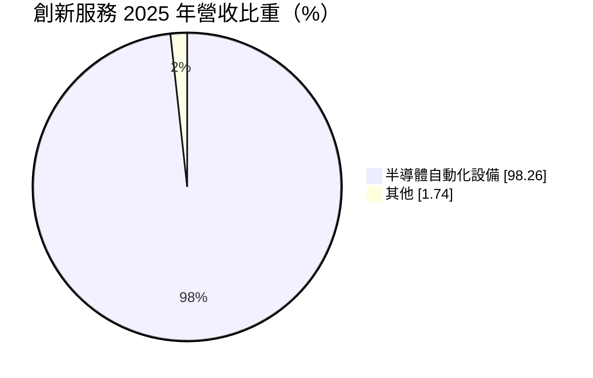
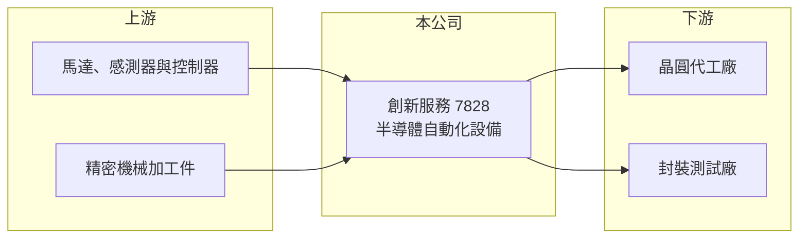

# 7828 創新服務

> 上櫃｜[[產業索引-半導體業|半導體業]]｜上市（櫃）日期 2026/04/22

# 第一章：企業模式與商業藍圖

> [!info] 撰寫說明
> 精簡版，由 Claude 依公開資料整理，架構比照 [[2330台積電]]，資料截至 2026-10-08。創新板／新掛牌，公開資料有限（2026 年 4 月上櫃）。來源：櫃買中心開放資料快照（基本資料、2026 年第二季綜合損益與資產負債、每月營收）、Goodinfo 年度經營績效、MoneyDJ 基本資料（2025 年營收比重）、聯合新聞網 2026 年 3 至 4 月上櫃報導標題。設備品項與客戶名稱未查得。#待校對

創新服務（英文名 INNOSTAR）位於台中大甲，2026 年 4 月掛牌上櫃，主力產品是半導體[[自動化設備]]。本章說明它在半導體供應鏈中的角色。

- **核心業務：** 創新服務設計與製造用於半導體製程與測試環節的自動化設備，協助晶圓廠與測試廠減少人工搬運與操作，提升產能與良率。依 2026 年上櫃報導，公司以「三引擎」布局 AI 半導體測試商機，並已卡位[[晶圓代工]]大廠供應鏈；具體設備品項未查得。
- **營收結構：** 依 MoneyDJ 資料，2025 年半導體自動化設備占營收 98.26%，其他占 1.74%。營收幾乎全部來自設備銷售，屬於隨客戶資本支出起伏的設備業。

- **營運據點：** 公司與工廠位於台中市大甲區，地處中部精密機械聚落，零組件與加工供應鏈完整。海外據點未查得。
- **長期方向：** AI 晶片的測試時間長、測試條件嚴苛，帶動測試與搬運自動化的需求；晶圓代工大廠持續擴產，也需要更多客製化自動化設備。創新服務的長期成長取決於能否在大客戶的新廠與新製程中持續被採用。

# 第二章：護城河深度與競爭優勢

客製化設備的護城河來自與客戶共同開發的經驗與驗證。本章分析創新服務的競爭位置。

- **競爭優勢：** 半導體自動化設備多為客製化，需要配合客戶的製程與廠房規格共同開發，驗證通過後才能量產複製，新供應商要取代並不容易。創新服務 2026 年上半年[[毛利率]]高達 79.4%，遠高於一般設備廠，代表產品具備高度技術門檻或專利保護（推估）。
- **主要對手：** 台股半導體自動化與設備同業包括 [[6640均華]]、[[6187萬潤]]、[[7751竑騰]]、[[5443均豪]]、[[3131弘塑]]、[[2360致茂]] 等，國際上則有日本與歐美的大型設備商。各家專長的製程環節不同，實際重疊程度需視產品而定。
- **觀察重點：** 一是客戶集中度，若主要營收來自單一晶圓代工大廠，訂單節奏會跟著該客戶走；二是毛利率能否維持在七成以上；三是「三引擎」中的新產品能否在兩到三年內貢獻營收。

# 第三章：財務體質與盈利規模

資料日期：2026-10-08，表格是撰寫當時的快照；最新月營收、毛利率、累計 EPS 由自動排程寫在本筆記的屬性欄位（月營收、毛利率、累計EPS 等）。#待校對

創新服務近三年從虧損轉為高獲利，營收快速放大。

| 年度 | 營收（億元） | [[毛利率]] | [[營業利益率]] | EPS（元） | [[ROE]] |
|---|---|---|---|---|---|
| 2023 | 1.20 | 61.8% | -45.6% | -2.33 | -12.6% |
| 2024 | 4.06 | 80.3% | 37.1% | 5.25 | 29.3% |
| 2025 | 7.16 | 76.3% | 38.9% | 6.33 | 25.0% |
| 2026 上半年 | 5.11 | 79.4% | 39.4% | 4.52 | 未查得 |

- **營收規模：** 營收從 2023 年 1.20 億元成長到 2025 年 7.16 億元，兩年成長約六倍，年複合成長率約 144%（推算）。2026 年 1 至 8 月累計營收 7.98 億元，已超過 2025 年全年，較前一年同期成長約 226%。
- **獲利：** 2026 年上半年營業利益 2.01 億元、稅後淨利 1.73 億元，EPS 4.52 元，營業利益率約 39%。2024 至 2025 年 ROE 維持在 25% 以上，但掛牌募資後股東權益大增，未來 ROE 會被稀釋。
- **財務特色：** 2026 年第二季底股東權益 51.7 億元、負債僅 6.09 億元，非流動負債 0.25 億元，幾乎沒有借款；流動資產 43.4 億元，主要是上櫃募得的現金，每股淨值 127.62 元。股利紀錄未查得。
- **[[ROIC]] 與 [[WACC]]：** 以非流動負債 0.25 億元作為有息負債近似值。2026 年上半年營業利益年化約 4.03 億元，扣除 20% 稅後約 3.22 億元，除以股東權益加非流動負債 51.9 億元，ROIC 約 6.2%（推算）；分母大部分是尚未投入營運的現金，若只計營運資產，報酬率會高出許多，2025 年 ROE 25% 可作為參考。WACC 以 CAPM 推估：無風險利率 1.75%、市場風險溢酬 6%、β 假設 1.3（半導體設備股推估值），公司無有息負債，WACC 約 9.6%（推算）。帳面 ROIC 暫時低於 WACC 是募資現金造成，核心業務本身的報酬率明顯高於資金成本，關鍵在於募得資金能否有效投入擴產或研發。

# 第四章：總體風險與地緣政治

半導體設備的需求與客戶資本支出緊密相連，本章整理創新服務的長期風險。

- **產業週期：** 晶圓廠與測試廠的資本支出有明顯循環，設備業營收常在景氣反轉時大幅下滑。2023 年營收僅 1.20 億元、營業虧損，就是需求不足時的樣子。
- **營運風險：** 營收快速成長且可能集中在少數大客戶，若客戶調整擴產計畫或轉向其他供應商，營收會大幅波動。快速擴張也考驗交期、品質與售後服務能力。
- **其他風險：** 客戶海外設廠時，需要建立當地服務團隊；關鍵零組件若仰賴進口，供應與匯率會影響成本。掛牌時間短，市場對其長期獲利能力仍需時間驗證。

# 專有名詞解析

## 半導體

- **[[晶圓代工]]**：替其他公司製造晶片、本身不賣自有品牌晶片的商業模式，代表廠商為台積電、聯電。
- **[[封裝測試]]**：晶片製造後段的封裝與電性測試流程，確認晶片功能並保護晶片。

## 產業

- **[[自動化設備]]**：以機械手臂、搬運與控制系統取代人工操作的生產設備。

# 核心供應鏈

- 上游：伺服馬達、感測器、控制器、機械手臂與中部聚落的精密加工件。
- 下游／客戶：晶圓代工大廠（報導未具名，推估包含 [[2330台積電]]）與[[封裝測試]]廠。
- 同業：[[6640均華]]、[[6187萬潤]]、[[7751竑騰]]、[[5443均豪]]、[[3131弘塑]]、[[2360致茂]]。

## 最新新聞
<!-- news:start（自動產生，請勿手動編輯此範圍） -->
- 2026-10-08 📰 媒體 19:52｜營收速報 - 創新服務(7828)9月營收1.56億元年增率高達102.3％｜[鉅亨網](https://news.cnyes.com/news/id/6625908)
- 2026-10-06 📰 媒體 12:01｜創新服務(7828)最新動態：雙臂植針機目標大上修！TGV放量時程遞延至2028下半年！｜[鉅亨網](https://news.cnyes.com/news/id/6622600)

完整紀錄：[[7828創新服務 新聞]]
<!-- news:end -->

## 相關連結
- [公開資訊觀測站](https://mopsov.twse.com.tw/mops/web/t05st03?step=1&firstin=1&co_id=7828)
- [Goodinfo](https://goodinfo.tw/tw/StockDetail.asp?STOCK_ID=7828)
- [Yahoo 股市](https://tw.stock.yahoo.com/quote/7828)
- [鉅亨網新聞](https://www.cnyes.com/twstock/7828/news)
