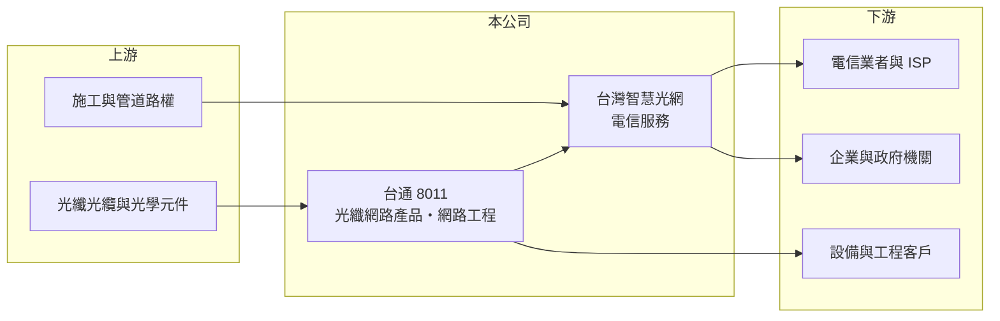

# 8011 台通

> 上市｜[[產業索引-通信網路業|通信網路業]]｜上市（櫃）日期 2011/09/19

# 第一章：企業模式與商業藍圖

> [!info] 撰寫說明
> 本文由 Claude 依公開資料整理，架構比照 [[2330台積電]] 的四章研究，資料截至 2026-10-08。財務數字來源：Goodinfo 年度經營績效頁與基本資料頁、證交所開放資料（基本資料、2026 年第二季資產負債與損益、營益分析、股利、本益比殖利率）。子公司台灣智慧光網的業務背景部分憑記憶整理，已標「待校對」。#待校對

評估一家同時賣設備、做工程又經營網路的公司，要把三種性質不同的收入分開看：設備有景氣循環，工程看標案，電信服務則是長期的經常性收入。本章說明台通光電（股票代號：8011，以下簡稱台通）的商業模式。

## 一、核心定位：[[光纖網路]]設備加上電信服務

台通成立於 1981 年，2011 年在證交所上市，總部位於新北市新莊區，實收資本額約 16.6 億元。依公司揭露的主要業務，收入來自三個來源：通信網路相關產品、電信服務收入與工程收入。產品端以光纖網路相關元件與設備為主，服務端則由重要子公司台灣智慧光網股份有限公司（2013 年登記，從事電信事業）經營。

台灣智慧光網是在都會區鋪設光纖網路、出租頻寬與提供寬頻服務的固網業者，其網路建設與台北市的智慧光網計畫有關（背景待校對）。光纖網路一旦鋪設完成，就能長期出租給電信業者、企業與政府機關，形成[[經常性收入]]。這讓台通不只是設備商，也具備部分基礎建設營運商的性質。各業務的營收比重未查得。

## 二、資本結構的特色

台通 2026 年第二季的非流動負債約 23.8 億元，占總負債七成以上，權益總計中約 6.9 億元屬於[[非控制權益]]（子公司的其他股東）。這種結構符合光纖網路「前期大量建設、後期長期回收」的特性：建設期以長期借款支應，營運期再用租金收入償還（推論）。

## 三、長期方向

台通的長期方向是擴大光纖網路的覆蓋與出租率，讓電信服務的經常性收入成為獲利主體，降低對設備與工程訂單的依賴。光纖網路是資料中心互連、5G 基地台回傳與企業專線的共同基礎，需求長期穩定成長，但回收期也很長。

# 第二章：護城河深度與競爭優勢

在長期價值投資中，「護城河」指企業抵禦競爭、維持超額利潤的保護機制。本章分析台通的優勢與限制。

## 一、護城河的組成

* **已鋪設的光纖網路：** 在都會區取得路權、鋪設光纖需要大量時間與審批，後進者很難複製同樣的路由。已建成的網路是台通最具長期價值的資產。
* **設備、工程與營運整合：** 公司能自己提供光纖元件、施工與維運，對中小型專網或地方建設案具有一站式的成本優勢（推估）。

設備產品本身的差異化有限，2021 至 2022 年毛利率曾低到 2% 至 5%，顯示設備端沒有明顯的定價能力。

## 二、主要競爭對手

| 對手 | 定位 | 對台通的威脅 |
|---|---|---|
| [[2412中華電]] | 全台最大固網業者 | 光纖網路與專線服務的主要競爭者 |
| [[3045台灣大]]、[[4904遠傳]] | 綜合電信業者，自有固網 | 爭取企業專線與批發頻寬 |
| [[6442光聖]]、[[3363上詮]] | 光纖連接與被動元件 | 在光纖產品端競爭 |

## 三、守得住／守不住／觀察重點

守得住的是已鋪設網路的租賃收入。守不住的是一般設備與工程的價格。長期觀察重點是電信服務收入的成長、光纖網路的出租率，以及長期借款能否隨現金流穩定下降。

# 第三章：財務體質與盈利規模

資料日期：2026-10-08，表格是撰寫當時的快照；最新月營收、毛利率、累計 EPS 由自動排程寫在本筆記的屬性欄位（月營收、毛利率、累計EPS 等）。#待校對

財務報表是檢驗護城河是否真實存在的最終標準。本章用六年的三率、ROE 與資本報酬，檢視台通的獲利品質。

## 一、多年度經營績效

| 年度 | 營收（新台幣） | [[毛利率]] | [[營業利益率]] | EPS（元） | [[ROE]] |
|---|---|---|---|---|---|
| 2020 | 14.4 億 | 13.2% | -2.22% | -0.19 | -1.85% |
| 2021 | 17.3 億 | 5.08% | -10.6% | -1.36 | -6.98% |
| 2022 | 17.0 億 | 2.32% | -11.7% | -1.62 | -7.41% |
| 2023 | 20.4 億 | 15.6% | 2.63% | 0.09 | 1.04% |
| 2024 | 24.9 億 | 19.1% | 6.76% | 2.43 | 11.5% |
| 2025 | 20.8 億 | 25.9% | 13.5% | 1.30 | 6.67% |
| 2026 上半年 | 8.35 億 | 20.4% | 7.02% | 0.19 | 未查得 |

台通的獲利在 2020 至 2022 年連續虧損，2023 年起明顯改善，2025 年毛利率提高到 25.9%、營業利益率 13.5%，是六年來最好的本業表現。2020 至 2025 年營收年複合成長率約 7.6%（推算），2021 至 2025 年平均 ROE 約 1.0%（推算），長期平均仍偏低。2025 年度配發現金股利每股 0.7 元，配發率約 54%（推算）。2026 年上半年營收與獲利都比 2025 年同期放緩，營業外支出也拉低了淨利。

## 二、[[ROIC]] 與 [[WACC]]：價值創造利差

**ROIC 推算：** 2025 年營業利益約 2.81 億元（20.8 億 × 13.5%），稅後約 2.25 億元。2026 年第二季權益總計約 38.6 億元，負債約 32.7 億元，假設有息負債約 25 億元（推估，以非流動負債為主），投入資本約 63.6 億元，2025 年 ROIC 約 3.5%（推算）；以 2026 年上半年營業利益 0.59 億元年化，ROIC 約 1.5%（推算）。

**WACC 推算：** 台灣 10 年期公債 1.75%、市場風險溢酬 6%、β 取電信與網通同業常見值 0.9，股東權益成本約 7.2%；負債成本 2.5%、稅後 2.0%；權益占投入資本約 61%，WACC 約 5.1%（推算）。

**結論：** 即使在 2025 年本業表現最好的一年，台通的 ROIC 仍低於 WACC。光纖網路屬於回收期長的資產，短期 ROIC 偏低是常態，但長期需要出租率持續提升，ROIC 才可能超過資金成本。

# 第四章：總體風險與地緣政治

任何企業都無法脫離宏觀環境獨立存在。本章分析台通長期必須面對的風險。

## 一、財務槓桿與利率

長期負債比重高，利率上升會直接增加利息支出。若網路出租率成長不如預期，償債壓力會限制配息與新投資。

## 二、法規與特許風險

電信服務受主管機關監理，費率、路權與營運條件若改變，會影響子公司的收入與投資回收。與地方政府相關的建設與營運合約，也可能在續約時面臨條件調整（推估）。

## 三、競爭與技術風險

大型電信業者擁有更完整的網路與客戶基礎，可能在企業專線與批發頻寬上削價競爭。設備端則面臨光通訊元件價格下滑與中國大陸同業的競爭。

# 專有名詞解析

## 應用

- **[[光纖網路]]**：以光纖傳輸資料的通訊網路，頻寬大、損耗低，是寬頻、行動基地台回傳與資料中心互連的基礎。

## 金融

- **[[非控制權益]]**：子公司中不屬於母公司股東的那部分權益，代表子公司還有其他股東。
- **[[ROIC]]**：投入資本報酬率，稅後營業利益除以股東權益與有息負債的合計，衡量本業對所有資金提供者的報酬。
- **[[WACC]]**：加權平均資金成本，依股東權益與負債的比重加權計算的資金成本，ROIC 高於它才代表創造價值。

## 產業

- **[[經常性收入]]**：依合約定期收取、每年重複發生的收入，例如租金與服務費，比一次性銷售更穩定可預測。

# 核心供應鏈

## 1. 上游：光纖材料與施工資源
- 光纖光纜、光學元件與施工管道資源

## 2. 中游：台通與子公司
- 子公司：台灣智慧光網（電信事業）
- 同業：[[6442光聖]]、[[3363上詮]]

## 3. 下游：客戶與競爭者
- 電信業者：[[2412中華電]]、[[3045台灣大]]、[[4904遠傳]]（同時是客戶與競爭者，實際往來未查得）
- 企業、政府機關與 ISP 業者

## 最新新聞
<!-- news:start -->
<!-- news:end -->

## 相關連結
- [公開資訊觀測站](https://mopsov.twse.com.tw/mops/web/t05st03?step=1&firstin=1&co_id=8011)
- [Goodinfo](https://goodinfo.tw/tw/StockDetail.asp?STOCK_ID=8011)
- [Yahoo 股市](https://tw.stock.yahoo.com/quote/8011)
- [鉅亨網新聞](https://www.cnyes.com/twstock/8011/news)
