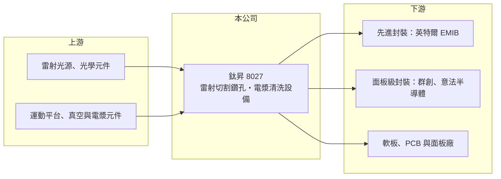

# 8027 鈦昇

> 上櫃｜[[產業索引-電機機械|電機機械]]｜上市（櫃）日期 2015/06/09

# 第一章：企業模式與商業藍圖

> [!info] 撰寫說明
> 精簡版，由 Claude 依公開資料整理，架構比照 [[2330台積電]]，資料截至 2026-10-08。來源：櫃買中心開放資料快照（基本資料、2026 年第二季資產負債與損益、每月營收、本益比殖利率）、Goodinfo 經營績效頁、理財周刊報導（2025 年底）。客戶與技術合作描述取自媒體報導，尚未比對公司公告。#待校對

鈦昇科技（以下簡稱鈦昇）是以[[雷射加工]]與[[電漿清洗]]為核心技術的自動化設備商，客戶橫跨半導體、軟板與面板產業。理解它的關鍵在於：鈦昇正把長年在電路板與面板累積的雷射技術，轉向[[先進封裝]]與[[玻璃基板]]等新一代半導體製程，這是一個高成長但仍在驗證階段的市場。

- **核心業務：** 鈦昇成立於 1994 年，2015 年在櫃買中心上櫃，實收資本額約 11.0 億元，董事長為王明慶、總經理為陳坤山，總部位於高雄燕巢。主要產品為雷射切割與鑽孔設備、電漿清洗設備，並提供製程模組整合、工廠自動化（CIM）規格建置與產能模擬服務。全球累計裝機超過 2,500 台，代表公司在雷射與電漿設備已有相當的安裝基礎。
- **營收結構：** 公開資料未揭露產品別營收比重。依報導，傳統應用為軟性電路板（FPC）與面板的雷射加工，半導體封裝相關設備是近年成長重心。
- **營運據點：** 總部與主要工廠位於高雄燕巢，2025 年 9 月在美國設立子公司，提供在地維修、教育訓練、備品與技術支援，配合美國客戶的先進封裝擴產。
- **長期方向：** 依 2025 年底報導，鈦昇是少數與 [[INTC英特爾]] 合作 [[EMIB]] 先進封裝的台灣供應商，提供雷射切割與雷射檢測；面板級扇出型封裝（[[FOPLP]]）設備則已獲 [[3481群創]] 與意法半導體（STMicroelectronics）採用。若玻璃基板與面板級封裝在 2027 年後放量，雷射鑽孔與切割會是關鍵製程，鈦昇的長期成長取決於能否在這波技術轉換中取得量產訂單。

# 第二章：護城河深度與競爭優勢

鈦昇的護城河來自雷射與電漿製程的長期經驗與客戶裝機基礎，但在先進封裝領域仍面對技術與規模更大的國際對手。

- **競爭優勢：** 雷射加工設備需要光學、運動控制與材料製程的整合能力，同一台設備在不同材料上的參數都要重新調校，累積的製程資料庫是後進者的門檻。打進英特爾、群創等大客戶的驗證流程，本身就是[[轉換成本]]的來源，後續擴產時客戶傾向沿用同一供應商。
- **主要對手：** 國際上有日本 Disco、德國 LPKF 與美國、日本的雷射設備大廠；台灣同業包括 [[6187萬潤]]、[[6640均華]]、[[3583辛耘]]、[[3131弘塑]] 等半導體後段設備廠，以及 [[6664群翊]] 等 PCB 與面板設備廠（待校對）。
- **觀察重點：** 毛利率在 2023 年後維持 35% 至 40%，但營業費用大增，營業利益率由 2022 年的 12.5% 轉為虧損，代表公司正大幅投入研發與海外布局。長期要看先進封裝設備能否從送樣、小量轉為量產重複訂單，讓營收規模回到 2022 年的 30 億元以上。

# 第三章：財務體質與盈利規模

資料日期：2026-10-08，表格是撰寫當時的快照；最新月營收、毛利率、累計 EPS 由自動排程寫在本筆記的屬性欄位（月營收、毛利率、累計EPS 等）。#待校對

鈦昇的財務呈現「毛利率高、但處於投資期虧損」的樣貌，資產負債表則因增資而相當充裕。

| 年度 | 營收（億元） | [[毛利率]] | [[營業利益率]] | EPS（元） | [[ROE]] |
|---|---|---|---|---|---|
| 2019 | 14.7 | 23.7% | -7.07% | -1.01 | -7.45% |
| 2020 | 20.4 | 32.2% | 10.5% | 2.00 | 12.0% |
| 2021 | 25.4 | 33.6% | 12.3% | 2.62 | 12.6% |
| 2022 | 32.2 | 34.9% | 12.5% | 3.94 | 15.4% |
| 2023 | 15.5 | 39.6% | 1.09% | 0.32 | 0.95% |
| 2024 | 16.4 | 36.3% | -7.23% | -0.51 | -2.27% |
| 2025 | 18.1 | 35.2% | -4.28% | -0.93 | -3.79% |
| 2026 上半年 | 10.1 | 29.7% | -8.69% | -0.46 | 未查得 |

（來源：Goodinfo 經營績效頁；2026 上半年取自櫃買中心開放資料。）

- **營收規模：** 2019 至 2022 年營收由 14.7 億元成長到 32.2 億元，2023 年腰斬到 15.5 億元，反映 PCB 與面板設備需求在疫情後急凍。2021 至 2025 年年複合成長率約 -8.1%（推算）；2026 年前八月累計營收較前一年同期成長約 47%，回升明顯。
- **獲利：** 2021 至 2025 年平均 ROE 約 4.6%（推算），2024 年起連續虧損。2026 年上半年營業費用約 3.88 億元，高於營業毛利約 3.00 億元，營業虧損約 0.88 億元，主要是研發與人員擴充的投入。
- **財務特色：** 依 2026 年第二季資料，總資產約 44.7 億元、權益約 29.0 億元、負債約 15.7 億元，負債比約 35%。資本公積約 20.2 億元，遠高於股本，代表公司近年透過溢價增資籌得大筆資金；保留盈餘為負約 0.51 億元，另有約 2.0 億元的庫藏股。連續虧損期間未配發現金股利。
- **[[ROIC]] 與 [[WACC]]：** 2026 年上半年營業虧損約 0.88 億元，年化後約 -1.75 億元（虧損不扣稅），以權益 29.0 億元到「權益加全部負債」44.7 億元計算，ROIC 約 -6.1% 至 -3.9%（推算）；2025 年營業虧損約 0.77 億元，ROIC 同樣為負。WACC 以 [[CAPM]] 推估：無風險利率 1.75%、市場風險溢酬 6%、β 假設 1.3（半導體設備股常見值），權益成本約 9.55%；有息負債比重低，假設占資本約 15%、稅前負債成本 2.5%，WACC 約 8.4%（推算）。目前 ROIC 為負、遠低於 WACC，股東投入的資本尚未產生報酬，價值能否實現完全取決於先進封裝設備的商業化成果。

# 第四章：總體風險與地緣政治

鈦昇的風險主要來自技術轉換的不確定性、設備業的循環，以及長期虧損。

- **產業週期：** PCB、軟板與面板設備需求高度循環，2023 年營收腰斬即為例證。先進封裝與玻璃基板雖是長期趨勢，但量產時程由少數大廠決定，可能一再延後。
- **營運風險：** 研發與海外服務費用大幅增加，若量產訂單晚於預期，虧損可能延續數年；客戶集中於少數大廠，單一客戶的策略變化（例如英特爾的代工與封裝計畫調整）影響很大。
- **其他風險：** 雷射光源等關鍵零件多仰賴進口，供應與匯率影響成本；美國子公司的營運成本與當地法規；技術路線競爭（例如機械鑽孔、蝕刻等替代製程）可能改變雷射設備的需求。

# 專有名詞解析

## 半導體

- **[[電漿清洗]]**：以電漿中的離子與自由基清除材料表面的有機物與氧化層，提高封裝打線與接合的可靠度。
- **[[先進封裝]]**：把多顆晶片以中介層、混合鍵合等方式高密度整合的封裝技術，例如 CoWoS、SoIC。
- **[[EMIB]]**：英特爾的嵌入式多晶片互連橋接技術，把小片矽橋埋入載板，連接並排的多顆晶片。
- **[[FOPLP]]**：面板級扇出型封裝，用方形大面板取代圓形晶圓進行封裝，可提高面積利用率、降低成本。
- **[[玻璃基板]]**：以玻璃取代有機材料作為封裝載板，平整度與熱穩定性較佳，被視為下一代 AI 晶片封裝材料。

## 產業

- **[[雷射加工]]**：以高能量雷射光束進行切割、鑽孔或剝除材料的加工方式，精度高且不接觸工件。

# 核心供應鏈

- 上游：雷射光源與光學元件、精密運動平台、真空與電漿元件；實際供應商未查得，#待校對。
- 下游／客戶：[[INTC英特爾]]（EMIB 雷射切割與檢測）、[[3481群創]] 與意法半導體（FOPLP 設備），以及軟板、PCB 與面板製造商。
- 同業：[[6187萬潤]]、[[6640均華]]、[[3583辛耘]]、[[3131弘塑]]、[[6664群翊]]；國際的 Disco、LPKF。

## 供應鏈關係
- 供應給 [[2330台積電]]：雷射鑽孔與切割設備（台積電供應鏈 › 下游：先進封裝大聯盟 (CoWoS 設備與載板) › CoWoS 核心設備群）

## 最新新聞
<!-- news:start（自動產生，請勿手動編輯此範圍） -->
- 2026-10-20 📰 媒體 01:11｜鈦昇亮燈 華通、啟碁、昇達科列觀察｜[聚財網](https://news.google.com/rss/articles/CBMiTEFVX3lxTE9GS1RBbUN2bkpid1FFMkgycUZIcWRpZTRJRDJmZ2x2U0ZlRmFtSnlBSTJSSFAtZU94ZWF3U21HcnA4ZHZtazVlV1Y0dUY?oc=5)
- 2026-10-12 📰 媒體 21:41｜輝達點火玻璃基板！鈦昇、正達強勢表態 AI先進封裝下一棒來了？｜[聚財網](https://news.google.com/rss/articles/CBMiTEFVX3lxTE00cnU4aVJ0bDRjcl9uTUx0RzBUUTVCWUZLZnZCMVpxaTFFS25HSXdocUFlRjhRMndOeDRTcUZvc0g0TmNxMkFiMU9RdmQ?oc=5)
- 2026-10-10 📰 媒體 09:44｜鈦昇估值下修與哪些因素有關？｜[CMoney](https://news.google.com/rss/articles/CBMie0FVX3lxTE5nbzBBR09STE81d25VcTJlTmNUYVJrRUdZbUx5YlpPZFZIVFZzcTU5RVZQc2x2TjhSMF9BODNBYkZ3RHZCSHRCVmpYdDNLMEZTMkl4SlZIdzVQTWJSWHNUclMtSGszdXVSU29ieXJ2TU1ORE8zb3QxSU5WMA?oc=5)
- 2026-10-06 📰 媒體 23:29｜鈦昇(8027) 個股概覽 ／ 個股 - 股市｜[CMoney](https://news.google.com/rss/articles/CBMiU0FVX3lxTFA5aXB4Q0I1dkdmZkdVRDFPcmNwU2x5Z1hhT1lOZmEybjFGNzdlbjc4c1N6Z2FSTnUxT2FPeU1QQng4c0NKR2MyTm5YOHZVWGxOVm9J?oc=5)
- 2026-10-05 📰 媒體 18:50｜營收速報 - 鈦昇(8027)9月營收2.23億元年增率高達30.94％｜[鉅亨網](https://news.cnyes.com/news/id/6621915)

完整紀錄：[[8027鈦昇 新聞]]
<!-- news:end -->

## 相關連結
- [公開資訊觀測站](https://mopsov.twse.com.tw/mops/web/t05st03?step=1&firstin=1&co_id=8027)
- [Goodinfo](https://goodinfo.tw/tw/StockDetail.asp?STOCK_ID=8027)
- [Yahoo 股市](https://tw.stock.yahoo.com/quote/8027)
- [鉅亨網新聞](https://www.cnyes.com/twstock/8027/news)
