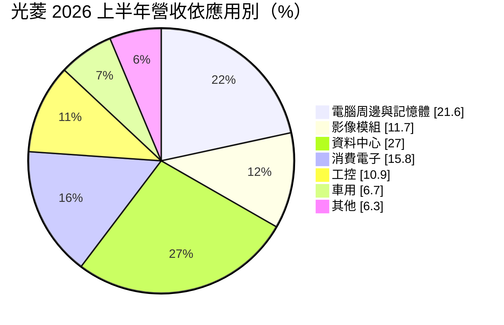
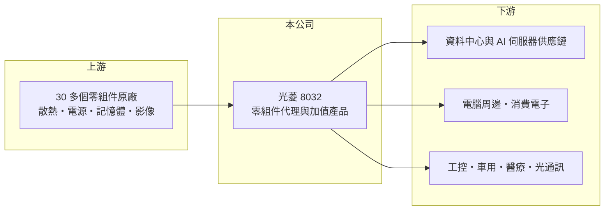

# 8032 光菱

> 上櫃｜[[產業索引-電子通路業|電子通路業]]｜上市（櫃）日期 2003/10/02

# 第一章：企業模式與商業藍圖

> [!info] 撰寫說明
> 精簡版，由 Claude 依公開資料整理，架構比照 [[2330台積電]] 的四章研究，資料截至 2026-10-08。來源：富果研究 2026-09-21 法說會摘要、Goodinfo 經營績效頁、櫃買中心開放資料快照（基本資料、2026 年第二季損益與資產負債）。代理品牌名稱與主要客戶未查得。#待校對

光菱電子是一家代理超過 30 個品牌的電子零組件通路商，近年把重心從電腦周邊移向資料中心、工控與車用。本章說明它的產品組合與轉型方向。

- **核心業務：** 光菱成立於 1987 年，2003 年上櫃，是專業的[[電子通路]]業者，代理品牌超過 30 個。除了代理零組件，公司也開發電力模組、醫療電子、伺服器應用與散熱材料等較高附加價值的產品，技術主軸是散熱、儲能、節能與控能。
- **營收結構：** 2026 年上半年，電腦資通訊約占 33.2%（其中電腦周邊與記憶體 21.6%、影像模組 11.7%），資料中心 27%，消費電子 15.8%，工控 10.9%，車用 6.7%，其餘為民生基礎、IoT 與醫療。資料中心業務涵蓋散熱與資料傳輸，是成長最快的板塊。
- **營運據點：** 主要市場包括台灣、中國（工具機需求強）與歐美（長距離光通訊模組），未來計畫拓展東北亞、東南亞與南亞。分散市場的目的是降低地緣政治與貿易政策的衝擊。
- **長期方向：** 公司把「擴大客戶群、降低集中度」列為首要任務。資料中心業務已從單一客戶擴展到整個 [[AI 伺服器]]生態系，並陸續有新客戶量產。另一條路線是找尋替代與互補產品、往上下游延伸，以提升毛利率。

# 第二章：護城河深度與競爭優勢

光菱的競爭力來自產品線的廣度與在利基應用的技術支援。本章分析它的優勢與限制。

- **競爭優勢：** 代理超過 30 個品牌，讓光菱能替客戶整合散熱、電源、傳輸等多種零組件，提供較完整的方案。資料中心與工控客戶重視產品可靠度與長期供貨，一旦完成[[設計導入]]，通常會在產品生命週期內持續採購。
- **主要對手：** 大型通路商 [[3702大聯大]]、[[3036文曄]] 在規模上占優勢；在散熱與電源相關零組件上，光菱也會和原廠直接銷售及其他中型代理商競爭。光菱屬中小型業者，主要靠利基產品線突圍。
- **觀察重點：** 第一，資料中心營收能否在 AI 伺服器景氣之外持續成長，客戶是否真正分散。第二，自有或加值產品比重能否提升，讓毛利率回到 14% 以上。第三，2026 年上半年車用營收受惠一項已執行完畢的合約，下半年起需要新案子補上。

# 第三章：財務體質與盈利規模

資料日期：2026-10-08，表格是撰寫當時的快照；最新月營收、毛利率、累計 EPS 由自動排程寫在本筆記的屬性欄位（月營收、毛利率、累計EPS 等）。#待校對

光菱的毛利率在 11% 至 15% 之間，高於一般純買賣通路商，但營業利益率仍薄，獲利隨景氣波動。本章用多年度數據檢視它的獲利品質。

| 年度 | 營收（億元） | [[毛利率]] | [[營業利益率]] | EPS（元） | [[ROE]] |
|---|---|---|---|---|---|
| 2021 | 38.2 | 14.7% | 4.95% | 2.91 | 8.62% |
| 2022 | 40.9 | 14.4% | 4.88% | 3.54 | 9.93% |
| 2023 | 27.0 | 11.0% | 0.12% | 1.18 | 3.34% |
| 2024 | 28.9 | 14.6% | 2.88% | 2.15 | 5.30% |
| 2025 | 36.3 | 13.6% | 4.11% | 2.19 | 4.92% |
| 2026 上半年 | 24.8 | 12.5% | 4.35% | 1.78 | 未查得 |

- **營收規模：** 2023 年營收從 40.9 億元跌到 27.0 億元，之後隨資料中心需求回升，2025 年回到 36.3 億元。2021 至 2025 年年複合成長率約 -1.3%（推算），2026 年上半年營收已明顯高於前一年同期。
- **獲利：** 近 5 年平均 ROE 約 6.4%（推算），偏低。值得注意的是 2024 至 2025 年 EPS 約 2.2 元，但 ROE 只有 5% 左右，代表股東權益相對獲利偏大，部分可能是持有金融資產的評價（2026 年第二季其他權益約 2.9 億元）。
- **財務特色：** 2026 年第二季末股東權益約 22.0 億元、負債總計 17.3 億元，以流動負債為主。公司以遠期外匯合約管理新台幣匯率風險，Goodinfo 顯示長期平均現金股利約 1.32 元。

**[[ROIC]] 與 [[WACC]]：** 有息負債明細未查得，假設約 8 億元（推估）。2025 年稅後營業利益約 1.19 億元（36.3 億 × 4.11% × 0.8），投入資本為權益 22.0 億元加有息負債 8 億元，約 30 億元，ROIC 約 4%（推算）；2026 年上半年年化約 5.8%（推算）。WACC 用 CAPM 推估：無風險利率 1.75%、市場風險溢酬 6%、β 取 1.0（小型電子股常見值，假設），股東權益成本約 7.8%；負債成本 2.5%、稅率 20%，以權益七成三、負債兩成七加權，WACC 約 6.2%（推算）。結論是：光菱的 ROIC 近年低於 WACC，本業尚未穩定創造價值；資料中心與高附加價值產品能否把營業利益率拉到 5% 以上，是報酬率能否超越資金成本的關鍵。

# 第四章：總體風險與地緣政治

光菱的風險來自客戶集中、AI 伺服器景氣與匯率。本章整理主要風險。

- **產業週期：** 電腦資通訊與消費電子合計約占一半，受 PC 與消費性電子景氣影響；資料中心業務則和 AI 伺服器的資本支出循環連動，雲端業者若放緩投資，訂單會同步減少。2023 年營業利益率幾乎歸零，說明景氣下行時的獲利彈性很大。
- **營運風險：** 公司自己把客戶集中列為首要課題，資料中心業務初期依賴單一客戶，任何訂單變化都會放大影響。通路商也要承擔庫存跌價與應收帳款風險。
- **其他風險：** 業務橫跨中國、歐美與東南亞，面臨美中貿易政策與關稅變化。進貨與銷售多以外幣計價，新台幣升值會壓縮毛利，需靠避險工具管理。

# 專有名詞解析

## 應用

- **[[AI 伺服器]]**：搭載 GPU 等加速晶片、用於訓練與推論 AI 模型的伺服器，對散熱與電源規格要求很高。

## 金融

- **[[ROIC]]**：投入資本報酬率，稅後營業利益除以股東權益加有息負債，衡量本業運用資本的效率。
- **[[WACC]]**：加權平均資金成本，股東權益成本與負債成本依資本結構加權，是 ROIC 必須超越的門檻。

## 產業

- **[[電子通路]]**：替上游原廠銷售零組件並提供備貨、技術支援與帳期的中間商，毛利率低、靠周轉賺錢。
- **[[設計導入]]**：通路商或原廠協助客戶在新產品設計階段採用某顆晶片，量產後在產品生命週期內持續出貨。

# 核心供應鏈

- 上游：散熱、電源、記憶體、影像感測等零組件原廠（品牌名稱未查得）。
- 下游／客戶：AI 伺服器與資料中心供應鏈、電腦周邊廠、工具機與工控業者、車用與醫療電子客戶。
- 同業：[[3702大聯大]]、[[3036文曄]]、3028增你強。

## 最新新聞
<!-- news:start -->
<!-- news:end -->

## 相關連結
- [公開資訊觀測站](https://mopsov.twse.com.tw/mops/web/t05st03?step=1&firstin=1&co_id=8032)
- [Goodinfo](https://goodinfo.tw/tw/StockDetail.asp?STOCK_ID=8032)
- [Yahoo 股市](https://tw.stock.yahoo.com/quote/8032)
- [鉅亨網新聞](https://www.cnyes.com/twstock/8032/news)
