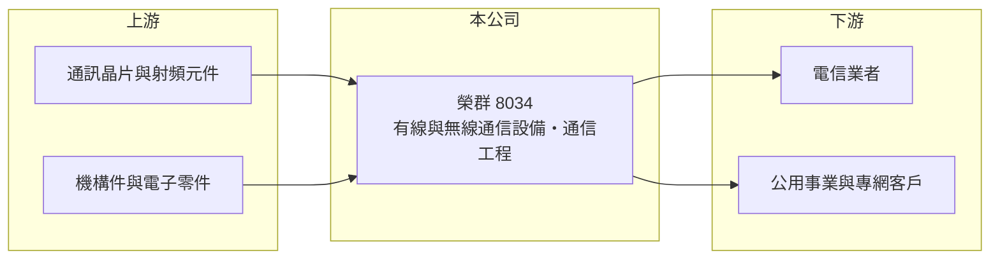

# 8034 榮群

> 上櫃｜[[產業索引-通信網路業|通信網路業]]｜上市（櫃）日期 2004/05/06

# 第一章：企業模式與商業藍圖

> [!info] 撰寫說明
> 本文由 Claude 依公開資料整理，架構比照 [[2330台積電]] 的四章研究，資料截至 2026-10-08。財務數字來源：Goodinfo 年度經營績效頁與基本資料頁、櫃買中心開放資料（基本資料、2026 年第二季資產負債與損益、本益比殖利率）、科技新報歷年月營收報導。公開資料有限，產品細節與客戶結構未查得，相關推論已標「待校對」。#待校對

評估以專案出貨為主的通訊設備商，重點不在單月或單季營收，而在多年平均的獲利能力與現金回饋。本章說明榮群電訊（股票代號：8034，以下簡稱榮群）的商業模式。

## 一、核心定位：通信設備製造與通信工程

榮群成立於 1992 年，2004 年在櫃買中心掛牌，總部位於新竹科學園區，實收資本額約 5.7 億元。依公司揭露的主要業務，榮群從事有線通信機械器材製造、無線通信機械器材製造與通信工程。換句話說，公司同時提供通訊設備與建置服務，客戶可能包括電信業者、公用事業與政府相關專網（客戶結構為推論，待校對）。各產品的營收比重未查得。

## 二、專案型營收的特性

榮群的月營收波動極大。依科技新報整理的月營收報導，2023 年 10 月營收 1.61 億元，較 9 月成長超過 25 倍；2024 年 10 月營收卻只有約 0.12 億元，年減 93%。這種「平時低、交貨月暴增」的型態，是[[專案型收入]]的典型特徵：設備在專案驗收時一次認列，因此年度營收也在 3 億至 7 億元之間大幅跳動。理解這一點後，投資人應以多年平均而非單一期間評估公司。

## 三、長期方向

在網路持續升級、專網與關鍵基礎設施需求增加的趨勢下，榮群的長期方向是累積更多可重複採購的專案客戶，讓營收波動逐步收斂（推估）。公司近年毛利率由三成左右提高到四至五成，代表產品組合可能正轉向附加價值較高的設備或解決方案（推估，待校對）。

# 第二章：護城河深度與競爭優勢

在長期價值投資中，「護城河」指企業抵禦競爭、維持超額利潤的保護機制。本章分析榮群的優勢與限制。

## 一、護城河的組成

* **專案經驗與客戶關係：** 通信工程與設備案通常要求過往實績，長期服務同一批客戶的廠商在投標時較具優勢。
* **設備加工程的整合能力：** 同時提供設備與建置，可降低客戶的整合風險，也提高後續維護與擴充的黏著度（推估）。
* **較高的毛利率：** 2024 至 2025 年毛利率達 44% 至 46%，高於一般網通製造廠，代表產品或服務具一定的差異化。

不過公司規模小、專案集中，單一專案延遲就會讓整年獲利明顯變動，護城河屬於較窄的類型。

## 二、主要競爭對手

| 對手 | 定位 | 對榮群的威脅 |
|---|---|---|
| [[2314台揚]] | 微波與衛星通訊設備 | 在無線通訊設備專案可能重疊（推估） |
| [[3491昇達科]] | 微波與毫米波元件 | 在高頻通訊元件可能重疊（推估） |
| 系統整合商與國際設備商 | 大型通訊專案 | 規模與產品線較完整 |

## 三、守得住／守不住／觀察重點

守得住的是長期合作客戶的後續擴充與維護案。守不住的是新專案的得標時點，營收因此大起大落。長期觀察重點是多年平均的營業利益率能否維持在 15% 以上，以及現金股利是否持續穩定。

# 第三章：財務體質與盈利規模

資料日期：2026-10-08，表格是撰寫當時的快照；最新月營收、毛利率、累計 EPS 由自動排程寫在本筆記的屬性欄位（月營收、毛利率、累計EPS 等）。#待校對

財務報表是檢驗護城河是否真實存在的最終標準。本章用六年的三率、ROE 與資本報酬，檢視榮群的獲利品質。

## 一、多年度經營績效

| 年度 | 營收（新台幣） | [[毛利率]] | [[營業利益率]] | EPS（元） | [[ROE]] |
|---|---|---|---|---|---|
| 2020 | 3.16 億 | 33.2% | 1.53% | 0.19 | 1.87% |
| 2021 | 5.26 億 | 38.1% | 15.8% | 1.28 | 11.8% |
| 2022 | 4.82 億 | 29.8% | 6.46% | 0.65 | 5.78% |
| 2023 | 6.76 億 | 33.0% | 16.2% | 1.51 | 13.0% |
| 2024 | 4.24 億 | 44.6% | 14.4% | 1.00 | 8.44% |
| 2025 | 4.89 億 | 46.0% | 19.8% | 1.42 | 11.4% |
| 2026 上半年 | 1.24 億 | 52.2% | 6.33% | 0.25 | 未查得 |

雖然營收逐年跳動，但 2021 年以後榮群每年都維持獲利，2021 至 2025 年平均 ROE 約 10.1%（推算），2020 至 2025 年營收年複合成長率約 9.1%（推算）。公司財務結構保守，2026 年第二季負債只有約 1.7 億元，股東權益約 6.7 億元。最近一次現金股利每股 1.2 元，相對 2025 年 EPS 1.42 元，配發率約 85%（推算），屬於把多數盈餘發還股東的類型。2026 年上半年營收偏低，符合專案型收入集中在下半年認列的慣例（推估）。

## 二、[[ROIC]] 與 [[WACC]]：價值創造利差

**ROIC 推算：** 2025 年營業利益約 0.97 億元（4.89 億 × 19.8%），稅後約 0.77 億元。2026 年第二季股東權益約 6.7 億元，負債約 1.7 億元，假設有息負債約 0.5 億元（推估），投入資本約 7.2 億元，2025 年 ROIC 約 10.7%（推算）。2021 至 2025 年的 ROIC 推估在 4% 至 12% 之間波動。

**WACC 推算：** 台灣 10 年期公債 1.75%、市場風險溢酬 6%、β 取網通同業常見值 1.1，股東權益成本約 8.4%；負債成本 2.5%、稅後 2.0%；權益占投入資本約 93%，WACC 約 7.9%（推算）。

**結論：** 榮群在專案集中認列的年度 ROIC 可超過 WACC，專案空窗年則低於資金成本，多年平均大致與資金成本相當。高配息率讓股東能實際拿到現金，但也代表公司保留用於擴張的資金有限。

# 第四章：總體風險與地緣政治

任何企業都無法脫離宏觀環境獨立存在。本章分析榮群長期必須面對的風險。

## 一、專案集中與時點風險

營收高度依賴少數專案的交貨與驗收時點，專案延後或流標會讓整年獲利大幅下滑。客戶集中度可能偏高（推估），單一客戶預算調整的影響很大。

## 二、技術與競爭風險

通訊設備技術持續演進，若公司產品無法跟上新世代網路規格，既有客戶可能轉向大型設備商。系統整合商與國際大廠在大型專案上具有價格與產品線優勢。

## 三、規模與匯率

公司營收規模只有數億元，研發與人才投入相對有限。若有外銷或進口零件，匯率變動也會影響毛利。

# 專有名詞解析

## 應用

- **[[通信工程]]**：通訊網路的規劃、施工、安裝與測試服務，常與設備銷售一起承攬。

## 金融

- **[[ROIC]]**：投入資本報酬率，稅後營業利益除以股東權益與有息負債的合計，衡量本業對所有資金提供者的報酬。
- **[[WACC]]**：加權平均資金成本，依股東權益與負債的比重加權計算的資金成本，ROIC 高於它才代表創造價值。

## 產業

- **[[專案型收入]]**：依專案交貨或驗收時一次認列的收入，金額大但時點不固定，造成營收在各期間大幅波動。

# 核心供應鏈

## 1. 上游：零組件
- 通訊晶片、射頻元件與機構件供應商（實際供應商未查得）

## 2. 中游：榮群與同業
- 同業：[[2314台揚]]、[[3491昇達科]]（產品重疊程度待校對）

## 3. 下游：客戶
- 電信業者、公用事業與專網客戶（具體客戶未查得）

## 最新新聞
<!-- news:start -->
<!-- news:end -->

## 相關連結
- [公開資訊觀測站](https://mopsov.twse.com.tw/mops/web/t05st03?step=1&firstin=1&co_id=8034)
- [Goodinfo](https://goodinfo.tw/tw/StockDetail.asp?STOCK_ID=8034)
- [Yahoo 股市](https://tw.stock.yahoo.com/quote/8034)
- [鉅亨網新聞](https://www.cnyes.com/twstock/8034/news)
