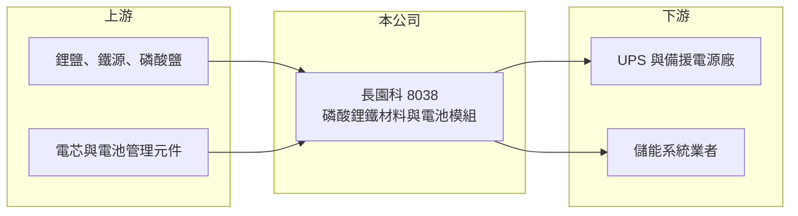

# 8038 長園科

> 上櫃｜[[產業索引-電子零組件業|電子零組件業]]｜上市（櫃）日期 2013/11/21

# 第一章：企業模式與商業藍圖

> [!info] 撰寫說明
> 精簡版，由 Claude 依公開資料整理，架構比照 [[2330台積電]]，資料截至 2026-10-08。來源：櫃買中心開放資料快照（基本資料、2026 年第二季資產負債與損益、本益比殖利率）、Goodinfo 經營績效頁、nStock 公司簡介、優分析報導標題。公開資料有限，產品與技術授權細節依記憶整理，已標註待校對。#待校對

長園科技實業（以下簡稱長園科）是一家以[[磷酸鋰鐵電池]]技術為核心的小型公司，業務涵蓋電池材料、技術授權與電池模組銷售租賃。理解它的關鍵在於：它擁有材料技術，但長年規模太小、營收不穩，直到近年電池模組打進 [[UPS]] 等備援電源市場，才開始出現獲利。

- **核心業務：** 長園科成立於 1997 年，總部在台中西屯，2013 年 11 月在櫃買中心掛牌，實收資本額約 6.23 億元，董事長為張李琇玉、總經理為張惇育。依 nStock 介紹，公司從事磷酸鋰鐵電池及其材料的生產、研發、技術轉移，以及電池模組的租賃與銷售。依記憶，公司早年以磷酸鋰鐵[[正極材料]]的專利與製程技術起家，並曾對外授權（待校對）。
- **營收結構：** 產品別比重未查得。依優分析報導標題，2025 年 UPS 電池出貨成長，帶動公司轉虧為盈、EPS 0.92 元，代表電池模組已成為主要營收來源（比重待校對）。
- **營運據點：** 總部位於台中科學園區周邊，生產與子公司配置未查得；資產負債表上有約 1.46 億元的非控制權益，顯示有與其他股東合資的子公司。
- **長期方向：** 磷酸鋰鐵電池安全性高、循環壽命長，正逐步取代鉛酸電池成為 UPS、資料中心備援電源與儲能系統的主流。長園科的長期機會在於把材料技術延伸為電池模組產品，搭上資料中心與儲能的需求成長。

# 第二章：護城河深度與競爭優勢

長園科的護城河目前偏弱，主要來自材料技術與早期累積的專利，但規模與財務實力限制了優勢的發揮。

- **競爭優勢：** 長園科是台灣少數從正極材料做到電池模組的業者，懂材料特性有助於設計出安全、壽命長的模組。UPS 與備援電源客戶重視安全認證與長期供貨穩定，一旦導入通常會持續採用，形成一定的轉換成本。
- **主要對手：** 磷酸鋰鐵材料與電芯市場由中國寧德時代、比亞迪與眾多材料廠主導，規模與價格遠勝台灣業者。台灣相關公司包括正極材料的 [[5227立凱-KY]]，以及電池模組與儲能的 [[6121新普]]、[[3211順達]]、[[3323加百裕]]、[[4931新盛力]]、[[6558興能高]] 等，這些公司規模多數比長園科大。
- **觀察重點：** 2019 至 2024 年營收在 0.66 至 3.33 億元間大幅波動，多數年度虧損，2025 年才轉盈。長期要觀察營收能否穩定在 5 億元以上、營業利益率能否長期為正，這代表公司是否找到可持續的商業模式。

# 第三章：財務體質與盈利規模

資料日期：2026-10-08，表格是撰寫當時的快照；最新月營收、毛利率、累計 EPS 由自動排程寫在本筆記的屬性欄位（月營收、毛利率、累計EPS 等）。#待校對

長園科的財務特色是規模小、獲利不穩、累積虧損尚未彌補，2025 年是近年第一個明顯獲利的年度。

| 年度 | 營收（億元） | [[毛利率]] | [[營業利益率]] | EPS（元） | [[ROE]] |
|---|---|---|---|---|---|
| 2019 | 3.28 | 22.2% | -8.09% | -0.51 | -4.66% |
| 2020 | 1.45 | 11.8% | -53.6% | -1.00 | -9.76% |
| 2021 | 0.66 | -39.9% | -181% | -2.05 | -23.4% |
| 2022 | 2.07 | 23.9% | -13.7% | -0.41 | -6.10% |
| 2023 | 3.33 | 26.8% | 0.75% | 0.00 | 0.37% |
| 2024 | 1.77 | 3.65% | -60.8% | -1.54 | -19.7% |
| 2025 | 5.97 | 28.9% | 7.71% | 0.92 | 10.3% |
| 2026 上半年 | 3.45 | 23.6% | 1.72% | 0.03 | 未查得 |

（來源：Goodinfo 經營績效頁；2026 上半年依櫃買中心開放資料計算。）

- **營收規模：** 2019 至 2025 年營收在 0.66 至 5.97 億元間劇烈波動，2025 年營收是近七年最高。2026 年上半年營收約 3.45 億元，若下半年維持相同水準，全年規模約與 2025 年相當（推估）。
- **獲利：** 2021 至 2025 年平均 ROE 約 -7.7%（推算），長期處於虧損。2026 年上半年營業利益僅約 0.06 億元，且淨利大多歸屬非控制權益，歸屬母公司 EPS 僅 0.03 元，顯示 2025 年的獲利尚未穩定延續。
- **財務特色：** 2026 年第二季總資產約 14.3 億元、權益總計約 6.3 億元（歸屬母公司約 4.8 億元）、負債約 8.0 億元，權益比約 44%。保留盈餘為 -2.82 億元，每股淨值約 7.75 元，低於面額 10 元。累積虧損未彌補前無法發放現金股利，近年未配息。
- **[[ROIC]] 與 [[WACC]]：** 以 2025 年營業利益約 0.46 億元（5.97 億元 × 7.71%）、稅率 20% 計算，稅後營業利益約 0.37 億元。有息負債未查得，投入資本以權益 6.3 億元到總資產 14.3 億元為區間，ROIC 約 2.6% 至 5.9%（推算）；2026 年上半年年化僅約 0.7% 至 1.5%（推算），2019 至 2024 年多數年度 ROIC 為負。WACC 以 CAPM 推估：無風險利率 1.75%、市場風險溢酬 6%、β 假設 1.3（虧損與小型股風險較高），權益成本約 9.6%；負債比重假設三成五、稅後成本 2%，WACC 約 6.9%（推算）。長期 ROIC 明顯低於 WACC，代表公司過去是在消耗股東價值，2025 年雖轉盈，仍未證明能持續創造價值。

# 第四章：總體風險與地緣政治

長園科的風險在於規模小、獲利不穩，以及面對中國電池業者的價格競爭。

- **產業週期：** 磷酸鋰鐵材料與電芯價格受中國產能擴張影響，近年價格大幅下跌，台灣小型業者很難以規模競爭。UPS 與儲能需求雖然長期向上，但專案型訂單時多時少，營收容易大起大落。
- **營運風險：** 2024 年營收腰斬、營業利益率 -60.8%，顯示營收稍微下滑就會嚴重虧損，固定成本壓力大。若主要模組客戶訂單減少，獲利可能再度轉負。累積虧損與每股淨值低於面額，也限制了籌資與配息能力。
- **其他風險：** 鋰、鐵、磷等原料價格波動大，會直接影響材料與電芯成本。電池產品涉及安全認證與事故責任，一旦發生安全事件，商譽與訂單都會受影響。

# 專有名詞解析

## 應用

- **[[UPS]]**：不斷電系統，在市電中斷時由電池立即供電，保護伺服器與精密設備，資料中心是主要用途。

## 產業

- **[[磷酸鋰鐵電池]]**：以磷酸鋰鐵為正極材料的鋰電池，安全性高、壽命長、成本較低，廣泛用於儲能、電動巴士與備援電源。
- **[[正極材料]]**：鋰電池中決定能量密度與安全性的關鍵材料，常見種類有磷酸鋰鐵與三元材料。

# 核心供應鏈

- 上游：鋰鹽、鐵源與磷酸鹽等化學原料，以及電芯、電池管理系統元件（實際供應商未查得，#待校對）。
- 下游／客戶：UPS 與電源設備廠，例如 [[2308台達電]]、[[6409旭隼]]、[[3043科風]] 所在的產業，以及儲能系統業者；是否為長園科客戶未查得，#待校對。
- 同業：[[5227立凱-KY]]、[[6121新普]]、[[3211順達]]、[[3323加百裕]]、[[4931新盛力]]、[[6558興能高]]，中國的寧德時代、比亞迪。

## 最新新聞
<!-- news:start -->
<!-- news:end -->

## 相關連結
- [公開資訊觀測站](https://mopsov.twse.com.tw/mops/web/t05st03?step=1&firstin=1&co_id=8038)
- [Goodinfo](https://goodinfo.tw/tw/StockDetail.asp?STOCK_ID=8038)
- [Yahoo 股市](https://tw.stock.yahoo.com/quote/8038)
- [鉅亨網新聞](https://www.cnyes.com/twstock/8038/news)
