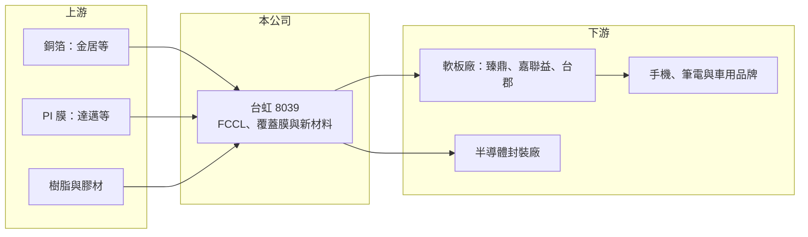

# 8039 台虹

> 上市｜[[產業索引-電子零組件業|電子零組件業]]｜上市（櫃）日期 2009/12/17

# 第一章：企業模式與商業藍圖

> [!info] 撰寫說明
> 精簡版，由 Claude 依公開資料整理，架構比照 [[2330台積電]]，資料截至 2026-10-08。來源：證交所開放資料快照（基本資料、2026 年第二季資產負債與損益、股利、本益比殖利率）、Goodinfo 經營績效頁、nStock 公司簡介、鉅亨號與財經媒體報導標題。應用別比重、產地與客戶依記憶整理，已標註待校對。#待校對

台虹科技（以下簡稱台虹）是全球主要的軟性電路板材料供應商之一。理解它的關鍵在於：手機、筆電、穿戴裝置與車用電子裡的[[軟板]]，都需要以[[FCCL]]與[[覆蓋膜]]為基礎材料，台虹賣的是這些「軟板的原料」，因此它的景氣跟著消費性電子的出貨量走，長期轉型方向則是往半導體與高頻材料延伸。

- **核心業務：** 台虹成立於 1997 年，總部在高雄前鎮，2009 年 12 月在證交所上市，實收資本額約 26.4 億元，董事長為陳永恒、總經理為江宗翰。依 nStock 的營業項目，公司從事軟性銅箔基板、覆蓋膜、純膠、補強板與複合板的製造、研發與銷售。
- **營收結構：** 產品別與應用別比重未查得。依記憶，FCCL 與覆蓋膜合計占營收大宗，主要應用在智慧型手機，其次是筆電、平板、穿戴與車用（待校對）。依 2026 年鉅亨號產業報告標題，台虹正推進[[先進封裝]]材料與高頻材料，走向高毛利材料供應鏈。
- **營運據點：** 總部與主要工廠在高雄，依記憶在中國昆山等地也設有生產據點，就近供應中國的軟板廠（待校對）。
- **長期方向：** 軟板材料是成熟市場，成長有限。台虹的長期方向有兩條：一是高頻、低損耗的軟板材料，供應 5G 天線與高速傳輸；二是半導體先進封裝使用的膠材與膜材，這些產品技術門檻與毛利都高於傳統 FCCL（產品細節待校對）。

# 第二章：護城河深度與競爭優勢

台虹的護城河來自材料配方、規模與長期客戶認證，屬於窄護城河，但在價格競爭下逐漸被侵蝕。

- **競爭優勢：** 軟板材料必須通過軟板廠與終端品牌的雙重驗證，從耐熱、尺寸穩定到可靠度都有嚴格標準，認證通過後轉換成本不低。台虹營收規模超過百億元，在台灣同業中最大，具備採購與製程規模優勢。公司長期維持 19% 至 24% 的毛利率，顯示仍有一定的產品與成本競爭力。
- **主要對手：** 國際同業包括日本松下（Panasonic）、美國杜邦（DuPont）的軟板材料部門、日本有澤製作所，以及中國生益科技等。台灣同業有 3354律勝、[[4939亞電]] 等。中國業者以價格搶市，是近年毛利率下滑的主要壓力來源。
- **觀察重點：** 2020 至 2025 年營業利益率由 11.9% 降到 4.6%，代表傳統產品的獲利空間被壓縮。長期要觀察半導體與高頻材料能否成為新的獲利支柱，讓營業利益率回到 8% 以上。

# 第三章：財務體質與盈利規模

資料日期：2026-10-08，表格是撰寫當時的快照；最新月營收、毛利率、累計 EPS 由自動排程寫在本筆記的屬性欄位（月營收、毛利率、累計EPS 等）。#待校對

台虹的財務特色是營收規模穩定、負債低、配息率高，但近年利潤率明顯下滑。

| 年度 | 營收（億元） | [[毛利率]] | [[營業利益率]] | EPS（元） | [[ROE]] |
|---|---|---|---|---|---|
| 2019 | 75.8 | 22.9% | 9.77% | 3.02 | 8.39% |
| 2020 | 87.7 | 23.7% | 11.9% | 3.70 | 10.5% |
| 2021 | 94.1 | 23.4% | 10.1% | 3.51 | 9.62% |
| 2022 | 87.2 | 23.8% | 7.43% | 3.35 | 8.67% |
| 2023 | 81.5 | 22.0% | 5.98% | 2.02 | 4.48% |
| 2024 | 99.4 | 21.5% | 6.67% | 2.53 | 5.68% |
| 2025 | 106 | 19.2% | 4.63% | 2.07 | 4.86% |
| 2026 上半年 | 51.1 | 22.6% | 6.25% | 1.56 | 未查得 |

（來源：Goodinfo 經營績效頁；2026 上半年依證交所開放資料計算。）

- **營收規模：** 2020 至 2025 年營收由 87.7 億元增至 106 億元，年複合成長率約 3.9%（推算），成長溫和。營收創新高但獲利下滑，代表增加的是低毛利產品或價格被壓低。
- **獲利：** 2021 至 2025 年平均 ROE 約 6.7%（推算），偏低。2026 年上半年毛利率回升到約 22.6%、營業利益率約 6.3%，略優於 2025 年；但上半年稅前淨利中約 2.1 億元來自業外收入，評估本業時應以營業利益為準。
- **財務特色：** 2026 年第二季總資產約 166.0 億元、權益約 112.2 億元、負債約 53.8 億元，權益比約 68%，非流動負債不到 10 億元，財務結構保守。2025 年度擬發現金股利每股 2 元，約為當年 EPS 2.07 元的 97%（推算），配息率很高，顯示公司缺乏高報酬的再投資機會，選擇把盈餘發還股東。
- **[[ROIC]] 與 [[WACC]]：** 以 2025 年營業利益約 4.91 億元（106 億元 × 4.63%）、稅率 20% 計算，稅後營業利益約 3.93 億元。有息負債未查得，投入資本以權益 112.2 億元到總資產 166.0 億元為區間，ROIC 約 2.4% 至 3.5%（推算）；2026 年上半年年化約 3.1% 至 4.6%（推算）。WACC 以 CAPM 推估：無風險利率 1.75%、市場風險溢酬 6%、β 假設 1.0（成熟材料股常見值），權益成本約 7.8%；負債比重假設一成五、稅後成本 2%，WACC 約 6.9%（推算）。近年 ROIC 明顯低於 WACC，代表傳統業務已難以創造經濟價值，轉型新材料是能否改善的關鍵。

# 第四章：總體風險與地緣政治

台虹的風險在於消費性電子景氣、中國同業的價格競爭，以及轉型的不確定性。

- **產業週期：** 軟板材料需求高度依賴智慧型手機與筆電出貨，2023 年營收下滑、營業利益率降到 6% 就是終端庫存調整的結果。新機上市週期會讓營收呈現明顯的季節性，下半年通常較旺（待校對）。
- **營運風險：** 中國軟板材料廠擴產並以低價搶單，使台虹在規模成長的同時毛利率下滑。若主要軟板廠客戶轉向中國材料，或終端品牌改變設計減少軟板用量，營收與獲利都會受影響。半導體材料需要長時間驗證，轉型成效可能慢於預期。
- **其他風險：** 銅箔、聚醯亞胺（PI）膜與樹脂是主要原料，價格上漲會壓縮毛利。兩岸都有生產據點，面臨地緣政治與關稅變化；產品多以美元計價，有匯率風險。

# 專有名詞解析

## 半導體

- **[[先進封裝]]**：把多顆晶片以中介層、混合鍵合等方式高密度整合的封裝技術，例如 CoWoS、SoIC。

## 產業

- **[[軟板]]**：軟性印刷電路板，可彎折的電路板，用於手機、筆電轉軸、穿戴與車用電子。
- **[[FCCL]]**：軟性銅箔基板，由銅箔與聚醯亞胺薄膜貼合而成，是製作軟板的基礎材料。
- **[[覆蓋膜]]**：貼在軟板線路表面的絕緣保護膜，防止線路氧化與短路。

# 核心供應鏈

- 上游：銅箔 8358金居、聚醯亞胺膜 [[3645達邁]]、樹脂與化學品 [[1717長興]]（實際供應關係未查得，#待校對）。
- 下游／客戶：軟板廠 [[4958臻鼎-KY]]、[[6153嘉聯益]]、[[6269台郡]]、[[2313華通]]，終端為手機與筆電品牌如 [[AAPL蘋果]]；實際客戶未查得，#待校對。
- 同業：3354律勝、[[4939亞電]]，國際的松下、杜邦、有澤製作所與中國生益科技。

## 最新新聞
<!-- news:start（自動產生，請勿手動編輯此範圍） -->
- 2026-10-15 📰 媒體 10:00｜輝達PTFE題材誰最有料？台郡續漲停、台虹爆量回檔，真正訂單仍要看這一步｜[鉅亨網](https://news.cnyes.com/news/id/6630911)

完整紀錄：[[8039台虹 新聞]]
<!-- news:end -->

## 相關連結
- [公開資訊觀測站](https://mopsov.twse.com.tw/mops/web/t05st03?step=1&firstin=1&co_id=8039)
- [Goodinfo](https://goodinfo.tw/tw/StockDetail.asp?STOCK_ID=8039)
- [Yahoo 股市](https://tw.stock.yahoo.com/quote/8039)
- [鉅亨網新聞](https://www.cnyes.com/twstock/8039/news)
