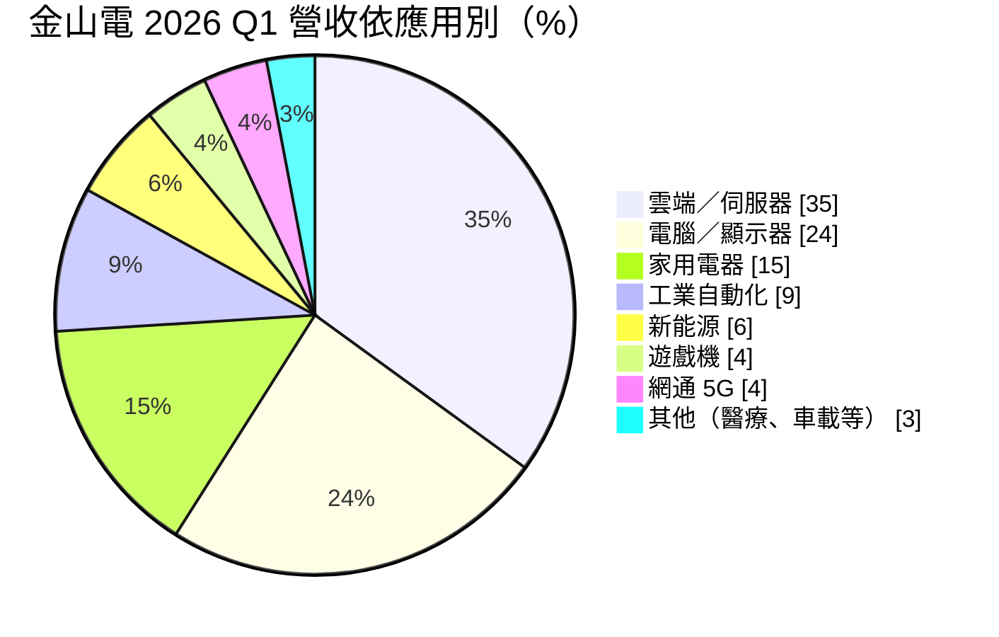
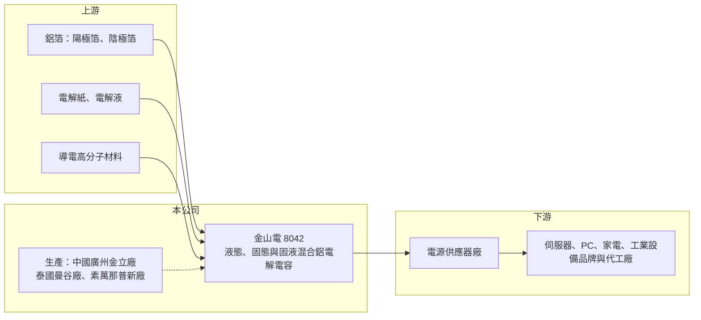

# 8042 金山電

> 上櫃｜[[產業索引-電子零組件業|電子零組件業]]｜上市（櫃）日期 2004/03/22

# 第一章：企業模式與商業藍圖

> [!info] 撰寫說明
> 精簡版，由 Claude 依公開資料整理，架構比照 [[2330台積電]] 的四章研究，資料截至 2026-10-08。來源：櫃買中心開放資料（基本資料、2026 年第二季綜合損益與資產負債、每月營收、本益比殖利率）、富果投研平台 2026 年 5 月法說會摘要、HiStock 月營收累計資料。2022 至 2023 年的毛利率與 EPS 未查得；競爭對手、上游材料與客戶類型部分憑一般產業知識整理，尚未逐條比對原始文件。#待校對

金山電（臺灣金山電子工業）是台灣老牌的[[鋁質電解電容]]製造商，1970 年成立，2004 年在櫃買中心掛牌。本章說明它賣什麼、賣給誰，以及近年從家電與電腦轉向 AI 伺服器的結構變化。

- **核心業務：** 金山電專做[[被動元件]]中的鋁質電解電容，產品分成兩大類。一類是傳統的液態鋁電解電容，包括導針型、貼片型（V-chip）、牛角型與螺絲型，2026 年第一季約占營收八成；另一類是[[導電高分子電容]]，也就是固態與固液混合電容，約占兩成。液態電容技術成熟、價格競爭激烈，固態與固液混合電容耐高溫、壽命長、單價較高，是公司提升毛利的主要方向。
- **營收結構：** 依 2026 年第一季法說資料，雲端與伺服器占 35%（其中約一半是 [[AI 伺服器]]），電腦與顯示器 24%，家用電器 15%，工業自動化 9%，新能源 6%，遊戲機與網通各 4%。雲端與伺服器的比重由 2024 年的 17%、2025 年的 22% 一路升到 2026 年第一季的 35%，代表公司的客戶組合正從消費性電子往資料中心電源移動，這是近年最重要的結構轉變。
- **營運據點：** 總部在台灣（新北三重登記、三峽為集團據點），生產主要在中國廣州與泰國。廣州原有精瑞、金立兩個廠區，2026 年已把產能整合到金立廠，並在第一季認列約人民幣 7,300 萬元的舊廠搬遷補助。泰國除了曼谷廠，還有素萬那普新廠，是固態與固液混合電容的生產重心，也規劃新增液態電容產線。全集團員工約 1,600 人。
- **長期方向：** 公司的策略可以歸納成兩條線。第一是產品升級，把資源集中在 AI 伺服器與雲端需要的高階固態、固液混合電容，家電等低價紅海則轉向利基型號；固液混合電容月產能目標由 2,000 萬顆提升到 3,000 萬顆，固態電容目標 7,000 萬顆。第二是產地分散，用泰國廠回應客戶的[[中國加一]]採購要求，降低關稅與地緣政治對接單的影響。

# 第二章：護城河深度與競爭優勢

鋁質電解電容是成熟產業，日本大廠握有材料與品牌優勢，中國廠商則以低價競爭。本章分析金山電在這個夾縫中靠什麼守住訂單，以及哪些市場守不住。

- **競爭優勢：** 金山電的優勢主要來自兩點。一是長年經營的電源供應器客戶關係，電容一旦通過電源廠的設計導入（design-in）與可靠度驗證，同一個機種在生命週期內很少更換料號，形成一定的轉換成本。二是泰國產能，在美中貿易摩擦後，國際電源與伺服器客戶需要中國以外的供貨來源，擁有東南亞量產能力的台系電容廠因此取得新的議價空間。不過整體而言，這屬於窄護城河，產品本身的差異化有限。
- **主要對手：** 高階市場的主要對手是日本的日本貴彌功（Nippon Chemi-Con）、尼吉康（Nichicon）、紅寶石（Rubycon）與松下（Panasonic），它們在電解紙、鋁箔與導電高分子材料上掌握較多技術，是 AI 伺服器電源的首選供應商。台灣同業有 [[2472立隆電]]、凱美等，中國則有艾華集團、江海股份等低價競爭者（對手名單憑產業常識整理，待校對）。金山電的定位介於日系與中國廠之間，以性價比和交期爭取第二供應商的位置。
- **守得住與守不住：** AI 伺服器電源要求高溫、長壽命與高漣波電流，對可靠度的要求較嚴，一旦打進供應鏈，價格敏感度相對低，是金山電較守得住的市場。相反地，家電、一般電腦與遊戲機的電容高度標準化，中國廠商以價格搶單，公司自己也預期 2026 年家電需求持續下滑，這些市場很難維持毛利。
- **觀察重點：** 長期要看三件事。第一，雲端與伺服器的營收比重能否穩定維持在三成以上，而不只是單一年度的拉貨。第二，泰國新廠的固態與固液混合產能能否如期擴充並維持良率。第三，在扣除搬遷補助這類一次性收益後，本業的營業利益率能否長期站穩在高個位數以上。

# 第三章：財務體質與盈利規模

資料日期：2026-10-08，表格是撰寫當時的快照；最新月營收、毛利率、累計 EPS 由自動排程寫在本筆記的屬性欄位（月營收、毛利率、累計EPS 等）。#待校對

財務數字是檢驗轉型是否成功的標準。本章用多年度營收、獲利與資本報酬，檢視金山電從低獲利的傳統電容廠轉向伺服器電容後，賺錢能力是否真的改善。

| 年度 | 營收（新台幣） | [[毛利率]] | [[營業利益率]] | EPS（元） | [[ROE]] |
|---|---|---|---|---|---|
| 2022 | 37.94 億 | 未查得 | 未查得 | 未查得 | 未查得 |
| 2023 | 32.16 億 | 未查得 | 未查得 | 未查得 | 未查得 |
| 2024 | 34.58 億 | 未查得 | 未查得 | 0.60 | 未查得 |
| 2025 | 37.66 億 | 未查得 | 未查得 | 0.89 | 未查得 |
| 2026 上半年 | 23.80 億 | 21.25% | 7.74% | 2.84（含一次性補助） | 未查得 |

- **營收規模：** 金山電年營收長期落在 32 億至 38 億元之間，2023 年因消費性電子庫存調整降到 32 億元，之後隨伺服器需求回升，2025 年回到 37.66 億元。2026 年前九個月累計營收約 37.26 億元，已接近 2025 年全年，年增約三成五，成長主要來自雲端與伺服器。2022 至 2025 年的營收年複合成長率約為 -0.2%（推算），代表過去幾年只是回到原本規模，真正的放大要看 2026 年之後能否延續。
- **獲利：** 2024 年 EPS 0.60 元、2025 年 0.89 元，獲利能力偏薄。2026 年上半年 EPS 2.84 元看似大幅躍升，但其中第一季認列約新台幣 3.69 億元的廣州舊廠搬遷補助，屬於[[一次性收益]]；上半年營業利益 1.84 億元、營業外收益 3.16 億元，本業貢獻不到四成。評估長期獲利能力時，應以營業利益率 7.74% 這類本業數字為準，它比過去幾年明顯改善，原因是高單價的伺服器電容占比提高。
- **財務特色：** 2026 年第二季底總資產約 101.4 億元、股東權益 46.4 億元、總負債 54.9 億元，負債比約 54%，比一般被動元件廠略高，與廠房搬遷及泰國擴產的資金需求有關。資本支出集中在泰國新廠，未來幾年折舊會增加，需要靠產能利用率與產品組合提升來消化。依櫃買中心快照，近一年現金股利約 1.2 元；更長期的配息穩定度與自由現金流紀錄未查得。

**[[ROIC]] 與 [[WACC]]：** 以 2026 年上半年營業利益 1.84 億元年化為 3.69 億元，乘以（1－20% 稅率）得稅後營業利益約 2.95 億元（推算）。有息負債金額未查得，因此用區間估計：若投入資本只算股東權益 46.4 億元，ROIC 約 6.4%；若把總負債 54.9 億元全部視為有息負債，投入資本為 101.4 億元，ROIC 約 2.9%。實際 ROIC 應落在約 3% 至 6% 之間（推算）。WACC 用 CAPM 推估：無風險利率取 1.75%、市場風險溢酬 6%、β 取電子零組件同業常見值 1.0，股東權益成本約 7.75%；負債成本假設 2.5%、稅後 2.0%，負債占資本約三成，WACC 約 6.0%（推算）。ROIC 目前大致等於或略低於 WACC，2024 至 2025 年 EPS 不到 1 元時更是明顯低於資金成本，代表公司過去並未長期創造經濟價值。伺服器電容占比若能持續提升、把營業利益率推向一成以上，ROIC 才有機會穩定超過 WACC。

# 第四章：總體風險與地緣政治

電容廠的營運受電子產業景氣、原物料與地緣政治三方面影響。本章整理金山電長期必須面對的主要風險。

- **產業週期：** 鋁質電解電容是典型的週期性產業，終端需求一轉弱，電源廠與組裝廠會先去化庫存，訂單減少的幅度會被[[長鞭效應]]放大，2023 年營收下滑就是一例。雲端與伺服器比重提高後，公司對 PC 與家電的依賴降低，但也轉而受到雲端業者資本支出循環的影響；AI 伺服器拉貨若在某一年放緩，高基期會讓營收與獲利明顯回落。
- **營運風險：** 第一是擴產執行風險，泰國新廠的產能爬坡、良率與人才培養若不如預期，會同時拉高成本與折舊。第二是獲利品質，2026 年的獲利含有大額搬遷補助，未來年度沒有這筆收入，市場若以 2026 年 EPS 推估長期獲利，容易高估。第三是規模劣勢，與日系大廠相比，金山電在材料研發與品牌上的投入有限，高階產品的認證進度可能落後。
- **其他風險：** 原料方面，電解電容的主要成本是鋁箔（陽極箔、陰極箔）、電解紙與電解液，鋁價與電力成本上升會壓縮毛利。匯率方面，營收以美元為主，新台幣升值會影響以台幣計算的獲利。地緣政治方面，中國廣州仍是液態電容的主要產地，美中關稅與出口管制若進一步升級，可能影響客戶下單地點，這也是公司加速布局泰國的原因。

# 專有名詞解析

## 應用

- **[[AI 伺服器]]**：搭載 GPU 或 AI 加速晶片、用來訓練與執行 AI 模型的伺服器，耗電量高，對電源與散熱零件的規格要求更嚴格。

## 金融

- **[[一次性收益]]**：不會每年重複發生的收益，例如處分資產、政府補助或搬遷補償，評估長期獲利時應排除。

## 產業

- **[[鋁質電解電容]]**：以鋁箔為電極、電解液為介質的電容，容量大、價格低，主要用於電源供應器與家電的濾波與穩壓。
- **[[導電高分子電容]]**：以導電高分子取代或搭配電解液的電容，包括固態與固液混合型，耐高溫、壽命長，單價與毛利較高。
- **[[被動元件]]**：不需外加電源即可運作的電子元件，主要是電容、電阻、電感，用於穩壓、濾波與儲能。
- **[[中國加一]]**：在中國以外另設生產基地，以分散關稅與地緣政治風險的供應鏈策略。

# 核心供應鏈

- 上游：鋁箔（陽極箔、陰極箔）、電解紙、電解液與導電高分子材料，日系與中國材料商為主，具體供應商名單未查得。
- 下游／客戶：電源供應器廠是鋁質電解電容的主要買家，再出貨給伺服器、PC、顯示器、家電與工業設備品牌；台灣代表性電源廠有 [[2308台達電]]、[[2301光寶科]]、[[6412群電]]，但是否為金山電客戶未查得。終端應用以雲端與 AI 伺服器、電腦與顯示器、家電為主。
- 同業：[[2472立隆電]]、凱美；日本貴彌功（Nippon Chemi-Con）、尼吉康（Nichicon）、紅寶石（Rubycon）；中國艾華集團、江海股份。被動元件龍頭 [[2327國巨]] 與 [[3026禾伸堂]] 以 MLCC 等其他電容為主，屬廣義同業。

## 最新新聞
<!-- news:start（自動產生，請勿手動編輯此範圍） -->
- 2026-10-15 🏛️ 重訊 16:30｜本公司可轉換公司債金山電六(代號：80426)達公布注 意交易資訊標準，故公告相關訊息，以利投資人區別瞭解。｜[觀測站](https://mops.twse.com.tw/mops/#/web/t05st01)
- 2026-10-08 🏛️ 重訊 16:11｜代重要子公司廣州金立電子有限公司公告決議辦理現金增資｜[觀測站](https://mops.twse.com.tw/mops/#/web/t05st01)

完整紀錄：[[8042金山電 新聞]]
<!-- news:end -->

## 相關連結
- [公開資訊觀測站](https://mopsov.twse.com.tw/mops/web/t05st03?step=1&firstin=1&co_id=8042)
- [Goodinfo](https://goodinfo.tw/tw/StockDetail.asp?STOCK_ID=8042)
- [Yahoo 股市](https://tw.stock.yahoo.com/quote/8042)
- [鉅亨網新聞](https://www.cnyes.com/twstock/8042/news)
