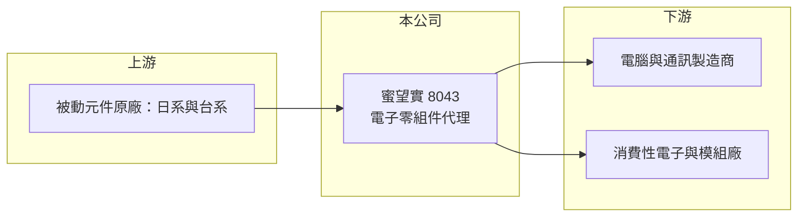

# 8043 蜜望實

> 上櫃｜[[產業索引-電子零組件業|電子零組件業]]｜上市（櫃）日期 2003/10/24

# 第一章：企業模式與商業藍圖

> [!info] 撰寫說明
> 精簡版，由 Claude 依公開資料整理，架構比照 [[2330台積電]]，資料截至 2026-10-08。來源：櫃買中心開放資料快照（基本資料、2026 年第二季資產負債與損益、本益比殖利率）、Goodinfo 經營績效頁、nStock 公司簡介、CMoney 與優分析報導標題。代理品牌與客戶依記憶整理，公開資料有限，已標註待校對。#待校對

蜜望實企業（以下簡稱蜜望實）是一家電子零組件[[代理商]]，以[[被動元件]]代理為主。理解它的關鍵在於：代理商不生產產品，而是替原廠銷售、備庫存與提供技術支援，賺取薄薄的價差，因此獲利取決於營收規模、存貨管理與資金效率，而不是毛利率高低。

- **核心業務：** 蜜望實成立於 1989 年，總部在台北內湖，2003 年 10 月在櫃買中心掛牌，實收資本額約 7.99 億元，董事長為林訓民、總經理為許弘志。依 nStock 的營業項目，公司從事電子零組件的買賣，以及國內外廠商產品的經銷、代理與投標業務；CMoney 報導將它定位為被動元件代理商。
- **營收結構：** 代理產品線與應用別比重未查得。依記憶，蜜望實長期代理日本太陽誘電的積層陶瓷電容等被動元件，客戶涵蓋電腦、通訊與消費性電子製造商（待校對）。
- **營運據點：** 總部在台北，依記憶在中國華南與華東設有銷售據點，服務當地的組裝與模組廠（待校對）。
- **長期方向：** 被動元件是所有電子產品都需要的基礎零件，AI 伺服器、電動車與工業設備使用的電容、電感數量與規格都持續提升。代理商的長期方向是擴充產品線、深入高階應用客戶，並提高周轉效率，以有限的資本支撐更大的營收規模。

# 第二章：護城河深度與競爭優勢

蜜望實的護城河很窄，主要來自與原廠的長期代理關係與客戶服務，而這種關係本身就有被收回的風險。

- **競爭優勢：** 代理商的價值在於替原廠開發中小型客戶、承擔庫存與應收帳款風險，並提供選料與技術支援。長期合作的代理權，以及對客戶需求的了解，讓蜜望實在特定產品線上有穩定的出貨。財務上維持低負債，也讓它在景氣低迷時不至於被庫存壓垮。
- **主要對手：** 台灣大型通路商如 [[3702大聯大]]、[[3036文曄]] 規模遠大於蜜望實，產品線也更完整；被動元件代理同業包括 [[3090日電貿]]、3028增你強、[[3033威健]] 等。原廠直接銷售給大客戶，也是代理商常見的競爭來源。
- **觀察重點：** 毛利率長期只有 3% 至 6%，營業利益率接近零，代表本業獲利能力有限。長期要觀察代理線是否擴充、高階應用占比是否提升，以及營業利益率能否穩定在 2% 以上。

# 第三章：財務體質與盈利規模

資料日期：2026-10-08，表格是撰寫當時的快照；最新月營收、毛利率、累計 EPS 由自動排程寫在本筆記的屬性欄位（月營收、毛利率、累計EPS 等）。#待校對

蜜望實的財務呈現典型代理商的樣貌：營收大、毛利率低、獲利對景氣與業外收益敏感。

| 年度 | 營收（億元） | [[毛利率]] | [[營業利益率]] | EPS（元） | [[ROE]] |
|---|---|---|---|---|---|
| 2019 | 53.7 | 5.08% | 1.64% | 0.97 | 3.07% |
| 2020 | 57.8 | 4.17% | 1.22% | 0.37 | 1.22% |
| 2021 | 61.5 | 5.31% | 2.07% | 1.76 | 5.63% |
| 2022 | 58.5 | 4.33% | 0.71% | 1.91 | 5.83% |
| 2023 | 48.9 | 2.78% | -1.09% | -0.24 | -0.74% |
| 2024 | 46.9 | 4.47% | -0.27% | 1.53 | 4.65% |
| 2025 | 54.3 | 5.62% | 0.74% | 1.67 | 4.89% |
| 2026 上半年 | 36.7 | 6.87% | 2.60% | 1.70 | 未查得 |

（來源：Goodinfo 經營績效頁；2026 上半年依櫃買中心開放資料計算。）

- **營收規模：** 2020 至 2025 年營收在 47 至 62 億元之間，年複合成長率約 -1.2%（推算），長期沒有成長。2026 年 1 至 9 月營收約 55.8 億元，已超過 2025 年全年，是近年明顯的回升。
- **獲利：** 2021 至 2025 年平均 ROE 約 4.1%（推算），偏低。2022 與 2024 年營業利益率接近零或為負，EPS 卻有 1.5 至 1.9 元，代表獲利有相當比例來自業外收益（例如投資收益或匯兌），本業貢獻有限。2026 年上半年營業利益率回升到 2.6%，EPS 1.70 元，其中業外收入約 0.76 億元。
- **財務特色：** 2026 年第二季總資產約 56.8 億元、權益約 28.4 億元、負債約 28.4 億元，權益比約 50%；流動資產占總資產九成以上，主要是存貨與應收帳款，符合通路商的資產結構。最近一次現金股利每股 0.9 元，約為 2025 年 EPS 1.67 元的 54%（推算）。
- **[[ROIC]] 與 [[WACC]]：** 以 2025 年營業利益約 0.40 億元（54.3 億元 × 0.74%）、稅率 20% 計算，稅後營業利益約 0.32 億元。有息負債未查得，投入資本以權益 28.4 億元到總資產 56.8 億元為區間，ROIC 約 0.6% 至 1.1%（推算）；2026 年上半年年化約 2.7% 至 5.4%（推算）。WACC 以 CAPM 推估：無風險利率 1.75%、市場風險溢酬 6%、β 假設 0.9（通路股波動較低的常見值），權益成本約 7.2%；通路商常以短期借款支應存貨，負債比重假設四成、稅後成本 2%，WACC 約 5.1%（推算）。長期 ROIC 低於 WACC，代表本業難以創造經濟價值，2026 年上半年利差縮小但仍偏負。

# 第四章：總體風險與地緣政治

蜜望實的風險在於代理權、存貨與被動元件的景氣循環。

- **產業週期：** 被動元件是循環性很強的產業，缺貨時價格上漲、代理商受惠，供過於求時價格下跌、存貨跌價。2023 年營收下滑約一成六、營業利益轉負，就是庫存調整期的典型表現。
- **營運風險：** 代理商最大的風險是原廠收回代理權或改為直銷，一旦主要代理線流失，營收會大幅下降（代理線集中度待校對）。存貨與應收帳款占資產比重高，若客戶倒帳或存貨跌價，會直接侵蝕獲利。
- **其他風險：** 進貨多以日圓或美元計價、銷售以美元或人民幣為主，匯率波動影響明顯。中國市場的需求與政策變化，也會影響主要客戶的訂單。

# 專有名詞解析

## 產業

- **[[代理商]]**：替原廠銷售產品、備庫存並提供技術支援的通路業者，以低毛利、高周轉的方式經營。
- **[[被動元件]]**：電容、電阻、電感等不需外加電源即可運作的基本電子零件，幾乎所有電子產品都會用到。

# 核心供應鏈

- 上游：被動元件原廠，依記憶包括日本太陽誘電，台灣原廠例如 [[2327國巨]]、[[2492華新科]]、[[3026禾伸堂]] 所在的產業（實際代理線未查得，#待校對）。
- 下游／客戶：電腦、通訊與消費性電子製造商與模組廠（實際客戶未查得，#待校對）。
- 同業：[[3702大聯大]]、[[3036文曄]]、[[3090日電貿]]、3028增你強、[[3033威健]]。

## 最新新聞
<!-- news:start -->
<!-- news:end -->

## 相關連結
- [公開資訊觀測站](https://mopsov.twse.com.tw/mops/web/t05st03?step=1&firstin=1&co_id=8043)
- [Goodinfo](https://goodinfo.tw/tw/StockDetail.asp?STOCK_ID=8043)
- [Yahoo 股市](https://tw.stock.yahoo.com/quote/8043)
- [鉅亨網新聞](https://www.cnyes.com/twstock/8043/news)
