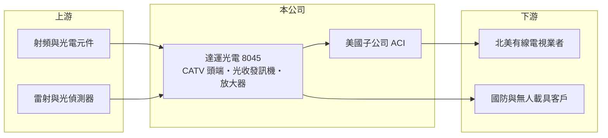

# 8045 達運光電

> 上市｜[[產業索引-通信網路業|通信網路業]]｜上市（櫃）日期 2024/12/11

# 第一章：企業模式與商業藍圖

> [!info] 撰寫說明
> 本文由 Claude 依公開資料整理，架構比照 [[2330台積電]] 的四章研究，資料截至 2026-10-08。財務數字來源：Goodinfo 年度經營績效頁與基本資料頁（含 2026 年新聞標題）、證交所開放資料（基本資料、2026 年第二季資產負債與損益、營益分析、股利、本益比殖利率）。北美客戶結構與產業背景部分憑記憶整理，已標「待校對」。#待校對

評估有線電視網路設備商，要看北美有線電視業者的網路升級週期，因為這類設備的需求幾乎完全由業者的資本支出決定。本章說明達運光電（股票代號：8045，以下簡稱達運）的商業模式與新事業布局。

## 一、核心定位：有線電視網路的頭端與傳輸設備

達運成立於 1992 年，2024 年 12 月在證交所上市，總部與工廠位於新北產業園區，實收資本額約 9.5 億元。依公司揭露的主要業務，產品包括[[有線電視]]頭端設備、光收發訊機、放大器、接頭與監測系統，並提供寬頻網路系統的規劃、設計與安裝。公司在美國設有子公司 ACI Communications（2017 年登記，從事通訊器材買賣）與 ACI Holdings（2019 年登記，投資業），顯示北美是主要市場（客戶結構待校對）。

有線電視網路採用[[HFC]]架構：從業者的頭端機房以光纖傳到社區節點，再用同軸電纜接到用戶家中。達運的光收發訊機負責光電轉換，放大器則負責在同軸線路上補強訊號。各產品的營收比重未查得。

## 二、產品世代：網路升級帶動的週期

北美有線電視業者為了提供更高速的寬頻，持續把網路升級到新一代 [[DOCSIS]] 規格，並把光纖節點推得更靠近用戶。每一次升級都需要更換放大器與節點設備，形成數年一次的設備汰換潮。達運 2023 年營收跳升到 23.3 億元、EPS 5.0 元，2024 至 2025 年又回落到 17.4 億與 12.0 億元，就是這種週期的寫照（與升級週期的關聯為推估）。

## 三、長期方向：國防與無人載具

依 2026 年的新聞標題，達運正把業務延伸到軍工與無人載具領域：2026 年 8 月報導其無人載具策略在淡水與嘉義完成驗證，2026 年 9 月宣布取得美國奧克拉荷馬州客戶的採購合約。公司把射頻與光傳輸技術應用到[[無人機]]與國防通訊，目的是降低對有線電視單一市場的依賴。新事業的規模與獲利貢獻仍未查得，需要觀察多年才能判斷是否成為第二支柱。

# 第二章：護城河深度與競爭優勢

在長期價值投資中，「護城河」指企業抵禦競爭、維持超額利潤的保護機制。本章分析達運的優勢與限制。

## 一、護城河的組成

* **北美業者的設備認證：** 有線電視業者對網路設備有嚴格的互通性與可靠度要求，通過認證的供應商在升級週期中較容易持續接單。
* **美國在地據點：** 美國子公司提供銷售與服務支援，在偏好非中國供應的北美市場具有優勢（推估）。
* **射頻與光傳輸技術：** 長期累積的類比光傳輸與射頻放大技術，可延伸到國防與無人載具通訊。

## 二、主要競爭對手

| 對手 | 定位 | 對達運的威脅 |
|---|---|---|
| 美系有線電視網路設備大廠 | 頭端、節點與放大器全產品線 | 與大型業者關係深、產品完整 |
| 歐洲與加拿大 HFC 設備商 | 放大器與節點 | 在升級標案中直接競爭 |
| 中國大陸 CATV 設備廠 | 價格低 | 在價格敏感市場競爭 |

## 三、守得住／守不住／觀察重點

守得住的是已認證的北美業者與升級專案。守不住的是升級週期之間的需求空窗，2024 至 2025 年營收連續下滑就是例子。長期觀察重點是北美網路升級的進度、國防與無人載具訂單的規模，以及毛利率能否維持在三成五以上。

# 第三章：財務體質與盈利規模

資料日期：2026-10-08，表格是撰寫當時的快照；最新月營收、毛利率、累計 EPS 由自動排程寫在本筆記的屬性欄位（月營收、毛利率、累計EPS 等）。#待校對

財務報表是檢驗護城河是否真實存在的最終標準。本章用六年的三率、ROE 與資本報酬，檢視達運的獲利品質。

## 一、多年度經營績效

| 年度 | 營收（新台幣） | [[毛利率]] | [[營業利益率]] | EPS（元） | [[ROE]] |
|---|---|---|---|---|---|
| 2020 | 10.6 億 | 38.9% | 6.23% | 0.21 | 1.54% |
| 2021 | 11.7 億 | 37.0% | 9.53% | 0.58 | 4.36% |
| 2022 | 10.2 億 | 38.4% | 2.91% | 0.76 | 5.65% |
| 2023 | 23.3 億 | 44.0% | 24.4% | 5.00 | 31.5% |
| 2024 | 17.4 億 | 33.8% | 10.7% | 2.45 | 11.2% |
| 2025 | 12.0 億 | 38.9% | 6.22% | 0.64 | 2.90% |
| 2026 上半年 | 9.18 億 | 27.0% | 3.40% | 0.25 | 未查得 |

達運的毛利率長期維持在 34% 至 44%，但營業利益率高度依賴營收規模：營收 10 億元左右時營業利益率只有 3% 至 9%，2023 年營收倍增時則跳升到 24%。2021 至 2025 年平均 ROE 約 11.1%（推算），但幾乎全部來自 2023 年；2020 至 2025 年營收年複合成長率約 2.5%（推算）。2025 年度配發現金股利每股 1.0 元，高於當年 EPS 0.64 元。2026 年上半年營收回升，但毛利率降到 27%，可能與產品組合改變有關（推估）。

## 二、[[ROIC]] 與 [[WACC]]：價值創造利差

**ROIC 推算：** 2025 年營業利益約 0.75 億元（12.0 億 × 6.22%），稅後約 0.60 億元。2026 年第二季權益總計約 19.4 億元，負債約 11.6 億元，假設有息負債約 6 億元（推估），投入資本約 25.4 億元，2025 年 ROIC 約 2.4%（推算）；2023 年高峰時 ROIC 推估超過 20%。

**WACC 推算：** 台灣 10 年期公債 1.75%、市場風險溢酬 6%、β 取網通同業常見值 1.2，股東權益成本約 9.0%；負債成本 2.5%、稅後 2.0%；權益占投入資本約 76%，WACC 約 7.3%（推算）。

**結論：** 達運只有在升級週期高峰時 ROIC 才明顯超過 WACC，其他年份都低於資金成本。新事業能否讓營收維持在 15 億元以上，是長期創造價值的關鍵。

# 第四章：總體風險與地緣政治

任何企業都無法脫離宏觀環境獨立存在。本章分析達運長期必須面對的風險。

## 一、北美有線電視的結構性衰退

北美有線電視訂戶持續流失到串流與光纖業者，業者雖然仍在升級寬頻網路，但長期資本支出可能逐步收縮，或轉向全光纖架構而減少同軸放大器的需求。

## 二、客戶集中與週期風險

設備需求集中在少數大型業者，升級計畫延後就會造成營收大幅下滑。2023 年的高峰與 2025 年的低谷，說明這種集中度帶來的波動。

## 三、新事業、關稅與匯率

國防與無人載具屬於新領域，需要投入研發與認證，短期可能拉低獲利。美國關稅與在地製造要求會影響出口成本，營收以美元為主（推估），新台幣升值也會壓縮毛利。

# 專有名詞解析

## 應用

- **[[有線電視]]**：以同軸電纜與光纖傳送電視與寬頻訊號的網路，北美業者同時提供寬頻上網服務。
- **[[HFC]]**：光纖同軸混合網路，頭端到社區用光纖、社區到用戶用同軸電纜，是有線電視網路的主流架構。
- **[[DOCSIS]]**：有線電視網路傳輸資料的標準，新一代規格可提供更高的上下行速度，帶動設備汰換。
- **[[無人機]]**：不需駕駛員搭乘、可遙控或自主飛行的航空器，軍用與商用需求都在成長。

## 金融

- **[[ROIC]]**：投入資本報酬率，稅後營業利益除以股東權益與有息負債的合計，衡量本業對所有資金提供者的報酬。
- **[[WACC]]**：加權平均資金成本，依股東權益與負債的比重加權計算的資金成本，ROIC 高於它才代表創造價值。

# 核心供應鏈

## 1. 上游：元件
- 射頻放大晶片、雷射與光偵測器供應商（實際供應商未查得）

## 2. 中游：達運與同業
- 子公司：ACI Communications、ACI Holdings（美國）
- 同業：美系與歐洲 HFC 網路設備商、中國大陸 CATV 設備廠

## 3. 下游：客戶
- 北美有線電視業者（具體客戶未查得）
- 國防與無人載具相關客戶

## 最新新聞
<!-- news:start -->
<!-- news:end -->

## 相關連結
- [公開資訊觀測站](https://mopsov.twse.com.tw/mops/web/t05st03?step=1&firstin=1&co_id=8045)
- [Goodinfo](https://goodinfo.tw/tw/StockDetail.asp?STOCK_ID=8045)
- [Yahoo 股市](https://tw.stock.yahoo.com/quote/8045)
- [鉅亨網新聞](https://www.cnyes.com/twstock/8045/news)
