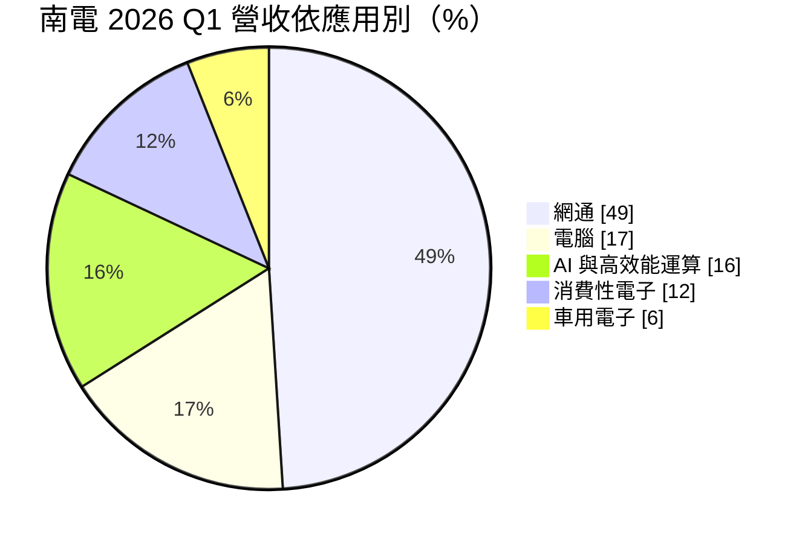
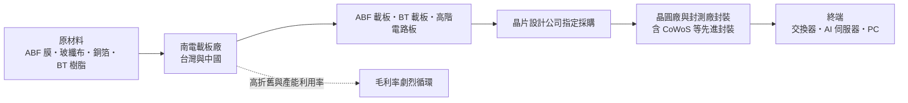
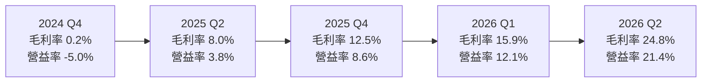
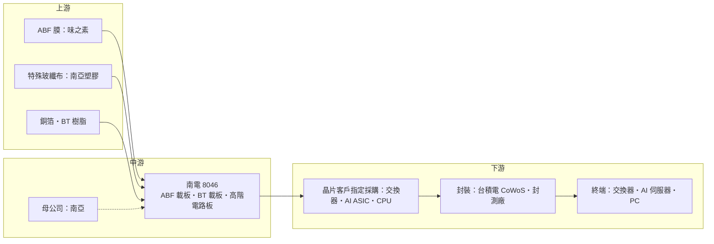

# 8046 南電

> 上市｜[[產業索引-電子零組件業|電子零組件業]]｜上市（櫃）日期 2006/04/07

# 第一章：企業模式與商業藍圖

> [!info] 撰寫說明
> 本文由 Claude 依公開資料整理，架構比照 [[2330台積電]] 的四章研究，資料截至 2026-10-08。財務數字來源：證交所開放資料（2026 年第二季財報、基本資料、股利）、Goodinfo 年度經營績效、MoneyDJ 季度財務比率、富果 2026 年 6 月法說會摘要、Brodog Investment 南電深度分析（引述機構研究報告）；產業描述為整理性內容，尚未逐條比對原始文件。#待校對

在評估單一個股的長期投資價值時，首要步驟是拆解企業的底層獲利邏輯。本章針對南亞電路板（股票代號：8046，以下簡稱南電）的商業模式進行定性分析，說明這家台塑集團旗下的載板廠如何隨著 PC、網通到 AI 的需求轉換經歷劇烈的景氣循環，以及它在 AI 晶片封裝中扮演的角色。

## 一、核心定位：台塑集團的 IC 載板廠

南電成立於 1997 年，2006 年在證交所上市，母公司為 [[1303南亞]]（南亞塑膠，持股比例待校對），屬於台塑集團。南電生產 [[IC載板]] 與高階電路板。IC 載板是晶片封裝時承載晶片、把晶片上極細的接點轉接到電路板的關鍵材料，可以理解為晶片與主機板之間的「轉接層」。

南電的產品分為三類：

* **[[ABF載板]]（約六成）：** 以味之素增層膜為絕緣材料，線路極細、層數多，用於 CPU、GPU、AI 加速器、高階交換器晶片等高腳數的[[覆晶封裝]]。依引述機構報告的整理，ABF 約占南電營收 60%。南電目前聚焦新世代 AI 伺服器客製化晶片，以及高階交換器、路由器用載板。
* **[[BT載板]]（約三成）：** 以 BT 樹脂為材料，主要用於記憶體、手機射頻模組、SSD 控制晶片與電源管理晶片。南電正開發 5G 射頻模組、智慧眼鏡、SSD 與電源管理 IC 等新應用。
* **一般電路板（約一成）：** 針對資料中心伺服器、交換器與邊緣 AI 的高階網通卡、背板與高層板。

依使用者整理的供應鏈關係，南電位於 [[台積電供應鏈]] 的「先進封裝大聯盟（CoWoS 設備與載板）」中的「ABF 高階載板三雄」，供應高階 IC 載板。實務上，載板多由晶片設計公司指定並採購，再送到台積電或封測廠完成封裝，南電與台積電的關係屬於封裝流程中的材料供應。

## 二、終端應用板塊：網通過半，AI 快速成長

依 2026 年 6 月法說會資料，南電 2026 年第一季的應用別營收結構如下：

* **網通（約五成）：** 高階交換器與路由器晶片用的大尺寸 ABF 載板是南電的強項。依機構報告整理，南電在 800G 與 [[1.6T交換器]]所用高階交換晶片的 ABF 載板市占超過七成。資料中心的網路頻寬隨 AI 擴張而倍增，帶動這塊需求。
* **電腦（一成多）：** PC 與一般伺服器 CPU 的 ABF 載板，過去是南電最大的市場。2015 年 PC 約占 ABF 市場的七成，但這個比重正在快速下降。
* **AI 與 [[HPC]]（一成多）：** AI 加速器與雲端業者自研 [[ASIC]] 的載板，面積大、層數多，單價遠高於 PC 載板，是南電成長最快的板塊。
* **消費性與車用：** 主要由 BT 載板與一般電路板供應。

## 三、資本轉化邏輯：重資產、長週期的製造業

IC 載板是重資產產業：新建一座 ABF 載板廠需要投入大量資金，建廠到量產需要兩年以上，設備折舊占成本比重很高。這種結構讓南電的獲利對[[產能利用率]]與價格極為敏感：

* **景氣好時：** 供不應求，價格上漲、產能滿載，折舊被大量營收攤薄，毛利率可以飆到 40%（2022 年）。
* **景氣差時：** 價格下跌、產能閒置，但折舊照提，毛利率可能接近零（2024 年 1.1%）。

另一個重要特點是，AI 載板的「面積與層數」快速增加。依機構報告整理，AI 伺服器載板層數從 4 至 8 層增加到 16 至 20 層以上、面積超過 70 x 70 毫米。同樣的產能能生產的載板數量變少，等於有效產能被稀釋，這是 AI 時代載板供需轉緊的結構性原因之一。

## 四、企業長期藍圖：ABF 擴產與四大轉型

* **擴產方向：** ABF 持續擴充，包括新建廠房；BT 透過既有廠房去瓶頸化與產線調整增加產能，不排除未來新建廠房。新廠時程待董事會決議。2025 年實際資本支出約 43.14 億元，2026 年預計約 40 億元。
* **材料供應：** ABF 膜等關鍵材料供應緊張，南電已分散供應來源。依機構報告整理，母公司南亞塑膠承諾至 2027 年代工編織其全球約 20% 的特殊玻纖布，集團內的材料整合是南電的潛在優勢。
* **四大轉型：** 公司提出產品轉型（高附加價值產品）、事業轉型（新材料、新技術、新產品）、數位轉型（導入 AI 與數位工具）與低碳轉型（綠色能源與循環經濟）。

# 第二章：護城河深度與競爭優勢

在長期價值投資中，「護城河」指企業抵禦競爭、維持超額利潤的保護機制。本章分析南電在 IC 載板市場的護城河構成、主要競爭對手，以及這些優勢在載板景氣循環中能守住多少。

## 一、南電護城河的核心組成要素

南電的護城河屬於「窄護城河」，載板產業的寡占結構提供了一定保護，但無法讓南電擺脫景氣循環：

* **1. 寡占市場與高進入門檻：** 全球 ABF 載板前五大廠商合計市占超過 74%。高階 ABF 載板需要長期的製程經驗、龐大資本與客戶認證，新進者很難在短時間內做出合格的大尺寸、高層數產品。
* **2. 大尺寸網通載板的技術優勢：** 南電在高階交換器晶片載板的市占領先，這類載板尺寸大、層數多、良率難以控制，客戶認證週期長，一旦通過認證就不容易被替換。
* **3. 集團資源：** 背靠台塑集團，南電在玻纖布、銅箔基板等上游材料具備集團內整合的可能，財務上也能在景氣低谷時維持投資，不至於因資金壓力被迫減產。

## 二、全球主要競爭對手格局

| 對手 | 定位 | 對南電的威脅 |
|---|---|---|
| 揖斐電（Ibiden） | 日本 ABF 載板龍頭 | 在 AI GPU 與高階 CPU 載板居領先地位，計畫大規模投資 |
| 新光電氣（Shinko） | 日本 ABF 載板大廠 | 在高階 CPU 與伺服器載板競爭 |
| [[3037欣興]] | 台灣最大 ABF 載板廠 | 產能規模大，在 AI 與 CPU 載板直接競爭 |
| [[3189景碩]] | 台灣 ABF 與 BT 載板廠 | 在網通與 BT 載板競爭 |
| 三星電機、AT&S | 韓國與奧地利載板廠 | 在伺服器 CPU 與 AI 載板爭取國際客戶 |

## 三、優勢轉化：哪些市場守得住、哪些守不住

* **守得住：** 高階交換器與網通晶片的大尺寸 ABF 載板。這是南電市占最高、技術門檻最高的領域，也是 AI 資料中心網路升級的直接受惠者。
* **守不住：** 景氣循環本身。2022 年南電 EPS 高達 30.05 元，2024 年卻只有 0.32 元，毛利率從 40% 跌到 1.1%。即使有寡占結構，產業在 2021 至 2022 年集體擴產後，供過於求仍讓價格與獲利崩落。PC 與一般消費性載板則面臨中國業者的價格競爭。
* **觀察重點：** 第一，AI 與高效能運算的營收比重能否持續上升，讓南電的產品組合從 PC 轉向更穩定的 AI 與網通。第二，這一輪 ABF 漲價與擴產，是否會再次演變成 2023 至 2024 年的供過於求。第三，南電在 AI GPU 載板市場能否取得更大份額，目前這塊市場由日系廠商主導。

# 第三章：財務體質與盈利規模

資料日期：2026-10-08。數字取自證交所開放資料、Goodinfo 年度經營績效、MoneyDJ 季度財務比率與法說會摘要，表格是撰寫當時的快照；最新月營收、毛利率、累計 EPS 由自動排程寫在本筆記的屬性欄位（月營收、毛利率、累計EPS 等）。#待校對

財務報表是檢驗護城河是否真實存在的最終標準。本章用多年度的三率、ROE、現金流與資本報酬，檢視南電在載板景氣循環中的獲利波動與資本效率。

## 一、獲利能力的基石：三率

| 年度 | 營收（億元） | [[毛利率]] | [[營業利益率]] | EPS（元） | [[ROE]] |
|---|---|---|---|---|---|
| 2019 | 311 | 5.2% | 0.2% | 0.48 | 1.1% |
| 2020 | 385 | 14.9% | 10.7% | 5.67 | 11.9% |
| 2021 | 522 | 28.5% | 24.6% | 16.38 | 29.1% |
| 2022 | 646 | 40.0% | 36.5% | 30.05 | 41.2% |
| 2023 | 423 | 19.4% | 15.0% | 9.00 | 11.4% |
| 2024 | 323 | 1.1% | -3.9% | 0.32 | 0.4% |
| 2025 | 402 | 9.1% | 4.9% | 3.01 | 4.3% |
| 2026 上半年 | 247.5 | 20.7% | 17.2% | 5.53 | 未查得 |

註：2019 至 2025 年取自 Goodinfo；2026 上半年取自證交所開放資料。

* **[[毛利率]]：** 七年間在 1.1% 到 40% 之間擺盪，是典型的週期性製造業。2024 年第四季毛利率僅 0.2%，之後隨 ABF 價格上漲與產能利用率回升，連續六季走升，2026 年第二季回到 24.8%。
* **[[營業利益率]]：** 費用率低，營業利益率與毛利率差距只有 3 至 4 個百分點，毛利率的變化幾乎全數反映到營業利益。
* **業外：** 南電帳上現金多，利息收入與匯兌損益會影響稅後淨利。2025 年第二季營業利益為正但稅後虧損，推估與新台幣升值的匯兌損失有關。

## 二、[[ROE]]：資本效率

南電近 5 年（2021 至 2025 年）平均 ROE 約 17.3%（推算），但這個平均值掩蓋了極大的波動：2022 年 41.2%，2024 年只有 0.4%。南電幾乎沒有長期借款，負債比率約 24%，ROE 的波動完全來自獲利循環。營收方面，2019 至 2025 年年複合成長率約 4.4%（推算），中間經歷 2022 年 646 億元的高峰與 2024 年 323 億元的低谷。對長期投資人來說，南電的價值不在於穩定成長，而在於能否在下一個循環中站在更高的獲利基礎。

## 三、資本支出與自由現金流

* **[[CapEx]]：** 2025 年實際約 43.14 億元，2026 年預計約 40 億元。南電在 2021 至 2023 年景氣高峰時大舉擴產，之後折舊高、景氣差，形成 2024 年的獲利谷底。依機構報告估計，2026 年折舊約 71 億元，2028 年降到約 58 億元。
* **[[自由現金流]]：** 依機構報告整理，2025 年自由現金流約 6 億元，處於低點；若 ABF 漲價持續，機構預估 2027 年可達 200 億元以上。這些都是第三方預估，並非公司指引。
* **股利：** 2025 年度配發現金股利每股 2 元，以 EPS 3.01 元計算配發率約 66%（推算）。2022 年高峰時期配息較高，南電的股利隨景氣循環大幅變動。

## 四、[[ROIC]] 與 [[WACC]]：價值創造利差

* **ROIC（推算）：** 以 2025 年營收 402 億元乘營業利益率 4.93%，營業利益約 19.8 億元，稅後營業利益約 15.9 億元。南電幾乎沒有有息負債（機構報告指出全程淨現金、無長期負債），投入資本以 2026 年第二季股東權益 492.6 億元計算，ROIC 約 3.2%；機構報告估計 2025 年 ROIC 為 4.4%。若以 2026 年上半年營業利益約 42.5 億元年化，ROIC 約 13.8%。2022 年高峰時，ROIC 推估超過 30%。
* **WACC（推算）：** 以 [[CAPM]] 估算：無風險利率 1.75%、市場風險溢酬 6%、β 取 1.59（Brodog Investment 整理的近五年 β），股權成本約 11.3%；由於幾乎沒有負債，WACC 約等於股權成本，約 11.3%。機構報告估計的股權資金成本約 9.3%，可作為區間下緣。
* **結論：** 南電的 ROIC 在景氣高峰遠高於 WACC，在谷底則遠低於 WACC，2025 年約 3% 至 4% 明顯低於 9% 至 11% 的資金成本。長期是否創造價值，取決於整個循環的平均 ROIC 能否高於 WACC。以 2019 至 2025 年粗估，景氣高峰兩年的超額報酬大致能彌補低谷年份（推估），但投資人必須接受獲利的劇烈波動。

# 第四章：總體風險與地緣政治

任何企業都無法脫離宏觀環境獨立存在。本章分析南電未來必須面對的地緣政治、產業週期、營運與技術風險。

## 一、地緣政治風險

* **中國產能：** 南電在台灣與中國都有生產基地。美中科技管制若擴及高階載板，或客戶要求 AI 相關載板不得在中國生產，南電的中國產能可能需要轉作較低階的產品。
* **客戶在地化要求：** 美國推動半導體供應鏈在地化，部分客戶可能要求載板在台灣以外生產。日系競爭對手在日本與東南亞擴產，南電的生產據點集中在台灣與中國，未來可能面臨分散產能的壓力。

## 二、產業週期與市場結構風險

* **供過於求的循環：** 載板產業的擴產週期約兩到三年，需求旺盛時各家同時擴產，產能開出時往往遇到需求放緩。2021 至 2022 年的擴產潮造成 2023 至 2024 年的價格崩跌，這一輪 AI 帶動的擴產同樣存在重演的風險。依機構報告整理，日本龍頭廠計畫在 2026 至 2028 年投資超過 5,000 億日圓，競爭者的擴產速度值得留意。
* **[[長鞭效應]]：** 載板位於晶片供應鏈的上游，終端需求的小幅變動會在庫存調整時被放大，南電的營收波動往往大於晶片出貨量的波動。

## 三、營運環境的隱性風險

* **原材料與貴金屬：** ABF 膜、玻纖布、金等材料價格上漲會推高成本，南電需要與客戶協商調價。ABF 膜由少數日本廠商供應，供應緊張時可能限制產出。
* **高折舊的固定成本：** 2026 年折舊估計約 71 億元，景氣一旦轉弱，固定成本會快速吞噬毛利。
* **匯率：** 南電以外銷為主，新台幣升值會壓縮營收與毛利率，並產生匯兌損失。

## 四、科技演進風險

[[玻璃基板]]被視為下一代 AI 晶片封裝的載板材料，平整度與耐熱性優於有機樹脂。若玻璃基板在 2030 年前後大規模取代部分 ABF 載板，南電必須投入新的製程與設備，否則可能失去高階市場。另一方面，[[CoWoS]] 等先進封裝讓單一晶片封裝的載板面積更大、層數更多，短期內反而提升 ABF 載板的需求與單價。南電能否在既有 ABF 技術與新材料之間取得平衡，是未來十年最重要的技術課題。

# 專有名詞解析

## 半導體

- **[[IC載板]]**：晶片封裝時承載晶片、把晶片細微接點轉接到電路板的基板，是封裝中成本最高的材料之一。
- **[[ABF載板]]**：以味之素增層膜為絕緣材料的高階 IC 載板，用於 CPU、GPU、AI 晶片等高腳數覆晶封裝。
- **[[BT載板]]**：以 BT 樹脂為絕緣材料的 IC 載板，主要用於記憶體、手機射頻與感測器等中小型晶片封裝。
- **[[覆晶封裝]]**：把晶片翻轉後以凸塊直接接合在載板上的封裝方式，接點密度高，是高效能晶片的主流封裝。
- **[[CoWoS]]**：台積電的 2.5D 先進封裝技術，把運算晶片與高頻寬記憶體並排放在矽中介層上，是 AI 晶片主流封裝。
- **[[玻璃基板]]**：以玻璃取代有機樹脂作為載板核心材料，平整度與耐熱性較佳，被視為下一代 AI 晶片封裝材料。
- **[[ASIC]]**：特定應用積體電路，為單一用途量身設計的晶片，雲端業者自研的 AI 加速晶片多屬此類。

## 應用

- **[[HPC]]**：高效能運算，泛指 AI 伺服器、資料中心等需要大量運算的應用。
- **[[1.6T交換器]]**：單埠傳輸速率達每秒 1.6 兆位元的資料中心網路交換器，是 AI 叢集網路升級的下一代規格。

## 金融

- **[[產能利用率]]**：實際生產量占總產能的比例，重資產的載板廠毛利率高度取決於此數字。
- **[[長鞭效應]]**：終端需求的小幅變動，沿供應鏈往上游傳遞時被逐級放大，造成上游庫存與訂單劇烈波動。
- **[[CAPM]]**：資本資產定價模型，以無風險利率加上 β 乘市場風險溢酬估算股東要求的報酬率。

# 核心供應鏈

## 1. 上游：載板材料
- ABF 增層絕緣膜：味之素（日本），南電表示已分散 ABF 膜等關鍵材料的供應來源
- 特殊玻纖布：[[1303南亞]]（承諾至 2027 年代工編織其全球約 20% 的特殊玻纖布）
- 銅箔與 BT 樹脂：個別供應商未查得

## 2. 中游：南電本身與集團
- 母公司：[[1303南亞]]，屬台塑集團
- ABF 載板約占六成、BT 載板約三成、一般電路板約一成

## 3. 下游：封裝
- CoWoS 先進封裝的高階 IC 載板：[[2330台積電]]
- 專業封測廠：[[3711日月光投控]]（推估）

## 4. 下游：晶片設計客戶（載板多由晶片公司指定採購）
- 800G 與 1.6T 高階交換器晶片：[[AVGO博通]]（推估，南電在此類載板市占逾七成，博通為交換晶片主要供應商）
- PC 與伺服器 CPU：[[INTC英特爾]]、[[AMD超微]]（待校對）
- AI 加速器與雲端自研 ASIC：成長最快的板塊，客戶名稱未公開

## 5. 同業競爭
- 日系載板廠：揖斐電（Ibiden）、新光電氣（Shinko）
- 台灣載板廠：[[3037欣興]]、[[3189景碩]]
- 韓國與歐洲載板廠：三星電機、AT&S

延伸閱讀：[[台積電供應鏈]]

## 供應鏈關係
- 供應給 [[2330台積電]]：高階IC載板製造（台積電供應鏈 › 下游：先進封裝大聯盟 (CoWoS 設備與載板) › ABF 高階載板三雄 (先進封裝必備)）

## 最新新聞
<!-- news:start（自動產生，請勿手動編輯此範圍） -->
- 2026-10-16 📰 媒體 08:15｜《外資》外資送暖 欣興、南電目標價調升｜[富聯網](https://news.google.com/rss/articles/CBMiiAFBVV95cUxOeEtjeG9lOVROazl1eVpCcDZ4QjNnU0VGQnAxRGVVT2RaVkJQcUlEM0YzNkxxSzZoMnRVMkhYMjY5M0NxTFdWbG9BazI0ak1nVXBzNXZaZEhKQlFhQV82bTNROWFKSHNHbmh4RDhYdHdYMWRUZzVfVmR6SUtjR3BGOExRZW5aZWUx?oc=5)
- 2026-10-15 📰 媒體 06:04｜目標價1表看》台光電、欣興、南電、臻鼎、華通等9檔PCB 法人一口氣全評了：它訂單看到2030年 - 上市櫃｜[旺得富理財網](https://news.google.com/rss/articles/CBMiakFVX3lxTE96ZFdwc3RUUnNtR1UtbTByVm9MZ3UtaWVOZUFkYWt6TXRyTnczRG9TUWVtcVhOQjJ3eW1mNHZva2libXdsek42MmI4NDgwcFZzazdoc092SjEwZS1TOF9VWGpYZ0o5eHdLaHc?oc=5)
- 2026-10-14 📰 媒體 16:20｜AI載板缺貨恐一路到2030年！欣興砸537億、南電豪擲468億擴產 ABF漲價超預期｜[FTNN 新聞網](https://news.google.com/rss/articles/CBMiS0FVX3lxTE5MaFAtRVh4Y1dyd25kcnFvZklOZVV2cG9BNDM1dG9HbEVpSUxvcVAwTVZiYXJSeC1aRDZqRmlhNWNpbDM1dHROemthdw?oc=5)
- 2026-10-14 📰 媒體 15:52｜南亞大股東賣自家股票（南電）獲利貢獻，創造自己，踐踏南電｜[CMoney](https://news.google.com/rss/articles/CBMiWEFVX3lxTE1VSVZiRm1qVlY4SGtTN1QyQjNsUGt5Tmk2Q2J5SmJlSmRIVU9mRnhQX0IzN0c0OUdodlg2VDlSWDEtQU15c09DS3g2dmdMSGdqeTc0MlZlaFU?oc=5)
- 2026-10-14 📰 媒體 08:08｜《電零組》欣興、南電 擴產搶商機｜[富聯網](https://news.google.com/rss/articles/CBMiiAFBVV95cUxQYXJ2MnZGY1MyNTBJaV9KUmpFY2V6cGZKeUEzcU9lQjZfMXFSeUMzSlBFQ3pma0F1cEN0am9IYWFEaWtoMG1FNXViZXJrbldiWFBVOGtoX0hzYUI3ZlN4WjZEU2ZBQ3R2cWlaZzBwdGNkYlB3eXg2aGZiQV9QZ0F3QUV1NU4wb0hZ?oc=5)

完整紀錄：[[8046南電 新聞]]
<!-- news:end -->

## 相關連結
- [公開資訊觀測站](https://mopsov.twse.com.tw/mops/web/t05st03?step=1&firstin=1&co_id=8046)
- [Goodinfo](https://goodinfo.tw/tw/StockDetail.asp?STOCK_ID=8046)
- [Yahoo 股市](https://tw.stock.yahoo.com/quote/8046)
- [鉅亨網新聞](https://www.cnyes.com/twstock/8046/news)
