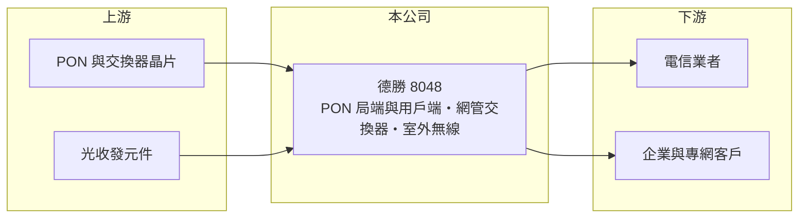

# 8048 德勝

> 上櫃｜[[產業索引-通信網路業|通信網路業]]｜上市（櫃）日期 2009/09/08

# 第一章：企業模式與商業藍圖

> [!info] 撰寫說明
> 本文由 Claude 依公開資料整理，架構比照 [[2330台積電]] 的四章研究，資料截至 2026-10-08。財務數字來源：Goodinfo 年度經營績效頁與基本資料頁、櫃買中心開放資料（基本資料、2026 年第二季資產負債與損益、本益比殖利率）。客戶結構與產品世代描述部分憑記憶整理，已標「待校對」。#待校對

評估光纖接取設備商，要看它能否在電信業者的光纖到府建設週期中持續得標，並在規格升級時跟上新世代產品。本章說明德勝科技（股票代號：8048，以下簡稱德勝）的商業模式。

## 一、核心定位：光纖接取網路設備

德勝成立於 1981 年，2009 年在櫃買中心掛牌，總部位於台北市南港區，實收資本額約 5.9 億元。依公司揭露的主要業務，德勝研發、製造與銷售光纖網路的局端設備、用戶端設備與網管交換器，另外也做室外無線網路設備。

光纖到府網路多採用 [[PON]] 架構：電信機房裡的局端設備（[[OLT]]）透過一條光纖與分光器，連到數十個用戶家中的用戶端設備（ONU 或 [[ONT]]）。德勝同時做局端與用戶端，能提供整套接取方案，這比只做用戶端的廠商更容易進入電信業者的系統標案。國內電信業者的光纖建設可能是重要需求來源（客戶結構待校對）。各產品的營收比重未查得。

## 二、產品世代：從 GPON 走向 10G PON

PON 技術每隔數年升級一次，從 GPON 的 2.5G 下行，到 XGS-PON 的 10G 對稱，再往 25G 與 50G 發展。每一次升級，電信業者都要更換局端板卡與用戶端設備，形成設備換機潮（世代描述待校對）。德勝 2023 年營收跳升到 17.9 億元，之後回到 10 億元左右，反映標案與升級週期的節奏（推估）。

## 三、長期方向

德勝的長期方向是跟著光纖網路升級推出新世代設備，並以網管交換器與室外無線設備擴大產品線，讓公司從單一接取設備延伸到更完整的網路方案。光纖到府與企業網路的建設是長期趨勢，只要能維持技術跟進，需求具延續性。

# 第二章：護城河深度與競爭優勢

在長期價值投資中，「護城河」指企業抵禦競爭、維持超額利潤的保護機制。本章分析德勝的優勢與限制。

## 一、護城河的組成

* **局端加用戶端的整合能力：** 局端與用戶端必須相容，能同時提供兩端設備的廠商，在系統標案中具有整體方案優勢。
* **電信業者認證與維運經驗：** 接取設備需要長期的互通測試與現場維運，既有供應商在後續擴充與換機時較具優勢。
* **穩定的獲利紀錄：** 2020 至 2025 年營業利益率都在 10% 以上，毛利率約 28% 至 35%，在網通設備廠中屬於穩定的一群。

## 二、主要競爭對手

| 對手 | 定位 | 對德勝的威脅 |
|---|---|---|
| [[5388中磊]]、[[3596智易]] | 大型寬頻 CPE 廠 | 在用戶端設備具規模優勢 |
| [[3380明泰]] | 網通 ODM 大廠 | 產品線完整 |
| 國際 PON 設備大廠 | 局端系統領先 | 在大型系統標案占優勢 |

## 三、守得住／守不住／觀察重點

守得住的是國內既有業者的系統與維運關係。守不住的是大型海外標案與用戶端設備的價格。長期觀察重點是 10G PON 世代的出貨比重、海外市場的拓展，以及營業利益率能否穩定在 15% 以上。

# 第三章：財務體質與盈利規模

資料日期：2026-10-08，表格是撰寫當時的快照；最新月營收、毛利率、累計 EPS 由自動排程寫在本筆記的屬性欄位（月營收、毛利率、累計EPS 等）。#待校對

財務報表是檢驗護城河是否真實存在的最終標準。本章用六年的三率、ROE 與資本報酬，檢視德勝的獲利品質。

## 一、多年度經營績效

| 年度 | 營收（新台幣） | [[毛利率]] | [[營業利益率]] | EPS（元） | [[ROE]] |
|---|---|---|---|---|---|
| 2020 | 7.81 億 | 32.9% | 10.8% | 2.69 | 14.9% |
| 2021 | 8.84 億 | 31.1% | 11.0% | 2.94 | 15.1% |
| 2022 | 10.8 億 | 30.1% | 13.1% | 2.43 | 12.1% |
| 2023 | 17.9 億 | 28.5% | 15.5% | 4.38 | 21.6% |
| 2024 | 10.2 億 | 31.4% | 13.7% | 2.36 | 11.6% |
| 2025 | 10.1 億 | 34.7% | 16.1% | 2.67 | 13.3% |
| 2026 上半年 | 6.44 億 | 33.7% | 17.2% | 1.50 | 未查得 |

德勝是本批公司中獲利最穩定的一家：六年都有兩位數的營業利益率，2021 至 2025 年平均 ROE 約 14.7%（推算），2020 至 2025 年營收年複合成長率約 5.3%（推算）。資產負債表也很保守，2026 年第二季負債約 4.9 億元且幾乎都是流動負債，股東權益約 11.8 億元，保留盈餘約 5.4 億元。最近一次現金股利每股 2.3 元，相對 2025 年 EPS 2.67 元，配發率約 86%（推算），長期維持高配息。2026 年上半年營業利益率提高到 17.2%，EPS 1.50 元。

## 二、[[ROIC]] 與 [[WACC]]：價值創造利差

**ROIC 推算：** 2025 年營業利益約 1.63 億元（10.1 億 × 16.1%），稅後約 1.30 億元。2026 年第二季股東權益約 11.8 億元，有息負債推估約 0.5 億元，投入資本約 12.3 億元，2025 年 ROIC 約 10.6%（推算）；以 2026 年上半年營業利益 1.10 億元年化，ROIC 約 14.4%（推算）。

**WACC 推算：** 台灣 10 年期公債 1.75%、市場風險溢酬 6%、β 取網通同業常見值 1.0，股東權益成本約 7.8%；負債成本 2.5%、稅後 2.0%；權益占投入資本約 96%，WACC 約 7.5%（推算）。

**結論：** 德勝的 ROIC 長期高於 WACC，代表本業穩定創造價值。不過公司幾乎沒有負債、現金多，資本效率的提升主要靠營收成長，而非財務槓桿。

# 第四章：總體風險與地緣政治

任何企業都無法脫離宏觀環境獨立存在。本章分析德勝長期必須面對的風險。

## 一、客戶集中與標案風險

接取設備的需求集中在少數電信業者，標案時程與規模決定營收高低。2023 年營收的高峰與 2024 年的回落，說明單一年度可能被大型標案大幅墊高。

## 二、技術世代風險

PON 規格持續升級，若在新世代產品的開發或認證進度落後，可能在換機潮中失去份額。大型國際設備商與中國大陸廠商在局端系統上具規模優勢。

## 三、零件與匯率

網通晶片與光學元件價格波動會影響成本，關鍵晶片供應集中於少數晶片商。若海外營收比重提高，匯率變動的影響也會增加。

# 專有名詞解析

## 應用

- **[[PON]]**：被動光纖網路，用一條光纖加分光器同時服務數十戶，是光纖到府的主流架構。
- **[[OLT]]**：光纖線路終端，放在電信機房的局端設備，負責管理與連接多個用戶端設備。
- **[[ONT]]**：光纖網路終端，放在用戶家中的光纖設備，把光訊號轉成網路或電話訊號。

## 金融

- **[[ROIC]]**：投入資本報酬率，稅後營業利益除以股東權益與有息負債的合計，衡量本業對所有資金提供者的報酬。
- **[[WACC]]**：加權平均資金成本，依股東權益與負債的比重加權計算的資金成本，ROIC 高於它才代表創造價值。

# 核心供應鏈

## 1. 上游：晶片與光元件
- PON 與交換器晶片、光收發元件供應商（實際供應商未查得）

## 2. 中游：德勝與同業
- 同業：[[5388中磊]]、[[3596智易]]、[[3380明泰]]

## 3. 下游：客戶
- 電信業者，例如 [[2412中華電]]（往來關係待校對）
- 企業與專網客戶

## 最新新聞
<!-- news:start -->
<!-- news:end -->

## 相關連結
- [公開資訊觀測站](https://mopsov.twse.com.tw/mops/web/t05st03?step=1&firstin=1&co_id=8048)
- [Goodinfo](https://goodinfo.tw/tw/StockDetail.asp?STOCK_ID=8048)
- [Yahoo 股市](https://tw.stock.yahoo.com/quote/8048)
- [鉅亨網新聞](https://www.cnyes.com/twstock/8048/news)
