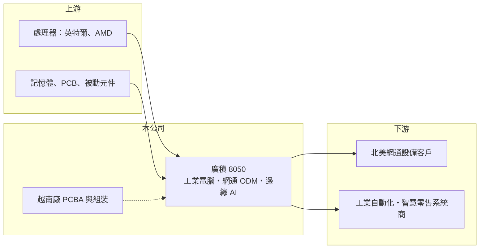

# 8050 廣積

> 上櫃｜[[產業索引-電腦及週邊設備業|電腦及週邊設備業]]｜上市（櫃）日期 2003/10/24

# 第一章：企業模式與商業藍圖

> [!info] 撰寫說明
> 精簡版，由 Claude 依公開資料整理，架構比照 [[2330台積電]]，資料截至 2026-10-08。來源：櫃買中心開放資料快照（基本資料、2026 年第二季資產負債與損益、月營收）、Wistock 部落格 2026 年整理（引述 MoneyDJ、經濟日報）。2024 年以前的年度財務數字這次未查得；轉投資描述憑記憶整理，已標「待校對」。公開資料有限。#待校對

廣積科技（以下簡稱廣積，英文 IBASE）是兼做自有品牌[[工業電腦]]與網通設備代工的中型廠，理解它的關鍵在於：它的營收主體是北美網通客戶的 [[ODM]] 訂單，而它想把重心轉向毛利較高的邊緣 AI 與應用系統。

- **核心業務：** 廣積成立於 2000 年，2003 年在櫃買中心掛牌。產品涵蓋工業電腦、[[邊緣 AI]]運算系統、網通設備與 ODM 服務，自有品牌為 IBASE（Wistock）。例如 2026 年推出的 3.5 吋單板電腦採用 Intel Core Ultra 處理器，主打邊緣 AI 運算。
- **營收結構：** 依 Wistock 整理，網通設備是最主要的營收來源，工業自動化與智慧零售是成長中的應用，另有智慧交通、醫療與 AIoT 等較小的領域。地區別以美洲超過四成最大，其次為亞洲與歐洲。具體產品別比重未查得。
- **營運據點：** 總部位於台灣，越南廠於 2026 年上半年啟用，提供 PCBA 與系統組裝產能，並已有大型 ODM 客戶指定在越南量產（Wistock）。合併報表中有約 6.9 億元的[[非控制權益]]，推估包含持股未達百分之百的子公司，依記憶包括工業顯示器廠 Litemax（晶達，待校對）。
- **長期方向：** 廣積的長期策略是從傳統網通 ODM 轉向邊緣 AI 與高附加價值的應用系統，並透過越南廠因應北美客戶「中國以外」生產的要求。公司也是 AMD 機器人夥伴網路的成員，預計 2026 年第四季進行概念驗證，最快 2027 年出現量產專案（Wistock）。

# 第二章：護城河深度與競爭優勢

廣積的護城河很窄，主要來自網通客戶的長期代工關係與工業電腦的設計導入，但網通 ODM 本身毛利不高、客戶集中，議價能力有限。

- **競爭優勢：** 網通設備與工業電腦都需要長期供貨與穩定品質，客戶導入一個平台後通常會合作多年。廣積已連續 25 年發放現金股利（Wistock），代表本業長期能產生現金。越南廠提早到位，在美國關稅與供應鏈轉移下，可能成為爭取北美 ODM 訂單的優勢。
- **主要對手：** 工業電腦同業包括 [[2395研華]]、[[6579研揚]]、[[6166凌華]]、[[8234新漢]]、[[2397友通]]、[[3088艾訊]]；網通設備代工方面則有 [[6245立端]] 與許多大型網通 ODM 廠。廣積兩邊都不是龍頭，必須靠特定客戶與產品專長競爭。
- **觀察重點：** 長期最該追蹤的是[[營業利益率]]能否回升。2026 年第一季營業利益率只有約 1%，第二季回升，上半年合計約 5.8%，毛利率約 24.9%，低於工業電腦同業常見的三成以上，反映網通代工比重高。邊緣 AI 與應用系統比重若能提高，毛利率與營益率才有結構性改善的空間。

# 第三章：財務體質與盈利規模

資料日期：2026-10-08，表格是撰寫當時的快照；最新月營收、毛利率、累計 EPS 由自動排程寫在本筆記的屬性欄位（月營收、毛利率、累計EPS 等）。#待校對

廣積的財務呈現「營收中等、毛利率偏低、業外占比高」的網通代工兼工業電腦廠樣貌，這次查得的年度數字有限。

| 期間 | 營收（億元） | [[毛利率]] | [[營業利益率]] | EPS（元） | [[ROE]] |
|---|---|---|---|---|---|
| 2021 | 未查得 | 未查得 | 未查得 | 未查得 | 未查得 |
| 2022 | 未查得 | 未查得 | 未查得 | 未查得 | 未查得 |
| 2023 | 未查得 | 未查得 | 未查得 | 未查得 | 未查得 |
| 2024 | 未查得 | 未查得 | 未查得 | 未查得 | 未查得 |
| 2025 | 未查得 | 未查得 | 未查得 | 1.44 | 約 4%（推算） |
| 2026 上半年 | 33.34 | 24.9% | 5.8% | 2.69 | 約 5.3%（半年，推算） |

（來源：2025 年 EPS 為 Wistock 引述資料，描述為近年低點；2026 年上半年為櫃買中心綜合損益資料。ROE 以 EPS ÷ 每股淨值 37.03 元推算。）

- **營收規模：** 2026 年 1 至 8 月累計營收約 45.45 億元，年增約 17.6%，6 月單月營收創約 40 個月新高（Wistock）。以此推估廣積2026 年全年營收約在 60 億至 70 億元之間（推估）。多年度營收與年複合成長率未查得。
- **獲利：** 2026 年上半年營業利益 1.94 億元，業外收益約 1.87 億元，母公司淨利 3.95 億元，業外貢獻接近一半，來源未查得（推估包含轉投資收益或匯兌）。評估本業時應以營業利益為準。
- **財務特色：** 2026 年第二季總資產約 148.1 億元、負債約 66.3 億元，負債比約 45%，母公司權益約 74.9 億元，每股淨值 37.03 元。非流動負債約 32.2 億元，推估包含長期借款，可能與越南廠投資有關（推估）。2026 年發放現金股利 2.147 元，已連續 25 年配發現金股利（Wistock）。自由現金流是否長期為正未查得。
- **[[ROIC]] 與 [[WACC]]：** 以 2026 年上半年營業利益 1.94 億元年化約 3.88 億元、稅率 20% 計算，稅後營業利益約 3.10 億元；有息負債未查得，投入資本以權益總計 81.8 億元到總資產 148.1 億元為區間，ROIC 約 2.1% 至 3.8%（推算，年化）。WACC 以 [[CAPM]] 推估：無風險利率 1.75%、市場風險溢酬 6%、β 假設 0.9（工業電腦股常見值），權益成本約 7.2%；稅後負債成本 2%、負債占三成，WACC 約 5.6%（推算）。以本業計算，ROIC 低於 WACC，廣積目前的股東報酬相當程度仰賴業外收益；轉型到高毛利產品是提升資本效率的關鍵。

# 第四章：總體風險與地緣政治

廣積的風險集中在網通客戶集中、轉型執行與新廠成本，屬於穩定配息但成長仰賴轉型的公司。

- **產業週期：** 網通設備需求跟著企業與電信業者的資本支出走，客戶在景氣放緩時會大幅去化庫存，代工廠的訂單波動會被放大。2025 年 EPS 降到近年低點，推估與網通客戶的庫存調整有關（推估）。
- **營運風險：** 網通 ODM 客戶集中在北美少數大客戶，客戶轉單或產品世代結束，營收可能大幅變動。越南廠初期的良率、人力與管理成本可能壓縮毛利。邊緣 AI 產品的研發投入需要時間才能轉成營收。
- **其他風險：** 美洲營收超過四成，美國關稅與新台幣升值都會影響獲利。記憶體與處理器缺貨或漲價時，代工模式較難完全轉嫁成本。

# 專有名詞解析

## 應用

- **[[邊緣 AI]]**：在終端設備或現場電腦上直接執行 AI 推論，不必把資料傳回雲端，延遲低、隱私性高。

## 金融

- **[[非控制權益]]**：合併子公司中不屬於母公司股東的權益，比例高代表有許多非全資子公司。

## 產業

- **[[工業電腦]]**：用於工廠自動化、交通、醫療等場域的電腦，強調耐用、長期供貨與客製化。
- **[[ODM]]**：原廠委託設計製造，代工廠同時負責產品設計與生產，再由品牌商掛牌銷售。

# 核心供應鏈

- 上游：處理器來自 [[INTC英特爾]]、[[AMD超微]]，另需記憶體、PCB 與被動元件。
- 下游／客戶：北美網通設備品牌（ODM 客戶未點名，#待校對），以及工業自動化、智慧零售、交通與醫療的系統整合商。
- 同業：[[2395研華]]、[[6579研揚]]、[[6166凌華]]、[[8234新漢]]、[[2397友通]]、[[6245立端]]。

## 最新新聞
<!-- news:start（自動產生，請勿手動編輯此範圍） -->
- 2026-10-12 📰 媒體 17:53｜營收速報 - 廣積(8050)9月營收11.45億元年增率高達167.1％｜[鉅亨網](https://news.cnyes.com/news/id/6628293)

完整紀錄：[[8050廣積 新聞]]
<!-- news:end -->

## 相關連結
- [公開資訊觀測站](https://mopsov.twse.com.tw/mops/web/t05st03?step=1&firstin=1&co_id=8050)
- [Goodinfo](https://goodinfo.tw/tw/StockDetail.asp?STOCK_ID=8050)
- [Yahoo 股市](https://tw.stock.yahoo.com/quote/8050)
- [鉅亨網新聞](https://www.cnyes.com/twstock/8050/news)
