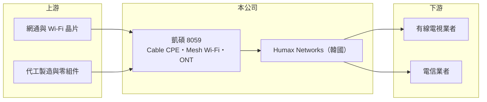

# 8059 凱碩

> 上櫃｜[[產業索引-通信網路業|通信網路業]]｜上市（櫃）日期 2010/03/16

# 第一章：企業模式與商業藍圖

> [!info] 撰寫說明
> 本文由 Claude 依公開資料整理，架構比照 [[2330台積電]] 的四章研究，資料截至 2026-10-08。財務數字來源：Goodinfo 年度經營績效頁與基本資料頁（含 2026 年公告標題）、櫃買中心開放資料（基本資料、2026 年第二季資產負債與損益、本益比殖利率）、富邦證券公告標題。Humax Networks 併入的時間點依營收變化推估，已標「待校對」。#待校對

評估一家靠併購改變規模的公司，要分清楚營收成長來自本業擴張還是[[合併報表]]，並觀察併購後的整合能否帶來獲利。本章說明凱碩科技（股票代號：8059，以下簡稱凱碩）如何透過取得韓國 Humax Networks，從小型網通廠變成營收數十億元的寬頻設備商。

## 一、核心定位：寬頻用戶端設備

凱碩成立於 1998 年，2010 年在櫃買中心掛牌，總部位於台北市松山區，實收資本額約 11.6 億元。依公司揭露的主要業務，凱碩開發、製造與銷售寬頻纜線用戶端設備（Broadband Cable [[CPE]]）、網格無線路由系統（[[Mesh Wi-Fi]]）與 [[ONT]] 等產品。這些都是放在用戶家中、連接有線電視或光纖網路的設備，買方主要是電信與有線電視業者。各產品的營收比重未查得。

## 二、結構轉折：取得韓國 Humax Networks

凱碩透過子公司 Superhero Patterns, Inc.（SPI）投資韓國的 Humax Networks, Inc.，SPI 完成對 Humax Networks 約 3,872 萬美元的增資股款繳納（公告日期未查得）。Humax Networks 是韓國機上盒與寬頻設備商 Humax 分出的網通事業，從事廣播與網路通訊設備銷售。凱碩合併營收從 2024 年的 4.11 億元躍升到 2025 年的 76.5 億元，顯示 Humax Networks 自 2025 年起併入合併報表（推估，待校對）。2026 年 9 月，Humax Networks 公告將吸收合併其母公司 SPI，以簡化持股架構；凱碩本身也在 2026 年 8 月完成減資登記。

## 三、長期方向

併購後的凱碩，目標是結合 Humax Networks 在歐美與韓國電信業者的客戶基礎，以及台灣的研發與供應鏈資源，成為具規模的寬頻 CPE 供應商（推估）。這個策略的成敗不在營收，而在於能否把 Humax Networks 的低毛利、高費用結構改善到穩定獲利。

# 第二章：護城河深度與競爭優勢

在長期價值投資中，「護城河」指企業抵禦競爭、維持超額利潤的保護機制。本章分析凱碩在 CPE 產業的位置。

## 一、護城河的組成

* **併購取得的電信客戶：** Humax Networks 長期供應國際電信與有線電視業者，既有的業者認證與出貨實績是凱碩自行開發難以快速取得的資產（客戶細節待校對）。
* **規模：** 合併後營收規模躋身台灣中型 CPE 廠，對零件採購與代工議價較有利。

CPE 產業的產品差異化有限，規格由晶片商參考設計主導，護城河整體偏窄。2025 年毛利率 9.21%、營業利益率 -3.52%，說明併入後的業務仍缺乏定價能力。

## 二、主要競爭對手

| 對手 | 定位 | 對凱碩的威脅 |
|---|---|---|
| [[5388中磊]] | 全球寬頻 CPE 大廠 | 規模與客戶數最大 |
| [[3596智易]] | 電信 CPE 與閘道器 | 爭取同一批歐洲電信業者 |
| [[2419仲琦]] | 有線電視數據機 | 在 Cable CPE 直接競爭 |
| 美系與中國大陸 CPE 廠 | 產品線完整或價格低 | 壓低報價 |

## 三、守得住／守不住／觀察重點

守得住的是 Humax Networks 既有業者的換機需求。守不住的是新標案的價格。長期觀察重點是併購後毛利率能否回到 15% 以上、營業利益能否穩定轉正，以及 SPI 合併案完成後的持股與股東權益結構。

# 第三章：財務體質與盈利規模

資料日期：2026-10-08，表格是撰寫當時的快照；最新月營收、毛利率、累計 EPS 由自動排程寫在本筆記的屬性欄位（月營收、毛利率、累計EPS 等）。#待校對

財務報表是檢驗護城河是否真實存在的最終標準。本章用六年的三率、ROE 與資本報酬，檢視凱碩併購前後的獲利品質。

## 一、多年度經營績效

| 年度 | 營收（新台幣） | [[毛利率]] | [[營業利益率]] | EPS（元） | [[ROE]] |
|---|---|---|---|---|---|
| 2020 | 13.0 億 | 7.39% | -5.06% | -0.04 | -0.38% |
| 2021 | 16.9 億 | 1.20% | -9.19% | -0.80 | -7.87% |
| 2022 | 11.5 億 | 15.0% | -2.05% | 0.09 | 0.88% |
| 2023 | 5.56 億 | 20.0% | -18.1% | 0.04 | 0.36% |
| 2024 | 4.11 億 | -39.9% | -93.0% | -1.84 | -20.3% |
| 2025 | 76.5 億 | 9.21% | -3.52% | -2.39 | -30.0% |
| 2026 上半年 | 48.6 億 | 14.1% | 0.50% | -0.65 | 未查得 |

併購前的凱碩已連續多年本業虧損，2024 年營收只剩 4 億元。2025 年併入 Humax Networks 後營收放大近 19 倍，但營業利益率仍為負，EPS -2.39 元。2026 年上半年毛利率回升到 14.1%，營業利益小幅轉正，但業外損失與所得稅讓稅後仍虧損。2021 至 2025 年平均 ROE 約 -11.4%（推算）；因為併購造成營收規模斷層，營收年複合成長率不具參考意義。近年未配發現金股利，2026 年第二季保留盈餘為 -1.37 億元。

## 二、[[ROIC]] 與 [[WACC]]：價值創造利差

**ROIC 推算：** 2025 年營業損失約 2.69 億元（76.5 億 × -3.52%）。2026 年第二季權益總計約 13.5 億元，負債約 74.6 億元且以流動負債為主（多為應付帳款等營運負債，推估），假設有息負債約 15 億元（推估），投入資本約 28.5 億元，2025 年 ROIC 約 -9.4%（推算）；以 2026 年上半年營業利益 0.24 億元年化，ROIC 約 1.4%（推算）。

**WACC 推算：** 台灣 10 年期公債 1.75%、市場風險溢酬 6%、β 取網通同業常見值 1.2，股東權益成本約 9.0%；負債成本假設 4%（含韓國子公司借款）、稅後 3.2%；權益占投入資本約 47%，WACC 約 5.9%（推算）。

**結論：** 凱碩的 ROIC 長期為負或接近零，明顯低於 WACC，併購至今尚未創造價值。由於營運負債龐大、權益相對薄，未來若營業利益率能提升到 2% 至 3%，ROIC 就有機會超過資金成本，營運槓桿的方向值得追蹤。

# 第四章：總體風險與地緣政治

任何企業都無法脫離宏觀環境獨立存在。本章分析凱碩長期必須面對的風險。

## 一、併購整合風險

Humax Networks 規模遠大於凱碩原有業務，跨國管理、成本控制與組織整合都是挑戰。SPI 合併案與相關臨時股東會延後召開，顯示整合過程仍有變數。

## 二、財務結構風險

2026 年第二季總負債約 74.6 億元、權益約 13.5 億元，負債比約 85%。營運資金若被客戶延遲付款或庫存積壓占用，流動性壓力會明顯升高。

## 三、產業與匯率風險

CPE 需求依賴電信業者的換機週期，單一業者延後採購就會影響營收。公司同時有新台幣、韓圜與美元的收支，匯率波動會影響合併損益。

# 專有名詞解析

## 應用

- **[[CPE]]**：用戶端設備，放在家庭或企業端、連接電信或有線電視網路的設備，例如數據機、閘道器、分享器。
- **[[Mesh Wi-Fi]]**：由多台無線節點互相串連組成的家用網路，讓訊號覆蓋整個住家而不需拉線。
- **[[ONT]]**：光纖網路終端，放在用戶家中的光纖設備，把光訊號轉成網路或電話訊號。

## 金融

- **[[合併報表]]**：母公司把持有控制權的子公司營收、資產與負債全部合計編製的財務報表。
- **[[ROIC]]**：投入資本報酬率，稅後營業利益除以股東權益與有息負債的合計，衡量本業對所有資金提供者的報酬。
- **[[WACC]]**：加權平均資金成本，依股東權益與負債的比重加權計算的資金成本，ROIC 高於它才代表創造價值。

# 核心供應鏈

## 1. 上游：晶片與製造
- 網通與 Wi-Fi 晶片：[[AVGO博通]]、[[QCOM高通]] 等晶片商（實際採用廠牌未查得）

## 2. 中游：凱碩與同業
- 子公司：Superhero Patterns, Inc.、Humax Networks, Inc.
- 同業：[[5388中磊]]、[[3596智易]]、[[2419仲琦]]

## 3. 下游：客戶
- 國際電信與有線電視業者（具體客戶未查得）

## 最新新聞
<!-- news:start（自動產生，請勿手動編輯此範圍） -->
- 2026-10-07 🏛️ 重訊 18:57｜代重要子公司Humax Networks, Inc.公告董事會決議延後 召開股東臨時會｜[觀測站](https://mops.twse.com.tw/mops/#/web/t05st01)

完整紀錄：[[8059凱碩 新聞]]
<!-- news:end -->

## 相關連結
- [公開資訊觀測站](https://mopsov.twse.com.tw/mops/web/t05st03?step=1&firstin=1&co_id=8059)
- [Goodinfo](https://goodinfo.tw/tw/StockDetail.asp?STOCK_ID=8059)
- [Yahoo 股市](https://tw.stock.yahoo.com/quote/8059)
- [鉅亨網新聞](https://www.cnyes.com/twstock/8059/news)
