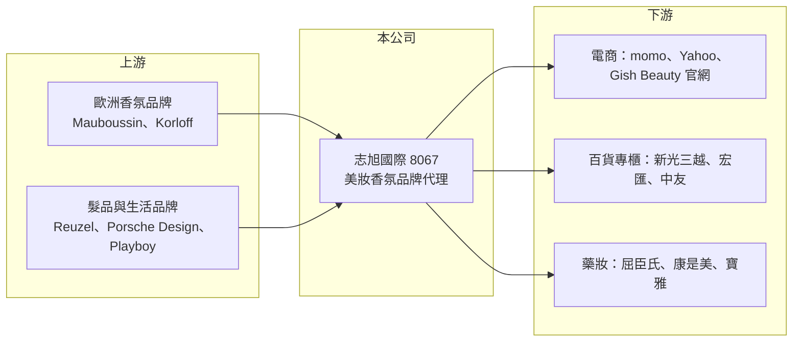

# 8067 志旭

> 上櫃｜[[產業索引-電子通路業|電子通路業]]｜上市（櫃）日期 2004/04/23

# 第一章：企業模式與商業藍圖

> [!info] 撰寫說明
> 精簡版，由 Claude 依公開資料整理，架構比照 [[2330台積電]] 的四章研究，資料截至 2026-10-08。來源：富果研究 2025-12-19 法說會摘要、Goodinfo 經營績效頁、櫃買中心開放資料快照（基本資料、每月營收、2026 年第二季損益與資產負債）。公開資料有限，轉型年份與營收比重未查得。#待校對

志旭國際雖然仍列在電子通路業，實際上已從儲存媒體代理商轉型為美妝、香氛與生活風格品牌的代理通路。本章說明它的新商業模式與規模。

- **核心業務：** 志旭成立於 1989 年，早年代理光碟片等儲存媒體，近年轉型專注於高毛利的美妝與生活風格市場（轉型確切年份未查得）。現在的產品組合包括奢華香氛（Mauboussin 夢寶星、Korloff）、專業髮品與護理（Reuzel）、風格配件（Porsche Design），以及 Playboy、Pure Paw Paw 等沐浴與生活用品，形成沙龍護理、國際香水、生活沐浴三層品牌組合。
- **營收結構：** 公司未公開各品牌或各通路的營收比重。整體規模很小，2025 年營收約 1.07 億元，2026 年 1 至 8 月營收約 0.60 億元，每月營收多在 600 萬至 900 萬元之間。
- **營運據點：** 以台灣市場為主，採[[全通路]]經營：線上透過 momo、Yahoo 等電商平台與自營官網 Gish Beauty，實體則在新光三越、宏匯廣場、中友百貨設有 Gish Beauty 專櫃，並進入屈臣氏、康是美、[[5904寶雅]] 等連鎖藥妝通路。
- **長期方向：** 策略包括引進新品牌、深化既有[[品牌代理]]合作、擴大線上與線下通路，並導入數位工具優化供應鏈與庫存周轉。管理層的目標是透過高毛利產品與直營電商，盡快達到損益兩平。

# 第二章：護城河深度與競爭優勢

品牌代理商的護城河取決於代理權的穩定度與通路網路，志旭在兩方面都還在建立中。本章分析它的條件與競爭者。

- **競爭優勢：** 志旭的優勢是精選的歐洲品牌組合與已經建立的百貨、藥妝、電商全通路網路。品牌方要進入台灣市場，需要有人處理進口、法規登記、通路上架與行銷，這是代理商存在的價值。直營電商能降低外部通路的抽成，提高毛利。
- **主要對手：** 台灣的美妝香氛代理商眾多，包括大型品牌代理集團與國際品牌的台灣分公司，也有寶雅等通路自行引進品牌。志旭規模小，議價能力與行銷預算都有限。
- **觀察重點：** 第一，營業費用能否隨營收成長而攤薄，讓營業利益轉正。第二，主力品牌代理合約是否穩定續約，避免品牌成長後被收回自營。第三，高毛利品牌占比能否持續提高。

# 第三章：財務體質與盈利規模

資料日期：2026-10-08，表格是撰寫當時的快照；最新月營收、毛利率、累計 EPS 由自動排程寫在本筆記的屬性欄位（月營收、毛利率、累計EPS 等）。#待校對

志旭的財報顯示轉型後毛利率明顯提高，但營收規模太小，無法支撐營業費用，本業長期虧損。本章用多年度數據說明這個結構。

| 年度 | 營收（億元） | [[毛利率]] | [[營業利益率]] | EPS（元） | [[ROE]] |
|---|---|---|---|---|---|
| 2021 | 2.28 | 30.0% | -12.1% | -0.92 | -14.5% |
| 2022 | 1.47 | 37.0% | -15.9% | -1.11 | -11.7% |
| 2023 | 1.04 | 40.3% | -31.5% | -0.77 | -9.81% |
| 2024 | 1.09 | 45.2% | -21.4% | -0.71 | -9.03% |
| 2025 | 1.07 | 41.1% | -27.4% | -0.59 | -8.06% |
| 2026 上半年 | 0.45 | 54.0% | -22.6% | 0.03 | 未查得 |

- **營收規模：** 2021 至 2025 年營收從 2.28 億元降到 1.07 億元，年複合成長率約 -17.2%（推算），反映舊有儲存媒體業務萎縮、新品牌業務尚未補上。2026 年 1 至 8 月營收較前一年同期減少約 18.5%。
- **獲利：** 毛利率從 30% 一路升到 2026 年上半年的 54%，證明產品組合確實轉向高毛利；但營業利益率長期在 -12% 至 -32% 之間，近 5 年平均 ROE 約 -10.6%（推算）。2026 年上半年每股盈餘 0.03 元，是靠業外收入抵銷了約 1,027 萬元的營業損失。
- **財務特色：** 2026 年第二季末股東權益只有 1.45 億元、負債總計 2.24 億元，負債高於權益。實收資本額 2.07 億元，長期虧損使淨值低於股本，Goodinfo 顯示長期平均現金股利僅約 0.3 元，近年沒有配息能力。

**[[ROIC]] 與 [[WACC]]：** 有息負債明細未查得，假設約 1 億元（推估）。2025 年營業損失約 0.29 億元（1.07 億 × -27.4%），虧損不計稅，投入資本為權益約 1.45 億元加有息負債 1 億元，約 2.45 億元，ROIC 約 -12%（推算），為負值。WACC 用 CAPM 推估：無風險利率 1.75%、市場風險溢酬 6%、β 取 1.0（假設），股東權益成本約 7.8%，小型虧損公司實際要求報酬可能更高；負債成本 3%、稅率 20%，以權益六成、負債四成加權，WACC 約 5.6%（推算）。結論是：志旭的 ROIC 長期為負、遠低於 WACC，公司持續消耗股東資本；只有營收規模擴大到能攤平費用，ROIC 才可能轉正。

# 第四章：總體風險與地緣政治

志旭的風險集中在規模不足與財務體質。本章整理需要留意的部分。

- **產業週期：** 美妝與香氛屬於可選消費，景氣轉弱時百貨與專櫃銷售會先受影響。電商平台的促銷檔期（雙 11、雙 12）帶動營收，但也壓縮毛利與增加行銷費用。
- **營運風險：** 營收規模約 1 億元，營業費用相對固定，只要營收不成長就難以轉虧為盈。品牌代理權若到期不續約，或品牌方決定自行進入台灣，營收會立即流失。
- **其他風險：** 淨值低於股本且負債高於權益，若虧損持續，可能需要增資或處分資產。進口商品以歐元等外幣計價，匯率變動會影響成本；化粧品進口也須符合台灣的法規登錄要求。

# 專有名詞解析

## 金融

- **[[ROIC]]**：投入資本報酬率，稅後營業利益除以股東權益加有息負債，衡量本業運用資本的效率。
- **[[WACC]]**：加權平均資金成本，股東權益成本與負債成本依資本結構加權，是 ROIC 必須超越的門檻。

## 產業

- **[[品牌代理]]**：取得國外品牌在特定市場的進口與銷售權，負責法規、通路、行銷的商業模式，風險在於代理權可被收回。
- **[[全通路]]**：同時經營電商、百貨專櫃、連鎖藥妝等線上線下通路，讓消費者在任何管道都能購買。

# 核心供應鏈

- 上游：Mauboussin、Korloff、Reuzel、Porsche Design、Playboy、Pure Paw Paw 等國外品牌。
- 下游／客戶：momo、Yahoo 購物、自營官網 Gish Beauty；新光三越、宏匯廣場、中友百貨；屈臣氏、康是美、[[5904寶雅]]。
- 同業：台灣美妝香氛代理商與國際品牌在台分公司（未逐一查證）。

## 最新新聞
<!-- news:start -->
<!-- news:end -->

## 相關連結
- [公開資訊觀測站](https://mopsov.twse.com.tw/mops/web/t05st03?step=1&firstin=1&co_id=8067)
- [Goodinfo](https://goodinfo.tw/tw/StockDetail.asp?STOCK_ID=8067)
- [Yahoo 股市](https://tw.stock.yahoo.com/quote/8067)
- [鉅亨網新聞](https://www.cnyes.com/twstock/8067/news)
