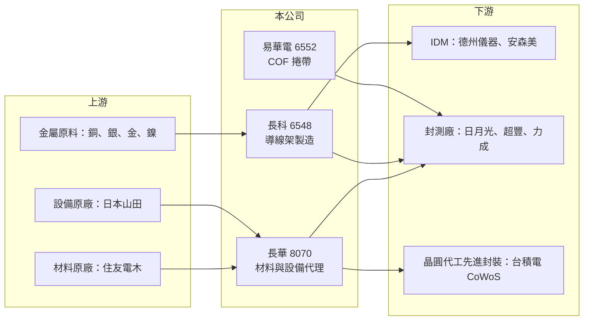

# 8070 長華

> 上市｜[[產業索引-電子通路業|電子通路業]]｜上市（櫃）日期 2007/12/31

# 第一章：企業模式與商業藍圖

> [!info] 撰寫說明
> 精簡版，由 Claude 依公開資料整理，架構比照 [[2330台積電]] 的四章研究，資料截至 2026-10-08。來源：富果研究 2026-01-28 法說會摘要、Goodinfo 經營績效頁、證交所開放資料快照（基本資料、2026 年第二季損益與資產負債）。集團持股比例未查得。#待校對

長華電材是台灣最重要的半導體封裝材料通路與製造集團之一，同時代理封裝材料與設備，並透過子公司自製導線架。本章說明這個「代理＋製造＋轉投資」的集團結構。

- **核心業務：** 長華成立於 1989 年，2007 年上市，每股面額新台幣 1 元。母公司主要代理[[封裝材料]]，尤其是住友電木的[[封裝樹脂]]（molding compound），也代理日本山田（Yamada）的壓模機，這款設備用於台積電 [[CoWoS]] 先進封裝製程。子公司 [[6548長科]] 開發與製造[[導線架]]，轉投資 [[6552易華電]] 生產電視面板驅動 IC 用的 [[COF]] 捲帶。
- **營收結構：** 法說會資料沒有公開各事業的營收比重。從集團結構看，營收由材料與設備代理、導線架製造兩大塊組成，導線架業務透過長科併入合併營收（推估）。合併淨利中有相當比例屬於非控制權益，2026 年上半年合併淨利 14.3 億元中，歸屬母公司約 9.1 億元。
- **營運據點：** 導線架產能分布在中國、馬來西亞與台灣。中國的 QFN 產能自 2024 年起滿載，計畫兩年內擴充為三倍；馬來西亞廠 2026 年第一季緊急擴產，並規劃 2027 年新廠導入蝕刻製程；台灣則建置與蘇州廠相當的蝕刻產能，以分散生產風險。
- **長期方向：** 一是材料端隨銅、銀、金、鎳價格上漲調整導線架與樹脂售價；二是擴大先進封裝設備代理，山田 CoWoS 壓模機的月產能由 1.5 台提高到 6 台，並開發點膠機與切割機；三是在中國以外擴充產能，回應客戶的「中國加一」需求。

# 第二章：護城河深度與競爭優勢

長華的護城河來自長期的原廠代理關係、導線架的規模與客戶認證，以及與先進封裝的連結。本章分析這些優勢。

- **競爭優勢：** 封裝材料一旦通過封測廠與 IDM 認證，更換材料需要重新驗證，轉換成本高，因此住友電木等原廠和長華的長期代理關係很穩定。導線架方面，集團是德州儀器（TI）最大的導線架供應商，約占其採購量的五至六成，規模與良率形成成本優勢。
- **主要對手：** 導線架同業有 [[2351順德]]、[[5285界霖]]，以及日本、韓國與中國的導線架廠；材料與設備代理則與 [[5434崇越]]、[[3010華立]] 等競爭。先進封裝設備方面，[[6187萬潤]]、[[6640均華]]、[[3583辛耘]] 等台灣設備廠也積極切入。
- **觀察重點：** 第一，CoWoS 壓模機的出貨量與下一代機種能否如期量產。第二，導線架漲價能否轉嫁金屬成本，維持毛利率在 18% 以上。第三，客戶集中於 TI 等 IDM，若大客戶自製或轉單，影響會很大。

# 第三章：財務體質與盈利規模

資料日期：2026-10-08，表格是撰寫當時的快照；最新月營收、毛利率、累計 EPS 由自動排程寫在本筆記的屬性欄位（月營收、毛利率、累計EPS 等）。#待校對

長華兼具通路與製造特性，營業利益率約一成，明顯高於一般電子通路商。本章用多年度數據檢視它的獲利能力與資本效率。

| 年度 | 營收（億元） | [[毛利率]] | [[營業利益率]] | EPS（元） | [[ROE]] |
|---|---|---|---|---|---|
| 2021 | 207 | 20.1% | 12.4% | 2.54 | 21.1% |
| 2022 | 219 | 23.2% | 15.7% | 3.16 | 23.0% |
| 2023 | 165 | 18.6% | 10.2% | 2.19 | 12.5% |
| 2024 | 172 | 20.3% | 11.2% | 2.32 | 12.0% |
| 2025 | 194 | 18.5% | 11.1% | 1.02 | 6.31% |
| 2026 上半年 | 115.5 | 18.8% | 12.0% | 1.30 | 未查得 |

- **營收規模：** 營收在 2022 年達 219 億元高峰，2023 年隨半導體庫存調整降到 165 億元，2025 年回升到 194 億元（年增約 12%）。2021 至 2025 年年複合成長率約 -1.6%（推算），2026 年上半年營收 115.5 億元，回升明顯。
- **獲利：** 2025 年 EPS 降到 1.02 元，主因是第四季一次認列易華電資產與商譽減損約 7.25 億元，影響 EPS 約 0.93 元，屬非現金項目。排除這項減損，2025 年本業獲利與 2024 年相近。近 5 年平均 ROE 約 15.0%（推算）。
- **財務特色：** 2026 年第二季末總資產 522 億元、權益總計 318 億元，其中「其他權益」高達 155 億元，主要是持有信越化學、旺詮等股票的未實現評價利益。公司 2024 年度配發現金股利 2.7 元，並表示 2025 年度股利目標不低於此水準（以董事會決議為準）。

**[[ROIC]] 與 [[WACC]]：** 有息負債明細未查得，以負債總計 204 億元的一半約 100 億元推估。2025 年稅後營業利益約 17.2 億元（194 億 × 11.1% × 0.8）。若投入資本採權益總計 318 億元加有息負債 100 億元，ROIC 約 4.1%；扣除屬於金融資產評價的其他權益 155 億元後，以營業相關資本約 263 億元計，ROIC 約 6.5%（皆為推算）。2026 年上半年營業利益 13.9 億元年化後，同口徑 ROIC 約 5.3% 至 8.4%（推算）。WACC 用 CAPM 推估：無風險利率 1.75%、市場風險溢酬 6%、β 取 1.0（半導體材料股常見值，假設），股東權益成本約 7.8%；負債成本 2.5%、稅率 20%，以權益七成、負債三成加權，WACC 約 6.1%（推算）。結論是：以營業資本計算，長華的 ROIC 略高於 WACC，本業仍在創造價值；但大量資本鎖在金融資產上，若以全部帳面資本計算則報酬率低於資金成本，資本配置效率是長期觀察重點。

# 第四章：總體風險與地緣政治

長華的風險包括半導體週期、金屬價格、客戶集中與地緣政治。本章整理主要風險。

- **產業週期：** 導線架與封裝材料用於類比、電源、車用等成熟封裝，需求隨半導體庫存循環起伏，2023 年營收下滑兩成多就是例子。先進封裝設備則依賴 AI 晶片的 CoWoS 擴產，若擴產放緩，設備訂單會快速減少。
- **營運風險：** 導線架的主要成本是銅、銀、金、鎳等金屬，價格上漲若無法即時轉嫁，毛利率會受壓。客戶集中於德州儀器等少數 IDM，轉投資易華電也曾產生大額減損，顯示轉投資事業的風險。
- **其他風險：** 中國產能占比高，面臨美中關係與供應鏈移轉壓力，這也是公司加速擴充馬來西亞與台灣產能的原因。持有大量股票使淨值隨股價波動；新台幣匯率變動也會造成匯兌損益。

# 專有名詞解析

## 半導體

- **[[封裝材料]]**：晶片封裝所需的樹脂、導線架、基板、焊線等材料，需經封測廠與 IDM 長期認證。
- **[[封裝樹脂]]**：包覆並保護晶片的環氧樹脂材料（molding compound），影響散熱與可靠度。
- **[[導線架]]**：承載晶片並把訊號引出到電路板的金屬框架，用於 QFN、SOP 等傳統封裝，主要材料為銅。
- **[[CoWoS]]**：台積電的 2.5D 先進封裝技術，把 GPU 與 HBM 記憶體並排放在矽中介層上，是 AI 晶片的主流封裝。
- **[[COF]]**：薄膜覆晶封裝，把驅動 IC 直接貼在可撓式薄膜上，主要用於面板驅動 IC。

## 金融

- **[[ROIC]]**：投入資本報酬率，稅後營業利益除以股東權益加有息負債，衡量本業運用資本的效率。

# 核心供應鏈

- 上游：住友電木（封裝樹脂）、日本山田（壓模機）、金屬原料供應商；持有 [[4063信越化學]] 股票（屬投資）。
- 本公司集團：[[6548長科]]（導線架）、[[6552易華電]]（COF）。
- 下游／客戶：德州儀器、安森美等 IDM；[[3711日月光投控]]、[[2441超豐]]、[[6239力成]] 等封測廠（未逐一查證為直接客戶）；[[2330台積電]] CoWoS 製程使用山田壓模機。
- 同業：[[2351順德]]、[[5285界霖]]、[[5434崇越]]、[[3010華立]]、[[6187萬潤]]、[[6640均華]]、[[3583辛耘]]。

## 最新新聞
<!-- news:start -->
<!-- news:end -->

## 相關連結
- [公開資訊觀測站](https://mopsov.twse.com.tw/mops/web/t05st03?step=1&firstin=1&co_id=8070)
- [Goodinfo](https://goodinfo.tw/tw/StockDetail.asp?STOCK_ID=8070)
- [Yahoo 股市](https://tw.stock.yahoo.com/quote/8070)
- [鉅亨網新聞](https://www.cnyes.com/twstock/8070/news)
