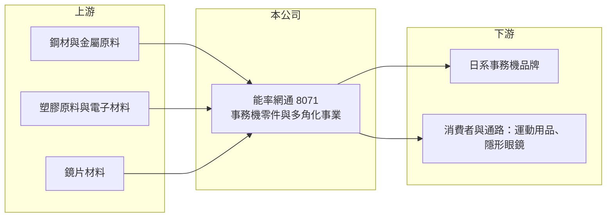

# 8071 能率網通

> 上櫃｜[[產業索引-電子零組件業|電子零組件業]]｜上市（櫃）日期 2003/12/29

# 第一章：企業模式與商業藍圖

> [!info] 撰寫說明
> 精簡版，由 Claude 依公開資料整理，架構比照 [[2330台積電]]，資料截至 2026-10-08。來源：櫃買中心開放資料快照（基本資料、2026 年第二季資產負債與損益、本益比殖利率）、Goodinfo 經營績效頁、nStock 公司簡介、CMoney 報導標題。事業別比重與集團關係依記憶整理，公開資料有限，已標註待校對。#待校對

能率網通（以下簡稱能率網通）是一家業務相當多角化的公司，核心是[[事務機]]零件製造，另外經營金屬沖壓與模具、電子材料與運動用品貿易、影音代理與隱形眼鏡。理解它的關鍵在於：這是一家由集團資源組合而成的控股型公司，各事業規模都不大，整體獲利能力取決於核心零件業務能否撐起其他事業的成本。

- **核心業務：** 能率網通成立於 1993 年，總部在新北市汐止，2003 年 12 月在櫃買中心掛牌，實收資本額約 6.01 億元，董事長為胡湘麒、總經理為洪再發。依 nStock 介紹，公司製造與銷售事務機零組件、電子零件、光電產品與運動用品；集團事業另包括金屬沖壓與模具製造、電子材料貿易、運動用品貿易、影音代理，以及[[隱形眼鏡]]製造銷售。CMoney 報導標題將它定位為事務機零件製造商。
- **營收結構：** 事業別比重未查得。依記憶，事務機（印表機、影印機）零件與沖壓件是主要營收來源，隱形眼鏡等新事業規模仍小（待校對）。
- **營運據點：** 總部在汐止，生產據點未查得。依 nStock 資料，子公司包括正能量智能，2025 年向同一最終母公司旗下的姐妹公司買下捷誠科技；Goodinfo 公告另提到子公司能遠國際與精能光學。
- **長期方向：** 依記憶，能率網通屬於能率集團，與 [[2374佳能]]、[[5392能率]]、[[7777能率亞洲]] 為關係企業（待校對）。事務機市場因無紙化而長期萎縮，公司的長期方向是透過集團內的併購與新事業（如隱形眼鏡、智能產品）尋找新的成長來源。

# 第二章：護城河深度與競爭優勢

能率網通的護城河很弱，主要依賴與事務機品牌的長期配合關係，新事業尚未建立競爭優勢。

- **競爭優勢：** 事務機零件需要配合日系品牌的設計與品質標準，供應商一旦通過認證，通常能隨機種長期供貨，這是公司核心業務的主要穩定來源。集團內的資源整合，讓公司能取得模具、沖壓與貿易等能力，但也使業務分散、難以聚焦。
- **主要對手：** 事務機零件與沖壓件領域有大量台灣與中國的中小型零件廠競爭，例如 [[3294英濟]] 等事務機相關代工廠（業務重疊度待校對）。隱形眼鏡事業則面對 [[1565精華]]、[[6491晶碩]]、[[6782視陽]]、[[4771望隼]] 等國內大廠與國際品牌，這些公司規模與產能都遠大於能率網通，競爭激烈。
- **觀察重點：** 2019 年營收 48.5 億元，2020 年後降到 20 億元上下，且 2023 至 2025 年連續虧損。長期要觀察公司是否處分或整併虧損事業、核心零件業務能否恢復獲利，否則多角化只會持續稀釋股東報酬。

# 第三章：財務體質與盈利規模

資料日期：2026-10-08，表格是撰寫當時的快照；最新月營收、毛利率、累計 EPS 由自動排程寫在本筆記的屬性欄位（月營收、毛利率、累計EPS 等）。#待校對

能率網通的財務特色是營收萎縮、利潤率偏低，近三年持續虧損，累積虧損尚未彌補。

| 年度 | 營收（億元） | [[毛利率]] | [[營業利益率]] | EPS（元） | [[ROE]] |
|---|---|---|---|---|---|
| 2019 | 48.5 | 19.9% | 4.62% | 1.35 | 9.28% |
| 2020 | 21.2 | 15.7% | 1.77% | 0.28 | 0.94% |
| 2021 | 25.7 | 16.3% | 3.52% | 1.11 | 8.50% |
| 2022 | 25.5 | 18.3% | 2.94% | 0.67 | 5.89% |
| 2023 | 21.2 | 16.5% | 1.11% | -0.82 | -2.56% |
| 2024 | 20.4 | 15.5% | -1.71% | -0.96 | -4.13% |
| 2025 | 19.8 | 16.8% | -4.31% | -1.10 | -7.71% |
| 2026 上半年 | 11.5 | 16.0% | -1.42% | -0.72 | 未查得 |

（來源：Goodinfo 經營績效頁；2026 上半年依櫃買中心開放資料計算。2020 年營收大減的原因未查得，可能與事業調整或處分有關，#待校對。）

- **營收規模：** 2020 至 2025 年營收由 21.2 億元降到 19.8 億元，年複合成長率約 -1.4%（推算），較 2019 年更是腰斬。2026 年上半年營收約 11.5 億元，略高於 2025 年同期水準（推估）。
- **獲利：** 2021 至 2025 年平均 ROE 約 0%（推算），2023 年起連續虧損。毛利率維持在 15% 至 18%，但營業費用侵蝕全部毛利，2026 年上半年營業費用約 2.0 億元、高於毛利 1.84 億元，顯示多角化事業的費用負擔過重。
- **財務特色：** 2026 年第二季總資產約 28.0 億元、權益總計約 10.4 億元（歸屬母公司約 7.8 億元、非控制權益約 2.6 億元）、負債約 17.7 億元，權益比約 37%，負債比偏高。保留盈餘為 -1.01 億元，每股淨值約 12.98 元，近年未發放現金股利。
- **[[ROIC]] 與 [[WACC]]：** 2025 年營業損失約 0.85 億元（19.8 億元 × -4.31%），稅後營業損益約 -0.68 億元（虧損年度不計稅盾，以 80% 估算僅供比較）。有息負債未查得，投入資本以權益 10.4 億元到總資產 28.0 億元為區間，ROIC 約 -2.4% 至 -6.6%（推算）；2026 年上半年年化約 -0.9% 至 -2.5%（推算）。WACC 以 CAPM 推估：無風險利率 1.75%、市場風險溢酬 6%、β 假設 1.1（電子零組件常見值），權益成本約 8.4%；負債比重假設四成、稅後成本 2%，WACC 約 5.8%（推算）。ROIC 為負、遠低於 WACC，代表公司目前正在消耗股東價值，改善關鍵在於收斂虧損事業與降低費用。

# 第四章：總體風險與地緣政治

能率網通的風險在於核心市場萎縮、多角化事業虧損與財務槓桿偏高。

- **產業週期：** 事務機市場因無紙化、遠距辦公而長期萎縮，零件需求也隨之下滑，這是結構性而非週期性的衰退。消費性的運動用品與影音代理則受景氣與消費習慣影響，營收波動大。
- **營運風險：** 營業費用長期高於或接近毛利，若虧損事業無法整頓，持續虧損會進一步侵蝕淨值。集團內的關係人交易（例如 2025 年向姐妹公司收購捷誠科技）需要留意定價是否公允，以及是否真正為股東創造價值。負債比偏高，也限制了公司投資新事業的空間。
- **其他風險：** 事務機零件客戶多為日系品牌，日圓匯率與日系品牌的產地調整會影響訂單。隱形眼鏡屬醫療器材，需要符合衛福部法規與品質要求，法規變動與品質事件都是風險。

# 專有名詞解析

## 產業

- **[[事務機]]**：辦公室使用的印表機、影印機與多功能事務機，零件包括進紙、傳動與機構件。
- **[[隱形眼鏡]]**：直接配戴在眼球表面的矯正或美容鏡片，屬於醫療器材，需取得衛福部許可。

# 核心供應鏈

- 上游：鋼材、塑膠原料、電子材料與鏡片材料（實際供應商未查得，#待校對）。
- 下游／客戶：日系事務機品牌，以及運動用品、隱形眼鏡的通路與消費者（實際客戶未查得，#待校對）。
- 同業與關係企業：事務機零件同業如 [[3294英濟]]；集團關係企業 [[2374佳能]]、[[5392能率]]、[[7777能率亞洲]]（集團關係待校對）。

## 最新新聞
<!-- news:start（自動產生，請勿手動編輯此範圍） -->
- 2026-10-15 🏛️ 重訊 16:01｜公告本公司自民國115年第三季起更換會計師事務所及簽證會計師｜[觀測站](https://mops.twse.com.tw/mops/#/web/t05st01)

完整紀錄：[[8071能率網通 新聞]]
<!-- news:end -->

## 相關連結
- [公開資訊觀測站](https://mopsov.twse.com.tw/mops/web/t05st03?step=1&firstin=1&co_id=8071)
- [Goodinfo](https://goodinfo.tw/tw/StockDetail.asp?STOCK_ID=8071)
- [Yahoo 股市](https://tw.stock.yahoo.com/quote/8071)
- [鉅亨網新聞](https://www.cnyes.com/twstock/8071/news)
