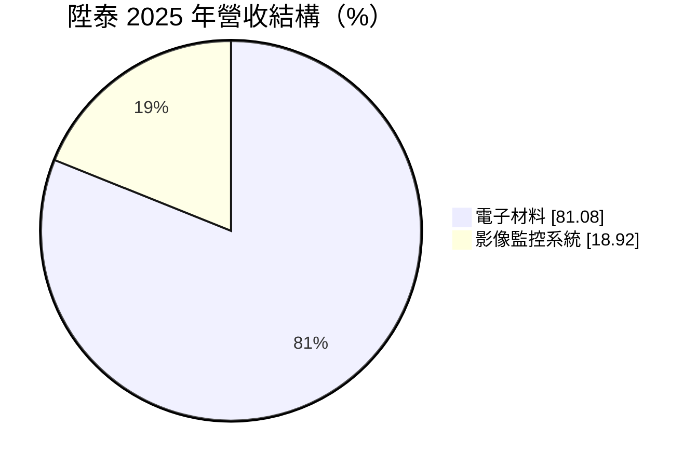
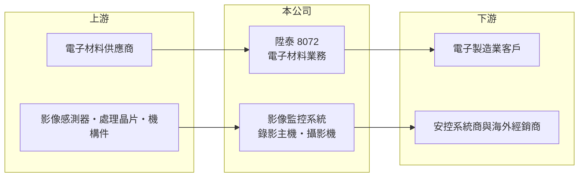

# 8072 陞泰

> 上市｜[[產業索引-電子通路業|電子通路業]]｜上市（櫃）日期 2005/08/19

# 第一章：企業模式與商業藍圖

> [!info] 撰寫說明
> 精簡版，由 Claude 依公開資料整理，架構比照 [[2330台積電]] 的四章研究，資料截至 2026-10-08。來源：MoneyDJ（富邦 e 點通）公司基本資料頁、Goodinfo 經營績效頁、證交所開放資料快照（基本資料、2026 年第二季損益與資產負債）。公開資料有限，電子材料業務的產品與客戶未查得；DVR 起家的沿革為憑記憶撰寫。#待校對

陞泰科技以影像監控設備起家，如今營收大部分來自電子材料業務，屬於「本業轉型、資產保守」的小型公司。本章說明它的兩大業務與資本特色。

- **核心業務：** 陞泰成立於 1996 年，早年以數位錄影機（DVR）等[[影像監控]]系統聞名，英文名稱為 AVTECH（沿革待校對）。依 MoneyDJ 的 2025 年營收結構，電子材料約占 81%、影像監控系統約占 19%，電子材料已是營收主體，產業分類也列在電子通路業。
- **營收結構：** 電子材料業務的具體產品、供應商與客戶在這次查到的資料中沒有說明，推估以材料買賣或代理為主（推估）。影像監控則包括錄影主機、攝影機與相關系統，銷售對象為安控系統商與海外經銷商（推估）。
- **營運據點：** 總部位於台北南港，2003 年上櫃、2005 年轉上市，實收資本額 8 億元。合併報表中有非控制權益，代表部分業務透過持股未達百分之百的子公司經營。
- **長期方向：** 監控設備市場已被大型品牌與中國廠商主導，陞泰把營收重心移到電子材料，等於從自有品牌硬體轉向通路型業務。長期能否在材料業務建立穩定的產品線與客戶，是判斷轉型成敗的關鍵。

# 第二章：護城河深度與競爭優勢

陞泰的兩大業務都不具明顯的護城河，真正的特色在於保守的資產負債表。本章分析其競爭處境。

- **競爭優勢：** 陞泰幾乎沒有負債，帳上權益約 23.8 億元，遠高於年營業利益，財務彈性大，能撐過產業低潮。監控業務累積多年的產品與海外通路經驗，仍有一定的品牌知名度。電子材料業務的競爭優勢則因資料有限而無法判斷。
- **主要對手：** 監控設備的全球主要業者是海康威視、大華等中國大廠，台灣同業有 [[3356奇偶]]、晶睿通訊等。中國廠商以規模與低價主導市場，台灣廠商則轉向資安要求較高、排除中國產品的歐美市場。
- **觀察重點：** 第一，電子材料業務的毛利率與客戶結構，這決定公司未來的獲利水準。第二，監控業務能否受惠歐美排除中國設備的政策。第三，公司如何運用帳上的大量權益，是提高配息、回購還是投資新事業。

# 第三章：財務體質與盈利規模

資料日期：2026-10-08，表格是撰寫當時的快照；最新月營收、毛利率、累計 EPS 由自動排程寫在本筆記的屬性欄位（月營收、毛利率、累計EPS 等）。#待校對

陞泰的財務特色是毛利率約 17%、營業利益率很低，但資產負債表極為穩健，獲利有不小比例來自業外。本章用多年度數據說明。

| 年度 | 營收（億元） | [[毛利率]] | [[營業利益率]] | EPS（元） | [[ROE]] |
|---|---|---|---|---|---|
| 2021 | 13.6 | 16.7% | 2.42% | 0.39 | 1.91% |
| 2022 | 12.3 | 18.1% | 2.18% | 1.18 | 4.56% |
| 2023 | 11.6 | 17.9% | 1.03% | 0.73 | 2.94% |
| 2024 | 9.39 | 17.2% | 0.97% | 1.25 | 4.72% |
| 2025 | 12.8 | 16.5% | 4.73% | 1.11 | 4.27% |
| 2026 上半年 | 7.43 | 16.6% | 6.20% | 0.69 | 未查得 |

- **營收規模：** 營收在 9 億至 14 億元之間波動，2021 至 2025 年年複合成長率約 -1.5%（推算）。2025 年營收回升到 12.8 億元，2026 年 1 至 8 月營收較前一年同期成長約 21.7%。
- **獲利：** 營業利益率長期在 1% 至 5% 之間，但 2022 年與 2024 年 EPS 都明顯高於本業貢獻，代表業外收益（利息、投資收益等）占比不小。2026 年上半年稅前純益率 11.1%，高於營業利益率 6.2%，同樣反映業外的貢獻。近 5 年平均 ROE 約 3.7%（推算）。
- **財務特色：** 2026 年第二季末總資產 27.4 億元、負債總計僅 3.6 億元，負債比約 13%。MoneyDJ 列示的現金股利，108 至 114 股利年度分別為 0.2、0.2、0.35、1.0、0.75、1.0、1.0 元，近年穩定在約 1 元，配息率偏高。

**[[ROIC]] 與 [[WACC]]：** 公司幾乎沒有有息負債，以 0 計算。2025 年稅後營業利益約 0.48 億元（12.8 億 × 4.73% × 0.8），投入資本以權益總計 23.8 億元計，ROIC 約 2%（推算）；2026 年上半年營業利益 0.46 億元年化後約 3.1%（推算）。由於權益中包含大量現金與投資，實際營業資本較小，真正的營業 ROIC 會高一些（未查得現金部位，無法精確計算）。WACC 用 CAPM 推估：無風險利率 1.75%、市場風險溢酬 6%、β 取 0.8（低負債小型股常見值，假設），因無負債，WACC 約等於股東權益成本 6.6%（推算）。結論是：以帳面資本衡量，陞泰的 ROIC 長期低於 WACC，資本運用效率偏低；穩健的財務結構提供安全邊際，但若不能提高本業獲利或更積極地分配資本，股東報酬會持續偏低。

# 第四章：總體風險與地緣政治

陞泰的風險不在財務，而在本業的獲利能力與產業結構。本章整理主要風險。

- **產業週期：** 電子材料需求隨電子產業庫存循環起伏，營收在 2024 年曾降到 9.39 億元。監控設備則受各國公共建設與企業資本支出影響。
- **營運風險：** 監控市場由中國大廠主導，價格競爭激烈，小型業者難以維持毛利；電子材料業務若屬代理性質，面臨代理權與客戶集中的風險。營業利益率偏低，使獲利容易受費用或存貨跌價影響。
- **其他風險：** 監控產品涉及資訊安全，各國對聯網攝影機的資安法規趨嚴，產品必須持續更新認證。業外收益占比高，利率下降或投資收益減少時，EPS 會受影響；外銷產品也有匯率風險。

# 專有名詞解析

## 應用

- **[[影像監控]]**：以攝影機、錄影主機與管理軟體記錄並監看場域畫面的安控系統，常見於大樓、商店與公共空間。

## 金融

- **[[ROIC]]**：投入資本報酬率，稅後營業利益除以股東權益加有息負債，衡量本業運用資本的效率。
- **[[WACC]]**：加權平均資金成本，股東權益成本與負債成本依資本結構加權，是 ROIC 必須超越的門檻。

## 產業

- **[[電子通路]]**：替上游原廠銷售零組件並提供備貨、技術支援與帳期的中間商，毛利率低、靠周轉賺錢。

# 核心供應鏈

- 上游：電子材料供應商（未查得）；監控產品所需的影像感測器、處理晶片與機構件供應商。
- 下游／客戶：電子製造業客戶（未查得）；安控系統整合商、海外經銷商。
- 同業：[[3356奇偶]]、晶睿通訊、海康威視、大華。

## 最新新聞
<!-- news:start -->
<!-- news:end -->

## 相關連結
- [公開資訊觀測站](https://mopsov.twse.com.tw/mops/web/t05st03?step=1&firstin=1&co_id=8072)
- [Goodinfo](https://goodinfo.tw/tw/StockDetail.asp?STOCK_ID=8072)
- [Yahoo 股市](https://tw.stock.yahoo.com/quote/8072)
- [鉅亨網新聞](https://www.cnyes.com/twstock/8072/news)
