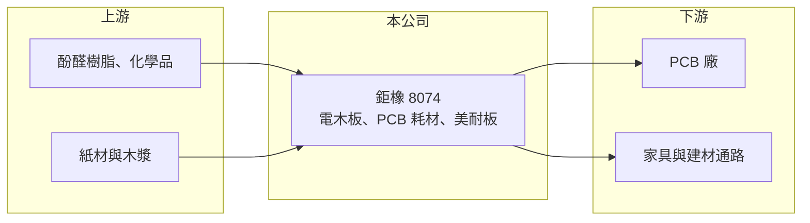

# 8074 鉅橡

> 上櫃｜[[產業索引-電子零組件業|電子零組件業]]｜上市（櫃）日期 2004/01/27

# 第一章：企業模式與商業藍圖

> [!info] 撰寫說明
> 精簡版，由 Claude 依公開資料整理，架構比照 [[2330台積電]]，資料截至 2026-10-08。來源：櫃買中心開放資料快照（基本資料、2026 年第二季資產負債與損益、本益比殖利率）、Goodinfo 經營績效頁、nStock 公司簡介、鉅亨網與優分析報導標題。產品比重與客戶依記憶整理，已標註待校對。#待校對

鉅橡企業（以下簡稱鉅橡）生產電木板、絕緣材料與美耐板，主要用途之一是 [[PCB]] 製程中的耗材。理解它的關鍵在於：PCB 廠在鑽孔時，需要在板子上下墊上[[鑽孔墊板]]與蓋板來保護孔壁品質，這些是「用完就丟」的耗材，需求跟著 PCB 的產量與鑽孔數量走，而 [[AI 伺服器]] 的高層數板讓鑽孔數大增。

- **核心業務：** 鉅橡成立於 1996 年，總部與工廠位於台南佳里，2004 年 1 月在櫃買中心掛牌，實收資本額約 8.70 億元，董事長兼總經理為莊煌星。依 nStock 介紹，公司製造與加工[[電木板]]、印刷電路基板、絕緣材料與[[美耐板]]，並從事相關產品的買賣與進出口。
- **營收結構：** 產品別比重未查得。依 2025 年鉅亨網報導標題，鉅橡被歸類為 PCB 耗材廠，另有報導指出 AI 伺服器與電子終端帶動高階材料出貨、高階產品比重提高。美耐板屬於建材裝潢用途，與電子景氣的連動較低（比重待校對）。
- **營運據點：** 主要生產基地在台南佳里；中國子公司昆山鉅橡複合材料曾於 2023 年決議減資，顯示公司在中國的布局有所收斂。
- **長期方向：** AI 伺服器與高速交換器使用的 PCB 層數多、板厚大、孔數多，對鑽孔墊板的平整度與耐熱性要求更高，單價也較高。鉅橡的長期方向是提高高階墊板與絕緣材料的比重，讓產品從一般耗材升級為規格型材料。

# 第二章：護城河深度與競爭優勢

鉅橡的護城河屬於窄護城河，來自材料製程經驗與 PCB 廠的認證，但產品標準化程度高，價格競爭不小。

- **競爭優勢：** 鑽孔墊板雖然是耗材，但平整度、硬度與散熱性會直接影響鑽孔精度與鑽針壽命，高階 PCB 廠會指定通過驗證的材料。鉅橡長年在電木板與絕緣板材累積製程經驗，能隨 PCB 規格升級調整產品。台南生產基地鄰近南部 PCB 聚落，也有運輸與服務上的便利。
- **主要對手：** PCB 耗材同業包括鑽針廠 [[8021尖點]]，以及日本、中國的墊板與蓋板供應商；中國業者在一般規格產品上的價格競爭最激烈。美耐板則有國內外多家建材品牌競爭（同業名稱未查得）。
- **觀察重點：** 2024 至 2025 年毛利率回升到約 23%，2026 年上半年約 26.7%，顯示高階產品比重提升。長期要觀察毛利率能否穩定在 25% 以上，以及高階墊板占營收比重是否持續提高。

# 第三章：財務體質與盈利規模

資料日期：2026-10-08，表格是撰寫當時的快照；最新月營收、毛利率、累計 EPS 由自動排程寫在本筆記的屬性欄位（月營收、毛利率、累計EPS 等）。#待校對

鉅橡的財務特色是營收規模長期持平，近年隨高階產品增加而改善利潤率，2026 年營收明顯成長。

| 年度 | 營收（億元） | [[毛利率]] | [[營業利益率]] | EPS（元） | [[ROE]] |
|---|---|---|---|---|---|
| 2019 | 12.3 | 18.2% | 4.13% | 0.62 | 3.24% |
| 2020 | 12.3 | 21.9% | 8.38% | 0.91 | 5.16% |
| 2021 | 13.9 | 20.8% | 7.89% | 0.94 | 5.74% |
| 2022 | 13.7 | 14.6% | 29.0% | 3.47 | 20.5% |
| 2023 | 11.4 | 19.6% | 4.98% | 0.70 | 4.31% |
| 2024 | 12.6 | 23.0% | 8.95% | 1.17 | 6.47% |
| 2025 | 13.1 | 22.9% | 9.21% | 1.35 | 7.18% |
| 2026 上半年 | 7.84 | 26.7% | 11.5% | 0.96 | 未查得 |

（來源：Goodinfo 經營績效頁；2026 上半年依櫃買中心開放資料計算。2022 年營業利益率高於毛利率，推估含處分資產等一次性利益，屬非經常性，#待校對。）

- **營收規模：** 2020 至 2025 年營收由 12.3 億元增至 13.1 億元，年複合成長率約 1.3%（推算），長期持平。2026 年 1 至 8 月營收約 10.6 億元，年增約 22%，是近年少見的明顯成長。
- **獲利：** 2021 至 2025 年平均 ROE 約 8.8%（推算），但若扣除 2022 年的一次性高峰，約 5.9%，偏低。2026 年上半年營業利益率約 11.5%、EPS 0.96 元，獲利能力為近年較佳水準。
- **財務特色：** 2026 年第二季總資產約 41.0 億元、權益總計約 21.0 億元、負債約 20.0 億元，權益比約 51%；非流動負債約 12.0 億元，推估含長期借款（細節未查得）。最近一次現金股利每股 1.1 元，約為 2025 年 EPS 1.35 元的 81%（推算）。自由現金流是否長期為正未查得。
- **[[ROIC]] 與 [[WACC]]：** 以 2025 年營業利益約 1.21 億元（13.1 億元 × 9.21%）、稅率 20% 計算，稅後營業利益約 0.97 億元。有息負債未查得，投入資本以權益 21.0 億元到總資產 41.0 億元為區間，ROIC 約 2.4% 至 4.6%（推算）；2026 年上半年年化約 3.5% 至 6.9%（推算）。WACC 以 CAPM 推估：無風險利率 1.75%、市場風險溢酬 6%、β 假設 1.0（材料類中小型股常見值），權益成本約 7.8%；負債比重假設三成五、稅後成本 2%，WACC 約 5.7%（推算）。2025 年 ROIC 低於 WACC，2026 年上半年接近 WACC，代表鉅橡過去長期未能創造經濟價值，高階產品能否持續拉高利潤率是改善關鍵。

# 第四章：總體風險與地緣政治

鉅橡的風險來自 PCB 景氣循環、原料價格與中國同業的價格競爭。

- **產業週期：** 鑽孔墊板等耗材需求跟著 PCB 產量走，2023 年 PCB 產業庫存調整時，鉅橡營收下滑約一成七、營業利益率降到約 5%。AI 伺服器帶來的高階需求雖然強勁，但若雲端業者放緩投資，高階板訂單也會隨之修正。
- **營運風險：** 一般規格墊板技術門檻不高，中國業者以低價競爭，使鉅橡在非高階產品上議價能力有限。客戶集中於少數大型 PCB 廠時，客戶擴廠地點（例如移往東南亞）也會影響鉅橡的供貨與運輸成本（客戶結構待校對）。非流動負債偏高，利率上升會增加財務費用。
- **其他風險：** 主要原料為酚醛樹脂、紙材與木漿等，價格受石化與紙漿行情影響。美耐板與建材景氣連動，房市與裝修需求放緩會影響這部分營收。工廠位於台南佳里工業區，工安與環保法規也需要留意。

# 專有名詞解析

## 應用

- **[[AI 伺服器]]**：搭載 GPU 或 ASIC 加速器、用於訓練與推論 AI 模型的伺服器，功耗與散熱需求遠高於一般伺服器。

## 產業

- **[[PCB]]**：印刷電路板，用銅線路連接電子元件的基板，是所有電子產品的骨架。
- **[[鑽孔墊板]]**：PCB 鑽孔時墊在板子下方的耗材，用來保護孔壁品質並延長鑽針壽命，用後即報廢。
- **[[電木板]]**：以酚醛樹脂與紙或布壓製而成的硬質絕緣板，用於電子絕緣、治具與 PCB 耗材。
- **[[美耐板]]**：表面為耐磨裝飾層的高壓積層板，常用於家具與室內裝潢檯面。

# 核心供應鏈

- 上游：酚醛樹脂與化學原料，例如 [[1714和桐]]、[[1717長興]] 所在的產業，以及紙材與木漿（實際供應商未查得，#待校對）。
- 下游／客戶：PCB 廠，例如 [[2368金像電]]、[[3044健鼎]]、[[2313華通]]、[[3037欣興]] 所在的產業；家具與建材通路。是否為鉅橡客戶未查得，#待校對。
- 同業：PCB 耗材的 [[8021尖點]]，以及日本、中國的墊板與蓋板供應商。

## 最新新聞
<!-- news:start -->
<!-- news:end -->

## 相關連結
- [公開資訊觀測站](https://mopsov.twse.com.tw/mops/web/t05st03?step=1&firstin=1&co_id=8074)
- [Goodinfo](https://goodinfo.tw/tw/StockDetail.asp?STOCK_ID=8074)
- [Yahoo 股市](https://tw.stock.yahoo.com/quote/8074)
- [鉅亨網新聞](https://www.cnyes.com/twstock/8074/news)
