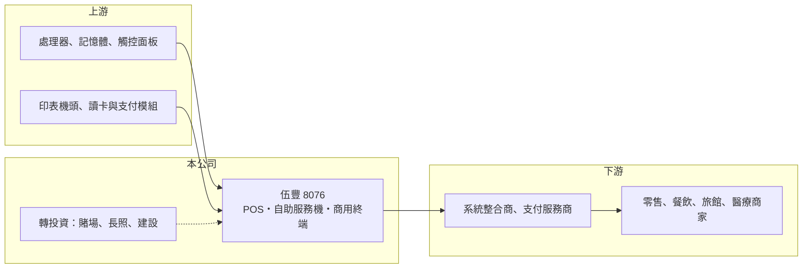

# 8076 伍豐

> 上櫃｜[[產業索引-電腦及週邊設備業|電腦及週邊設備業]]｜上市（櫃）日期 2003/12/15

# 第一章：企業模式與商業藍圖

> [!info] 撰寫說明
> 精簡版，由 Claude 依公開資料整理，架構比照 [[2330台積電]]，資料截至 2026-10-08。來源：櫃買中心開放資料快照（基本資料、2026 年第二季資產負債與損益、月營收）、Goodinfo 經營績效頁、富果研究 2025 年 12 月法說會摘要。美國子公司與英文品牌描述憑記憶整理，已標「待校對」。#待校對

伍豐科技（以下簡稱伍豐，英文 Posiflex）是台灣的 [[POS]] 收銀終端品牌廠，理解它的關鍵在於：傳統 POS 硬體正被中國同業壓價，伍豐把成長押在單價高好幾倍的[[自助服務機]]與軟硬整合服務，同時持有賭場、長照與建設等與本業無關的轉投資。

- **核心業務：** 伍豐登記成立於 1995 年，2003 年在櫃買中心掛牌。產品包括一體式 POS 收銀機、廚房用強固終端、自助服務機（Kiosk）、智慧販賣機、雲端印表機與彩券機，客戶是零售、餐飲、旅館與醫療等商家（富果研究）。依記憶，伍豐旗下的美國子公司 KIOSK Information Systems 是自助服務機的主要據點（待校對）。
- **營收結構：** 依富果研究，自助服務機目前占營收不到 5%，公司目標 2026 年提高到約 30%，廚房強固終端約 10%，傳統 POS 比重預計降到 60% 以下。地區別比重未查得，客戶包括亞洲拉麵連鎖、歐美速食品牌、歐洲與日本零售連鎖，以及美國支付服務商與北美彩券業者。自助服務機的單價約為傳統 POS 的 6 至 10 倍，比重提高會明顯拉高營收與毛利。
- **營運據點：** 總部位於台灣，生產據點這次未查得。公司正建立在地服務團隊，直接服務商家（富果研究）。轉投資方面，伍豐持有俄羅斯賭場 Tigre de Cristal 的權益、南港與嘉義的長照專案股權，以及持股 28.57% 的建設公司（富果研究），這些都與 POS 本業無關。
- **長期方向：** 伍豐的策略是從硬體製造商轉型為「軟體加硬體」的商家服務商，主攻高單價的無人化終端以避開 POS 價格戰，並以 AI 工具協助商家導入數位化。長期能否成功，取決於自助服務機與服務收入能否撐起營收，以及轉投資能否穩定貢獻或被逐步處分。

# 第二章：護城河深度與競爭優勢

伍豐的護城河屬於「窄護城河」，來自 POS 品牌與全球通路關係、餐飲零售客戶的導入成本，以及自助服務機的系統整合能力。

- **競爭優勢：** 連鎖餐飲與零售客戶導入一套 POS 或自助點餐系統，需要整合支付、點餐軟體與後台系統，並在數百到上千家門市部署，一旦上線很少輕易更換硬體品牌。伍豐 2024、2025 年[[毛利率]]提升到 32% 至 34%，高於 2020 年的 27.6%，顯示產品組合往高附加價值移動。
- **主要對手：** 台灣同業包括 [[8114振樺電]]、[[6206飛捷]]、[[3537堡達]]，國際上有 NCR、東芝等大型零售系統商，以及大量低價的中國 POS 品牌。傳統 POS 已高度同質化，伍豐必須靠自助服務機與服務整合拉開差距。
- **觀察重點：** 長期最該追蹤的是自助服務機占比能否如期提高，以及本業獲利能否不被業外拖累。2025 年營業利益率約 4%，EPS 卻只有 0.14 元，主因轉投資[[公允價值]]的非現金損失（富果研究），本業與業外的表現落差很大。

# 第三章：財務體質與盈利規模

資料日期：2026-10-08，表格是撰寫當時的快照；最新月營收、毛利率、累計 EPS 由自動排程寫在本筆記的屬性欄位（月營收、毛利率、累計EPS 等）。#待校對

伍豐的財務呈現「毛利率尚可、營益率偏低、股本大、業外波動大」的樣貌：營收在 20 億至 31 億元之間，EPS 長期偏低。

| 年度 | 營收（億元） | [[毛利率]] | [[營業利益率]] | EPS（元） | [[ROE]] |
|---|---|---|---|---|---|
| 2021 | 25.5 | 29.6% | 5.38% | 0.55 | 3.84% |
| 2022 | 27.1 | 29.2% | 4.69% | 1.10 | 8.38% |
| 2023 | 25.5 | 28.3% | 5.43% | 0.15 | 1.31% |
| 2024 | 22.3 | 32.6% | 4.70% | 1.49 | 10.3% |
| 2025 | 19.7 | 33.7% | 3.99% | 0.14 | 0.98% |

（來源：Goodinfo 經營績效頁。2026 年上半年依櫃買中心資料，營收 13.5 億元、毛利率約 33.6%、營業利益率約 11.2%、EPS 0.33 元。）

- **營收規模：** 2019 年營收 31.3 億元，2020 年降到 22.4 億元，2025 年再降到 19.7 億元，2020 至 2025 年年複合成長率約 -2.5%（推算）。2026 年 1 至 8 月累計營收約 18.4 億元、年增約 55%，推估與延後的 POS 專案與彩券機出貨有關（推估）。
- **獲利：** 2021 至 2025 年平均 ROE 約 5.0%（推算），長期偏低。EPS 在 0.14 元到 1.49 元之間大幅跳動，主要不是本業波動，而是轉投資評價與業外損益造成。股本 29.22 億元、股數多，即使獲利數億元，攤到每股也不多。
- **財務特色：** 2026 年第二季總資產約 63.0 億元、負債約 25.1 億元，負債比約 40%，每股淨值 12.75 元。轉投資涵蓋賭場、長照與建設，資產組合比一般電子硬體廠複雜。Goodinfo 統計歷年平均現金股利約 0.72 元。自由現金流是否長期為正未查得。
- **[[ROIC]] 與 [[WACC]]：** 以 2025 年營業利益約 0.79 億元（19.7 億元 × 3.99%）、稅率 20% 計算，稅後營業利益約 0.63 億元；有息負債未查得，投入資本以權益總計 37.9 億元到總資產 63.0 億元為區間，ROIC 約 1.0% 至 1.7%（推算）。2026 年上半年營業利益 1.51 億元，年化後 ROIC 約 3.8% 至 6.4%（推算）。WACC 以 [[CAPM]] 推估：無風險利率 1.75%、市場風險溢酬 6%、β 假設 0.8（中小型硬體股常見值），權益成本約 6.6%；稅後負債成本 2%、負債占三成，WACC 約 5.2%（推算）。過去 ROIC 長期低於 WACC，代表投入的資本沒有賺到足夠報酬，大量資本放在與本業無關的轉投資是主因之一。

# 第四章：總體風險與地緣政治

伍豐的風險集中在 POS 價格戰、轉投資與轉型執行，屬於本業轉型中、業外變數大的公司。

- **產業週期：** POS 與自助服務機需求跟著零售與餐飲業的展店與數位化投資走，景氣轉弱時連鎖業者會延後換機。大型連鎖專案的出貨時點常延遲，2025 年營收下滑就與專案遞延有關（富果研究）。
- **營運風險：** 傳統 POS 面臨中國同業的價格壓力，若自助服務機成長不如預期，營收可能持續萎縮。DDR4、DDR5 記憶體漲價與缺貨會影響成本與交期。轉型為服務商需要軟體與在地團隊投資，短期增加費用。
- **其他風險：** 轉投資的俄羅斯賭場受國際制裁、匯率與地緣政治影響，價值與收益不確定性高；長照與建設專案則有開發與法規風險。這些業外資產的評價變動，會讓 EPS 與本業表現脫鉤。

# 專有名詞解析

## 應用

- **[[POS]]**：銷售時點系統，零售與餐飲門市用來結帳、記錄銷售與管理庫存的收銀設備與軟體。
- **[[自助服務機]]**：Kiosk，讓消費者自行點餐、結帳或查詢的觸控終端機，可降低門市人力需求。

## 金融

- **[[公允價值]]**：資產或負債在市場上可交易的價格，轉投資依此重新評價時會產生非現金的損益。

# 核心供應鏈

- 上游：處理器、記憶體、觸控面板、熱感印表機機構與支付讀卡模組供應商。
- 下游／客戶：各地系統整合商與支付服務商，以及連鎖餐飲、零售、旅館、醫療與彩券業者（富果研究，具體名稱未點名，#待校對）。
- 同業：[[8114振樺電]]、[[6206飛捷]]、[[3537堡達]]，國際同業 NCR、東芝。

## 最新新聞
<!-- news:start -->
<!-- news:end -->

## 相關連結
- [公開資訊觀測站](https://mopsov.twse.com.tw/mops/web/t05st03?step=1&firstin=1&co_id=8076)
- [Goodinfo](https://goodinfo.tw/tw/StockDetail.asp?STOCK_ID=8076)
- [Yahoo 股市](https://tw.stock.yahoo.com/quote/8076)
- [鉅亨網新聞](https://www.cnyes.com/twstock/8076/news)
