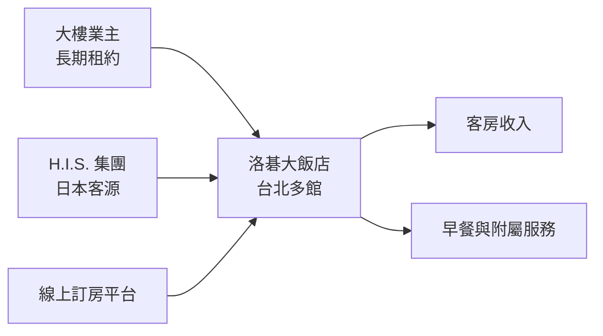
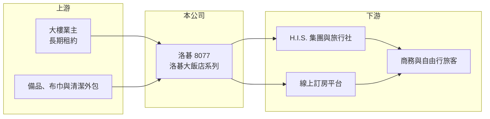

# 8077 洛碁

> 上櫃｜[[產業索引-觀光餐旅|觀光餐旅]]｜上市（櫃）日期 2004/12/06

# 第一章：企業模式與商業藍圖

> [!info] 撰寫說明
> 精簡版，由 Claude 依公開資料整理，架構比照 [[2330台積電]] 的四章研究，資料截至 2026-10-08。來源：Goodinfo 年度經營績效頁、CMoney 2025 年 2 月投資快訊、櫃買中心開放資料（基本資料、2026 年第二季資產負債與綜合損益、每月營收、本益比殖利率）。旅館據點與經營模式部分憑記憶與公開訂房資訊整理，已標示待校對；房間數與各館營收未查得，公開資料有限。#待校對

洛碁實業是在台北經營「洛碁大飯店」（Green World Hotels）系列商務旅館的公司，母公司為日本旅行社集團 H.I.S.。本章說明它的旅館組合與經營模式。

## 一、核心定位：日系旅行集團旗下的平價商務旅館

洛碁成立於 1994 年，2004 年 12 月登錄上櫃，董事長為謝憲治、總經理為崔潔民，實收資本額約 2.19 億元，其中約 1,189 萬股為私募股（櫃買中心開放資料）。CMoney 2025 年 2 月報導指出，公司母公司為日本最大旅遊集團之一的 H.I.S.。旗下旅館以「洛碁大飯店」為品牌，分布在台北西門、南港等交通便利的區域（例如西門町萬企大樓內的洛碁大飯店、南港館），定位為中價位商務與觀光旅館（館別清單待校對）。

* **為什麼母公司重要：** H.I.S. 擁有大量日本赴台旅客的客源，能為旅館帶來穩定的團體與自由行訂房，降低對單一訂房平台的依賴（推估）。
* **商務旅館的特性：** 不設大型宴會廳與多樣餐廳，收入以客房為主，人力與營運比國際觀光飯店精簡。

## 二、商業模式：承租大樓經營客房

洛碁的旅館多為承租他人大樓經營（推估，依資產負債表中非流動負債遠高於權益判斷）。這種模式不必自己買地蓋樓，資本需求小，但要長期支付固定租金，所以毛利率只有約 27% 至 30%（Goodinfo），而且住房率下滑時虧損會快速擴大。2020 至 2022 年疫情期間，營收從 2019 年的 12.2 億元跌到不到 4 億元，毛利率轉為負 50% 左右，就是固定租金成本的放大效果。

## 三、長期方向

國境開放後，台灣來台旅客回升，洛碁營收在 2023 年回到 9.78 億元、2025 年回到 10.8 億元（Goodinfo），但仍低於 2019 年水準。長期成長取決於來台旅客數（特別是日本旅客）、台北旅館房價，以及公司是否新增館別；目前未查得新的展店計畫。

# 第二章：護城河深度與競爭優勢

旅館業的護城河主要來自地段與客源。本章分析洛碁的優勢與限制。

## 一、護城河的核心組成要素

* **母公司客源：** H.I.S. 在日本有龐大的旅遊銷售網路，能把日本旅客導入旗下旅館，這是一般本土連鎖旅館缺乏的穩定通路。
* **交通便利的地段：** 西門、南港等館別鄰近捷運或高鐵、展覽館，商務與觀光需求兼具，住房率相對穩定（推估）。
* **輕資產營運：** 承租模式讓公司以較小的股本經營多家旅館，景氣好時 ROE 可以很高，2025 年 ROE 達 29.1%（Goodinfo）。

## 二、主要競爭對手

| 對手 | 定位 | 對洛碁的威脅 |
|---|---|---|
| [[2707晶華]] | 國際觀光飯店與捷絲旅等平價品牌 | 在平價商務旅館市場直接競爭 |
| 福泰桔子、承億、和逸等連鎖 | 台灣連鎖商務旅館 | 價格帶與客群重疊 |
| [[2722夏都]] | 旅館與飯店經營 | 搶觀光住宿需求 |
| 東橫 INN、日系商務旅館 | 日系連鎖商務旅館 | 爭取同一批日本旅客 |

## 三、守得住與守不住

* **守得住：** 有母公司導客的日本旅客市場，以及交通便利館別的基本住房率。
* **守不住：** 景氣與疫情衝擊。固定租金使得獲利對住房率極度敏感，2020 至 2022 年連續三年大幅虧損。
* **觀察重點：** 來台旅客數與日本旅客占比、平均房價，以及租約到期時的續約條件。

# 第三章：財務體質與盈利規模

資料日期：2026-10-08，表格是撰寫當時的快照；最新月營收、毛利率、累計 EPS 由自動排程寫在本筆記的屬性欄位（月營收、毛利率、累計EPS 等）。#待校對

本章用多年度數據檢視洛碁在疫情前後的獲利變化與資本報酬。

## 一、多年度三率與 ROE

| 年度 | 營收（新台幣） | [[毛利率]] | [[營業利益率]] | EPS（元） | [[ROE]] |
|---|---|---|---|---|---|
| 2019 | 12.2 億 | 26.9% | 11.1% | 0.55 | 3.57% |
| 2020 | 4.41 億 | -53.4% | -72.6% | -7.82 | -66.9% |
| 2021 | 3.92 億 | -49.0% | -63.8% | -3.30 | -54.0% |
| 2022 | 5.46 億 | -17.2% | -30.5% | -10.28 | -59.7% |
| 2023 | 9.78 億 | 26.5% | 11.3% | 2.26 | 17.1% |
| 2024 | 10.7 億 | 29.5% | 16.0% | 4.40 | 26.6% |
| 2025 | 10.8 億 | 28.9% | 16.6% | 6.04 | 29.1% |
| 2026 上半年 | 5.38 億 | 28.8% | 17.5% | 3.26 | 未查得 |

註：2019 至 2025 年取自 Goodinfo；2026 上半年依櫃買中心綜合損益計算。

* **疫後恢復：** 2023 年起營業利益率回到 11% 以上，2026 年上半年達 17.5%，已高於疫情前。2026 年 1 至 8 月累計營收約 7.03 億元、年增約 2.4%（櫃買中心每月營收）。
* **營收尚未回到 2019 年：** 2019 至 2025 年營收年複合成長率約 -2%（推算），獲利改善主要來自房價提升與成本控制，而不是規模擴大。
* **ROE 劇烈波動：** 2021 至 2025 年平均 ROE 約 -8%（推算），疫情三年的大虧把權益大幅侵蝕，使近兩年 ROE 在較小的權益基礎上顯得偏高。

## 二、股利與財務結構

2025 年度每股配發現金股利 2.0 元（櫃買中心本益比殖利率資料），以 EPS 6.04 元計算配發率約 33%（推算），配發率偏低，可能是為了重建疫情後的權益（推估）。2026 年第二季底總資產約 25.0 億元、總負債約 19.7 億元（其中非流動負債約 12.6 億元）、權益約 5.3 億元（櫃買中心資產負債），負債比約 79%。負債中大部分應是旅館長期租約的[[租賃負債]]（推估），銀行借款金額未查得。

## 三、[[ROIC]] 與 [[WACC]]

**ROIC 推算：** 2025 年營業利益約 10.8 億 × 16.6% ≈ 1.79 億元，以 20% 稅率計算稅後約 1.43 億元。若只以權益約 5.3 億元計算，報酬率高達約 27%；但旅館的實際投入資本應包含租賃負債，以權益加上推估的租賃與有息負債約 13 億元、合計約 18 億元計算，ROIC 約 8%（推算）。

**WACC 推算：** 台灣 10 年期公債 1.75%、市場風險溢酬 6%、β 取觀光旅館同業常見值 0.8，權益成本約 6.6%；租賃負債稅後成本約 2%，以權益 30%、負債 70% 加權，WACC 約 3.4%（推算）。

**結論：** 在旅遊景氣正常的年度，ROIC 高於 WACC，承租經營模式能創造價值；但 2020 至 2022 年 ROIC 大幅為負，代表這種模式的長期報酬必須把疫情、天災等極端年份一起計算。高槓桿（以租約形式存在）讓好年與壞年的落差非常大。

# 第四章：總體風險與地緣政治

本章整理洛碁長期面對的旅遊景氣、租約與集團風險。

## 一、產業週期與外部衝擊

* **旅遊需求波動：** 疫情、地緣政治、天災與航班變化都可能讓來台旅客驟減，2020 至 2022 年的經驗顯示營收可能在一年內減少六成以上。
* **日圓與日本旅客：** 日本旅客是重要客源，日圓貶值會降低日本人出國意願，影響住房率與房價。

## 二、營運風險

* **固定租金與續約：** 承租大樓的租約到期時，業主可能調漲租金或收回大樓，影響館別存續。
* **人力成本：** 房務與櫃台人力短缺、薪資上漲，會壓縮營業利益率。

## 三、其他風險

* **母公司策略：** H.I.S. 的集團策略調整（例如出售海外資產）可能改變洛碁的經營方向或股權結構。
* **市場競爭：** 台北新旅館持續開幕，平價商務旅館的房價競爭激烈。

# 專有名詞解析

## 金融

- **[[租賃負債]]**：依 IFRS 16，企業把長期租約未來應付的租金折現後認列在資產負債表上的負債，連鎖餐飲與零售業金額通常很大。
- **[[ROIC]]**：投入資本報酬率，衡量企業用股東與債權人投入的資本，每年能產生多少稅後營業利益。
- **[[WACC]]**：加權平均資金成本，股東要求報酬與負債利息依資本結構加權後的平均值，是判斷是否創造價值的門檻。

## 產業

- **[[商務旅館]]**：以客房為主要收入、設施精簡、價格中等的旅館型態，主要服務商務與自由行旅客。
- **[[住房率]]**：旅館已售出客房數占可售客房數的比例，與平均房價共同決定旅館的客房收入。

# 核心供應鏈

- 上游：大樓業主（例如西門町萬企大樓的業主 [[2701萬企]]）、旅館備品、布巾與清潔外包廠商。
- 下游／客戶：母公司 H.I.S. 與其他旅行社、線上訂房平台、商務與觀光旅客。
- 同業：[[2707晶華]]、[[2722夏都]]、福泰桔子、承億、東橫 INN。

## 最新新聞
<!-- news:start -->
<!-- news:end -->

## 相關連結
- [公開資訊觀測站](https://mopsov.twse.com.tw/mops/web/t05st03?step=1&firstin=1&co_id=8077)
- [Goodinfo](https://goodinfo.tw/tw/StockDetail.asp?STOCK_ID=8077)
- [Yahoo 股市](https://tw.stock.yahoo.com/quote/8077)
- [鉅亨網新聞](https://www.cnyes.com/twstock/8077/news)
