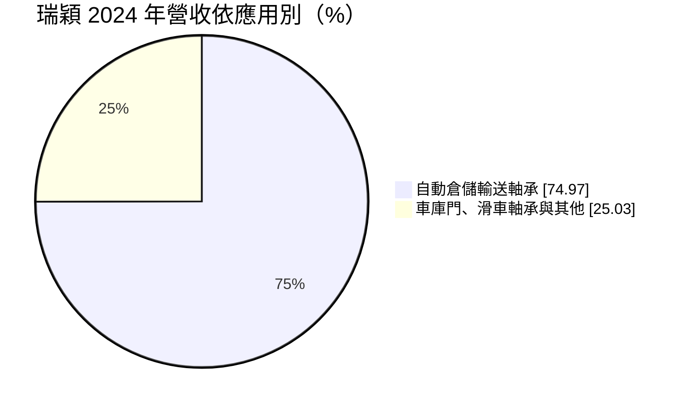
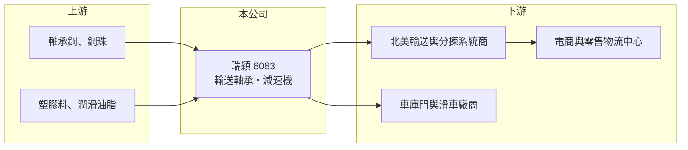

# 8083 瑞穎

> 上櫃｜[[產業索引-電機機械|電機機械]]｜上市（櫃）日期 2004/09/23

# 第一章：企業模式與商業藍圖

> [!info] 撰寫說明
> 精簡版，由 Claude 依公開資料整理，架構比照 [[2330台積電]]，資料截至 2026-10-08。來源：櫃買中心開放資料快照（基本資料、2026 年第二季資產負債與損益、每月營收、本益比殖利率）、Goodinfo 經營績效頁、富果研究 2025 年 12 月法說會摘要。法說會摘要為 AI 整理內容，尚未逐條比對原始文件。#待校對

瑞穎是一家專做輸送用[[滾動軸承]]的公司，產品大量用在北美電商與零售業的[[自動倉儲]]輸送線上。理解它的關鍵在於：瑞穎把一個看似普通的零件，做到高度自動化生產與極低成本，再搭上電商物流自動化的長期趨勢，因而擁有台灣中小型製造業中少見的高利潤率與高配息。

- **核心業務：** 瑞穎成立於 1997 年，2004 年在櫃買中心上櫃，實收資本額約 3.51 億元，董事長為陳柏峰、總經理為陳柏津，總部位於新北新莊。核心產品是自動倉儲輸送線與分揀系統使用的滾動軸承，創立初期的車庫門與滑車軸承比重已下降。近年另發展單價約 30 至 50 美元、毛利率七至八成的[[減速機]]，以及物流自動化的新產品。
- **營收結構：** 自動倉儲軸承占營收比重由 2020 年的 70.03% 提高到 2024 年的 74.97%。地區上以北美為絕對主力，2024 年占 91.46%，2025 年前三季降到 88.95%，公司正逐步開發歐洲與亞洲市場。
- **營運據點：** 主要工廠位於桃園楊梅，約 15 年前購入，廠區約 7,000 坪，其中 3,000 坪為貨櫃車作業空間，單日最多可出貨 20 個貨櫃。公司自行設計製造大部分生產設備，某項物流產品從人工改為自動化後，單位成本由 35 元降到 5 元。
- **長期方向：** 電商與零售業為提高出貨效率，長期持續投資倉儲自動化，輸送線上的軸承屬於耗用型零件，會隨系統擴建與汰換產生重複需求。瑞穎的長期策略是集中資源在減速機等高毛利產品，並分散北美以外的市場，降低地緣政治與關稅風險。

# 第二章：護城河深度與競爭優勢

瑞穎的護城河來自自製自動化設備所建立的成本優勢，以及長年供應北美大型物流系統所累積的客戶關係。

- **競爭優勢：** 輸送軸承的單價不高、數量極大，誰的單位成本最低誰就能勝出。瑞穎自行設計製造生產設備，把人工降到最低，營業費用僅占營收約 8%，營業利益率長期在 20% 至 30% 以上，這是一般零件廠難以達到的水準，也顯示成本優勢是真實存在的護城河。
- **主要對手：** 輸送用軸承的主要競爭者為中國的軸承與輸送零件廠，以及北美輸送系統廠的其他亞洲供應商（待校對）。台灣上市櫃的軸承與傳動同業包括 [[1597直得]]、[[2049上銀]]、[[4583台灣精銳]]，但產品以精密傳動為主，與瑞穎的輸送軸承市場重疊有限。
- **觀察重點：** 營收從 2021 年的 22.9 億元降到 2023 年的 11.0 億元，但毛利率與營業利益率反而上升，代表公司在需求下滑時仍守住價格與成本。長期要看減速機等新產品能否放大，以及北美以外市場的比重能否提高。

# 第三章：財務體質與盈利規模

資料日期：2026-10-08，表格是撰寫當時的快照；最新月營收、毛利率、累計 EPS 由自動排程寫在本筆記的屬性欄位（月營收、毛利率、累計EPS 等）。#待校對

瑞穎的財務呈現「高利潤率、高 ROE、高配息」的特徵，是這類小型零件廠中資本效率最好的一群。

| 年度 | 營收（億元） | [[毛利率]] | [[營業利益率]] | EPS（元） | [[ROE]] |
|---|---|---|---|---|---|
| 2019 | 14.7 | 38.9% | 27.4% | 9.00 | 27.2% |
| 2020 | 18.8 | 39.5% | 27.4% | 11.10 | 32.5% |
| 2021 | 22.9 | 35.4% | 20.6% | 10.08 | 28.7% |
| 2022 | 16.7 | 35.7% | 22.3% | 10.30 | 29.2% |
| 2023 | 11.0 | 38.6% | 27.5% | 6.79 | 20.2% |
| 2024 | 14.7 | 43.2% | 29.1% | 10.19 | 30.4% |
| 2025 | 14.3 | 40.5% | 30.7% | 9.80 | 28.0% |
| 2026 上半年 | 7.67 | 43.2% | 35.5% | 6.32 | 未查得 |

（來源：Goodinfo 經營績效頁；2026 上半年取自櫃買中心開放資料。）

- **營收規模：** 營收在 11 億至 23 億元之間，2021 年疫情期間電商倉儲大舉擴建時達到高峰，2023 年隨北美客戶庫存調整降到低點，2021 至 2025 年年複合成長率約 -11.1%（推算）。營收波動主要來自北美倉儲投資的節奏，而非市占流失。
- **獲利：** 2021 至 2025 年平均 ROE 約 27.3%（推算），即使在 2023 年的低谷，ROE 仍有 20%。2026 年上半年營業利益率升到 35.5%，EPS 6.32 元，獲利能力持續提升。
- **財務特色：** 依 2026 年第二季資料，總資產約 18.7 億元、權益約 11.0 億元、負債約 7.7 億元，負債幾乎全為流動負債，推估包含用於匯率避險的外幣借款與應付股利。公司長年維持高配息，近年配息率接近或超過 100%，最近一次現金股利為每股 10 元，屬於典型的「現金牛」型公司。
- **[[ROIC]] 與 [[WACC]]：** 2025 年營業利益約 4.39 億元，稅後約 3.51 億元（推算，稅率 20%），以權益約 11 億元到「權益加全部負債」18.7 億元計算，ROIC 約 19% 至 32%（推算）；2026 年上半年年化後約 23% 至 40%。WACC 以 [[CAPM]] 推估：無風險利率 1.75%、市場風險溢酬 6%、β 假設 0.9（工業零組件股常見值），權益成本約 7.15%；假設有息負債占資本約 30%、稅前負債成本 2.5%，WACC 約 5.6%（推算）。ROIC 長期遠高於 WACC，代表瑞穎持續創造可觀的經濟價值，而且高配息顯示這些價值確實以現金回到股東手上。

# 第四章：總體風險與地緣政治

瑞穎的風險集中在單一市場與單一產業，以及美國貿易政策。

- **產業週期：** 營收高度依賴北美電商與零售業的倉儲投資，當大型電商放緩擴建或調整庫存時，訂單可能在一年內下滑三至五成，2022 至 2023 年即是例子。倉儲投資也受利率與消費景氣影響。
- **營運風險：** 北美占營收約九成，客戶集中於少數大型零售與電商業者及其系統整合商，單一客戶策略改變的影響很大。高配息政策使帳上保留的資金有限，若未來需要大規模擴廠，可能需要調整配息。
- **其他風險：** 美國關稅政策是最大的外部變數，公司已把貿易條件由 CIF 改為 FOB，將部分關稅與運輸風險轉由客戶承擔；新台幣兌美元匯率影響報價與毛利，公司以外幣借款避險；鋼材價格波動影響成本。

# 專有名詞解析

## 應用

- **[[自動倉儲]]**：以輸送線、分揀機與機器人自動完成入庫、揀貨與出貨的倉庫系統，電商物流中心大量採用。

## 金融

- **[[配息率]]**：現金股利占每股盈餘的比例，越高代表公司把越多盈餘發還股東。
- **[[CAPM]]**：資本資產定價模型，以無風險利率加上 β 乘以市場風險溢酬，推估股東要求的報酬率。

## 產業

- **[[滾動軸承]]**：以滾珠或滾柱在內外環之間滾動來支撐旋轉軸、降低摩擦的機械零件。
- **[[減速機]]**：以齒輪組降低馬達轉速、提高扭力的傳動裝置，用於輸送線與自動化設備。

# 核心供應鏈

- 上游：軸承鋼、鋼珠、塑膠料與潤滑油脂；實際供應商未查得，#待校對。
- 下游／客戶：北美輸送與分揀系統商，終端為 [[AMZN亞馬遜]]、Walmart 等大型電商與零售業者的物流中心；另有車庫門與滑車廠商。
- 同業：中國輸送軸承廠；台灣傳動零組件的 [[1597直得]]、[[2049上銀]]、[[4583台灣精銳]]（市場重疊有限）。

## 最新新聞
<!-- news:start -->
<!-- news:end -->

## 相關連結
- [公開資訊觀測站](https://mopsov.twse.com.tw/mops/web/t05st03?step=1&firstin=1&co_id=8083)
- [Goodinfo](https://goodinfo.tw/tw/StockDetail.asp?STOCK_ID=8083)
- [Yahoo 股市](https://tw.stock.yahoo.com/quote/8083)
- [鉅亨網新聞](https://www.cnyes.com/twstock/8083/news)
