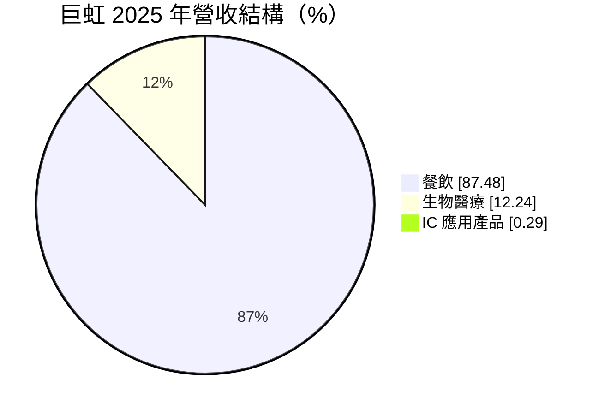
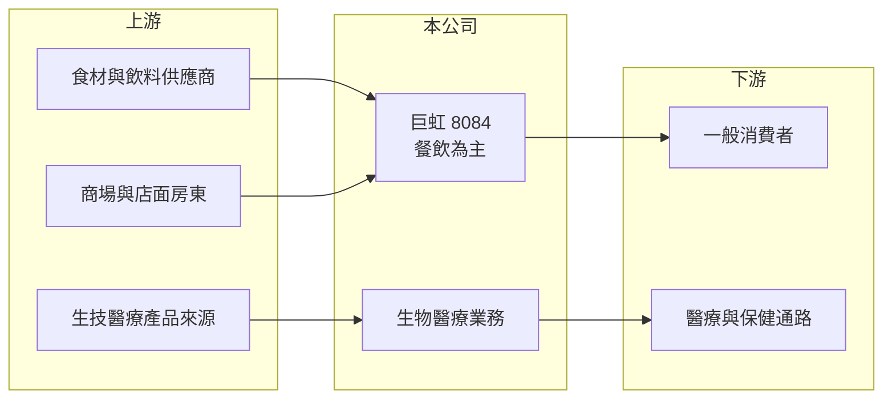

# 8084 巨虹

> 上櫃｜[[產業索引-電子通路業|電子通路業]]｜上市（櫃）日期 2004/03/08

# 第一章：企業模式與商業藍圖

> [!info] 撰寫說明
> 精簡版，由 Claude 依公開資料整理，架構比照 [[2330台積電]] 的四章研究，資料截至 2026-10-08。來源：MoneyDJ（富邦 e 點通）公司基本資料頁、Goodinfo 經營績效頁、櫃買中心開放資料快照（基本資料、每月營收、2026 年第二季損益與資產負債）。公開資料有限，餐飲品牌、生技產品與子公司持股比例未查得。#待校對

巨虹電子名義上仍屬電子通路業，但營收已幾乎全部來自餐飲與生技醫療，是一家徹底轉型的公司。本章說明目前的業務組成與經營結構。

- **核心業務：** 巨虹成立於 1993 年，2004 年上櫃，早年經營 IC 應用產品。依 MoneyDJ 的 2025 年營收結構，餐飲約占 87.5%、生物醫療約占 12.2%、IC 應用產品只剩約 0.3%，原本的電子業務已近乎停止，公司實質上是餐飲集團。
- **營收結構：** 餐飲業務的品牌與門市數在這次查到的資料中沒有說明。生物醫療業務約占一成，產品內容未查得。由於合併財報中的非控制權益（約 9.7 億元）大於歸屬母公司的權益（約 5.1 億元），推估主要營運子公司是巨虹持股未達百分之百、且有大量外部股東的公司（推估）。
- **營運據點：** 以台灣為主（推估）。2026 年第二季末非流動負債約 4.1 億元，以餐飲業特性推估多為門市租約產生的[[租賃負債]]。
- **長期方向：** 公司從電子轉向餐飲與生技，代表它已不再依賴半導體景氣，而是改走內需消費與健康產業。長期能否複製門市、提高[[翻桌率]]與坪效，以及生技業務能否形成穩定收入，是轉型能否成功的關鍵。

# 第二章：護城河深度與競爭優勢

餐飲業進入門檻低、競爭激烈，巨虹的規模在上市櫃餐飲股中偏小。本章分析它的條件與競爭對手。

- **競爭優勢：** 餐飲業的護城河通常來自品牌知名度、展店規模帶來的採購與管理效率，以及標準化的營運系統。巨虹的毛利率在 2024 至 2026 年達到 40% 至 45%，符合餐飲業的毛利結構，但營業利益率起伏大，顯示門市費用與人力成本的控制仍是挑戰。由於品牌資訊未查得，無法判斷其品牌力。
- **主要對手：** 上市櫃餐飲同業包括 [[2729瓦城]]、[[2723美食-KY]]、[[1268漢來美食]]、[[2753八方雲集]]、[[2754亞洲藏壽司]] 等，這些公司擁有更多門市與更完整的品牌組合。巨虹在規模與品牌上都處於追趕位置。
- **觀察重點：** 第一，營業利益能否穩定轉正，而不是靠業外收益撐起淨利。第二，母公司與子公司的持股結構，以及歸屬母公司股東的獲利比例。第三，生技醫療業務的實際內容與成長性。

# 第三章：財務體質與盈利規模

資料日期：2026-10-08，表格是撰寫當時的快照；最新月營收、毛利率、累計 EPS 由自動排程寫在本筆記的屬性欄位（月營收、毛利率、累計EPS 等）。#待校對

巨虹轉型後的財報特色是高毛利、低營業利益，且大部分淨利屬於子公司的少數股東。本章用多年度數據說明。

| 年度 | 營收（億元） | [[毛利率]] | [[營業利益率]] | EPS（元） | [[ROE]] |
|---|---|---|---|---|---|
| 2021 | 8.52 | 10.7% | -7.56% | -0.83 | -15.9% |
| 2022 | 11.6 | 15.9% | -9.02% | 0.83 | 13.6% |
| 2023 | 8.88 | 31.3% | 2.28% | 1.58 | 23.6% |
| 2024 | 6.36 | 39.6% | 7.9% | 1.01 | 12.3% |
| 2025 | 5.67 | 42.1% | -24.3% | -1.82 | -14.7% |
| 2026 上半年 | 2.82 | 44.5% | -0.72% | -0.05 | 未查得 |

- **營收規模：** 2021 至 2025 年營收從 8.52 億元降到 5.67 億元，年複合成長率約 -9.7%（推算），反映電子業務退出與業務組合轉換。毛利率從約 11% 升到 40% 以上，正是從電子通路轉成餐飲的結果。
- **獲利：** 獲利極不穩定，2022 至 2024 年為正、2025 年每股虧損 1.82 元，營業利益率 -24.3%。2026 年上半年合併淨利約 3,272 萬元，但歸屬母公司為虧損約 327 萬元，淨利幾乎都歸非控制權益。近 5 年平均 ROE 約 3.8%（推算），但波動極大，參考價值有限。
- **財務特色：** 2026 年第二季末總資產 21.6 億元、權益總計 14.8 億元，其中歸屬母公司僅 5.1 億元。實收資本額約 6.95 億元，母公司權益已低於股本。MoneyDJ 顯示 108 至 114 股利年度都沒有發放股利。

**[[ROIC]] 與 [[WACC]]：** 有息負債明細未查得，假設借款約 2 億元，另有租賃負債（推估）。2025 年營業損失約 1.38 億元（5.67 億 × -24.3%），投入資本以權益總計 14.8 億元加有息負債 2 億元，約 16.8 億元，ROIC 約 -8%（推算），為負值；2024 年營業利益率 7.9% 時，ROIC 約 2% 至 3%（推算）。WACC 用 CAPM 推估：無風險利率 1.75%、市場風險溢酬 6%、β 取 1.0（餐飲股常見值，假設），股東權益成本約 7.8%；負債成本 3%、稅率 20%，以權益九成、負債一成加權，WACC 約 7.2%（推算）。結論是：巨虹的 ROIC 長期低於 WACC，2025 年更為負值，轉型尚未創造價值；加上淨利多歸少數股東，母公司股東實際分到的報酬更低。

# 第四章：總體風險與地緣政治

巨虹的風險集中在餐飲經營、持股結構與資訊透明度。本章整理主要風險。

- **產業週期：** 餐飲需求和民間消費、觀光人潮相關，景氣轉弱或疫情等事件時來客數會明顯下降。食材價格、基本工資調漲會直接壓縮利潤，餐飲業的固定成本（租金、人力）占比高，營收下滑時虧損擴大得很快。
- **營運風險：** 營收規模小、獲利不穩，加上母公司權益已低於股本，若持續虧損，可能需要增資或處分資產。主要獲利歸屬子公司少數股東，母公司股東的權益受持股比例限制。
- **其他風險：** 公司名稱與產業分類仍是電子通路業，但實際業務已是餐飲與生技，投資人容易誤判公司性質。食品安全事件、生技產品的法規審查，以及公開資訊不足，都是需要留意的風險。

# 專有名詞解析

## 金融

- **[[租賃負債]]**：依國際會計準則，承租門市或廠房的未來租金現值必須列為負債，餐飲與零售業金額通常較大。
- **[[ROIC]]**：投入資本報酬率，稅後營業利益除以股東權益加有息負債，衡量本業運用資本的效率。
- **[[WACC]]**：加權平均資金成本，股東權益成本與負債成本依資本結構加權，是 ROIC 必須超越的門檻。

## 產業

- **[[翻桌率]]**：一段時間內每張餐桌接待的客人批次，是衡量餐廳營運效率與坪效的重要指標。

# 核心供應鏈

- 上游：食材與飲料供應商、門市房東；生技醫療產品來源（未查得）。
- 下游／客戶：一般消費者；醫療與保健通路（推估）。
- 同業：[[2729瓦城]]、[[2723美食-KY]]、[[1268漢來美食]]、[[2753八方雲集]]、[[2754亞洲藏壽司]]。

## 最新新聞
<!-- news:start（自動產生，請勿手動編輯此範圍） -->
- 2026-10-12 📰 媒體 18:51｜營收速報 - 巨虹(8084)9月營收1.19億元年增率高達252.26％｜[鉅亨網](https://news.cnyes.com/news/id/6628400)
- 2026-10-12 🏛️ 重訊 17:38｜告本公司115年09月之合併帳齡、收款及銷售情形｜[觀測站](https://mops.twse.com.tw/mops/#/web/t05st01)

完整紀錄：[[8084巨虹 新聞]]
<!-- news:end -->

## 相關連結
- [公開資訊觀測站](https://mopsov.twse.com.tw/mops/web/t05st03?step=1&firstin=1&co_id=8084)
- [Goodinfo](https://goodinfo.tw/tw/StockDetail.asp?STOCK_ID=8084)
- [Yahoo 股市](https://tw.stock.yahoo.com/quote/8084)
- [鉅亨網新聞](https://www.cnyes.com/twstock/8084/news)
