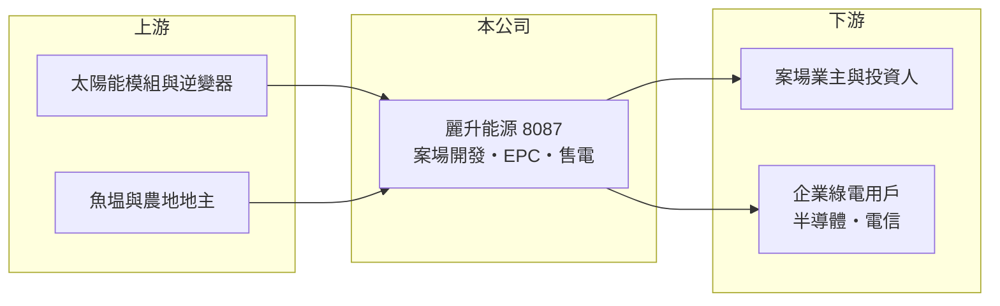

# 8087 麗升能源

> 上櫃｜[[產業索引-綠能環保|綠能環保]]｜上市（櫃）日期 2004/02/25

# 第一章：企業模式與商業藍圖

> [!info] 撰寫說明
> 精簡版，由 Claude 依公開資料整理，架構比照 [[2330台積電]]，資料截至 2026-10-08。來源：Goodinfo 台灣股市資訊網年度經營績效（2020 至 2025 年）；優分析 UAnalyze 2026 年 3 月報導；櫃買中心開放資料快照（基本資料、2026 年上半年資產負債與損益、股利）。公開資料有限，業務別營收比重與案場總容量未查得。#待校對

麗升能源科技成立於 1997 年 8 月、2004 年 2 月上櫃，總部在台北信義區，董事長兼總經理為林麗珍，實收資本額 3.9 億元。公司目前的主業是太陽光電案場開發、建置與綠電售電轉供，案場類型以[[漁電共生]]與農電為主，並延伸到[[儲能]]。

- **核心業務：** 麗升的收入來自兩類：一是替案場業主進行開發與工程建置（[[EPC]]），依工程進度認列；二是取得售電業資格後，把綠電以[[綠電轉供]]方式賣給企業用戶，簽訂長期 [[RE100]] 購電合約。前者金額大但一次性，後者規模較小但可長期重複。
- **營收結構：** 業務別比重這次未查得。2025 年營收只有 2.51 億元，2024 年則有 7.78 億元，落差來自案場工程的認列時點。2026 年 1 月簽下彰化漁電共生工程，規模 37.8 億元，將依進度認列，2026 年上半年營收 4.86 億元已接近 2025 年全年的兩倍。
- **營運據點：** 案場集中在台灣中南部，包括彰化漁電共生、五福案場（預計 2026 年上半年併網）與農電案場（預計 2026 年底前分期完工）。集團轉供量 2025 年年增約 5 倍，已簽約綠電總量達 7 億度，需求來自半導體與電信客戶。
- **長期方向：** AI 用電增加、企業 RE100 與 2050 淨零目標，讓企業綠電需求長期成長。麗升的課題是把工程業務累積的案場資源轉為持有型電廠與長期售電合約，降低營收的大起大落。

# 第二章：護城河深度與競爭優勢

麗升的競爭力在於案場開發經驗與售電通路，但護城河仍淺，執行力是關鍵。

- **競爭優勢：** 漁電共生案場需要與漁民、地方政府與農漁業主管機關長期協調，取得土地與許可的經驗不易複製。已簽約的 7 億度綠電合約，代表公司在企業購電端已建立客戶基礎。
- **主要對手：** 太陽光電開發與售電同業包括 [[6873泓德能源]]、[[6869雲豹能源]]、[[6806森崴能源]]、[[3576聯合再生]] 等，大型電力集團也積極搶進綠電售電市場。
- **觀察重點：** 2025 年虧損的主因是申設與工程進度嚴重延宕，顯示許可與施工管理是最大瓶頸。長期要看大型漁電工程能否如期認列，以及持有型售電收入是否穩定成長。

# 第三章：財務體質與盈利規模

資料日期：2026-10-08，表格是撰寫當時的快照；最新月營收、毛利率、累計 EPS 由自動排程寫在本筆記的屬性欄位（月營收、毛利率、累計EPS 等）。#待校對

麗升營收規模小、波動大，本業多數年份處於營業虧損，獲利年份多仰賴業外收益。

| 年度 | 營收（億元） | [[毛利率]] | [[營業利益率]] | EPS（元） | [[ROE]] |
|---|---|---|---|---|---|
| 2021 | 0.52 | -6.56% | -80.7% | -0.84 | -9.10% |
| 2022 | 2.06 | 35.4% | -7.36% | 1.29 | 13.4% |
| 2023 | 2.04 | 26.8% | -19.4% | 4.10 | 32.9% |
| 2024 | 7.78 | 14.5% | 1.87% | 0.61 | 3.52% |
| 2025 | 2.51 | 12.4% | -32.1% | -1.32 | -6.35% |

註：Goodinfo 合併報表；2020 年營收 0.62 億元、EPS -0.20 元。2022 至 2023 年營業虧損但 EPS 為正，推估來自處分案場等業外收益（來源未查得）。2026 年上半年營收 4.86 億元、毛利率約 14.9%、EPS 0.56 元（櫃買中心資料）。

- **長期指標：** 2021 至 2025 年平均 ROE 約 6.9%（推算），但年度間由 -9% 到 33%，平均值參考性低。營收年複合成長率因基期極小而不具意義。2025 年度未配發現金股利。
- **[[ROIC]] 與 [[WACC]]：** 2025 年營業損失約 0.81 億元（2.51 億元 × -32.1%），因虧損不計稅盾；投入資本約 10 億元（2026 年第二季股東權益 7.65 億元，加上以非流動負債 2.36 億元推估的有息負債），ROIC 約 -8%（推算），為負值，代表本業在消耗資本。2026 年上半年營業利益 0.38 億元，年化 ROIC 約 6%（推算）。WACC 約 6.4%（推算：無風險利率 1.75%、市場風險溢酬 6%、β 取綠能開發業常見值 1.0，股東權益成本 7.75%；稅前負債成本 2.5%、稅率 20%，負債占資本約 24%）。長期 ROIC 低於 WACC，尚未證明能持續創造價值。
- **財務特色：** 2026 年第二季負債比率約 67%（負債 15.19 億元 ÷ 資產 22.84 億元），流動負債 12.84 億元，推估與大型工程的預收款與短期融資有關。

# 第四章：總體風險與地緣政治

麗升的風險在於案場許可、工程執行與營收集中。

- **產業週期：** 營收取決於少數大型案場的工程進度，延宕就會造成虧損，2025 年即為例子。太陽光電建置受政策與土地取得影響，週期不規則。
- **營運風險：** 單一大型工程（37.8 億元）相對公司規模極大，若成本超支或業主付款延遲，對財務影響很大。負債比率高，營運資金壓力大。
- **其他風險：** 漁電共生的環社檢核與地方抗爭、綠電售電價格與轉供規則變動，以及模組與電力設備的進口成本與匯率。

# 專有名詞解析

## 金融

- **[[ROIC]]**：投入資本報酬率，稅後營業利益除以股東權益加有息負債，衡量本業運用資本的效率。

## 產業

- **[[漁電共生]]**：在魚塭上方或周邊設置太陽能板，同時養殖與發電，是台灣增加太陽光電土地的政策方向。
- **[[EPC]]**：設計（Engineering）、採購（Procurement）、施工（Construction）一次承包的工程模式。
- **[[綠電轉供]]**：發電業者透過台電電網把再生能源電力輸送給指定企業用戶，台電收取代輸費用。
- **[[RE100]]**：企業承諾 100% 使用再生能源電力的國際倡議，帶動企業對綠電的長期需求。
- **[[儲能]]**：以電池等設備儲存電力，在用電尖峰或電網需要時釋放，可參與電力交易市場賺取收入。

# 核心供應鏈

- 上游：太陽能模組與逆變器供應商（例如 [[6443元晶]] 等，實際採購對象未查得）、魚塭與農地地主。
- 下游／客戶：案場業主與投資人；半導體與電信等綠電購電企業（名單未查得）。
- 同業：[[6873泓德能源]]、[[6869雲豹能源]]、[[6806森崴能源]]、[[3576聯合再生]]。

## 最新新聞
<!-- news:start（自動產生，請勿手動編輯此範圍） -->
- 2026-10-12 🏛️ 重訊 19:15｜代子公司麗崴新能源股份有限公司依公開發行公司 資金貸與及背書保證處理準則第二十五條第一項第 二、三及四款規定辦理公告｜[觀測站](https://mops.twse.com.tw/mops/#/web/t05st01)
- 2026-10-08 🏛️ 重訊 18:20｜代子公司香印永續股份有限公司公告董事會 決議通過擬簽訂購售電合約｜[觀測站](https://mops.twse.com.tw/mops/#/web/t05st01)

完整紀錄：[[8087麗升能源 新聞]]
<!-- news:end -->

## 相關連結
- [公開資訊觀測站](https://mopsov.twse.com.tw/mops/web/t05st03?step=1&firstin=1&co_id=8087)
- [Goodinfo](https://goodinfo.tw/tw/StockDetail.asp?STOCK_ID=8087)
- [Yahoo 股市](https://tw.stock.yahoo.com/quote/8087)
- [鉅亨網新聞](https://www.cnyes.com/twstock/8087/news)
