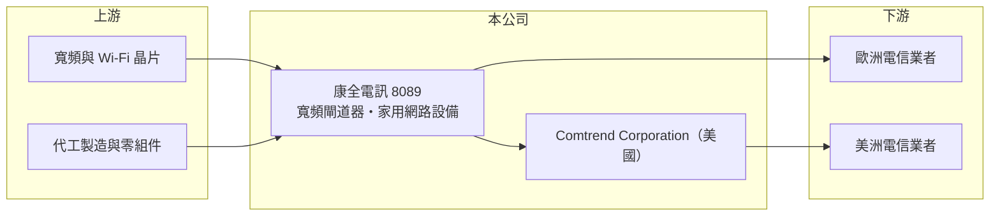

# 8089 康全電訊

> 上櫃｜[[產業索引-通信網路業|通信網路業]]｜上市（櫃）日期 2020/09/23

# 第一章：企業模式與商業藍圖

> [!info] 撰寫說明
> 本文由 Claude 依公開資料整理，架構比照 [[2330台積電]] 的四章研究，資料截至 2026-10-08。財務數字來源：Goodinfo 年度經營績效頁與基本資料頁（含 2026 年新聞標題）、櫃買中心開放資料（基本資料、2026 年第二季資產負債與損益、本益比殖利率）、優分析 2026 年 9 月報導標題。產品線與歐洲客戶描述部分憑記憶整理，已標「待校對」。#待校對

評估以電信業者標案為主的寬頻設備商，要看它在大案之間能否維持基本獲利，以及能否持續取得新的業者訂單。本章說明康全電訊（股票代號：8089，以下簡稱康全）的商業模式。

## 一、核心定位：寬頻通訊設備

康全成立於 1990 年，2020 年在櫃買中心掛牌，總部位於新北市三重區，實收資本額約 6.6 億元，國際品牌為 Comtrend。依公司揭露的主要業務，康全從事寬頻通訊設備，重要子公司為美國的 Comtrend Corporation（2018 年登記，負責寬頻通訊產品銷售與服務）。產品屬於[[CPE]]，包括銅線寬頻（[[xDSL]]）與光纖閘道器、家用網路設備等，主要客戶為歐洲與美洲的電信業者（產品與客戶描述待校對）。各產品的營收比重未查得。

## 二、標案驅動的營收型態

康全的營收在大型標案年與空窗年之間差距極大：2024 年營收 39.5 億元、EPS 8.29 元，2025 年卻只有 8.19 億元、EPS -3.09 元；2023 年也曾跌到 8.89 億元並虧損。這說明公司營收高度依賴少數業者的大型採購案，屬於典型的[[專案型收入]]，大案出貨時獲利大增，出貨結束後固定費用就把獲利吃掉。依 2026 年 9 月報導，公司歐洲寬頻出貨自 2026 年下半年啟動，營運可望優於上半年。

## 三、長期方向

康全的長期方向是在歐美電信業者從銅線轉向光纖的過程中，持續取得光纖閘道器與家用網路設備的標案，並透過美國子公司擴大北美客戶（推估）。要讓營收曲線更平滑，關鍵是同時服務更多業者，降低單一標案的比重。

# 第二章：護城河深度與競爭優勢

在長期價值投資中，「護城河」指企業抵禦競爭、維持超額利潤的保護機制。本章分析康全的優勢與限制。

## 一、護城河的組成

* **歐洲業者的長期關係：** 康全長期服務歐洲電信業者，熟悉當地規格與認證流程，在換機標案中具備實績優勢（待校對）。
* **中小業者的彈性服務：** 相較大型 CPE 廠，康全能接受較小量、客製化程度較高的訂單，適合中型電信業者（推估）。

不過公司規模小，大型業者標案常由大廠取得，護城河整體偏窄。

## 二、主要競爭對手

| 對手 | 定位 | 對康全的威脅 |
|---|---|---|
| [[5388中磊]] | 全球寬頻 CPE 大廠 | 規模與客戶數遠大於康全 |
| [[3596智易]] | 歐洲電信 CPE 主要供應商 | 在歐洲業者標案直接競爭 |
| [[3380明泰]]、[[2419仲琦]] | 網通設備 | 產品線部分重疊 |
| 歐洲本土與中國大陸 CPE 廠 | 在地關係或低價 | 壓縮報價 |

## 三、守得住／守不住／觀察重點

守得住的是已合作業者的後續換機與維護。守不住的是大型標案之間的營收空窗。長期觀察重點是歐洲新案的出貨規模、能否同時服務更多業者，以及在空窗年度控制費用、避免大幅虧損。

# 第三章：財務體質與盈利規模

資料日期：2026-10-08，表格是撰寫當時的快照；最新月營收、毛利率、累計 EPS 由自動排程寫在本筆記的屬性欄位（月營收、毛利率、累計EPS 等）。#待校對

財務報表是檢驗護城河是否真實存在的最終標準。本章用六年的三率、ROE 與資本報酬，檢視康全的獲利品質。

## 一、多年度經營績效

| 年度 | 營收（新台幣） | [[毛利率]] | [[營業利益率]] | EPS（元） | [[ROE]] |
|---|---|---|---|---|---|
| 2020 | 26.2 億 | 32.2% | 10.3% | 3.96 | 17.6% |
| 2021 | 16.6 億 | 32.2% | -1.22% | -0.46 | -1.96% |
| 2022 | 19.2 億 | 30.9% | -0.67% | 0.16 | 0.74% |
| 2023 | 8.89 億 | 20.9% | -41.5% | -5.90 | -32.3% |
| 2024 | 39.5 億 | 29.6% | 11.6% | 8.29 | 42.0% |
| 2025 | 8.19 億 | 39.7% | -19.2% | -3.09 | -16.1% |
| 2026 上半年 | 2.09 億 | 32.4% | -58.0% | -1.47 | 未查得 |

康全的毛利率大致穩定在 30% 左右，獲利的劇烈變化幾乎完全來自營收規模：營收超過 25 億元時營業利益率可達一成以上，低於 10 億元時就陷入大幅虧損。2021 至 2025 年平均 ROE 約 -1.5%（推算），2020 至 2025 年營收年複合成長率約 -21%（推算），但這個數字受起訖年份影響很大。最近一次未配發現金股利。2026 年上半年營收只有 2.09 億元，營業虧損 1.21 億元，業外收入部分抵銷。

## 二、[[ROIC]] 與 [[WACC]]：價值創造利差

**ROIC 推算：** 2025 年營業損失約 1.57 億元（8.19 億 × -19.2%）。2026 年第二季股東權益約 10.0 億元，負債約 4.4 億元，假設有息負債約 2 億元（推估），投入資本約 12 億元，2025 年 ROIC 約 -13%（推算）；2024 年大案年度的 ROIC 推估超過 25%。

**WACC 推算：** 台灣 10 年期公債 1.75%、市場風險溢酬 6%、β 取網通同業常見值 1.2，股東權益成本約 9.0%；負債成本 2.5%、稅後 2.0%；權益占投入資本約 83%，WACC 約 7.8%（推算）。

**結論：** 康全的 ROIC 在大案年遠高於 WACC，空窗年則深度為負，多年平均低於資金成本。長期能否創造價值，取決於能否讓大案出現的頻率提高、空窗期縮短。

# 第四章：總體風險與地緣政治

任何企業都無法脫離宏觀環境獨立存在。本章分析康全長期必須面對的風險。

## 一、客戶集中與標案風險

營收高度依賴少數電信業者的大型採購，標案延後、規模縮小或流失，都會讓整年營收大幅下滑。2023 與 2025 年的虧損就是例子。

## 二、技術與競爭風險

電信業者從銅線轉向光纖、從 Wi-Fi 6 轉向 Wi-Fi 7，產品必須跟著換代。大型 CPE 廠在研發資源與價格上具優勢，可能在新世代標案中取得更多份額。

## 三、匯率與地緣政治

營收以歐元與美元為主（推估），匯率波動會影響毛利。歐美業者對設備產地與資安的要求日益嚴格，生產布局可能需要調整，增加成本。

# 專有名詞解析

## 應用

- **[[CPE]]**：用戶端設備，放在家庭或企業端、連接電信或有線電視網路的設備，例如數據機、閘道器、分享器。
- **[[xDSL]]**：利用既有電話銅線傳輸寬頻資料的技術總稱，正逐步被光纖取代。

## 金融

- **[[ROIC]]**：投入資本報酬率，稅後營業利益除以股東權益與有息負債的合計，衡量本業對所有資金提供者的報酬。
- **[[WACC]]**：加權平均資金成本，依股東權益與負債的比重加權計算的資金成本，ROIC 高於它才代表創造價值。

## 產業

- **[[專案型收入]]**：依專案交貨或驗收時一次認列的收入，金額大但時點不固定，造成營收在各期間大幅波動。

# 核心供應鏈

## 1. 上游：晶片與製造
- 寬頻與 Wi-Fi 晶片：[[AVGO博通]]、[[QCOM高通]] 等晶片商（實際採用廠牌未查得）

## 2. 中游：康全與同業
- 子公司：Comtrend Corporation（美國）
- 同業：[[5388中磊]]、[[3596智易]]、[[3380明泰]]、[[2419仲琦]]

## 3. 下游：客戶
- 歐洲與美洲電信業者（具體客戶未查得）

## 最新新聞
<!-- news:start -->
<!-- news:end -->

## 相關連結
- [公開資訊觀測站](https://mopsov.twse.com.tw/mops/web/t05st03?step=1&firstin=1&co_id=8089)
- [Goodinfo](https://goodinfo.tw/tw/StockDetail.asp?STOCK_ID=8089)
- [Yahoo 股市](https://tw.stock.yahoo.com/quote/8089)
- [鉅亨網新聞](https://www.cnyes.com/twstock/8089/news)
