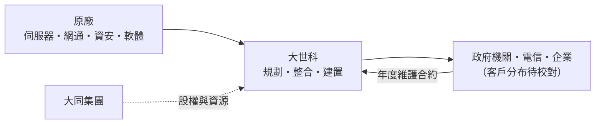
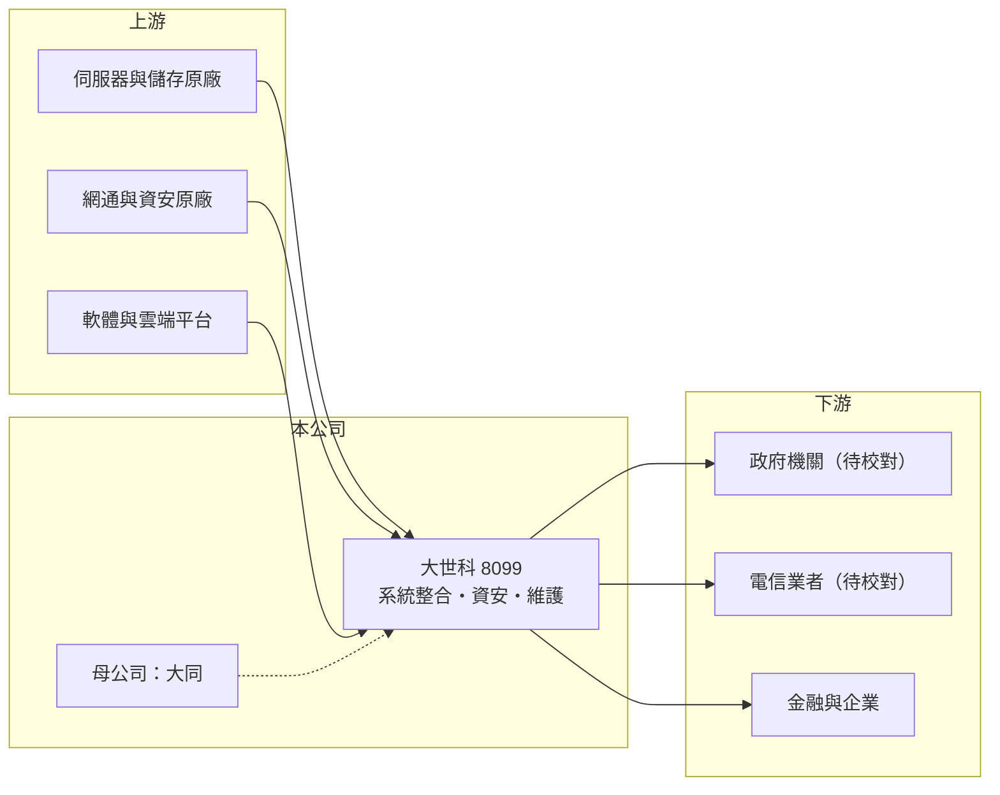

# 8099 大世科

> 上櫃｜[[產業索引-資訊服務業|資訊服務業]]｜上市（櫃）日期 2004/03/29

# 第一章：企業模式與商業藍圖

> [!info] 撰寫說明
> 本文由 Claude 依公開資料整理，架構比照 [[2330台積電]] 的四章研究，資料截至 2026-10-08。財務數字來源：Goodinfo 年度經營績效頁、nStock 公司簡介、櫃買中心開放資料（基本資料、2026 年第二季資產負債與綜合損益、本益比殖利率）；營收比重與客戶產業分布未查得，客戶描述部分憑記憶整理。公開資料有限。#待校對

大世科（股票代號：8099）是大同集團旗下的資通訊[[系統整合]]公司。本章說明它如何把電腦、網路與資安產品組裝成客戶需要的系統，以及集團背景在其中扮演的角色。

## 一、核心定位：大同集團的系統整合子公司

大世科成立於 2000 年，2004 年 3 月在櫃買中心掛牌，實收資本額約 10 億元，母公司為 [[2371大同]]。依 nStock 整理的公司資料，主要業務有三項：銷售電腦、通訊、網路與資安相關軟硬體；提供客製化的系統整合諮詢與服務；以及產業加值應用解決方案。

系統整合商的角色，是替客戶把不同廠牌的伺服器、儲存、網路、資安設備與軟體整合成一套可運作的系統，並負責規劃、建置與後續維護。客戶買的是「整套系統能正常運作」，而不只是設備本身，因此整合商的價值在於專案管理、技術整合與售後服務。

## 二、營收結構與客戶

公開資料未查得大世科的營收比重與客戶產業分布。依產業常態與過往報導記憶，系統整合商的客戶多來自政府機關、電信業者、金融業與大型企業，大世科亦以機關與電信相關專案為重要來源（待校對）。收入可分為設備與軟體轉售、建置服務，以及維護合約；其中維護合約按年收費，屬於[[經常性收入]]，但具體占比未查得。

## 三、資本轉化邏輯

* **專案制營收：** 系統整合以專案為單位認列，大型標案的得標與驗收時點會讓營收在年度之間波動。2024 年營收 39.3 億元，2025 年跳升到 50.1 億元。
* **營運資金需求：** 專案通常先採購設備、驗收後才收款，期間需要墊付資金，因此應收帳款與存貨的管理很重要。2026 年第二季底流動負債約 19.9 億元，推估多為應付帳款與合約負債。

## 四、長期方向

政府數位轉型、[[資安]]法規加嚴、企業上雲與 AI 應用，都是系統整合商的長期需求來源。大世科近年[[營業利益率]]從 2018 年的 2.4% 提升到 2025 年的 6.15%、2026 上半年的 7.5%，顯示產品組合正往附加價值較高的資安與服務移動（推估）。

# 第二章：護城河深度與競爭優勢

系統整合業的競爭很激烈，護城河主要來自實績與客戶關係。本章分析大世科的競爭位置。

## 一、護城河的組成

* **標案實績與資格：** 政府與大型企業的標案通常要求過往實績、技術人員證照與財務規模。累積二十多年的專案經驗，讓大世科具備投標門檻（推估）。
* **維護合約的黏著度：** 系統上線後，原建置廠商最熟悉架構，維護與擴充多半由原廠商承接，形成延續性收入。
* **集團背景：** 作為大同集團一員，在信用與資源上有一定支持，但集團本身的經營變動也可能帶來影響。

## 二、主要競爭對手

| 對手 | 定位 | 與大世科的比較 |
|---|---|---|
| [[6214精誠]] | 大型系統整合與軟體 | 規模更大，金融與企業客戶多 |
| [[2453凌群]]、5403中菲 | 政府與金融系統整合 | 在機關標案直接競爭 |
| [[2480敦陽科]]、6112邁達特 | 基礎架構與資安整合 | 在企業與資安專案競爭 |
| [[6183關貿]]、[[6614資拓宏宇]] | 政府資訊系統 | 在公部門專案競爭 |

## 三、守得住與守不住

* **守得住：** 已建置系統的維護與擴充、長期往來的機關與企業客戶。
* **守不住：** 新標案的價格。系統整合標案常以價格競爭，得標毛利有限。
* **觀察重點：** [[毛利率]]能否維持在 20% 以上、資安與服務收入占比，以及大型專案的驗收進度。

# 第三章：財務體質與盈利規模

資料日期：2026-10-08，表格是撰寫當時的快照；最新月營收、毛利率、累計 EPS 由自動排程寫在本筆記的屬性欄位（月營收、毛利率、累計EPS 等）。#待校對

系統整合商的財報重點是營益率趨勢與營收的穩定度。本章用多年度數字檢視大世科的獲利品質。

## 一、多年度財務表

| 年度 | 營收（新台幣） | [[毛利率]] | [[營業利益率]] | EPS（元） | [[ROE]] |
|---|---|---|---|---|---|
| 2021 | 42.7 億 | 20.8% | 5.01% | 2.01 | 12.9% |
| 2022 | 43.5 億 | 20.5% | 4.48% | 2.02 | 12.5% |
| 2023 | 41.8 億 | 22.2% | 5.09% | 2.12 | 13.0% |
| 2024 | 39.3 億 | 24.3% | 5.56% | 2.31 | 13.7% |
| 2025 | 50.1 億 | 21.0% | 6.15% | 2.53 | 15.8% |
| 2026 上半年 | 25.25 億 | 23.8% | 7.53% | 1.58 | 未查得 |

資料來源：Goodinfo；2026 上半年為櫃買中心開放資料。

* **營收平穩、利潤率改善：** 2020 至 2025 年營收年複合成長率約 3.2%（推算），成長不快；但營業利益率從 2018 年的 2.4% 一路提升到 2025 年的 6.15%，EPS 從 1.16 元增加到 2.53 元，代表獲利成長主要來自利潤率改善。
* **配息：** Goodinfo 統計一般平均現金股利約 1.53 元，2025 年度配發 2.1 元，以 EPS 2.53 元計算配息率約 83%（推算）。

## 二、ROE 與長期指標

2021 至 2025 年平均 ROE 約 13.6%（推算），且逐年上升。2026 年第二季底權益約 16.3 億元、負債約 21.4 億元，負債以營運相關的應付款與合約負債為主（推估）。

## 三、[[ROIC]] 與 [[WACC]]

**ROIC 推算：** 2025 年營業利益 3.08 億元，扣除 20% 稅率後約 2.46 億元。權益約 16.34 億元；有息負債未查得，假設約 0 至 3 億元（推估），投入資本約 16.3 億至 19.3 億元，ROIC 約 12.8% 至 15.1%（推算）。

**WACC 推算：** 台灣 10 年期公債殖利率假設 1.75%、市場風險溢酬 6%、β 取資訊服務業常見值 0.8（同業估計值），股東權益成本約 6.55%；負債成本假設 2.5%、稅後 2.0%，WACC 約 5.8% 至 6.5%（推算）。

**結論：** 大世科的 ROIC 約為 WACC 的兩倍，而且隨利潤率改善逐年擴大，屬於創造價值的公司。利差能否維持，取決於高附加價值服務的比重，而不是營收規模。

# 第四章：總體風險與地緣政治

系統整合商的風險多半來自專案執行與客戶集中。本章整理大世科的長期風險。

## 一、產業週期

* **政府與企業預算：** 機關預算與企業資本支出的節奏，決定標案數量與規模。預算刪減或延後時，營收會出現斷層。
* **專案認列波動：** 大型專案的驗收時點會讓單月與單季營收大幅波動，2026 年 8 月單月營收年減約 27% 即是例子，不宜過度解讀短期數字。

## 二、營運風險

* **專案成本超支：** 固定總價的標案若遇到設備漲價或需求變更，損失由整合商吸收。
* **人才：** 資安與雲端工程師供不應求，人力成本上升會壓縮利潤。
* **集團治理：** 母公司大同過去曾有經營權爭議，集團政策變動可能影響子公司的業務與股利政策（待校對）。

## 三、其他風險

* **匯率：** 進口設備多以美元計價，新台幣貶值會提高採購成本。
* **原廠政策：** 原廠調整通路或直接服務大型客戶，會壓縮整合商的角色。
* **雲端化：** 客戶轉向公有雲，地端設備整合的需求下降，整合商需要轉型為雲端代管與資安服務。

# 專有名詞解析

## 應用

- **[[資安]]**：資訊安全，保護資訊系統與資料不被入侵、竊取或破壞的技術與管理措施。

## 金融

- **[[毛利率]]**：營業毛利占營收的比例，反映產品定價能力與生產成本控制。
- **[[營業利益率]]**：扣除營業費用後的營業利益占營收的比例，衡量本業整體獲利能力。
- **[[ROE]]**：股東權益報酬率，稅後淨利除以股東權益，衡量公司運用股東資金的效率。
- **[[ROIC]]**：投入資本報酬率，稅後營業利益除以股東權益與有息負債的合計，衡量本業對所有資金提供者的報酬。
- **[[WACC]]**：加權平均資金成本，依股東權益與負債的比重加權計算的資金成本，ROIC 高於它才代表創造價值。

## 產業

- **[[系統整合]]**：把不同廠牌的硬體、軟體與網路設備整合成可運作的資訊系統，並負責建置與維護的服務。
- **[[經常性收入]]**：每年按合約重複收取的收入，例如維護費、訂閱費，可預測性高於一次性銷售。

# 核心供應鏈

## 1. 上游：原廠
- 網通設備：[[CSCO思科]] 等（實際代理品牌未查得）
- 軟體與雲端平台：[[MSFT微軟]] 等

## 2. 中游：大世科與同業
- 母公司：[[2371大同]]
- 系統整合同業：[[6214精誠]]、[[2453凌群]]、5403中菲、[[2480敦陽科]]、6112邁達特、[[6183關貿]]、[[6614資拓宏宇]]

## 3. 下游：客戶
- 政府機關、電信業者、金融與大型企業（客戶分布未查得，待校對）

## 最新新聞
<!-- news:start（自動產生，請勿手動編輯此範圍） -->
- 2026-10-12 📰 媒體 18:51｜營收速報 - 大世科(8099)9月營收7.13億元年增率高達123.46％｜[鉅亨網](https://news.cnyes.com/news/id/6628401)

完整紀錄：[[8099大世科 新聞]]
<!-- news:end -->

## 相關連結
- [公開資訊觀測站](https://mopsov.twse.com.tw/mops/web/t05st03?step=1&firstin=1&co_id=8099)
- [Goodinfo](https://goodinfo.tw/tw/StockDetail.asp?STOCK_ID=8099)
- [Yahoo 股市](https://tw.stock.yahoo.com/quote/8099)
- [鉅亨網新聞](https://www.cnyes.com/twstock/8099/news)
