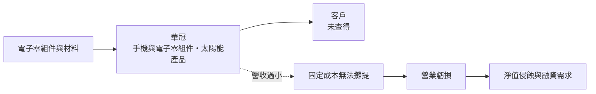
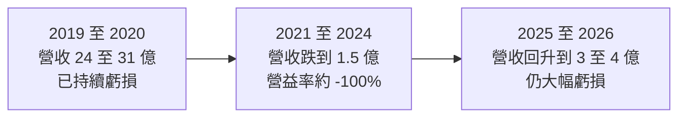
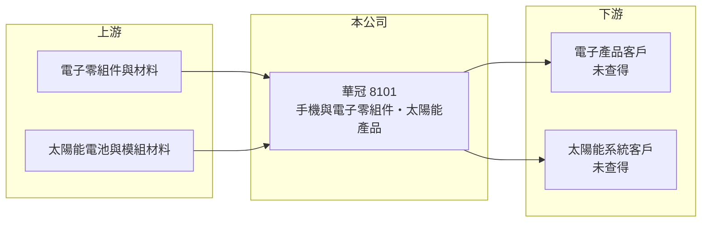

# 8101 華冠

> 上市｜[[產業索引-通信網路業|通信網路業]]｜上市（櫃）日期 2004/07/01

# 第一章：企業模式與商業藍圖

> [!info] 撰寫說明
> 本文由 Claude 依公開資料整理，架構比照 [[2330台積電]] 的四章研究，資料截至 2026-10-08。財務數字來源：Goodinfo 年度經營績效頁、證交所開放資料（基本資料、2026 年第二季資產負債與營益分析、股利、每月營收、本益比）、nstock 公司小百科（營業項目、2023 年重大訊息標題）。公開資料有限，現行產品、客戶與營收比重皆未查得；手機代工沿革部分憑記憶整理，已標「待校對」。#待校對

在評估單一個股的長期投資價值時，首要步驟是拆解企業的底層獲利邏輯。本章針對華冠通訊（股票代號：8101，以下簡稱華冠）的商業模式進行定性分析。華冠曾是台灣手機代工廠之一，但近年營收大幅萎縮、連年虧損，分析重點在於公司目前的經營狀態與存續風險。

## 一、核心定位：營收大幅萎縮的前手機代工廠

華冠成立於 1999 年，2004 年上市，實收資本額約 5.22 億元，董事長為李森田。依 nstock 公司小百科，華冠的營業項目為手機及電子零組件，以及太陽能產品及設備的製造、加工與銷售。華冠早年以手機[[ODM]]起家，曾替國際品牌設計與生產手機（客戶與年代待校對）。

手機代工是一個極度依賴規模的產業。2010 年代智慧型手機市場快速集中在蘋果、三星與中國品牌，代工訂單也集中到少數大型組裝廠，中小型手機 ODM 陸續退出。華冠的營收從 2020 年的約 30.6 億元，降到 2022 年的約 3.6 億元，2024 年只剩約 1.5 億元，正是這個產業變化的結果。

## 二、目前的業務狀態

* **營收規模：** 2025 年營收約 3.91 億元，2026 年 1 至 8 月累計營收約 2.59 億元，比去年同期的 2.84 億元減少約 9%（證交所每月營收）。
* **產品：** 依營業項目，目前業務包括手機及電子零組件與太陽能產品（各自比重未查得）。2026 年上半年毛利率只有 5.91%（證交所營益分析），顯示目前業務的附加價值很低。
* **存續警訊：** 2023 年 8 月，華冠公告會計師對 2023 年第二季財報出具[[繼續經營能力]]存在重大不確定性的核閱報告，並接獲證交所通知，股票改列變更交易方法（nstock 重大訊息標題）。

## 三、資本轉化邏輯：規模不足的製造業困境

* **固定成本壓力：** 製造業需要維持研發、管理與生產團隊，營收一旦大幅萎縮，固定成本無法攤提，營業利益率就會出現 -20% 到 -100% 的極端數字，這正是華冠近年的狀況。
* **淨值侵蝕：** 2026 年第二季底保留盈餘約 -4.25 億元，已接近實收資本額，每股淨值只剩約 4.23 元（證交所開放資料）。

## 四、企業長期方向

本文未查得華冠近年的轉型計畫或新事業說明。從營業項目來看，公司嘗試以電子零組件與太陽能產品維持營運，但營收規模仍不足以支撐損益兩平。華冠的長期發展，取決於能否找到具規模的新業務或策略投資者；在此之前，它應被視為處於轉型或重整階段的公司。

# 第二章：護城河深度與競爭優勢

本章分析華冠的競爭地位。在現階段，華冠很難說具備護城河，以下說明原因與觀察重點。

## 一、競爭地位評估

* **缺乏規模：** 手機與電子零組件製造的競爭關鍵是規模與成本，華冠每年營收只有數億元，與動輒數千億元的大型組裝廠無法相比。
* **技術與客戶：** 過去的手機設計經驗是潛在資產，但手機產業技術迭代快，若沒有持續的客戶與專案，經驗價值會快速流失。
* **太陽能產品：** 太陽能模組與設備市場由中國大廠主導，價格競爭激烈，小型業者很難取得優勢。

## 二、主要競爭對手格局

| 競爭對手 | 主要市場 | 與華冠的比較 |
|---|---|---|
| [[2317鴻海]]、[[4938和碩]] 等 | 全球手機組裝 | 規模與客戶完全不同等級 |
| 中國手機 ODM（華勤、龍旗、聞泰） | 全球中低階手機 | 主導中低階手機代工市場 |
| 中國太陽能業者 | 全球太陽能 | 成本與規模優勢明顯 |

## 三、觀察重點

* **營收能否止跌回升：** 營收需要大幅成長，才有機會讓固定成本被攤提。
* **財務與股權變化：** 是否辦理[[減資彌補虧損]]、增資或引進策略投資者，這些都會改變公司的經營方向與股東權益。
* **會計師意見：** 財報是否持續附有繼續經營能力的重大不確定性說明，是判斷存續風險的直接指標。

# 第三章：財務體質與盈利規模

資料日期：2026-10-08。數字取自 Goodinfo 年度經營績效頁與證交所開放資料，表格是撰寫當時的快照；最新月營收、毛利率、累計 EPS 由自動排程寫在本筆記的屬性欄位（月營收、毛利率、累計EPS 等）。#待校對

財務報表是檢驗護城河是否真實存在的最終標準。本章用多年度的三率、ROE 與資本報酬，呈現華冠營收萎縮與虧損的程度。

## 一、獲利能力的基石：三率

| 年度 | 營收（新台幣） | [[毛利率]] | [[營業利益率]] | EPS（元） | [[ROE]] |
|---|---|---|---|---|---|
| 2019 | 24.4 億 | 7.27% | -23.4% | -0.23 | -4.86% |
| 2020 | 30.6 億 | -2.74% | -22.9% | -3.06 | -87.8% |
| 2021 | 7.38 億 | -12.2% | -73.2% | 0.03 | 0.45% |
| 2022 | 3.62 億 | 3.06% | -78.3% | -2.22 | -45.7% |
| 2023 | 1.68 億 | 0.66% | -111% | -2.79 | -104% |
| 2024 | 1.47 億 | 28.9% | -109% | -3.27 | -151% |
| 2025 | 3.91 億 | 18.8% | -23.5% | -3.15 | -50.7% |
| 2026 上半年 | 1.87 億 | 5.91% | -35.50% | -1.46 | 未查得 |

* **[[毛利率]]：** 七年中有兩年毛利率為負，代表連生產成本都無法覆蓋；2024 至 2025 年毛利率回升到 19% 至 29%，但 2026 年上半年又降到 5.91%，波動極大。
* **[[營業利益率]]：** 七年全部為負，2023 至 2024 年甚至低於 -100%，也就是營業虧損超過營收。
* **2021 年的特殊性：** 2021 年營業利益率 -73.2%，EPS 卻為 0.03 元，代表當年有大額業外收益（推估為資產處分，具體項目未查得）。
* **ROE 的極端值：** 2023 至 2024 年 ROE 低於 -100%，是因為淨值已被虧損侵蝕到很小，分母變小使比率放大。

## 二、[[ROE]]：資本效率

2019 至 2025 年 ROE 幾乎全為負值，平均值已無參考意義。2026 年第二季底權益總計約 2.46 億元（歸屬母公司約 2.21 億元）、總負債約 3.45 億元，負債比約 58%（證交所開放資料）。股價淨值比約 2.51 倍（2026 年 10 月初），高於淨值的評價反映的是市場對轉型或重組的期待，而不是現有資產的報酬。

## 三、資本支出、自由現金流與股利

在持續虧損下，營業現金流預期為負（推估），公司需要依賴借款、增資或資產處分維持營運。股利方面，2025 年度虧損約 1.11 億元，未配發股利，近五年皆無配息紀錄（nstock 統計）。

## 四、[[ROIC]] 與 [[WACC]]：價值創造利差

**ROIC 推算：** 2025 年營業虧損約 0.92 億元（3.91 億 × -23.5%），虧損不計稅盾。以 2026 年第二季底權益總計約 2.46 億元、總負債約 3.45 億元，假設其中約 50% 為有息負債（推估，約 1.72 億元），投入資本約 4.18 億元，ROIC 約 -22%（推算）。

**WACC 推算：** 假設台灣 10 年期公債殖利率 1.75%、市場風險溢酬 6%、β 取 1.0（小型電子股常見值，實際風險可能更高），股東權益成本約 7.75%。負債成本假設 3.5%，稅後約 2.8%；以帳面價值計，權益約占 59%，WACC 約 5.7%（推算）。

**結論：** 華冠的 ROIC 長期大幅為負，與 WACC 的差距超過 25 個百分點，代表公司持續在消耗股東資本。在營收規模大幅成長或業務徹底轉型之前，華冠不具備創造價值的條件，投資判斷的重點應放在存續與重組，而非基本面成長。

# 第四章：總體風險與地緣政治

任何企業都無法脫離宏觀環境獨立存在。本章分析華冠長期必須面對的存續、財務、產業與治理風險。

## 一、存續風險

* **繼續經營能力：** 2023 年會計師已對華冠的繼續經營能力表示重大不確定性，若虧損持續、淨值進一步侵蝕，可能面臨更嚴格的交易限制，甚至下市風險。
* **淨值過低：** 每股淨值約 4.23 元，若跌破一定門檻，依證交所規定可能被改列[[全額交割股]]或觸發其他處置。

## 二、財務風險

* **資金來源：** 在虧損與負現金流下，公司需要持續籌資，增資會稀釋股東權益，借款則增加利息負擔。
* **[[減資彌補虧損]]：** 累積虧損已接近股本，未來可能需要辦理減資，股東持股數會減少。

## 三、產業風險

* **手機代工集中化：** 手機代工訂單集中在大型組裝廠與中國 ODM，小型廠商幾乎沒有生存空間。
* **太陽能價格競爭：** 太陽能產品價格長期下跌，由中國大廠主導，小型業者難以獲利。

## 四、治理與資訊揭露

* **資訊有限：** 公司現行業務、客戶與轉型計畫的公開資訊很少，投資人難以評估公司前景。
* **經營權變動：** 處於困境的公司常伴隨經營權或大股東變動，策略方向可能大幅改變（具體情況未查得）。

# 專有名詞解析

## 金融

- **[[繼續經營能力]]**：會計師判斷公司在可預見的未來能否持續營運；若存在重大不確定性，會在查核或核閱報告中特別說明。
- **[[全額交割股]]**：因財務或其他原因被交易所要求買賣時須先繳足款券的股票，通常與淨值過低或財報異常有關。
- **[[減資彌補虧損]]**：以減少股本的方式沖銷帳上累積虧損，股東持股數減少但持股比例不變。
- **[[ROIC]]**：投入資本報酬率，稅後營業利益除以股東權益與有息負債的合計，衡量本業對所有資金提供者的報酬。
- **[[WACC]]**：加權平均資金成本，依股東權益與負債的比重加權計算的資金成本，ROIC 高於它才代表創造價值。

## 產業

- **[[ODM]]**：原廠委託設計製造，代工廠負責產品設計與生產，再以客戶品牌出貨。

# 核心供應鏈

## 1. 上游：零組件與材料
- 電子零組件、太陽能電池與模組材料（供應商未查得）

## 2. 中游：華冠本身與同業
- 手機組裝大廠：[[2317鴻海]]、[[4938和碩]]
- 中國手機 ODM：華勤、龍旗、聞泰

## 3. 下游：客戶
- 電子產品與太陽能系統客戶（未查得）

## 最新新聞
<!-- news:start（自動產生，請勿手動編輯此範圍） -->
- 2026-10-14 🏛️ 重訊 18:43｜公告本公司接獲最高法院書記廳通知本公司三審勝訴｜[觀測站](https://mops.twse.com.tw/mops/#/web/t05st01)

完整紀錄：[[8101華冠 新聞]]
<!-- news:end -->

## 相關連結
- [公開資訊觀測站](https://mopsov.twse.com.tw/mops/web/t05st03?step=1&firstin=1&co_id=8101)
- [Goodinfo](https://goodinfo.tw/tw/StockDetail.asp?STOCK_ID=8101)
- [Yahoo 股市](https://tw.stock.yahoo.com/quote/8101)
- [鉅亨網新聞](https://www.cnyes.com/twstock/8101/news)
