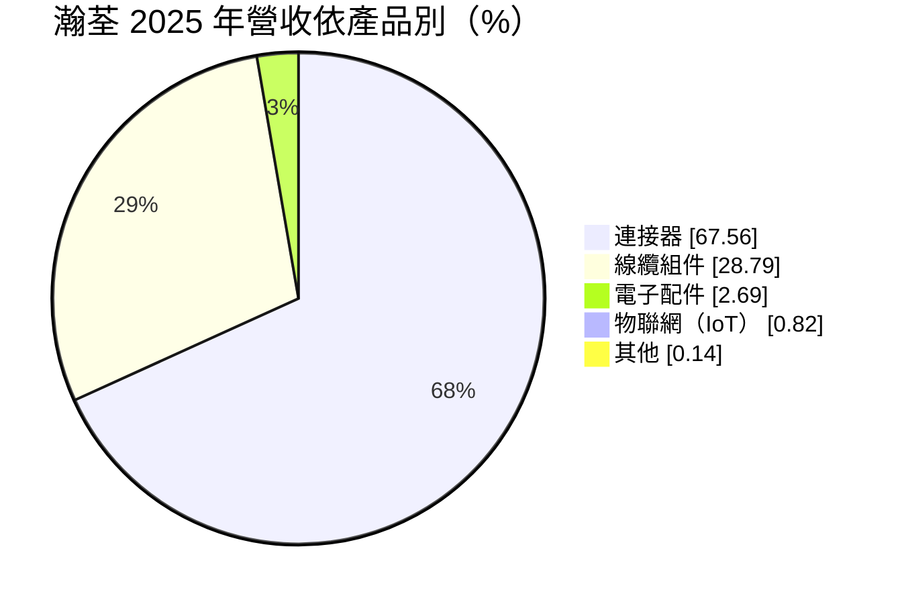
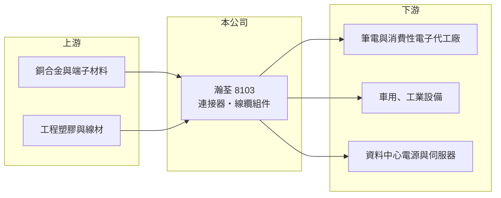

# 8103 瀚荃

> 上市｜[[產業索引-電子零組件業|電子零組件業]]｜上市（櫃）日期 2009/09/29

# 第一章：企業模式與商業藍圖

> [!info] 撰寫說明
> 精簡版，由 Claude 依公開資料整理，架構比照 [[2330台積電]]，資料截至 2026-10-08。來源：證交所開放資料快照（基本資料、2026 年第二季資產負債與損益、股利）、Goodinfo 經營績效頁、MoneyDJ 個股基本資料（2025 年營收比重）、聯合新聞網報導標題。應用市場與據點描述部分依記憶整理，已標註待校對。#待校對

瀚荃是一家中型的[[連接器]]與線纜組件製造商，理解它的關鍵在於：產品本身是標準化程度高的小零件，公司靠的是多品項、多應用的組合，以及把連接器延伸成整條線纜組件的能力。

- **核心業務：** 瀚荃成立於 1990 年，2009 年在證交所上市，實收資本額約 7.84 億元，董事長為楊超群、執行長為楊奕康。公司生產板對板、線對板與軟排線（FPC/FFC）等各類連接器，並把連接器加上線材做成線纜組件出貨。連接器是所有電子設備裡負責傳遞電力與訊號的介面，單價低但用量大，客戶最在意的是品質穩定與交期。
- **營收結構：** 依 MoneyDJ 資料，2025 年連接器約占營收 67.6%，線纜組件約 28.8%，電子配件與物聯網產品合計不到 4%。連接器與線纜組件合計超過九成六，代表公司的命運幾乎完全繫在電子零件的需求循環上。物聯網比重雖小，反映公司曾嘗試從零件往模組與應用延伸。
- **營運據點：** 公司總部在台灣，生產基地以中國為主，近年也在東南亞布局產能，以因應客戶分散生產地點的需求（待校對）。對連接器廠而言，貼近客戶的組裝工廠就近供貨，是能否拿到訂單的基本條件。
- **長期方向：** 依 2026 年的報導標題，資料中心 800V [[HVDC]] 供電架構帶動大電流連接器的出貨量與單價同步提升，是公司近年最重要的新成長來源（待校對）。過去瀚荃的應用以筆電、消費性電子與車用、工業為主（待校對），若能把高電流、高可靠度產品打進資料中心電源鏈，產品組合的毛利率有機會長期提高。

# 第二章：護城河深度與競爭優勢

瀚荃的護城河屬於製造業常見的「窄護城河」：靠客戶認證、產品齊全度與成本控制，而不是技術獨占。

- **競爭優勢：** 連接器一旦被設計進某個產品，通常會跟著該產品量產數年，換供應商要重新驗證，這構成一定的轉換成本。瀚荃毛利率由 2021 年約 30% 一路提高到 2025 年的 37.4%，2026 年上半年也維持 37.4%，代表產品組合正往附加價值較高的方向移動。能把連接器與線材整合成組件，也讓公司能提供較完整的方案。
- **主要對手：** 台灣同業包括 [[3533嘉澤]]、[[2392正崴]]、[[3665貿聯-KY]]、[[3023信邦]]、[[6197佳必琪]]、[[3605宏致]] 與 [[3526凡甲]]；國際上則有安費諾（Amphenol）、TE Connectivity、Molex 等大廠。和這些大廠相比，瀚荃規模小，難在通用規格上打價格戰，因此必須在利基應用中找到位置。
- **觀察重點：** 長期最值得追蹤的是大電流連接器在資料中心電源的滲透率，以及毛利率能否穩定在 35% 以上。若高附加價值產品比重持續上升，營業利益率可望維持在 13% 至 15% 的水準；若新應用只是短期題材，獲利就會回到過去 10% 左右的營業利益率。

# 第三章：財務體質與盈利規模

資料日期：2026-10-08，表格是撰寫當時的快照；最新月營收、毛利率、累計 EPS 由自動排程寫在本筆記的屬性欄位（月營收、毛利率、累計EPS 等）。#待校對

瀚荃的財務特色是營收規模多年在 30 億元上下打轉、但毛利率逐年改善，獲利品質比營收成長更值得注意。

| 年度 | 營收（億元） | [[毛利率]] | [[營業利益率]] | EPS（元） | [[ROE]] |
|---|---|---|---|---|---|
| 2021 | 41.6 | 30.0% | 13.3% | 4.29 | 12.3% |
| 2022 | 37.3 | 29.7% | 9.96% | 4.20 | 11.1% |
| 2023 | 29.6 | 34.1% | 10.0% | 2.76 | 7.01% |
| 2024 | 31.9 | 34.8% | 11.4% | 3.96 | 9.66% |
| 2025 | 33.6 | 37.4% | 13.4% | 3.92 | 8.78% |
| 2026 上半年 | 20.1 | 37.4% | 15.3% | 2.75 | 未查得 |

（來源：Goodinfo 經營績效頁；2026 上半年取自證交所開放資料。2020 年營收 31.3 億元、EPS 2.70 元。）

- **營收規模：** 2020 至 2025 年營收由 31.3 億元增至 33.6 億元，年複合成長率僅約 1.4%（推算），2021 年的 41.6 億元高點來自疫情期間的電子需求。2026 年上半年營收約 20.1 億元，若下半年維持相同水準，全年可望明顯超過過去高點，代表新應用正在改變營收規模（推估）。
- **獲利：** 2021 至 2025 年平均 ROE 約 9.8%（推算），屬中等水準。2026 年上半年 EPS 已達 2.75 元，營業利益率 15.3% 是近年最高。毛利率上升而營收持平的組合，說明公司過去幾年的重點是調整產品組合，而不是衝量。
- **財務特色：** 依 2026 年第二季資料，總資產約 69.1 億元、股東權益約 40.5 億元、負債約 28.6 億元，流動資產占總資產七成以上，財務結構保守。2025 年度每股配發現金股利 2.8 元，約為當年 EPS 3.92 元的七成一（推算），公司章程規定股東紅利不低於可分配盈餘的 15%。自由現金流是否長期為正未查得。
- **[[ROIC]] 與 [[WACC]]：** 以 2025 年營業利益約 4.50 億元（33.6 億元 × 13.4%）、稅率 20% 計算，稅後營業利益約 3.60 億元。有息負債未查得，投入資本以股東權益 40.5 億元到「權益加全部負債」69.1 億元為區間，ROIC 約 5.2% 至 8.9%（推算）；2026 年上半年年化後約 7.1% 至 12.1%（推算）。WACC 以 CAPM 推估：無風險利率 1.75%、市場風險溢酬 6%、β 假設 0.9（連接器同業常見值），權益成本約 7.2%；稅後負債成本假設 2%、負債占兩成，WACC 約 6.1%（推算）。2025 年 ROIC 大致與 WACC 相當，2026 年若維持上半年的獲利水準則明顯高於 WACC，代表公司正從「勉強賺回資金成本」走向創造價值。

# 第四章：總體風險與地緣政治

瀚荃的風險來自零件業的景氣循環、新應用能否延續，以及海外生產的成本與政策變動。

- **產業週期：** 連接器需求跟著終端電子產品走，筆電、手機與消費性電子的庫存調整會直接反映在訂單上，2023 年營收由 37.3 億元降到 29.6 億元就是例子。資料中心需求雖然成長快，但也有雲端業者資本支出的循環，不能視為永遠成長。
- **營運風險：** 大電流連接器若成為主要成長來源，會面臨國際大廠與台灣同業的直接競爭，價格與規格的主導權多在電源系統廠與雲端客戶手上。客戶認證時間長，一旦某個平台未被選用，就要等下一個世代才有機會。
- **其他風險：** 銅、塑膠等原物料價格波動會影響毛利率；生產據點集中在中國時，面臨美國關稅與供應鏈「中國以外」要求的壓力。營收以外幣計價為主，新台幣升值也會壓縮以台幣計算的獲利。

# 專有名詞解析

## 產業

- **[[連接器]]**：讓電子零件、模組或設備之間可插拔連接的元件，負責傳遞電力或訊號。
- **[[HVDC]]**：高壓直流供電架構，資料中心用較高電壓的直流配電以降低轉換損耗。
- **[[線纜組件]]**：把線材與兩端連接器組裝在一起的成品，可直接用於設備內部或設備之間的連接。

# 核心供應鏈

- 上游：銅合金帶材與端子材料（例如 [[2009第一銅]] 這類銅材業者）、工程塑膠與電線電纜材料。
- 下游／客戶：筆電與消費性電子代工廠、車用與工業設備廠，以及資料中心電源系統廠（例如 [[2308台達電]] 所在的電源產業，是否為瀚荃客戶未查得，#待校對）。
- 同業：[[3533嘉澤]]、[[2392正崴]]、[[3665貿聯-KY]]、[[3023信邦]]、[[6197佳必琪]]、[[3605宏致]]、[[3526凡甲]]，國際大廠安費諾、TE Connectivity、Molex。

## 最新新聞
<!-- news:start -->
<!-- news:end -->

## 相關連結
- [公開資訊觀測站](https://mopsov.twse.com.tw/mops/web/t05st03?step=1&firstin=1&co_id=8103)
- [Goodinfo](https://goodinfo.tw/tw/StockDetail.asp?STOCK_ID=8103)
- [Yahoo 股市](https://tw.stock.yahoo.com/quote/8103)
- [鉅亨網新聞](https://www.cnyes.com/twstock/8103/news)
