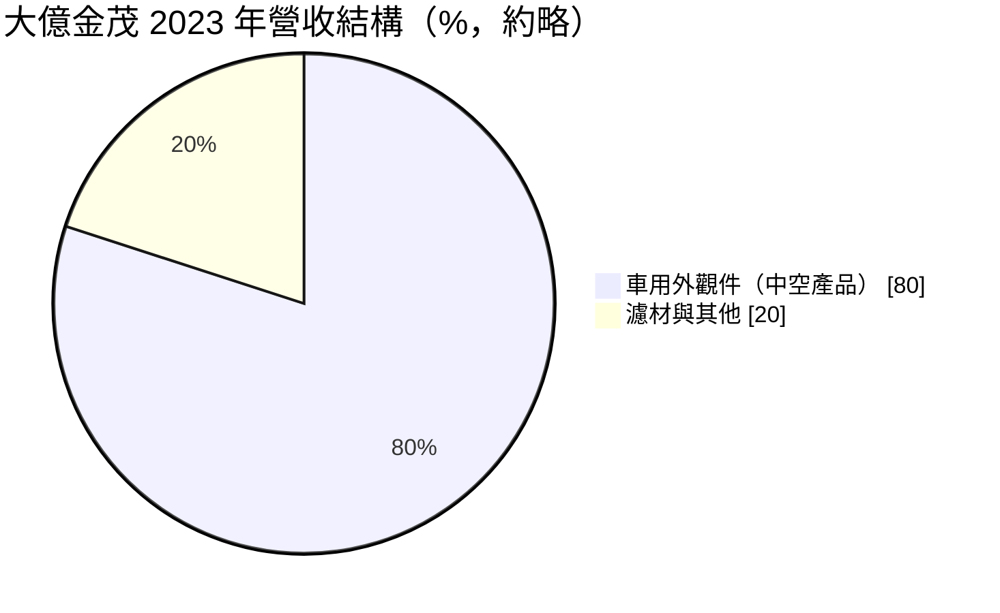
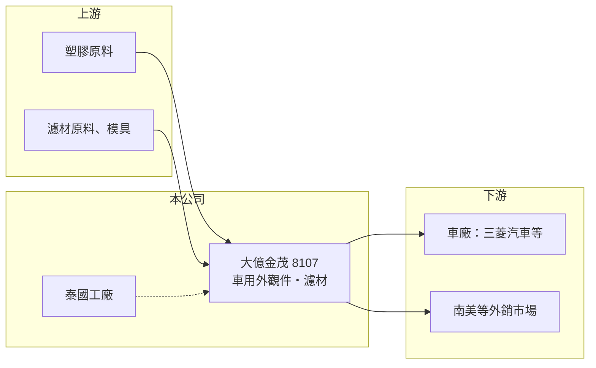

# 8107 大億金茂

> 上櫃｜[[產業索引-電機機械|電機機械]]｜上市（櫃）日期 2005/11/15

# 第一章：企業模式與商業藍圖

> [!info] 撰寫說明
> 精簡版，由 Claude 依公開資料整理，架構比照 [[2330台積電]]，資料截至 2026-10-08。來源：櫃買中心開放資料快照（基本資料、2026 年第二季資產負債與損益、每月營收、本益比殖利率）、Goodinfo 經營績效頁、工商時報 2024 年 6 月股東會報導、nStock 公司簡介。集團關係與產品細節部分依推估整理，已標註待校對。公開資料有限。#待校對

大億金茂（以下簡稱大億金茂）是一家以汽車外觀塑膠件為主力的零件廠，另有濾材產品線。理解它的關鍵在於：公司經過多次合併與更名，本業規模不大、獲利長期在損益兩平附近，但帳上有較多非流動資產，業外收益經常是盈虧的關鍵。

- **核心業務：** 公司於 1998 年以「大億科技」名義成立，2005 年在櫃買中心上櫃，2017 年更名為大億金茂，並在 2014、2015、2017、2019 年陸續合併轉投資公司。實收資本額 7.5 億元，董事長為莊智清、總經理為陳俊宏，總部位於台南南區。營業項目包括汽車零組件、其他塑膠製品與電子零組件。依 2024 年報導，主力為車用外觀件中的中空產品，推估以[[中空吹塑成型]]製造擾流板等外觀件（待校對）。
- **營收結構：** 2023 年車用外觀件約占營收八成，濾材產品營收較前一年微幅成長。外觀件銷售受客戶庫存調整影響，2023 年營收較前一年減少約 17.8%。
- **營運據點：** 台灣台南為總部，泰國轉投資工廠生產車用外觀件，並取得三菱汽車的新品訂單；外銷市場包括巴西、阿根廷等地。公司名稱與台南的 [[1521大億]] 相近，推估同屬大億集團體系（待校對）。
- **長期方向：** 公司表示將重新聚焦汽機車相關產品，拓展新客戶並提高產線良率。泰國廠接到日系車廠訂單，是切入東南亞汽車供應鏈的重要據點，但整體規模仍小，長期成長性有限。

# 第二章：護城河深度與競爭優勢

大億金茂的護城河很薄，優勢主要來自汽車零件的認證與既有客戶關係，而非技術或規模。

- **競爭優勢：** 汽車外觀件需要通過車廠的品質認證與[[設計導入]]，一旦進入車型專案，通常可供貨到該車型停產，具有一定的黏著度。泰國廠鄰近日系車廠在東南亞的生產基地，提供在地供應的便利。
- **主要對手：** 汽車外觀件與塑膠件市場的同業包括 [[1522堤維西]]、[[1524耿鼎]]、[[2228劍麟]]、[[1338廣華-KY]] 等，以及東南亞與中國的在地塑膠件廠商。
- **觀察重點：** 毛利率在 2020 至 2023 年一度降到 6% 至 18%，2024 至 2025 年回到約 27%，但營業利益率仍只有 1% 至 2%。長期要看本業能否穩定獲利，而不是依靠業外收益。

# 第三章：財務體質與盈利規模

資料日期：2026-10-08，表格是撰寫當時的快照；最新月營收、毛利率、累計 EPS 由自動排程寫在本筆記的屬性欄位（月營收、毛利率、累計EPS 等）。#待校對

大億金茂的財務呈現「本業薄利或虧損、業外影響大」的特徵，資本報酬率長期偏低。

| 年度 | 營收（億元） | [[毛利率]] | [[營業利益率]] | EPS（元） | [[ROE]] |
|---|---|---|---|---|---|
| 2019 | 8.03 | 28.6% | 3.69% | 2.33 | 11.9% |
| 2020 | 8.11 | 13.9% | -5.58% | 0.06 | 0.36% |
| 2021 | 9.40 | 13.0% | -4.73% | 0.27 | 1.46% |
| 2022 | 8.14 | 18.0% | -1.91% | 0.44 | 2.24% |
| 2023 | 6.69 | 6.0% | -17.3% | -0.84 | -4.32% |
| 2024 | 9.24 | 26.5% | 2.43% | 1.81 | 8.98% |
| 2025 | 9.43 | 26.7% | 1.16% | -0.53 | -2.61% |
| 2026 上半年 | 3.44 | 15.9% | -17.6% | 1.05 | 未查得 |

（來源：Goodinfo 經營績效頁；2026 上半年取自櫃買中心開放資料。）

- **營收規模：** 2019 至 2025 年營收在 6.7 億至 9.4 億元之間，2021 至 2025 年年複合成長率約 0.1%（推算），規模停滯。2026 年前八月累計營收較前一年同期減少約 32%，本業明顯轉弱。
- **獲利：** 2021 至 2025 年平均 ROE 約 1.1%（推算）。多數年度營業利益為負，EPS 主要靠業外支撐：2026 年上半年營業虧損約 0.61 億元，但業外收入約 1.24 億元，使 EPS 轉為 1.05 元，業外內容推估為處分資產或投資收益（待校對）。
- **財務特色：** 依 2026 年第二季資料，總資產約 29.7 億元、權益約 15.9 億元、負債約 13.9 億元，負債比約 47%。非流動資產約 21.3 億元，占總資產七成以上，推估包含土地、廠房與長期投資，這也是業外收益的來源。保留盈餘約 6.8 億元，但配息不穩定，近五年平均現金股利僅約 0.28 元，2024 年度配發 1 元、2025 年度未配息。
- **[[ROIC]] 與 [[WACC]]：** 2025 年營業利益僅約 0.11 億元，ROIC 約 0.3% 至 0.6%（推算）；2026 年上半年營業虧損約 0.61 億元，年化後約 -1.21 億元（虧損不扣稅），以權益 15.9 億元到「權益加全部負債」29.7 億元計算，ROIC 約 -7.6% 至 -4.1%（推算）。WACC 以 [[CAPM]] 推估：無風險利率 1.75%、市場風險溢酬 6%、β 假設 1.0（汽車零件股常見值），權益成本約 7.75%；假設有息負債占資本約 40%、稅前負債成本 2.5%，WACC 約 5.5%（推算）。ROIC 長期低於 WACC，代表本業多年未替股東創造經濟價值，公司價值較依賴資產本身而非經營獲利。

# 第四章：總體風險與地緣政治

大億金茂的風險來自本業競爭力不足、汽車產業循環，以及對業外收益的依賴。

- **產業週期：** 車用外觀件需求跟著車廠新車型與產量走，客戶庫存調整時訂單可能一次下修兩成以上，2023 年即是例子。巴西、阿根廷等新興市場的匯率與經濟波動也會影響外銷。
- **營運風險：** 本業營業利益率長期接近零，若業外收益消失，公司可能連續虧損。規模小、客戶有限，失去單一車型專案就會明顯影響營收。
- **其他風險：** 塑膠原料價格隨油價波動；泰國廠面對當地政治與匯率風險；電動車改變車身外觀件的設計與材料，可能需要投入新製程。

# 專有名詞解析

## 金融

- **[[業外收入]]**：本業以外的收益，例如利息、投資收益、匯兌利益或處分資產利益，持續性通常較低。
- **[[CAPM]]**：資本資產定價模型，以無風險利率加上 β 乘以市場風險溢酬，推估股東要求的報酬率。

## 產業

- **[[中空吹塑成型]]**：把加熱軟化的塑膠管吹氣撐開、貼合模具成型的製程，用來製作中空的塑膠件，如擾流板、油箱與瓶罐。
- **[[設計導入]]**：零件廠在客戶新產品開發階段就參與設計，被指定為該產品的零件供應商，量產後通常可持續供貨到產品停產。

# 核心供應鏈

- 上游：工程塑膠原料、濾材原料與模具；實際供應商未查得，#待校對。
- 下游／客戶：三菱汽車（透過泰國廠）、巴西與阿根廷等外銷市場的汽車與售後通路；其他客戶未查得。
- 同業：[[1522堤維西]]、[[1524耿鼎]]、[[2228劍麟]]、[[1338廣華-KY]]；可能同屬集團的 [[1521大億]]（待校對）。

## 最新新聞
<!-- news:start -->
<!-- news:end -->

## 相關連結
- [公開資訊觀測站](https://mopsov.twse.com.tw/mops/web/t05st03?step=1&firstin=1&co_id=8107)
- [Goodinfo](https://goodinfo.tw/tw/StockDetail.asp?STOCK_ID=8107)
- [Yahoo 股市](https://tw.stock.yahoo.com/quote/8107)
- [鉅亨網新聞](https://www.cnyes.com/twstock/8107/news)
