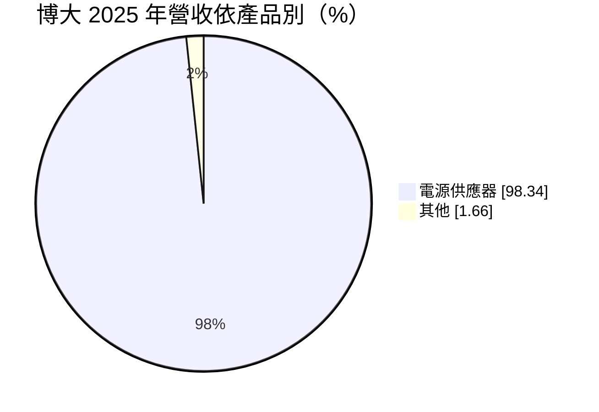
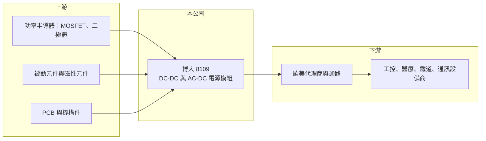

# 8109 博大

> 上櫃｜[[產業索引-電子零組件業|電子零組件業]]｜上市（櫃）日期 2005/03/22

# 第一章：企業模式與商業藍圖

> [!info] 撰寫說明
> 精簡版，由 Claude 依公開資料整理，架構比照 [[2330台積電]]，資料截至 2026-10-08。來源：櫃買中心開放資料快照（基本資料、2026 年第二季資產負債與損益、本益比殖利率）、Goodinfo 經營績效頁、MoneyDJ 個股基本資料（2025 年營收比重）、財經媒體報導標題。注意：博大的主業是電源產品而非連接器。產品應用描述部分依記憶整理，已標註待校對。#待校對

博大科技（英文品牌 P-DUKE）是一家專做工業級電源模組的公司，理解它的關鍵在於：它賣的不是大量生產的消費性電源，而是規格多、批量小、可靠度要求高的[[DC-DC轉換器]]，因此能長期維持接近五成的毛利率。

- **核心業務：** 博大成立於 1992 年，2005 年在櫃買中心掛牌，總部與工廠位於台中工業區，董事長兼總經理為廖本崇。依 MoneyDJ 資料，2025 年[[電源供應器]]類產品占營收約 98%，主力是 DC-DC 轉換器與 AC-DC 電源模組。這類模組把一種電壓轉成設備需要的穩定電壓，裝在工業控制、醫療、鐵道與通訊設備裡（應用別待校對）。
- **營收結構：** 公開資料只揭露產品別，應用別與地區別比重未查得。依記憶，博大以自有品牌透過歐美代理商銷售為主，客戶分散在數千家中小型設備商（待校對）。客戶分散的好處是單一客戶砍單影響有限，缺點是需要維持龐大的產品型錄與通路關係。
- **營運據點：** 台中為研發與主要生產基地，並在越南設有生產據點，報導標題提到越南廠讓產能明顯擴大（待校對）。工業電源訂單強調交期穩定與長期供貨，多地生產能降低單一地點停工的風險。
- **長期方向：** 博大的長期成長來自工業自動化、醫療與交通電氣化等設備對高可靠電源的需求，這些市場成長不快但穩定。公司的策略是持續擴充產品型號、取得更多安規與鐵道認證，用「品項廣度」換取每一個利基市場的訂價權（推估）。

# 第二章：護城河深度與競爭優勢

博大是本批公司中獲利結構最突出的一家，護城河來自認證、品項與品牌通路，而不是規模。

- **競爭優勢：** 工業與醫療電源必須通過各國安規、醫療與鐵道等認證，一個型號從設計到取得認證往往要很長時間，客戶一旦採用很少更換。博大毛利率多年維持在 46% 至 50%、營業利益率約 33% 至 36%，遠高於一般電源廠，顯示它在利基市場擁有訂價能力。這種高毛利來自「小量多樣」：大廠不願意做，小廠做不到完整認證。
- **主要對手：** 國際上有 Vicor、瑞士 TRACO Power、德國 RECOM、村田（Murata Power Solutions）、明緯等工業電源品牌；台灣上市櫃電源大廠如 [[2308台達電]]、[[6282康舒]]、[[6412群電]]、[[3015全漢]] 則以大量生產的 PC、伺服器電源為主，與博大的定位不同。工業模組市場較分散，沒有單一廠商能壟斷。
- **觀察重點：** 長期要追蹤毛利率能否守在四成五以上，以及越南產能擴大後營收能否回到 2023 年 19.3 億元以上的高點。工業設備庫存循環會讓營收起伏，但只要毛利率不下滑，就代表護城河仍在。

# 第三章：財務體質與盈利規模

資料日期：2026-10-08，表格是撰寫當時的快照；最新月營收、毛利率、累計 EPS 由自動排程寫在本筆記的屬性欄位（月營收、毛利率、累計EPS 等）。#待校對

博大的財務是典型的高毛利、低負債利基製造商：營收規模不大，但每一元營收能留下三成以上的營業利益。

| 年度 | 營收（億元） | [[毛利率]] | [[營業利益率]] | EPS（元） | [[ROE]] |
|---|---|---|---|---|---|
| 2021 | 15.1 | 48.3% | 35.3% | 5.28 | 21.7% |
| 2022 | 18.0 | 46.3% | 32.4% | 9.03 | 30.3% |
| 2023 | 19.3 | 48.1% | 35.2% | 8.03 | 23.0% |
| 2024 | 15.1 | 48.0% | 33.1% | 6.48 | 17.6% |
| 2025 | 17.4 | 49.4% | 34.7% | 6.18 | 16.5% |
| 2026 上半年 | 10.2 | 50.4% | 36.1% | 3.84 | 未查得 |

（來源：Goodinfo 經營績效頁；2026 上半年取自櫃買中心開放資料推算。2020 年營收 12.2 億元、EPS 4.41 元。）

- **營收規模：** 2020 至 2025 年營收由 12.2 億元增至 17.4 億元，年複合成長率約 7.4%（推算）。2024 年營收回落到 15.1 億元，反映工業設備市場的去庫存；2025 年起回升，2026 年上半年營收已達 10.2 億元。
- **獲利：** 2021 至 2025 年平均 ROE 約 21.8%（推算），在台灣電子零件股中屬於高水準。即使在 2024 年營收下滑的年度，營業利益率仍有 33%，說明成本結構有彈性、價格沒有崩跌。ROE 由 2022 年的 30% 逐步降到 16% 左右，主要是股東權益持續累積而營收沒有同步放大。
- **財務特色：** 依 2026 年第二季資料，總資產約 38.9 億元、股東權益約 30.0 億元、負債僅約 8.9 億元，幾乎沒有財務槓桿。最近一次現金股利每股 4.5 元，約為 2025 年 EPS 6.18 元的七成三（推算），配息穩定度高。自由現金流是否長期為正未查得，但高利潤率與低資本支出的組合通常意味著現金流充沛（推估）。
- **[[ROIC]] 與 [[WACC]]：** 以 2025 年營業利益約 6.04 億元（17.4 億元 × 34.7%）、稅率 20% 計算，稅後營業利益約 4.83 億元。有息負債未查得，投入資本以股東權益 30.0 億元到「權益加全部負債」38.9 億元為區間，ROIC 約 12.4% 至 16.1%（推算）；2026 年上半年年化後約 15.2% 至 19.7%（推算）。WACC 以 CAPM 推估：無風險利率 1.75%、市場風險溢酬 6%、β 假設 0.9（電子零件同業常見值），權益成本約 7.2%；負債極少，WACC 約 7%（推算）。ROIC 長期比 WACC 高出 5 至 12 個百分點，代表博大是持續創造經濟價值的公司。

# 第四章：總體風險與地緣政治

博大的風險不在財務，而在工業景氣、產能擴張與規模限制。

- **產業週期：** 工業設備、自動化與醫療器材的需求受全球製造業投資循環影響，下游設備商庫存過高時會連續幾季減少採購，2024 年營收下滑即為一例。這種循環通常比消費性電子溫和，但時間可能更長。
- **營運風險：** 高毛利會吸引競爭者，若中國電源廠在認證與品質上追上，價格壓力會逐漸浮現。越南廠擴產後，若需求成長跟不上，新增的折舊與人力成本會拉低利潤率。公司規模小、經營高度集中於創辦團隊，接班與人才延續也是長期課題。
- **其他風險：** 產品多數外銷，新台幣升值會壓縮獲利；電子零件（功率半導體、[[被動元件]]）缺貨時會影響出貨。各國安規標準變更時需要重新認證，增加研發負擔。

# 專有名詞解析

## 產業

- **[[DC-DC轉換器]]**：把一種直流電壓轉換成另一種直流電壓的電源模組，廣泛用於通訊、工業與鐵道設備。
- **[[電源供應器]]**：把市電轉換為電子設備所需穩定直流電的裝置，PC、伺服器與網通設備都需要，大廠集中在台灣。
- **[[被動元件]]**：不需外加電源即可運作的電子元件，主要是電容、電阻與電感，負責儲能、濾波與限流。

# 核心供應鏈

- 上游：功率半導體（例如 [[8261富鼎]]、[[5425台半]] 這類業者）、被動元件（例如 [[2327國巨]]）與磁性材料；實際供應商未查得，#待校對。
- 下游／客戶：歐美電子零件代理商，以及工業控制、醫療、鐵道與通訊設備商（例如 [[2395研華]] 所在的工業電腦產業，是否為客戶未查得）。
- 同業：Vicor、TRACO Power、RECOM、村田電源、明緯；台灣電源廠 [[2308台達電]]、[[6282康舒]]、[[6412群電]]、[[3015全漢]]（定位不同，以大量型電源為主）。

## 最新新聞
<!-- news:start -->
<!-- news:end -->

## 相關連結
- [公開資訊觀測站](https://mopsov.twse.com.tw/mops/web/t05st03?step=1&firstin=1&co_id=8109)
- [Goodinfo](https://goodinfo.tw/tw/StockDetail.asp?STOCK_ID=8109)
- [Yahoo 股市](https://tw.stock.yahoo.com/quote/8109)
- [鉅亨網新聞](https://www.cnyes.com/twstock/8109/news)
