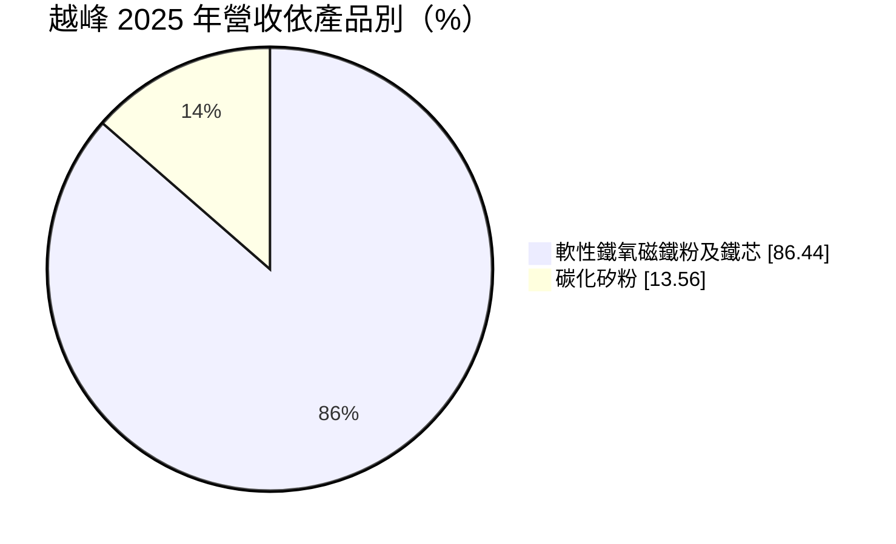
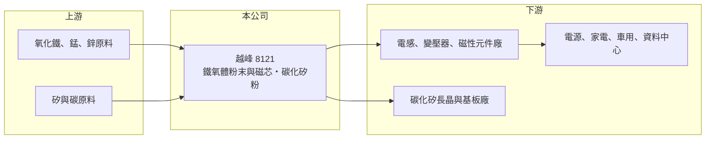

# 8121 越峰

> 上櫃｜[[產業索引-電子零組件業|電子零組件業]]｜上市（櫃）日期 2005/02/17

# 第一章：企業模式與商業藍圖

> [!info] 撰寫說明
> 精簡版，由 Claude 依公開資料整理，架構比照 [[2330台積電]]，資料截至 2026-10-08。來源：櫃買中心開放資料快照（基本資料、2026 年第二季資產負債與損益、本益比殖利率）、Goodinfo 經營績效頁、MoneyDJ 個股基本資料（2025 年營收比重）、2026 年 3 月法說會報導標題（方格子）。與中鋼集團的關係及原料來源依記憶整理，已標註待校對。#待校對

越峰電子材料（以下簡稱越峰）是一家磁性材料廠，生產錳鋅[[鐵氧體]]粉末與磁芯，近年再切入[[碳化矽]]粉體。理解它的關鍵在於：它位在電子零件供應鏈的最上游，賣的是材料而不是元件，景氣好壞直接反映在產能利用率與原料價格上。

- **核心業務：** 越峰成立於 1991 年，2005 年在櫃買中心掛牌，實收資本額約 21.3 億元，董事長為吳亦圭、總經理為吳文豪。主力產品是軟性鐵氧磁鐵粉與磁芯，用來製作[[電感]]、變壓器與抗電磁干擾元件，是電源轉換電路不可缺的材料。越峰屬於中鋼集團的轉投資事業，鐵氧體的主原料氧化鐵可取自鋼鐵廠酸洗製程的副產品（待校對）。
- **營收結構：** 依 MoneyDJ 資料，2025 年鐵氧體粉末與磁芯約占 86.4%，碳化矽粉約 13.6%。2026 年 3 月法說會報導標題指出碳化矽比重已達 15%，並以 AI 電源與高階市場為目標。碳化矽粉是長晶廠生產碳化矽晶錠的原料，與鐵氧體的客戶群完全不同，代表公司正試著在傳統磁材之外建立第二條成長曲線。
- **營運據點：** 總部位於台北內湖，在台灣與中國均設有生產子公司，中國子公司包括越峰電子（廣州）（待校對）。資產負債表上的非控制權益約 7.2 億元，顯示部分子公司由越峰與其他股東共同持有。
- **長期方向：** 電動車、太陽能逆變器、資料中心電源都需要大量高效率磁芯，長期需求向上；碳化矽功率元件普及，也帶動上游粉體需求。越峰的長期課題是把產品組合從一般消費性磁芯，移往高頻、低損耗的高階材料，才能擺脫中國同業的價格競爭。

# 第二章：護城河深度與競爭優勢

越峰的護城河較淺，優勢主要來自材料配方、集團資源與客戶認證，但面臨中國大型磁材廠的規模壓力。

- **競爭優勢：** 磁芯材料的配方與燒結製程決定元件的損耗與溫度特性，元件廠導入一種材料後需重新驗證才會更換，形成一定的轉換成本。背靠中鋼集團，在原料取得與財務支援上較一般中小企業穩定（待校對）。碳化矽粉屬於新興材料，國內供應商少，若品質獲長晶廠認證，可享有較高的門檻。
- **主要對手：** 鐵氧體市場的主要對手是日本 TDK，以及中國的橫店東磁、天通股份等大型磁材廠，中國廠商以規模與成本優勢主導中低階市場。碳化矽粉的對手則多為國外材料廠與中國新進者。越峰在全球規模上屬於中小型玩家，必須避開純價格競爭。
- **觀察重點：** 長期最該追蹤的是毛利率能否穩定回到 20% 以上，以及碳化矽粉比重能否持續提高。2023 年毛利率曾掉到 9.3%，2025 年又降到 16.6%，顯示一般磁芯的訂價能力有限；若高階材料比重提高，毛利率的波動應會縮小。

# 第三章：財務體質與盈利規模

資料日期：2026-10-08，表格是撰寫當時的快照；最新月營收、毛利率、累計 EPS 由自動排程寫在本筆記的屬性欄位（月營收、毛利率、累計EPS 等）。#待校對

越峰的財務呈現材料廠的高波動特性：營收規模約 30 億元，但獲利微薄、在損益兩平附近擺盪。

| 年度 | 營收（億元） | [[毛利率]] | [[營業利益率]] | EPS（元） | [[ROE]] |
|---|---|---|---|---|---|
| 2021 | 30.7 | 20.1% | 5.05% | 0.32 | 4.74% |
| 2022 | 30.6 | 17.0% | 1.55% | 0.09 | 0.75% |
| 2023 | 25.5 | 9.31% | -9.73% | -0.81 | -9.83% |
| 2024 | 31.0 | 20.6% | 3.14% | 0.73 | 5.13% |
| 2025 | 30.7 | 16.6% | -2.17% | -0.31 | -3.49% |
| 2026 上半年 | 17.5 | 18.0% | 1.1% | 0.00 | 未查得 |

（來源：Goodinfo 經營績效頁；2026 上半年取自櫃買中心開放資料推算。2020 年營收 21.7 億元、EPS 0.18 元。）

- **營收規模：** 2020 至 2025 年營收由 21.7 億元增至 30.7 億元，年複合成長率約 7.2%（推算），成長主要發生在 2021 年。之後營收在 25 億至 31 億元之間起伏，碳化矽粉的貢獻部分抵銷了磁芯需求的波動。
- **獲利：** 2021 至 2025 年平均 ROE 約 -0.5%（推算），五年中有兩年虧損，獲利能力明顯不足。2026 年上半年營業利益率回到 1.1%，但業外損失使稅前仍為小幅虧損，歸屬母公司 EPS 約為零。材料廠的固定成本高，產能利用率稍有下滑就會由盈轉虧。
- **財務特色：** 依 2026 年第二季資料，總資產約 56.7 億元、權益總計約 27.4 億元（其中非控制權益約 7.2 億元）、負債約 29.3 億元，其中非流動負債約 20.1 億元，財務槓桿在本批公司中偏高，推估與擴產借款有關。保留盈餘為負約 0.86 億元，屬[[累積虧損]]狀態，最近一次未配發股利。
- **[[ROIC]] 與 [[WACC]]：** 2025 年營業虧損約 0.67 億元（30.7 億元 × -2.17%），ROIC 為負。2026 年上半年營業利益約 0.19 億元，年化並扣稅 20% 後約 0.31 億元；有息負債未查得，投入資本以權益 27.4 億元到「權益加全部負債」56.7 億元為區間，ROIC 約 0.5% 至 1.1%（推算）。WACC 以 CAPM 推估：無風險利率 1.75%、市場風險溢酬 6%、β 假設 1.0（材料與零件股常見值），權益成本約 7.8%；稅後負債成本假設 2%、負債占四成，WACC 約 5.5%（推算）。ROIC 長期低於 WACC，代表過去五年越峰並未替股東創造經濟價值，碳化矽與高階磁材能否扭轉這個局面是關鍵。

# 第四章：總體風險與地緣政治

越峰的風險集中在價格競爭、原料成本與新事業的執行。

- **產業週期：** 鐵氧體需求跟著消費性電子、家電、電源與車用的生產量走，下游電感與變壓器廠的庫存調整會放大到材料端，2023 年營業虧損近一成即為例子。碳化矽粉的需求則跟隨電動車與功率元件的擴產循環，可能在產能過剩時快速降溫。
- **營運風險：** 中國同業產能龐大、報價低，越峰在一般規格產品上缺乏訂價權。擴產帶來的折舊與利息會在需求不足時加重虧損，財務槓桿也高於多數電子零件同業。
- **其他風險：** 氧化鐵、錳、鋅等原料價格與電價、天然氣價格直接影響燒結成本；中國子公司受當地政策與匯率影響。若中國擴大碳化矽產業補貼，碳化矽粉也可能陷入價格戰。

# 專有名詞解析

## 半導體

- **[[碳化矽]]**：由矽與碳組成的化合物半導體材料，耐高壓、高溫，用於電動車與綠能的功率元件，晶圓製作難度高。

## 金融

- **[[累積虧損]]**：歷年虧損累積後尚未彌補的金額，依公司法須先彌補完畢才能分配盈餘。

## 產業

- **[[鐵氧體]]**：以氧化鐵為主、加入錳鋅或鎳鋅燒結而成的磁性陶瓷，是電感與變壓器磁芯的主要材料。
- **[[電感]]**：以線圈儲存磁能、抑制電流變化的被動元件，用於濾波與電源轉換。

# 核心供應鏈

- 上游：氧化鐵（可能來自 [[2002中鋼]] 集團，#待校對）、錳與鋅等金屬原料，以及碳化矽粉所需的高純度矽與碳原料。
- 下游／客戶：電感、變壓器與磁性元件廠（例如 [[2327國巨]]、[[2492華新科]] 所在的被動元件產業，是否為客戶未查得），以及碳化矽長晶與基板廠（例如 [[6488環球晶]]、[[5483中美晶]] 這類矽晶圓與化合物半導體材料業者，是否為客戶未查得）。
- 同業：日本 TDK、中國橫店東磁、天通股份。

## 最新新聞
<!-- news:start（自動產生，請勿手動編輯此範圍） -->
- 2026-10-16 🏛️ 重訊 16:31｜代重要子公司越峰電子(廣州)有限公司 公告辦理減資變更登記完成｜[觀測站](https://mops.twse.com.tw/mops/#/web/t05st01)

完整紀錄：[[8121越峰 新聞]]
<!-- news:end -->

## 相關連結
- [公開資訊觀測站](https://mopsov.twse.com.tw/mops/web/t05st03?step=1&firstin=1&co_id=8121)
- [Goodinfo](https://goodinfo.tw/tw/StockDetail.asp?STOCK_ID=8121)
- [Yahoo 股市](https://tw.stock.yahoo.com/quote/8121)
- [鉅亨網新聞](https://www.cnyes.com/twstock/8121/news)
