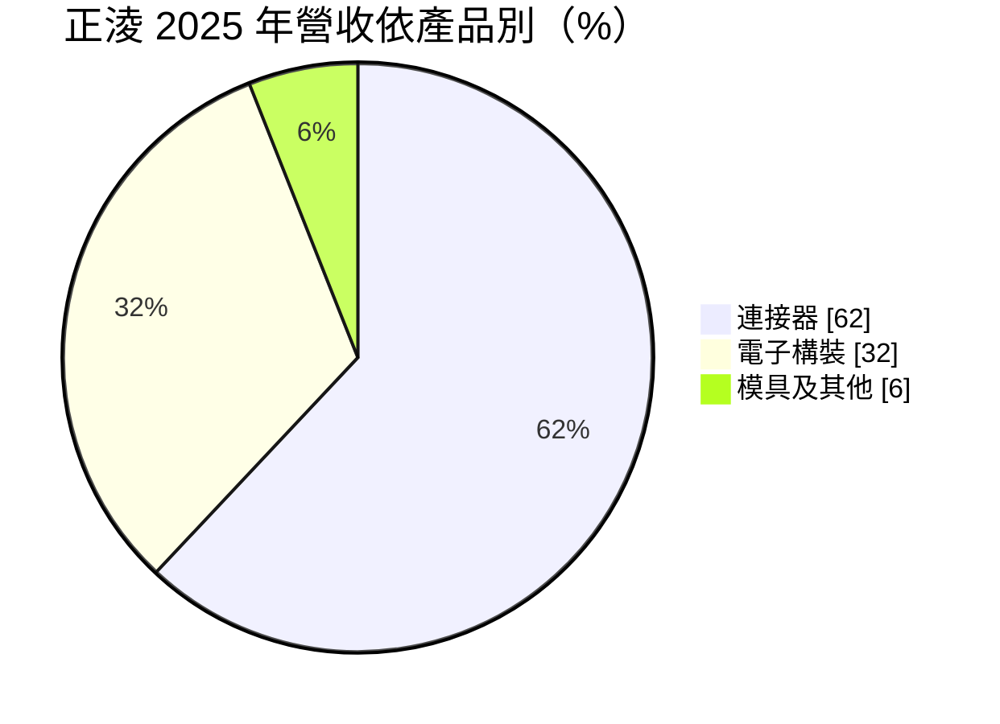
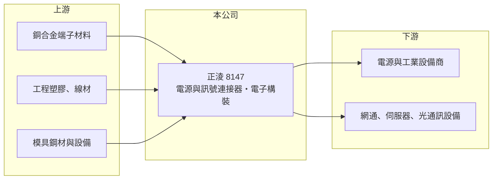

# 8147 正淩

> 上櫃｜[[產業索引-電子零組件業|電子零組件業]]｜上市（櫃）日期 2013/04/30

# 第一章：企業模式與商業藍圖

> [!info] 撰寫說明
> 精簡版，由 Claude 依公開資料整理，架構比照 [[2330台積電]]，資料截至 2026-10-08。來源：櫃買中心開放資料快照（基本資料、2026 年第二季資產負債與損益、本益比殖利率）、Goodinfo 經營績效頁、MoneyDJ 個股基本資料（2025 年營收比重）。產品線與應用描述部分依記憶整理，已標註待校對。公開資料有限。#待校對

正淩精密（英文品牌 Nextron）是一家以電源與訊號[[連接器]]為主、兼做電子構裝的公司，理解它的關鍵在於：它的客戶多是工業、網通與電源設備等少量多樣的市場，靠客製化設計而不是大量標準品取勝。

- **核心業務：** 正淩成立於 1986 年，2013 年在櫃買中心掛牌，總部位於新北汐止，實收資本額約 4.18 億元，董事長為徐季麟、總經理為賴琦憲。公司產品以電源連接器、高速訊號連接器與射頻連接器為主，並提供線纜與電子構裝等組裝服務（產品線待校對）。自行開發模具是連接器廠的基本功，模具收入也反映公司從設計到量產的一條龍能力。
- **營收結構：** 依 MoneyDJ 資料，2025 年連接器約占 62%、電子構裝約 32%、模具及其他約 6%。電子構裝比重達三成，代表正淩不只賣單一零件，也替客戶把連接器、線材與機構件組成次系統。這種組合讓公司能參與客戶較早期的設計階段。
- **營運據點：** 台灣為研發與營運總部，生產據點在台灣與中國（待校對）。公開資料未揭露各地區的營收比重。
- **長期方向：** 資料中心電源、伺服器、網通設備與光通訊對大電流與高速連接的需求持續提高，正淩的長期成長取決於能否打進這些高規格應用（推估）。Goodinfo 頁面上的新聞標題提到光學連接器、AI 伺服器、機器人與無人機等新應用，但多數標題未附年份，具體進度待校對。

# 第二章：護城河深度與競爭優勢

正淩的護城河屬於利基型零件廠的類型：靠客製化與認證取得客戶，規模不是它的優勢。

- **競爭優勢：** 工業與電源設備的連接器常需依客戶機構客製，開發週期長、認證後不輕易更換，形成轉換成本。正淩毛利率由 2020 年的 35.3% 逐步升到 2025 年的 39.4%，2026 年上半年約 37.9%，在連接器同業中屬於偏高的水準，說明產品偏向高附加價值的利基應用。
- **主要對手：** 台灣同業包括 [[3533嘉澤]]、[[8103瀚荃]]、[[3023信邦]]、[[6197佳必琪]]、[[3605宏致]] 與 [[3526凡甲]]；國際大廠安費諾、TE Connectivity、Molex 在電源與高速連接器上都有完整產品線。正淩規模遠小於國際大廠，只能在對方不重視的客製化專案中找到空間。
- **觀察重點：** 毛利率接近四成，但營業利益率長期只有 6% 至 10%，代表研發與管銷費用占營收比重高。長期要觀察營收規模擴大後，營業利益率能否明顯提升；若費用率下降，獲利的彈性會比營收成長更大。

# 第三章：財務體質與盈利規模

資料日期：2026-10-08，表格是撰寫當時的快照；最新月營收、毛利率、累計 EPS 由自動排程寫在本筆記的屬性欄位（月營收、毛利率、累計EPS 等）。#待校對

正淩是本批公司中營收成長最快的一家，但高毛利尚未完全轉化為高營業利益。

| 年度 | 營收（億元） | [[毛利率]] | [[營業利益率]] | EPS（元） | [[ROE]] |
|---|---|---|---|---|---|
| 2021 | 9.83 | 34.5% | 6.99% | 1.29 | 6.00% |
| 2022 | 11.6 | 37.3% | 8.72% | 3.80 | 15.7% |
| 2023 | 10.4 | 38.9% | 7.41% | 2.55 | 9.22% |
| 2024 | 12.6 | 38.0% | 6.51% | 2.03 | 6.80% |
| 2025 | 16.3 | 39.4% | 10.0% | 3.08 | 8.99% |
| 2026 上半年 | 9.83 | 37.9% | 9.0% | 1.38 | 未查得 |

（來源：Goodinfo 經營績效頁；2026 上半年取自櫃買中心開放資料推算。2020 年營收 7.55 億元、EPS 0.42 元。）

- **營收規模：** 2020 至 2025 年營收由 7.55 億元增至 16.3 億元，年複合成長率約 16.6%（推算），2025 年單年成長近三成。2026 年上半年營收約 9.83 億元，延續成長趨勢。
- **獲利：** 2021 至 2025 年平均 ROE 約 9.3%（推算）。2022 年 EPS 3.80 元、ROE 15.7% 是近年高點，但當年營業利益率只有 8.7%，推估有業外收益貢獻。營業利益率在 2025 年首度達到 10%，是觀察營運槓桿是否開始發揮的起點。
- **財務特色：** 依 2026 年第二季資料，總資產約 27.4 億元、權益總計約 14.8 億元、負債約 12.6 億元；資本公積約 8.4 億元，高於股本 4.18 億元，推估公司曾以溢價增資籌措擴充資金。最近一次現金股利每股約 3.03 元，接近 2025 年 EPS 3.08 元，配發率約九成八（推算），顯示公司傾向把盈餘大部分發給股東。
- **[[ROIC]] 與 [[WACC]]：** 以 2025 年營業利益約 1.63 億元（16.3 億元 × 10.0%）、稅率 20% 計算，稅後營業利益約 1.30 億元。有息負債未查得，投入資本以權益 14.8 億元到「權益加全部負債」27.4 億元為區間，ROIC 約 4.8% 至 8.8%（推算）；2026 年上半年年化後約 5.2% 至 9.6%（推算）。WACC 以 CAPM 推估：無風險利率 1.75%、市場風險溢酬 6%、β 假設 1.0（中小型連接器股常見值），權益成本約 7.8%；稅後負債成本假設 2%、負債占兩成五，WACC 約 6.3%（推算）。ROIC 與 WACC 大致相當，代表公司目前處於「勉強賺回資金成本」的階段，營業利益率若能持續提升才會進入創造價值的區間。

# 第四章：總體風險與地緣政治

正淩的風險來自客製化業務的規模限制、新應用的不確定性與景氣循環。

- **產業週期：** 工業、網通與電源設備的投資有明顯循環，2023 年營收由 11.6 億元降到 10.4 億元即反映下游庫存調整。資料中心相關需求成長快，但也跟著雲端業者資本支出起伏。
- **營運風險：** 客製化產品開發成本高，若新專案量產規模不如預期，研發投入就難以回收，這也是營業利益率長期偏低的原因之一。高配息率讓公司保留的資金有限，未來擴產可能需要再向外籌資，稀釋既有股東。
- **其他風險：** 銅與塑膠等原物料價格、中國生產據點面臨的關稅與地緣政治風險，以及新台幣匯率，都會影響毛利率。

# 專有名詞解析

## 應用

- **[[AI 伺服器]]**：搭載 GPU 或 ASIC 加速器、用於訓練與推論 AI 模型的伺服器，功耗與散熱需求遠高於一般伺服器。

## 產業

- **[[連接器]]**：讓電子零件、模組或設備之間可插拔連接的元件，負責傳遞電力或訊號。
- **[[電子構裝]]**：把連接器、線材、電路板與機構件組裝成次系統或模組，再交給客戶整合進設備。

# 核心供應鏈

- 上游：銅合金帶材與端子材料（例如 [[2009第一銅]] 這類銅材業者）、工程塑膠與線材、模具鋼材。
- 下游／客戶：電源供應器與工業設備商、網通與伺服器設備商（例如 [[2308台達電]]、[[2382廣達]] 所在的產業，是否為客戶未查得，#待校對）。
- 同業：[[3533嘉澤]]、[[8103瀚荃]]、[[3023信邦]]、[[6197佳必琪]]、[[3605宏致]]、[[3526凡甲]]，國際大廠安費諾、TE Connectivity、Molex。

## 最新新聞
<!-- news:start -->
<!-- news:end -->

## 相關連結
- [公開資訊觀測站](https://mopsov.twse.com.tw/mops/web/t05st03?step=1&firstin=1&co_id=8147)
- [Goodinfo](https://goodinfo.tw/tw/StockDetail.asp?STOCK_ID=8147)
- [Yahoo 股市](https://tw.stock.yahoo.com/quote/8147)
- [鉅亨網新聞](https://www.cnyes.com/twstock/8147/news)
