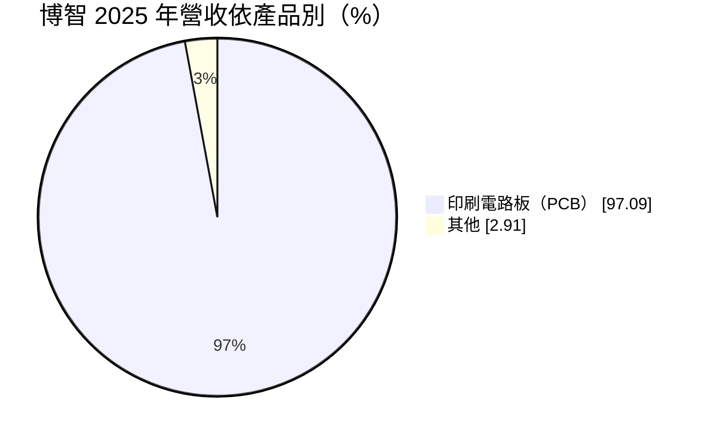
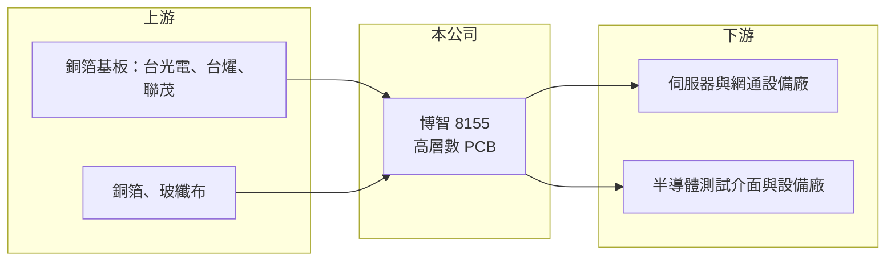

# 8155 博智

> 上櫃｜[[產業索引-電子零組件業|電子零組件業]]｜上市（櫃）日期 2012/12/18

# 第一章：企業模式與商業藍圖

> [!info] 撰寫說明
> 精簡版，由 Claude 依公開資料整理，架構比照 [[2330台積電]]，資料截至 2026-10-08。來源：櫃買中心開放資料快照（基本資料、2026 年第二季資產負債與損益、本益比殖利率）、Goodinfo 經營績效頁、MoneyDJ 個股基本資料（2025 年營收比重）、財經媒體報導標題。產品應用描述部分依記憶整理，已標註待校對。#待校對

博智電子（以下簡稱博智）是一家專做高層數[[PCB]]的公司，理解它的關鍵在於：它不追求大量生產的消費性電路板，而是做層數多、尺寸大、良率門檻高的板子，用在伺服器、網通設備與半導體測試等高階應用。

- **核心業務：** 博智成立於 1995 年，2012 年在櫃買中心掛牌，總部與工廠位於桃園龍潭，實收資本額約 6.24 億元，董事長為張永青、總經理為洪輝龍。依 MoneyDJ 資料，2025 年 PCB 占營收約 97%。公司以[[高層數板]]為專長，產品用於伺服器、網通交換器與半導體測試介面板等（應用別待校對）。
- **營收結構：** 應用別與客戶別比重未查得。依記憶，半導體測試用的大型高層數板是博智的特色產品，這類板子層數可達數十層、單價高、量小，需要在壓合對位與鑽孔上有長年經驗（待校對）。伺服器與網通板則隨 [[AI 伺服器]] 規格升級，層數與材料等級同步提高。
- **營運據點：** 主要生產基地在桃園龍潭；資產負債表上有約 1.5 億元非控制權益，顯示有與其他股東合資的子公司，細節未查得。
- **長期方向：** AI 伺服器與高速交換器的訊號速度不斷提高，主機板與加速卡需要更多層數與更高等級的低損耗材料，高層數板的需求與單價長期向上。博智 2025 年營收成長約 37%，2026 年上半年營收約 31.3 億元，已達 2025 年全年的六成以上，顯示公司正搭上這波結構性升級（推估）。

# 第二章：護城河深度與競爭優勢

博智的護城河來自高層數製程的良率經驗與客戶認證，屬於技術型的窄護城河。

- **競爭優勢：** 高層數板每多一層，壓合對位、鑽孔與電鍍的難度就提高，良率稍差就會吃掉利潤，因此能穩定量產數十層板子的廠商有限。測試介面板與伺服器板都要經過客戶長時間驗證，一旦進入供應鏈，通常會跟著產品世代合作數年。博智在 2020 至 2022 年營業利益率達 16% 至 22%，遠高於一般 PCB 廠，說明它過去在利基市場有明顯的訂價能力。
- **主要對手：** 台灣高層數與伺服器板同業包括 [[2368金像電]]、[[3044健鼎]]、[[2313華通]]、6191精成科、8213志超 與 [[2367燿華]]；國際上有美國 TTM、日本與中國的高階板廠。這些同業規模多數比博智大，在伺服器主機板上以產能取勝，博智必須守住較小量、較高難度的利基。
- **觀察重點：** 2023 至 2025 年毛利率降到 16% 至 17%，2026 年上半年回升到約 24%。長期要追蹤毛利率能否回到 2022 年以前的 25% 至 30% 水準；若做得到，代表高階產品比重回升、產能利用率改善，護城河仍然有效。

# 第三章：財務體質與盈利規模

資料日期：2026-10-08，表格是撰寫當時的快照；最新月營收、毛利率、累計 EPS 由自動排程寫在本筆記的屬性欄位（月營收、毛利率、累計EPS 等）。#待校對

博智的財務呈現「高峰很高、谷底也明顯」的循環特性，2026 年上半年正處於新一輪向上的階段。

| 年度 | 營收（億元） | [[毛利率]] | [[營業利益率]] | EPS（元） | [[ROE]] |
|---|---|---|---|---|---|
| 2021 | 29.0 | 24.5% | 15.7% | 7.85 | 20.2% |
| 2022 | 34.5 | 28.3% | 19.1% | 11.17 | 26.4% |
| 2023 | 28.9 | 17.5% | 7.48% | 4.08 | 9.29% |
| 2024 | 36.2 | 16.0% | 6.86% | 4.69 | 10.9% |
| 2025 | 49.5 | 17.1% | 8.05% | 6.88 | 13.8% |
| 2026 上半年 | 31.3 | 23.9% | 14.4% | 6.69 | 未查得 |

（來源：Goodinfo 經營績效頁；2026 上半年取自櫃買中心開放資料推算。2020 年營收 29.1 億元、EPS 10.69 元。）

- **營收規模：** 2020 至 2025 年營收由 29.1 億元增至 49.5 億元，年複合成長率約 11.2%（推算），其中 2024 與 2025 年成長最快。營收擴大但 2023 至 2025 年毛利率偏低，推估與新產能爬坡、產品組合轉向量較大的伺服器板有關。
- **獲利：** 2021 至 2025 年平均 ROE 約 16.1%（推算）。2026 年上半年 EPS 已達 6.69 元，營業利益率 14.4%，接近 2021 年的水準，代表產能利用率與產品組合同時改善。PCB 廠固定成本高，營收放大時利潤率擴張快，這是典型的營運槓桿。
- **財務特色：** 依 2026 年第二季資料，總資產約 68.2 億元、權益總計約 39.9 億元、負債約 28.3 億元，財務結構穩健。最近一次現金股利每股約 5.16 元，約為 2025 年 EPS 6.88 元的七成五（推算），配息政策穩定。自由現金流是否長期為正未查得，PCB 擴產的資本支出較大，需搭配現金流量表確認。
- **[[ROIC]] 與 [[WACC]]：** 以 2025 年營業利益約 3.98 億元（49.5 億元 × 8.05%）、稅率 20% 計算，稅後營業利益約 3.19 億元。有息負債未查得，投入資本以權益 39.9 億元到「權益加全部負債」68.2 億元為區間，ROIC 約 4.7% 至 8.0%（推算）；2026 年上半年年化後約 10.6% 至 18.1%（推算）。WACC 以 CAPM 推估：無風險利率 1.75%、市場風險溢酬 6%、β 假設 1.2（PCB 股循環性較高的常見值），權益成本約 9.0%；稅後負債成本假設 2%、負債占兩成五，WACC 約 7.2%（推算）。2023 至 2025 年 ROIC 大致與 WACC 相當，2020 至 2022 年與 2026 年上半年則明顯高於 WACC，代表博智在景氣好的年度能創造可觀的經濟價值。

# 第四章：總體風險與地緣政治

博智的風險來自 PCB 產業的循環、材料成本與大客戶集中。

- **產業週期：** PCB 需求跟著伺服器、網通與半導體設備的投資循環走，2023 年營業利益率由 19% 降到 7.5% 就是例子。AI 伺服器需求強勁時產能吃緊、報價上揚，一旦雲端業者放緩資本支出，訂單與價格會同時下修。
- **營運風險：** 高層數板良率是獲利關鍵，新產品或新產能良率不穩時，毛利率會明顯下滑。客戶多為少數伺服器與測試設備大廠，若主要客戶轉單或改變設計，影響會直接反映在營收（客戶結構待校對）。擴產需要大筆資本支出，若時機錯誤，折舊會壓低未來幾年的利潤率。
- **其他風險：** [[銅箔基板]]、銅箔與玻纖布等材料價格上漲會壓縮毛利；高階低損耗材料供應吃緊時可能影響出貨。產品多數外銷，匯率波動也會影響獲利。

# 專有名詞解析

## 應用

- **[[AI 伺服器]]**：搭載 GPU 或 ASIC 加速器、用於訓練與推論 AI 模型的伺服器，功耗與散熱需求遠高於一般伺服器。

## 產業

- **[[PCB]]**：印刷電路板，用銅線路連接電子元件的基板，是所有電子產品的骨架。
- **[[高層數板]]**：層數在 20 層以上的多層 PCB，用於伺服器、網通與半導體測試，壓合與鑽孔良率門檻高。
- **[[銅箔基板]]**：由銅箔、玻纖布與樹脂壓合而成的板材，是 PCB 的主要原料。

# 核心供應鏈

- 上游：銅箔基板 [[2383台光電]]、[[6274台燿]]、[[6213聯茂]]；銅箔 8358金居；玻纖布 [[1802台玻]]、[[5475德宏]]（實際供應商未查得，#待校對）。
- 下游／客戶：伺服器與網通設備廠（例如 [[2382廣達]]、[[6669緯穎]]、[[2345智邦]] 所在的產業），以及半導體測試介面廠（例如 [[6515穎崴]]、[[6223旺矽]]、[[6510精測]] 所在的產業）；是否為博智客戶未查得，#待校對。
- 同業：[[2368金像電]]、[[3044健鼎]]、[[2313華通]]、6191精成科、8213志超、[[2367燿華]]，國際上有 TTM。

## 最新新聞
<!-- news:start -->
<!-- news:end -->

## 相關連結
- [公開資訊觀測站](https://mopsov.twse.com.tw/mops/web/t05st03?step=1&firstin=1&co_id=8155)
- [Goodinfo](https://goodinfo.tw/tw/StockDetail.asp?STOCK_ID=8155)
- [Yahoo 股市](https://tw.stock.yahoo.com/quote/8155)
- [鉅亨網新聞](https://www.cnyes.com/twstock/8155/news)
