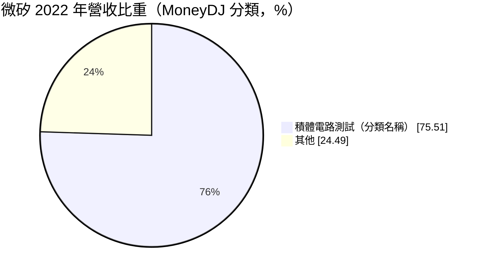
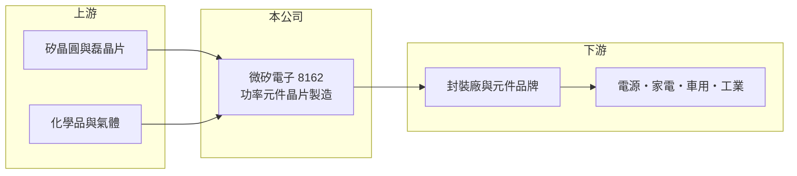

# 8162 微矽電子-創

> 創新板｜[[產業索引-半導體業|半導體業]]｜上市（櫃）日期 2024/03/07

# 第一章：企業模式與商業藍圖

> [!info] 撰寫說明
> 精簡版，由 Claude 依公開資料整理，架構比照 [[2330台積電]]，資料截至 2026-10-08。創新板／新掛牌，公開資料有限。來源：證交所開放資料快照（基本資料、2026 年第二季綜合損益與資產負債、每月營收、股利）、Goodinfo 年度經營績效、MoneyDJ 基本資料（2022 年營收比重）、方格子 2026 年 3 月法說會摘要標題。MoneyDJ 的產品分類與公司以功率半導體為主的定位有落差，產品細項待校對。#待校對

微矽電子（以下簡稱微矽）成立於 1987 年，是老牌的功率元件廠，2024 年 3 月登上[[創新板]]，公司登記於新竹竹東、營運據點在苗栗竹南。本章說明它的產品定位與轉型方向。

- **核心業務：** 微矽生產[[功率半導體]]分離式元件的晶片與相關製程服務，產品如[[二極體]]等，用於電源供應器、家電、工業設備與車用電子的電源轉換與保護（產品細項待校對）。功率元件不追求最小線寬，而是講究耐壓、耐熱與可靠度，製程 know-how 比線寬更重要。
- **營收結構：** MoneyDJ 資料顯示 2022 年「積體電路測試」占營收 75.51%、其他占 24.49%。這個分類名稱與公司以功率元件製造為主的公開定位不完全一致，可能是分類方式不同，實際產品別比重建議以公司年報核對。

- **營運據點：** 公司登記地址在新竹縣竹東鎮，英文通訊地址在苗栗縣竹南鎮友誼路，生產據點推估在竹南（待校對）。
- **長期方向：** 依 2026 年 3 月法說會摘要，公司看好功率半導體需求，並以 [[GaN]]（氮化鎵）、[[SiC]]（碳化矽）等第三代半導體與新製程作為成長動能。AI 伺服器電源、電動車與再生能源都需要更高效率的功率元件，這是微矽轉型的主要市場。

# 第二章：護城河深度與競爭優勢

功率元件市場分散、價格競爭激烈，護城河來自製程穩定度與客戶認證。本章分析微矽的競爭位置。

- **競爭優勢：** 功率元件用在電源與車用，客戶非常重視長期可靠度，通過認證後不輕易更換。微矽經營近四十年，累積了穩定的製程經驗與客戶基礎，這是新進者難以短期取得的。
- **主要對手：** 台股功率分離式元件同業包括 [[2481強茂]]、[[5425台半]]、[[3675德微]]、[[6435大中]]、[[8261富鼎]]、[[5299杰力]] 等，中國業者近年大幅擴產，帶來價格壓力。微矽的營收規模約 10 至 13 億元，在同業中屬於中小型。
- **觀察重點：** 一是[[毛利率]]能否從 2025 年的 25% 回到 2021 年近 40% 的水準，這反映產品組合是否升級；二是 GaN、SiC 等新產品的量產進度與營收占比；三是新產能折舊對獲利的影響。

# 第三章：財務體質與盈利規模

資料日期：2026-10-08，表格是撰寫當時的快照；最新月營收、毛利率、累計 EPS 由自動排程寫在本筆記的屬性欄位（月營收、毛利率、累計EPS 等）。#待校對

微矽的財務表現隨功率元件景氣起伏，2023 年是谷底，之後逐步回升。

| 年度 | 營收（億元） | [[毛利率]] | [[營業利益率]] | EPS（元） | [[ROE]] |
|---|---|---|---|---|---|
| 2020 | 10.2 | 31.5% | 14.9% | 1.98 | 13.4% |
| 2021 | 12.9 | 39.6% | 24.0% | 4.31 | 26.5% |
| 2022 | 12.3 | 32.9% | 16.7% | 2.70 | 13.7% |
| 2023 | 9.05 | 13.8% | -4.3% | -0.39 | -2.0% |
| 2024 | 10.6 | 20.0% | 3.7% | 1.28 | 6.5% |
| 2025 | 12.7 | 25.2% | 9.9% | 1.57 | 7.4% |
| 2026 上半年 | 6.17 | 20.3% | 6.9% | 0.66 | 未查得 |

- **營收規模：** 2020 至 2025 年營收年複合成長率約 4.5%（推算），規模大致在 9 億至 13 億元之間循環。2026 年 1 至 8 月累計營收 8.69 億元，與前一年同期大致持平（約 -1%）。
- **獲利：** 2026 年上半年營業利益 0.43 億元、稅後淨利 0.45 億元，EPS 0.66 元。近五年（2021 至 2025）平均 ROE 約 10%（推算），但 2023 年後的 ROE 明顯低於 2021 年高峰，顯示價格競爭壓縮了獲利能力。
- **財務特色：** 2026 年第二季底非流動資產 18.3 億元，占總資產七成，屬於資本密集的晶圓製造業；股東權益 14.4 億元、非流動負債 6.54 億元，長期借款應主要用於產能投資（推估）。2025 年度配發現金股利 1.5 元。
- **[[ROIC]] 與 [[WACC]]：** 官方快照未拆分有息負債，以非流動負債 6.54 億元作為有息負債近似值。2026 年上半年營業利益年化約 0.86 億元，扣除 20% 稅後約 0.69 億元，除以股東權益加非流動負債 20.9 億元，ROIC 約 3.3%（推算）。WACC 以 CAPM 推估：無風險利率 1.75%、市場風險溢酬 6%、β 假設 1.2（功率元件同業推估值），權益成本約 9.0%；負債成本假設 2.5%、稅後 2.0%，負債占比約 31%，WACC 約 6.8%（推算）。ROIC 低於 WACC，代表目前的資本投入尚未產生足夠報酬，新製程與產品升級能否帶動毛利回升，是能否重新創造價值的關鍵。

# 第四章：總體風險與地緣政治

功率元件產業同時面臨景氣循環與中國競爭，本章整理微矽的長期風險。

- **產業週期：** 功率元件需求跟著消費電子、工業與車用景氣走，2023 年的庫存調整讓微矽毛利率從三成以上掉到 13.8%，顯示週期影響很大。
- **營運風險：** 新產能與新製程投資會帶來折舊壓力，若需求不如預期，獲利會被侵蝕；GaN、SiC 的技術門檻高，國際大廠也在積極布局，量產與良率都有不確定性。
- **其他風險：** 中國功率元件業者在政策支持下大量擴產，持續壓低成熟產品價格；原物料（矽晶圓、金屬）與電價上漲，以及匯率波動，也會影響成本與報價。

# 專有名詞解析

## 半導體

- **[[功率半導體]]**：負責電能轉換與控制的半導體元件，例如二極體、MOSFET、IGBT，用於電源、馬達與車用。
- **[[二極體]]**：只允許電流單向通過的半導體元件，用於整流、保護與電源轉換。
- **[[GaN]]**：氮化鎵，第三代半導體材料，適合高頻、高效率的電源轉換，如快充與伺服器電源。
- **[[SiC]]**：碳化矽，第三代半導體材料，耐高壓高溫，主要用於電動車與再生能源的功率元件。

## 金融

- **[[創新板]]**：臺灣證券交易所為新創與成長型企業設立的上市板塊，掛牌條件較寬，但初期限制一般投資人交易資格。

# 核心供應鏈

- 上游：矽晶圓與磊晶片供應商，例如 [[6488環球晶]]、[[3016嘉晶]] 等同類廠商（實際供應商未查得），以及製程化學品與氣體。
- 下游／客戶：功率元件封裝廠與品牌，最終應用在電源供應器、家電、工業與車用電子。
- 同業：[[2481強茂]]、[[5425台半]]、[[3675德微]]、[[6435大中]]、[[8261富鼎]]、[[5299杰力]]。

## 最新新聞
<!-- news:start -->
<!-- news:end -->

## 相關連結
- [公開資訊觀測站](https://mopsov.twse.com.tw/mops/web/t05st03?step=1&firstin=1&co_id=8162)
- [Goodinfo](https://goodinfo.tw/tw/StockDetail.asp?STOCK_ID=8162)
- [Yahoo 股市](https://tw.stock.yahoo.com/quote/8162)
- [鉅亨網新聞](https://www.cnyes.com/twstock/8162/news)
