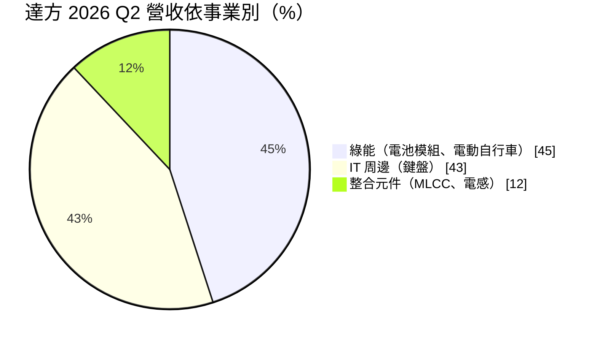
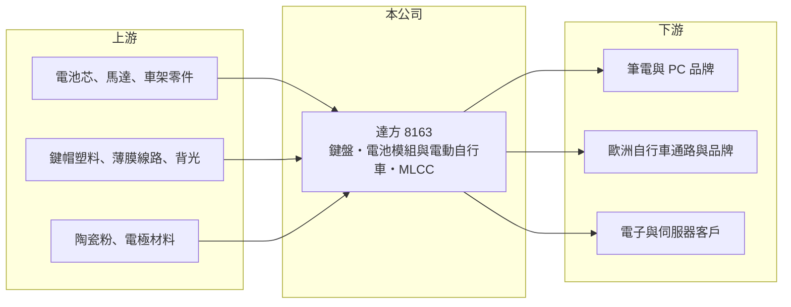

# 8163 達方

> 上市｜[[產業索引-電腦及週邊設備業|電腦及週邊設備業]]｜上市（櫃）日期 2007/11/28

# 第一章：企業模式與商業藍圖

> [!info] 撰寫說明
> 精簡版，由 Claude 依公開資料整理，架構比照 [[2330台積電]]，資料截至 2026-10-08。來源：證交所開放資料快照（基本資料、2026 年第二季資產負債與損益、股利、月營收）、Goodinfo 經營績效頁、富果研究 2026 年 8 月法說會摘要。集團關係與自行車品牌描述憑記憶整理，已標「待校對」。Goodinfo 2025 年數字與 2026 年上半年數字有雷同之處，待校對。#待校對

達方電子（以下簡稱達方）是 BenQ 集團（明基友達集團）旗下的零組件廠（待校對），理解它的關鍵在於：它以筆電鍵盤起家，之後跨足電動自行車與電池模組、被動元件，三大事業的景氣週期不同，讓營收規模大但獲利率始終偏低。

- **核心業務：** 達方成立於 1997 年，2007 年在證交所上市。依富果研究，業務分為三大事業：IT 周邊（筆電與桌機鍵盤、電競相關產品）、綠能（電源模組、電池模組、[[電動輔助自行車]]組裝與品牌通路）、整合元件（[[MLCC]] 與電感）。依記憶，自有電動自行車品牌為 BESV（待校對）。
- **營收結構：** 依富果研究，2026 年第二季 IT 周邊占 43%、綠能占 45%、整合元件占 12%，綠能已成為最大事業。綠能成長主要來自歐洲通路復甦與庫存去化順利；整合元件則受惠日韓大廠把 MLCC 產能轉向 AI 伺服器，價格上揚。三大事業互補，但也讓達方難以在任何一個領域取得龍頭地位。
- **營運據點：** IT 周邊正在東南亞（越南）建立產能，子公司泰譽在越南南部興建新廠，同時生產自行車車架，做垂直整合（富果研究）。2026 年上半年資本支出約 5 億元，其中七成用於自動化與產能、三成用於越南廠。
- **長期方向：** 達方的長期方向是「AIoT 轉型」，整合電池、電源與散熱，從 PC 客戶延伸到 AI 伺服器與資料中心。2026 年上半年以約 3.8 億元收購電源廠海創，並投資散熱方案業者全景（富果研究）。綠能事業則計畫從電動自行車電池擴展到工業、機器人、無人機，長期目標是資料中心 [[BBU]]。

# 第二章：護城河深度與競爭優勢

達方的護城河很窄，主要來自筆電鍵盤的大規模製造與品牌客戶關係，以及集團資源；三大事業各自面對強勁對手，議價能力有限。

- **競爭優勢：** 筆電鍵盤需要配合每一代機種的厚度、背光與按鍵手感客製，達方長年服務一線筆電品牌，具備大量生產與快速開發能力。電動自行車方面，達方同時擁有電池、電控與整車組裝能力，在歐洲通路有一定基礎。公司設定的長期毛利率目標為 18% 至 20%（富果研究），顯示管理層自己也定位在中低毛利的製造業。
- **主要對手：** 鍵盤領域的主要對手為 [[2385群光]]、[[4915致伸]]、[[2301光寶科]]；電動自行車與電池方面有 [[9921巨大]]、[[9914美利達]]、[[5309系統電]]、[[6121新普]]；MLCC 則面對 [[2327國巨]]、[[2492華新科]] 與日韓大廠。達方在每個領域都不是最大，競爭力來自跨事業的整合。
- **觀察重點：** 長期最該追蹤的是[[營業利益率]]能否回到 5% 以上。2019 至 2022 年營業利益率穩定在 5% 至 5.6%，2024 年降到 2.6%，2025 年轉為約 -0.3%，主因電動自行車庫存調整與一次性的存貨、應收帳款損失（富果研究）。綠能事業若能穩定獲利，加上 MLCC 漲價，達方才有機會恢復過去的獲利水準。

# 第三章：財務體質與盈利規模

資料日期：2026-10-08，表格是撰寫當時的快照；最新月營收、毛利率、累計 EPS 由自動排程寫在本筆記的屬性欄位（月營收、毛利率、累計EPS 等）。#待校對

達方的財務呈現「營收規模大、毛利率 16% 至 18%、營益率薄」的多角化零組件廠樣貌：營收在 190 億至 300 億元之間，獲利對產品組合與庫存非常敏感。

| 年度 | 營收（億元） | [[毛利率]] | [[營業利益率]] | EPS（元） | [[ROE]] |
|---|---|---|---|---|---|
| 2021 | 280 | 16.6% | 5.31% | 4.09 | 11.2% |
| 2022 | 295 | 17.0% | 5.45% | 4.15 | 10.9% |
| 2023 | 258 | 17.8% | 4.52% | 5.91 | 12.8% |
| 2024 | 217 | 18.4% | 2.64% | 2.22 | 3.43% |
| 2025 | 251 | 15.9% | -0.28% | 0.51 | -1.09% |

（來源：Goodinfo 經營績效頁；2025 年 EPS 為正而 ROE 為負，數字彼此矛盾，待校對。2026 年上半年依證交所資料，營收 135.4 億元、毛利率約 17.2%、營業利益率約 1.7%、EPS 0.51 元。）

- **營收規模：** 2020 年營收 223 億元，2025 年 251 億元，年複合成長率約 2.4%（推算）。2022 年 295 億元是高點，之後隨電動自行車庫存調整下滑，2025 年回升約 15.5%（富果研究）。營收規模大，但成長主要跟著產業循環，而不是結構性擴張。
- **獲利：** 2021 至 2025 年平均 ROE 約 7.4%（推算）。2023 年營業利益率只有 4.52%，EPS 卻達 5.91 元，推估含處分資產或轉投資等一次性收益（推估，原因未查得）。2025 年第四季 EPS 僅 0.05 元，2026 年第二季回升到 0.31 元。
- **財務特色：** 2026 年第二季總資產約 349.9 億元、負債約 216.8 億元，負債比約 62%，母公司權益約 107.6 億元，每股淨值 39.00 元；權益總計 133.1 億元，非控制權益約 25.5 億元。第二季存貨約 64.3 億元、現金約 64.8 億元（富果研究）。依證交所股利資料，114 年度現金股利 0.5 元；Goodinfo 統計長期平均現金股利約 1.44 元，配息隨獲利起伏。自由現金流是否長期為正未查得。
- **[[ROIC]] 與 [[WACC]]：** 2025 年營業利益約 -0.70 億元（251 億元 × -0.28%），ROIC 約 -0.5%（推算，以權益總計 133.1 億元計）。2026 年上半年營業利益 2.27 億元年化約 4.54 億元、稅後約 3.63 億元，有息負債未查得，投入資本以權益總計 133.1 億元到總資產 349.9 億元為區間，ROIC 約 1.0% 至 2.7%（推算）。2022 年營業利益約 16 億元，以相近的資本規模估算 ROIC 約 4% 至 10%（推算）。WACC 以 [[CAPM]] 推估：無風險利率 1.75%、市場風險溢酬 6%、β 假設 0.9（電子零組件股常見值），權益成本約 7.2%；稅後負債成本 2%、負債占四成，WACC 約 5.1%（推算）。近兩年 ROIC 明顯低於 WACC，達方需要營益率回到 2022 年以前的水準，才能重新創造價值。

# 第四章：總體風險與地緣政治

達方的風險集中在電動自行車週期、PC 需求與零組件成本，屬於多角化但每一塊都受景氣影響的零組件股。

- **產業週期：** 電動自行車在 2021 至 2022 年疫情期間需求暴增，之後歐洲通路累積大量庫存，2023 至 2025 年經歷漫長的去化，這是典型的[[長鞭效應]]，也是達方獲利下滑的主因。筆電鍵盤跟著 PC 換機週期走，MLCC 則有典型的漲價、擴產、跌價循環，三個週期疊加，使獲利難以穩定。
- **營運風險：** 2025 年第三季曾認列一次性的存貨與應收帳款損失，顯示通路庫存與客戶信用風險實際存在。記憶體等零組件漲價可能壓抑 PC 終端需求，影響 IT 周邊出貨。併購海創、投資全景與越南建廠需要時間整合，短期增加費用。
- **其他風險：** 綠能事業以歐洲市場為主，歐元匯率與歐洲消費景氣影響大；電動自行車與電池須符合歐盟的安全與電池法規。美國關稅促使生產移往越南，新廠成本與良率也是風險。

# 專有名詞解析

## 應用

- **[[電動輔助自行車]]**：騎乘者踩踏時由馬達提供助力的自行車，歐洲稱 e-bike，是自行車產業成長最快的品類。

## 金融

- **[[長鞭效應]]**：終端需求的小幅變動，沿供應鏈往上游傳遞時被逐級放大，造成上游庫存與訂單劇烈波動。

## 產業

- **[[MLCC]]**：積層陶瓷電容，由多層陶瓷與電極堆疊而成的小型電容，是用量最大的被動元件。
- **[[BBU]]**：備援電池單元，資料中心在斷電時提供短時間電力，讓伺服器安全切換或關機。

# 核心供應鏈

- 上游：電池芯、馬達與車架零件，鍵帽塑料、薄膜線路與背光模組，以及 MLCC 用陶瓷粉與電極材料。
- 下游／客戶：筆電與 PC 品牌、歐洲電動自行車通路，以及電子與伺服器客戶（具體客戶未點名，#待校對）；集團關係：[[2352佳世達]]、[[2409友達]]（待校對）。
- 同業：鍵盤 [[2385群光]]、[[4915致伸]]、[[2301光寶科]]；電動自行車與電池 [[9921巨大]]、[[9914美利達]]、[[5309系統電]]；MLCC [[2327國巨]]、[[2492華新科]]。

## 最新新聞
<!-- news:start -->
<!-- news:end -->

## 相關連結
- [公開資訊觀測站](https://mopsov.twse.com.tw/mops/web/t05st03?step=1&firstin=1&co_id=8163)
- [Goodinfo](https://goodinfo.tw/tw/StockDetail.asp?STOCK_ID=8163)
- [Yahoo 股市](https://tw.stock.yahoo.com/quote/8163)
- [鉅亨網新聞](https://www.cnyes.com/twstock/8163/news)
