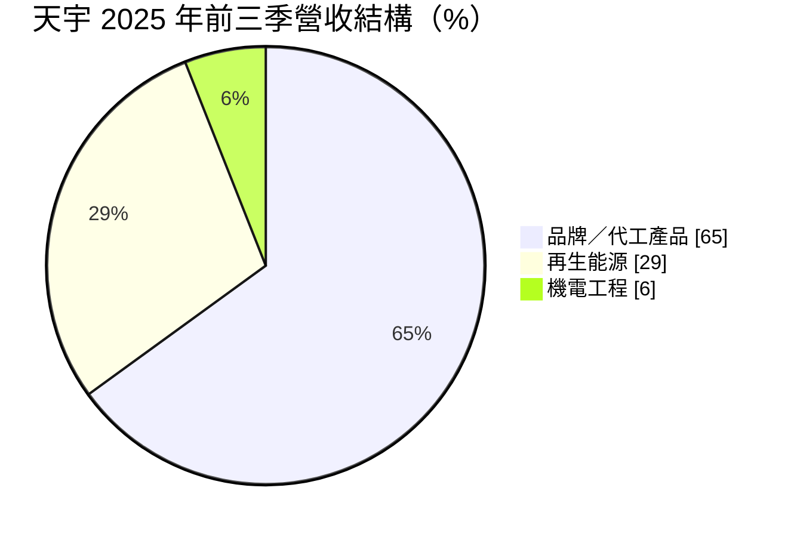
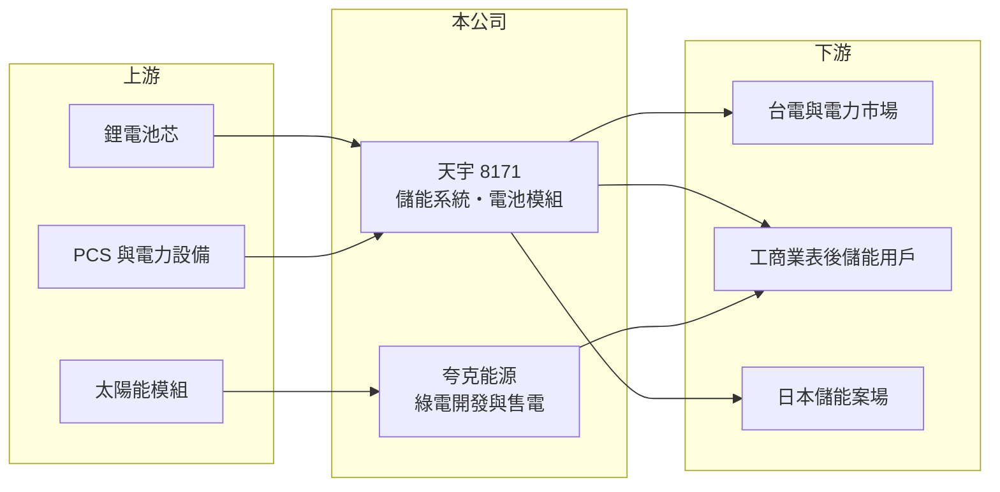

# 8171 天宇

> 上櫃｜[[產業索引-綠能環保|綠能環保]]｜上市（櫃）日期 2011/12/19

# 第一章：企業模式與商業藍圖

> [!info] 撰寫說明
> 精簡版，由 Claude 依公開資料整理，架構比照 [[2330台積電]]，資料截至 2026-10-08。來源：Goodinfo 台灣股市資訊網年度經營績效（2020 至 2025 年）；富果研究 2025 年 12 月法說會摘要；櫃買中心開放資料快照（基本資料、2026 年上半年資產負債與損益）。#待校對

天宇工業成立於 1983 年 10 月、2011 年 12 月上櫃，總部在新北市新店，董事長馬震偉、總經理劉奇威，實收資本額 11.3 億元（含私募股 3,500 萬股）。天宇原本是電池模組製造商，近年轉型為[[儲能]]系統與再生能源整合方案供應商，但轉型期間連年虧損。

- **核心業務：** 天宇以「創、儲、節、智」四大板塊經營：儲能櫃、液冷儲能貨櫃與電池模組的品牌與 [[OEM]]／[[ODM]] 代工；自有太陽能案場發電、案場開發、EPC 與綠電憑證銷售；機電工程；以及節能工程。儲能櫃累計出貨量超過 3.58GWh。
- **營收結構：** 2025 年前三季品牌／代工產品約占 65%、再生能源約 29%、機電工程約 6%，節能工程 2025 年第四季起貢獻。品牌代工營收從 2024 年同期的 8.38 億元降到 1.29 億元，主因美國電動巴士客戶 Proterra 清算。
- **營運據點：** 總部在新北；自有太陽能案場 5.2MW 已發電、6.9MW 建置中，EPC 案場約 31.8MW；雲林 100MW 儲能案場已取得台電併聯審查同意，預計 2026 年動工、2028 年第一季併網。子公司夸克能源負責綠電開發、轉供與售電；日本 SPV 建置 2MW/8MWh 儲能案場，預計 2026 年第三季併網。
- **長期方向：** 國內以[[表後儲能]]為核心，整合節能與機電工程；2026 年目標持有 50MW 以上太陽能案場，挹注穩定現金流；海外以日本為起點。2025 年 8.75 億元私募由三立集團參與，原經營團隊續任。

# 第二章：護城河深度與競爭優勢

天宇在儲能系統累積了出貨實績，但客戶集中與轉型虧損，使護城河目前很淺。

- **競爭優勢：** 累計超過 3.58GWh 的儲能出貨，代表公司在電池模組整合、熱管理與系統驗證上有經驗。雲林 100MW 儲能案已取得併聯審查，併網容量本身就是稀缺資源。
- **主要對手：** 儲能系統同業包括 [[2308台達電]]、[[1513中興電]]、[[1503士電]]、[[1519華城]] 等電力設備商，以及中國寧德時代、比亞迪等電池大廠的系統產品；太陽能案場則與 [[6873泓德能源]]、[[6869雲豹能源]] 競爭。
- **觀察重點：** 單一美國客戶清算就讓營收減少七成以上，說明過去客戶過度集中。長期要看表後儲能、持有型案場與日本市場能否建立分散且穩定的收入。

# 第三章：財務體質與盈利規模

資料日期：2026-10-08，表格是撰寫當時的快照；最新月營收、毛利率、累計 EPS 由自動排程寫在本筆記的屬性欄位（月營收、毛利率、累計EPS 等）。#待校對

天宇在 2020 至 2025 年只有 2022 年獲利，2025 年因客戶清算與呆帳提列出現大額虧損。

| 年度 | 營收（億元） | [[毛利率]] | [[營業利益率]] | EPS（元） | [[ROE]] |
|---|---|---|---|---|---|
| 2021 | 9.06 | 5.67% | -6.81% | -1.22 | -9.49% |
| 2022 | 14.8 | 15.1% | 3.84% | 2.20 | 12.5% |
| 2023 | 9.15 | 11.9% | -6.44% | -0.50 | -2.62% |
| 2024 | 9.54 | 3.80% | -17.9% | -1.29 | -6.37% |
| 2025 | 3.15 | -19.9% | -156% | -5.17 | -29.0% |

註：Goodinfo 合併報表；2020 年營收 2.47 億元、EPS -1.37 元。2025 年第二季提列約 2 億元備抵呆帳。2026 年上半年營收 2.36 億元、毛利率約 1.8%、EPS -0.68 元（櫃買中心資料）。

- **長期指標：** 2021 至 2025 年平均 ROE 約 -7.0%（推算），5 年中有 4 年虧損。營收由 2022 年高點 14.8 億元降到 2025 年 3.15 億元。近年未配發現金股利，靠私募增資補充資本。
- **[[ROIC]] 與 [[WACC]]：** 2025 年營業損失約 4.9 億元（3.15 億元 × -156%），虧損不計稅盾；投入資本約 32 億元（2026 年第二季權益總計 22.61 億元，加上以非流動負債 8.97 億元推估的有息負債），ROIC 約 -15%（推算）。2026 年上半年營業損失 1.39 億元，年化 ROIC 仍約 -9%（推算）。WACC 約 7.0%（推算：無風險利率 1.75%、市場風險溢酬 6%、β 取轉型中小型股 1.2，股東權益成本 8.95%；稅前負債成本 2.5%、稅率 20%，負債占資本約 28%）。ROIC 為負且遠低於 WACC，代表目前正在消耗股東資本，轉型成果尚未反映在報酬上。
- **財務特色：** 2026 年第二季負債比率約 39%（負債 14.64 億元 ÷ 資產 37.24 億元），私募資金讓財務尚有緩衝。上半年業外收入 0.46 億元，部分抵銷營業損失。

# 第四章：總體風險與地緣政治

天宇的風險在於轉型能否成功，以及儲能產業的激烈價格競爭。

- **產業週期：** 儲能系統價格隨鋰電池成本快速下滑，中國廠商產能龐大，系統整合商的毛利受壓。再生能源案場的收入則受政策與併網進度影響。
- **營運風險：** 過去客戶過度集中，Proterra 清算造成營收驟降與呆帳；雲林 100MW 儲能案投資金額大、時程長，若延誤會拖累資金。持續虧損可能需要再增資，稀釋股東權益。
- **其他風險：** 儲能安全法規與消防要求變嚴會提高成本；日本市場面臨當地法規與匯率風險；電池芯多為進口，供應鏈與價格受國際影響。

# 專有名詞解析

## 金融

- **[[ROIC]]**：投入資本報酬率，稅後營業利益除以股東權益加有息負債，衡量本業運用資本的效率。

## 產業

- **[[儲能]]**：以電池等設備儲存電力，在用電尖峰或電網需要時釋放，可參與電力交易市場賺取收入。
- **[[OEM]]**：原廠委託製造，代工廠依品牌客戶的設計與規格生產，產品掛品牌商的商標。
- **[[ODM]]**：原廠委託設計製造，代工廠除了生產也負責產品設計，品牌商只提出規格。
- **[[表後儲能]]**：裝在用戶電表後方的儲能設備，用來削減尖峰用電、降低電費或作為備援電力。

# 核心供應鏈

- 上游：鋰電池芯（多為進口）、PCS 與電力設備、太陽能模組供應商（名單未查得）。
- 下游／客戶：台電與電力交易市場、工商業表後儲能用戶、日本儲能案場；過去的美國電動巴士客戶 Proterra 已清算。
- 同業：[[2308台達電]]、[[1513中興電]]、[[1503士電]]、[[1519華城]]、[[6873泓德能源]]。策略股東：三立集團。

## 最新新聞
<!-- news:start（自動產生，請勿手動編輯此範圍） -->
- 2026-10-13 🏛️ 重訊 21:13｜公告本公司買回庫藏股期間屆滿執行情形｜[觀測站](https://mops.twse.com.tw/mops/#/web/t05st01)

完整紀錄：[[8171天宇 新聞]]
<!-- news:end -->

## 相關連結
- [公開資訊觀測站](https://mopsov.twse.com.tw/mops/web/t05st03?step=1&firstin=1&co_id=8171)
- [Goodinfo](https://goodinfo.tw/tw/StockDetail.asp?STOCK_ID=8171)
- [Yahoo 股市](https://tw.stock.yahoo.com/quote/8171)
- [鉅亨網新聞](https://www.cnyes.com/twstock/8171/news)
