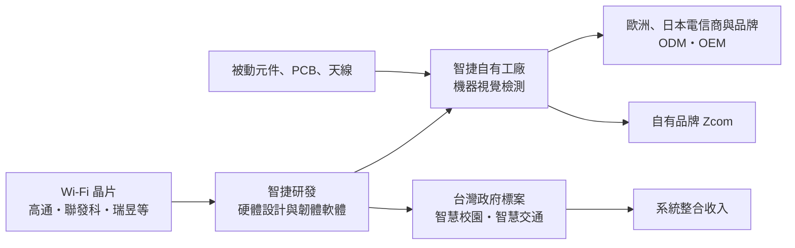
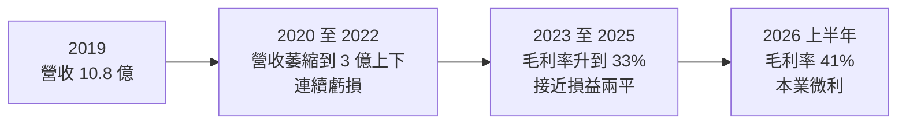
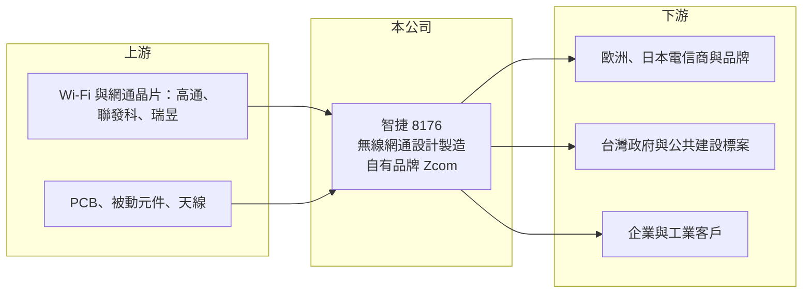

# 8176 智捷

> 上櫃｜[[產業索引-通信網路業|通信網路業]]｜上市（櫃）日期 2013/06/25

# 第一章：企業模式與商業藍圖

> [!info] 撰寫說明
> 本文由 Claude 依公開資料整理，架構比照 [[2330台積電]] 的四章研究，資料截至 2026-10-08。財務數字來源：Goodinfo 年度經營績效頁、富果研究 2025 年 12 月法說會整理（業務模式、市場、策略、2025 年前三季財務）、櫃買中心開放資料（基本資料、2026 年第二季資產負債與綜合損益、每月營收、本益比）。公開資料有限，產品營收比重與客戶集中度未查得。#待校對

在評估單一個股的長期投資價值時，首要步驟是拆解企業的底層獲利邏輯。本章針對智捷科技（股票代號：8176，以下簡稱智捷）的商業模式進行定性分析，說明這家小型無線網通廠如何在代工與政府標案之間找出生存空間。

## 一、核心定位：無線網路的設計製造一條龍

智捷成立於 1995 年，2013 年在櫃買中心掛牌，擁有約 30 年無線網通經驗。依櫃買中心基本資料，實收資本額登記約 5.98 億元，2026 年第二季資產負債表的股本約 7.17 億元，兩者差異可能與增資有關（推估）；董事長由法人凡恩科技擔任。

智捷的核心業務是無線寬頻網路的軟硬體開發與整合，提供從產品設計、軟硬體開發到自有工廠製造的一條龍服務（富果整理）。產品主要有三類：

* **電信商與工業級 [[Wi-Fi]] 設備：** 替電信業者與企業客戶開發無線基地台與網路設備，Wi-Fi 6 產品曾在 2024 年獲獎，Wi-Fi 7 產品在 2025 年獲國家品牌玉山獎。
* **網路管理軟體：** 無線網路控制器（WLC），已加入 AI 網路分析與優化功能，可整合 4G/5G、Wi-Fi 與 IoT 等不同網路。
* **[[邊緣運算]]平台：** ZMAX 平台可以搭載第三方 AI 應用，切入 [[AIoT]] 的特定應用。

## 二、業務模式與市場

* **[[ODM]]／[[OEM]]：** 主要市場在歐洲、日本與亞洲，替電信商與品牌客戶設計並生產設備，歐洲與日本客戶有多項新產品專案進行中。
* **自有品牌：** 在特定市場以自有品牌 Zcom 銷售。
* **台灣政府與公共建設標案：** 積極參與智慧校園、智慧交通與節能等領域的標案，提供軟硬體整合的完整方案，這類案件毛利較高。

本文未查得各業務的營收比重。2025 年前三季營收約 2.85 億元、年減 15%，毛利率約 31%（富果整理），營收規模在台灣網通廠中屬於很小的一群。

## 三、資本轉化邏輯：小規模工廠的效率挑戰

* **自有工廠：** 智捷保留自有工廠，主要產線已有 60% 至 70% 導入機器視覺判讀良品與不良品，以降低人事成本。對小型網通廠來說，自有工廠能提高彈性與交期掌握，但產量不足時，折舊與人力會變成固定成本負擔。
* **雙軌策略：** 一方面維持 ODM／OEM 的規模化生產以攤提成本，另一方面參與高毛利的垂直整合型政府標案，提升獲利與價值鏈地位。

## 四、企業長期方向

智捷的長期方向集中在三點：第一，靠歐洲、日本既有客戶的新產品專案恢復營收成長；第二，提高台灣政府與公共建設營收的占比，以系統整合提高毛利；第三，以 AIoT 與邊緣運算平台開拓物聯網應用。公司同時推動 ESG 與供應鏈透明化，並在 2025 年通過 ISO/IEC 27001 [[資安]]認證，這是承接政府與電信案件的重要資格。

# 第二章：護城河深度與競爭優勢

本章分析智捷的競爭優勢。坦白說，在大型網通廠環伺之下，智捷的優勢主要來自利基市場與客製化能力。

## 一、護城河的核心組成要素

* **客製化與軟體能力：** 智捷同時具備硬體設計、韌體與網管軟體能力，能為歐洲、日本的中小型電信商與企業客戶提供小量、客製化的方案，這是大型代工廠不一定願意接的訂單。
* **長期客戶關係：** 與歐洲、日本客戶合作多年，電信設備需要通過客戶的驗證與認證，客戶更換供應商的成本較高。
* **政府標案資格：** 資安認證與台灣在地服務能力，讓智捷具備承接政府智慧化標案的條件。

整體而言，智捷的護城河很窄：營收規模小，無法在零組件採購與研發投入上與大廠競爭，主要依靠利基市場生存。

## 二、主要競爭對手格局

| 競爭對手 | 主要市場 | 與智捷的比較 |
|---|---|---|
| [[2345智邦]] | 全球資料中心與企業網通 | 規模遠大於智捷，以高速交換器為主 |
| [[3596智易]]、[[5388中磊]] | 全球電信商 CPE 設備 | 電信商寬頻設備大廠，接單規模與成本優勢明顯 |
| [[3380明泰]]、[[2332友訊]] | 企業與消費網通 | 有自有品牌與代工業務 |
| [[3704合勤控]] | 歐洲電信與中小企業 | 在歐洲電信市場與智捷客群重疊 |

## 三、優勢轉化：守得住、守不住與觀察重點

* **守得住：** 小量客製化的電信與工業級訂單，以及台灣政府標案中需要在地整合的案件。
* **守不住：** 大量標準化的網通產品。這類產品由大型 ODM 主導，價格競爭激烈，智捷沒有規模優勢。
* **觀察重點：** 歐洲、日本新產品專案能否在 2026 年貢獻營收；政府標案營收占比的提升速度；以及營收能否回到 5 億元以上、讓本業穩定獲利。

# 第三章：財務體質與盈利規模

資料日期：2026-10-08。數字取自 Goodinfo 年度經營績效頁、富果法說會整理與櫃買中心開放資料，表格是撰寫當時的快照；最新月營收、毛利率、累計 EPS 由自動排程寫在本筆記的屬性欄位（月營收、毛利率、累計EPS 等）。#待校對

財務報表是檢驗護城河是否真實存在的最終標準。本章用多年度的三率、ROE 與資本報酬，檢視智捷在營收萎縮後的獲利能力。

## 一、獲利能力的基石：三率

| 年度 | 營收（新台幣） | [[毛利率]] | [[營業利益率]] | EPS（元） | [[ROE]] |
|---|---|---|---|---|---|
| 2019 | 10.8 億 | 22.9% | -1.31% | 0.21 | 0.38% |
| 2020 | 4.12 億 | 24.1% | -34.4% | -1.27 | -16.0% |
| 2021 | 2.60 億 | 26.3% | -50.3% | -0.88 | 未查得 |
| 2022 | 3.26 億 | 28.4% | -23.1% | -0.94 | -11.5% |
| 2023 | 4.32 億 | 33.7% | -3.31% | 0.08 | 0.91% |
| 2024 | 5.62 億 | 32.4% | 2.86% | 0.45 | 5.57% |
| 2025 | 3.73 億 | 33.4% | 0.68% | 0.40 | 4.93% |
| 2026 上半年 | 1.66 億 | 41.4% | 2.1% | 0.00 | 未查得 |

註：Goodinfo 顯示 2021 年 ROE 為 -0.67%，與同年 EPS 不一致，故列為未查得。2026 年上半年毛利率與營業利益率依櫃買中心綜合損益資料推算。

* **營收規模：** 2019 年營收約 10.8 億元，2020 年驟降到約 4.1 億元，2021 年再降到 2.6 億元，之後在 3 億至 5.6 億元之間。營收萎縮的具體原因未查得（推估與主要客戶訂單流失有關）。
* **[[毛利率]]：** 從約 23% 一路升到 2025 年的 33%、2026 年上半年約 41%，顯示產品組合往高毛利的客製化與標案方向調整。
* **[[營業利益率]]：** 2024 年才轉為正值，2025 年只有 0.68%。2025 年前三季稅後淨利約 2,356 萬元，其中約 3,200 萬元來自貨物水損理賠金（富果整理），屬於[[一次性收益]]，本業其實仍在打平邊緣。
* **營收趨勢：** 2021 至 2025 年營收從 2.6 億元增至 3.73 億元，年複合成長率約 9.4%（推算），但 2026 年 1 至 8 月累計營收約 2.26 億元，年減約 10%（櫃買中心每月營收）。

## 二、[[ROE]]：資本效率

2023 至 2025 年 ROE 在 1% 至 6% 之間，2020 至 2022 年則為負值。2026 年第二季底權益總計約 6.03 億元、總負債約 1.75 億元，負債比約 23%，保留盈餘為 -0.99 億元（櫃買中心開放資料），代表過去累積虧損尚未彌補。股價淨值比約 1.15 倍（2026 年 10 月初）。

## 三、資本支出、自由現金流與股利

智捷的資本支出以產線自動化與研發設備為主，規模不大。由於累積虧損未彌補，2026 年 10 月初資料顯示每股股利為 0（櫃買中心本益比資料），短期內配息能力有限。財務結構方面負債比低，沒有明顯的償債壓力。

## 四、[[ROIC]] 與 [[WACC]]：價值創造利差

**ROIC 推算：** 2025 年營業利益約 0.025 億元（3.73 億 × 0.68%），扣除 20% 稅率後約 0.02 億元。2026 年第二季底權益總計約 6.03 億元，總負債約 1.75 億元，假設約 30% 為有息負債（推估，約 0.53 億元），投入資本約 6.56 億元，ROIC 約 0.3%（推算）。2024 年營業利益率較高（2.86%），ROIC 約 2%（推算）。

**WACC 推算：** 假設台灣 10 年期公債殖利率 1.75%、市場風險溢酬 6%、β 取 1.0（小型網通股常見值），股東權益成本約 7.75%。負債成本假設 3.0%，稅後約 2.4%；以帳面價值計，權益約占 92%，WACC 約 7.3%（推算）。

**結論：** 智捷的 ROIC 遠低於 WACC，2020 至 2022 年更是大幅為負，代表目前的業務規模無法為股東創造價值。營收規模太小是根本問題：以約 33% 至 40% 的毛利率推算，營收需要回到 5 億元以上，營業利益率才可能超過 5%，ROIC 才有機會接近資金成本（推算）。

# 第四章：總體風險與地緣政治

任何企業都無法脫離宏觀環境獨立存在。本章分析智捷長期必須面對的規模、技術、客戶與經營權風險。

## 一、規模與競爭

* **規模劣勢：** 網通產業的零組件採購、研發與認證都有規模經濟，智捷營收只有大廠的零頭，難以在成本上競爭。
* **客戶集中：** 營收依賴少數歐洲、日本客戶的專案，單一客戶延後或取消專案，就會造成營收大幅波動。

## 二、技術演進

* **Wi-Fi 世代交替：** Wi-Fi 6、Wi-Fi 7 到下一代標準，每一代都需要重新投入研發與認證，小廠的研發資源有限。
* **晶片供應：** 網通設備依賴高通、聯發科、瑞昱等晶片商，晶片缺貨或價格上漲時，小廠的議價能力最弱。

## 三、市場與政策

* **關稅與景氣：** 公司指出全球經濟不確定性與關稅政策可能影響客戶拉貨節奏。
* **政府標案：** 標案收入受政府預算與招標時程影響，具有不連續性，且常以低價得標。

## 四、經營權與治理

* **法人董事長：** 董事長由法人凡恩科技擔任，股本也有變動跡象，經營權與股權結構的變化可能影響公司策略方向（具體情況未查得）。
* **累積虧損：** 保留盈餘仍為負，若未來虧損擴大，可能需要減資或增資，影響股東權益。

# 專有名詞解析

## 應用

- **[[Wi-Fi]]**：無線區域網路標準，Wi-Fi 7 是最新一代，傳輸速度與穩定度大幅提升。
- **[[邊緣運算]]**：在靠近資料產生端的設備上處理資料，而不是全部送回雲端，可降低延遲與頻寬需求。
- **[[AIoT]]**：人工智慧結合物聯網，讓連網設備具備資料分析與自動判斷能力。
- **[[資安]]**：資訊安全，保護系統與資料不被入侵、竊取或破壞，政府與電信案件常要求供應商取得相關認證。

## 金融

- **[[一次性收益]]**：處分資產、保險理賠等不會每年重複發生的收益，評估長期獲利時應排除。
- **[[ROIC]]**：投入資本報酬率，稅後營業利益除以股東權益與有息負債的合計，衡量本業對所有資金提供者的報酬。
- **[[WACC]]**：加權平均資金成本，依股東權益與負債的比重加權計算的資金成本，ROIC 高於它才代表創造價值。

## 產業

- **[[ODM]]**：原廠委託設計製造，代工廠負責產品設計與生產，再以客戶品牌出貨。
- **[[OEM]]**：原廠委託製造，代工廠依客戶提供的設計與規格生產，不參與產品設計。

# 核心供應鏈

## 1. 上游：晶片與零組件
- 網通晶片：[[QCOM高通]]、[[2454聯發科]]、[[2379瑞昱]]
- PCB、被動元件與天線

## 2. 中游：智捷本身與同業
- 台灣網通同業：[[2345智邦]]、[[3596智易]]、[[5388中磊]]、[[3380明泰]]、[[2332友訊]]、[[3704合勤控]]

## 3. 下游：客戶
- 歐洲、日本電信商與品牌客戶
- 台灣政府機關（智慧校園、智慧交通、節能）與企業、工業客戶

## 最新新聞
<!-- news:start -->
<!-- news:end -->

## 相關連結
- [公開資訊觀測站](https://mopsov.twse.com.tw/mops/web/t05st03?step=1&firstin=1&co_id=8176)
- [Goodinfo](https://goodinfo.tw/tw/StockDetail.asp?STOCK_ID=8176)
- [Yahoo 股市](https://tw.stock.yahoo.com/quote/8176)
- [鉅亨網新聞](https://www.cnyes.com/twstock/8176/news)
