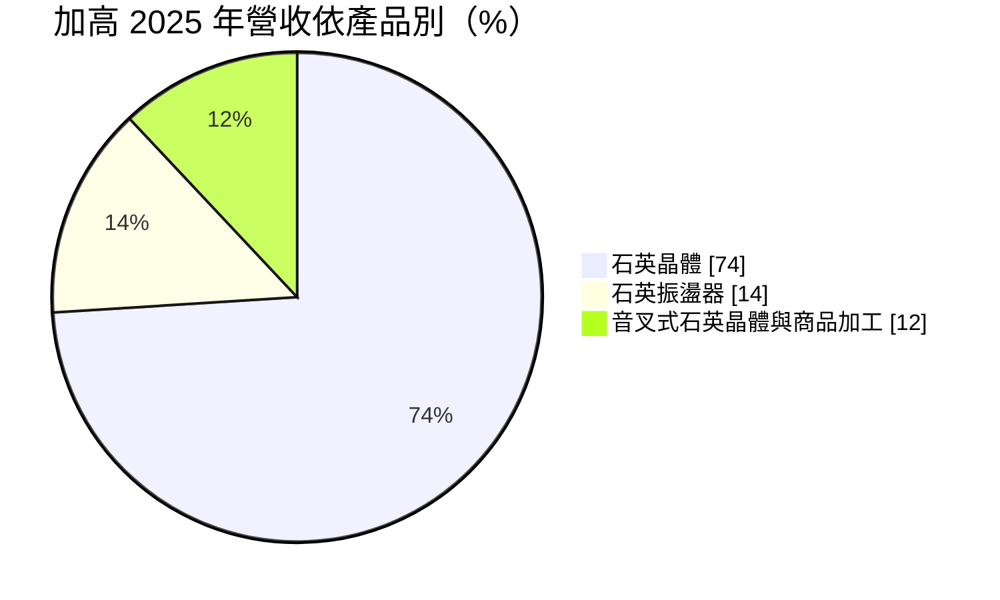
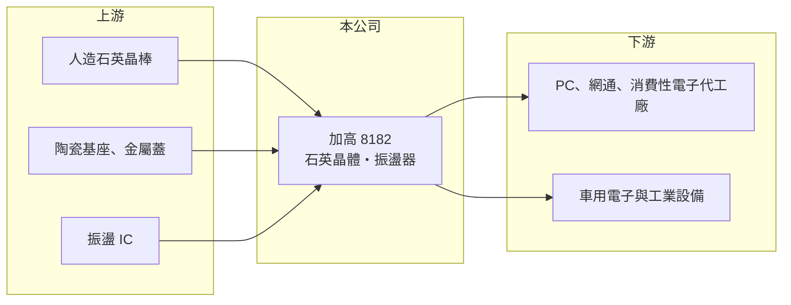

# 8182 加高

> 上櫃｜[[產業索引-電子零組件業|電子零組件業]]｜上市（櫃）日期 2006/05/25

# 第一章：企業模式與商業藍圖

> [!info] 撰寫說明
> 精簡版，由 Claude 依公開資料整理，架構比照 [[2330台積電]]，資料截至 2026-10-08。來源：櫃買中心開放資料快照（基本資料、2026 年第二季資產負債與損益、本益比殖利率）、Goodinfo 經營績效頁、MoneyDJ 個股基本資料（2025 年營收比重）、財經媒體報導標題。應用市場與據點描述部分依記憶整理，已標註待校對。#待校對

加高電子（以下簡稱加高）是台灣老牌的石英頻率元件廠，理解它的關鍵在於：石英元件是每一台電子產品都需要的「時脈心臟」，用量龐大但規格標準化，因此產業長期在產能與價格之間循環。

- **核心業務：** 加高成立於 1976 年，2006 年在櫃買中心掛牌，總部與工廠位於高雄大寮，實收資本額約 10.7 億元，董事長兼總經理為楊景晴。公司生產[[石英晶體]]、[[石英振盪器]]與音叉式晶體，為電子產品提供穩定的時脈訊號。沒有準確的時脈，處理器、無線通訊與記憶體都無法同步運作，因此石英元件幾乎出現在所有電路板上。
- **營收結構：** 依 MoneyDJ 資料，2025 年石英晶體約占 74%、石英振盪器約 14%、音叉式晶體與商品加工約 12%。以晶體為主代表產品偏向量大、單價較低的被動型元件，振盪器這類附加價值較高的主動元件比重仍不高。主要應用為 PC、網通、消費性電子與車用等（應用別比重未查得，待校對）。
- **營運據點：** 台灣高雄為主要基地，並在泰國設有生產據點，報導標題提到泰國第二生產基地已完工（年份待校對）。在東南亞建立產能，可以服務希望避開中國產地的國際客戶。
- **長期方向：** 石英元件的長期成長來自三個方向：車用電子化讓每輛車的晶體用量增加、[[AI 伺服器]] 與高速網通需要更高頻與更低抖動的時脈，以及[[低軌衛星]]等新應用。加高的課題是把產品組合往振盪器與車規產品移動。

# 第二章：護城河深度與競爭優勢

加高的護城河主要是規模、長年製程經驗與客戶認證，但產品標準化程度高，訂價能力有限。

- **競爭優勢：** 石英元件要經過晶片廠參考設計與系統廠的認證才能被採用，加高經營近五十年，累積了廣泛的客戶與認證基礎。自有晶片切割、研磨到封裝的製程經驗，讓公司能在價格競爭中維持基本的成本競爭力。泰國產能也讓公司在供應鏈分散化的趨勢下多一個籌碼。
- **主要對手：** 台灣同業包括 [[3042晶技]]、[[3221台嘉碩]] 與 [[8289泰藝]]；國際上有日本電波工業（NDK）、精工愛普生（Epson）、京瓷（KYOCERA）等日系大廠，以及多家中國廠商。晶技規模最大、產品線最完整，加高則以晶體為主力，在標準品上面對中國廠商的價格壓力。
- **觀察重點：** 2025 年毛利率降到 14.2%，2026 年上半年進一步降到約 12.8%，代表新產能或產品組合帶來的成本壓力尚未消化。長期要追蹤振盪器與車用產品比重能否提高，以及毛利率能否回到 2021 至 2024 年 18% 至 28% 的區間。

# 第三章：財務體質與盈利規模

資料日期：2026-10-08，表格是撰寫當時的快照；最新月營收、毛利率、累計 EPS 由自動排程寫在本筆記的屬性欄位（月營收、毛利率、累計EPS 等）。#待校對

加高的財務呈現典型零件廠的週期性：營收規模約 30 億元上下，獲利隨產業景氣大幅起伏。

| 年度 | 營收（億元） | [[毛利率]] | [[營業利益率]] | EPS（元） | [[ROE]] |
|---|---|---|---|---|---|
| 2021 | 36.0 | 28.5% | 18.2% | 4.76 | 15.5% |
| 2022 | 28.8 | 22.0% | 9.14% | 2.50 | 7.72% |
| 2023 | 27.1 | 17.9% | 5.75% | 1.16 | 3.56% |
| 2024 | 29.3 | 23.8% | 12.0% | 2.44 | 7.05% |
| 2025 | 28.7 | 14.2% | 2.73% | 0.44 | 1.25% |
| 2026 上半年 | 14.0 | 12.8% | 0.3% | 0.32 | 未查得 |

（來源：Goodinfo 經營績效頁；2026 上半年取自櫃買中心開放資料推算。2020 年營收 30.2 億元、EPS 2.08 元。）

- **營收規模：** 2020 至 2025 年營收由 30.2 億元降至 28.7 億元，年複合成長率約 -1.0%（推算），2021 年的 36 億元高點來自疫情期間的缺貨潮。營收長期持平，說明加高主要在既有市場中競爭，尚未找到明顯的新成長來源。
- **獲利：** 2021 至 2025 年平均 ROE 約 7.0%（推算），而且逐年下滑，2025 年僅 1.25%。2026 年上半年本業營業利益率只有 0.3%，EPS 0.32 元主要來自業外收益，本業獲利能力偏弱。
- **財務特色：** 依 2026 年第二季資料，總資產約 56.5 億元、權益總計約 36.0 億元、負債約 20.5 億元，其中非流動負債約 7.7 億元，推估與泰國擴廠有關。最近一次現金股利每股 0.25 元，約為 2025 年 EPS 0.44 元的五成七（推算），配息金額隨獲利大幅變動。自由現金流是否長期為正未查得。
- **[[ROIC]] 與 [[WACC]]：** 以 2025 年營業利益約 0.78 億元（28.7 億元 × 2.73%）、稅率 20% 計算，稅後營業利益約 0.63 億元。有息負債未查得，投入資本以權益 36.0 億元到「權益加全部負債」56.5 億元為區間，ROIC 約 1.1% 至 1.7%（推算）；2024 年同法約 5.0% 至 7.8%（推算）。WACC 以 CAPM 推估：無風險利率 1.75%、市場風險溢酬 6%、β 假設 0.9（電子零件同業常見值），權益成本約 7.2%；稅後負債成本假設 2%、負債占三成，WACC 約 5.6%（推算）。近年 ROIC 多數低於或接近 WACC，只有 2021 年這類缺貨年度明顯超過，代表加高長期大致只能賺回資金成本。

# 第四章：總體風險與地緣政治

加高的風險來自石英元件的產能循環、價格競爭與擴廠執行。

- **產業週期：** 石英元件的需求跟著 PC、手機與消費性電子出貨走，缺貨時價格大漲、廠商擴產，之後又陷入供過於求，2021 年高峰到 2023 年低谷就是一次完整循環。車用與 AI 伺服器雖能降低對消費性電子的依賴，但比重仍有限。
- **營運風險：** 標準型晶體同質性高，中國廠商以低價搶市，加高在一般規格上缺乏訂價權。泰國新產能若利用率不足，折舊與人力成本會繼續壓低毛利率，2025 至 2026 年上半年的毛利率下滑就反映這種壓力（推估）。
- **其他風險：** 人造石英、陶瓷基座與貴金屬等材料價格會影響成本；產品多數外銷，新台幣升值會壓縮獲利；美國關稅與供應鏈分散化政策會影響客戶的採購地點選擇。

# 專有名詞解析

## 應用

- **[[石英振盪器]]**：把石英晶體與振盪電路封裝在一起的主動元件，可直接輸出穩定時脈，精度與單價高於晶體。
- **[[AI 伺服器]]**：搭載 GPU 或 ASIC 加速器、用於訓練與推論 AI 模型的伺服器，功耗與散熱需求遠高於一般伺服器。
- **[[低軌衛星]]**：在距地面約 500 至 2,000 公里軌道運行的通訊衛星群，用於全球寬頻上網，帶動地面接收設備需求。

## 產業

- **[[石英晶體]]**：利用石英的壓電效應產生固定頻率的被動元件，需搭配外部電路才能起振。

# 核心供應鏈

- 上游：人造石英晶棒、陶瓷基座（日系京瓷等為主要供應來源）、振盪器使用的振盪 IC；實際供應商未查得，#待校對。
- 下游／客戶：PC、網通與消費性電子代工廠（例如 [[2382廣達]]、[[4938和碩]] 所在的產業），以及晶片廠參考設計認證（例如 [[2454聯發科]]、[[2379瑞昱]] 這類 IC 設計公司）；是否為加高客戶未查得，#待校對。
- 同業：[[3042晶技]]、[[3221台嘉碩]]、[[8289泰藝]]，日本電波工業、精工愛普生、京瓷。

## 最新新聞
<!-- news:start -->
<!-- news:end -->

## 相關連結
- [公開資訊觀測站](https://mopsov.twse.com.tw/mops/web/t05st03?step=1&firstin=1&co_id=8182)
- [Goodinfo](https://goodinfo.tw/tw/StockDetail.asp?STOCK_ID=8182)
- [Yahoo 股市](https://tw.stock.yahoo.com/quote/8182)
- [鉅亨網新聞](https://www.cnyes.com/twstock/8182/news)
