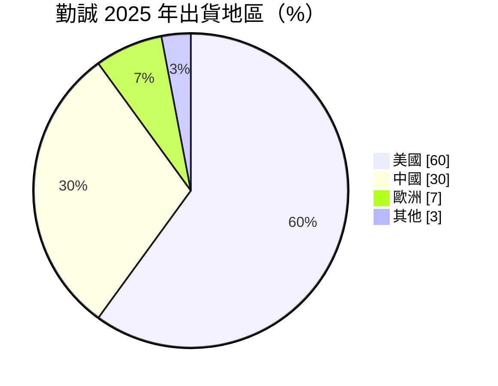
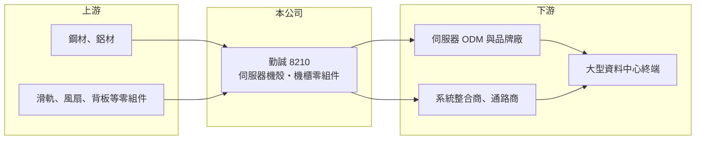

# 8210 勤誠

> 上市｜[[產業索引-電腦及週邊設備業|電腦及週邊設備業]]｜上市（櫃）日期 2011/12/01

# 第一章：企業模式與商業藍圖

> [!info] 撰寫說明
> 精簡版，由 Claude 依公開資料整理，架構比照 [[2330台積電]]，資料截至 2026-10-08。來源：證交所開放資料快照（基本資料、2026 年第二季資產負債與損益、股利）、Goodinfo 經營績效頁、優分析 2026 年 3 月整理之 2025 年財報新聞。#待校對

勤誠（以下簡稱勤誠）是台灣主要的[[伺服器機殼]]專業廠，理解它的關鍵在於：機殼看似是鐵件，但在 AI 時代它決定了伺服器的散熱氣流、結構強度與組裝效率，因此成為資料中心供應鏈中不可省略的一環。

- **核心業務：** 勤誠成立於 1983 年，2011 年在證交所上市，主力產品是機架式與塔式伺服器機殼、儲存設備機殼，以及近年擴大的機櫃零組件。依 2025 年第四季資料，機殼約占營收 99%，產品幾乎全部集中在伺服器機構件這一個領域。公司提供的不只是外殼，而是包含背板、風道與模組化設計的機構方案，客戶可以直接把主機板與電源裝進去。
- **營收結構：** 2025 年全年出貨地區約為美國 60%、中國 30%、歐洲 7%、其他 3%，終端有超過六成來自大型資料中心客戶。產品透過系統整合商與通路商出貨，因此勤誠的客戶名單同時包含[[ODM]]代工廠、品牌伺服器廠與白牌系統商。美國比重高，代表它直接受惠北美雲端業者的資本支出，但也承擔美國關稅與政策的變化。
- **營運據點：** 公司總部在台灣，並在中國上海、昆山設有子公司與生產據點（依 Goodinfo 子公司資訊，詳細產能配置待校對）。多地生產讓公司可以依客戶出貨地與關稅安排產能，這在中美貿易摩擦後成為接單條件之一。海外新產能的具體時程公開資料未查得年份，本文不列。
- **長期方向：** 勤誠的長期方向是從單一機殼往[[機櫃級整合]]的機構件延伸，2025 年起機櫃零組件已陸續量產。AI 伺服器的功耗與重量大增，機殼與機櫃必須配合[[液冷散熱]]與高密度設計重新開發，這讓具備設計能力的機殼廠議價力提升。能否把機櫃零組件做成第二支柱，是公司下一個十年的成長關鍵。

# 第二章：護城河深度與競爭優勢

勤誠的護城河來自設計導入與規模，而非材料或專利獨占；在 AI 伺服器世代，這種「與客戶一起設計」的能力價值明顯上升。

- **競爭優勢：** 伺服器機殼要在主機板設計初期就參與規劃，一旦被選入某個平台，通常會跟著該平台出貨數年，形成[[設計導入]]帶來的轉換成本。勤誠長年供應通路與品牌客戶，累積大量標準化機殼型號，可以用少量多樣的方式服務中小型系統商，這是只做單一大客戶的代工廠難以複製的。2025 年毛利率升到約 30%，顯示 AI 專案提高了產品附加價值。
- **主要對手：** 台灣同業包括 [[3693營邦]]、[[6117迎廣]]、[[3013晟銘電]]，另外 [[2317鴻海]]、[[2382廣達]] 等大型代工廠也有自製機構件能力。大型 ODM 若把機殼內製，會壓縮專業機殼廠的空間；因此勤誠的優勢必須建立在設計速度、通路廣度與品質穩定上。
- **觀察重點：** 長期最值得追蹤的是機櫃零組件與 AI 專案占營收比重能否持續提高，以及毛利率能否維持在三成附近而不是回到 2021 年的 20% 以下。另一個重點是客戶結構：若營收過度集中在少數雲端專案，議價力與穩定性都會下降。

# 第三章：財務體質與盈利規模

資料日期：2026-10-08，表格是撰寫當時的快照；最新月營收、毛利率、累計 EPS 由自動排程寫在本筆記的屬性欄位（月營收、毛利率、累計EPS 等）。#待校對

勤誠的財務在 2024 至 2025 年出現結構性的跳升：營收與利潤率同時擴張，反映 AI 伺服器把機殼從低單價零件變成高附加價值機構件。

| 年度 | 營收（億元） | [[毛利率]] | [[營業利益率]] | EPS（元） | [[ROE]] |
|---|---|---|---|---|---|
| 2020 | 75.4 | 25.6% | 12.8% | 8.16 | 26.1% |
| 2021 | 94.2 | 19.6% | 9.36% | 5.62 | 16.5% |
| 2022 | 106 | 20.2% | 10.8% | 8.32 | 22.1% |
| 2023 | 112 | 22.9% | 13.0% | 9.03 | 21.1% |
| 2024 | 145 | 26.1% | 17.3% | 16.05 | 30.7% |
| 2025 | 220 | 30.0% | 21.7% | 29.06 | 39.9% |

（來源：Goodinfo 經營績效頁；2026 年上半年營收 149.3 億元、毛利率約 32.7%、營業利益率約 24.8%、EPS 21.83 元，依證交所開放資料計算。）

- **營收規模：** 2020 至 2025 年營收由 75.4 億元成長到 220 億元，年複合成長率約 24%（推算），其中 2025 年單年成長約 52%。成長的主因是 AI 伺服器專案與機櫃零組件量產，使每台伺服器的機構件價值提高。這種成長幅度在機殼業相當少見，但也意味著基期已墊高，未來成長會更依賴新平台的導入。
- **獲利：** 2021 至 2025 年平均 ROE 約 26%（推算），而且逐年上升到 2025 年的 39.9%。營業利益率由 2021 年的 9.4% 升到 2025 年的 21.7%，說明營收擴張時費用並未同步增加，這是典型的[[營業槓桿]]。2021 年毛利率曾跌到 19.6%，提醒讀者原物料（鋼材）與產品組合變化會讓利潤率大幅擺動。
- **財務特色：** 依 2026 年第二季資料，總資產約 294 億元、權益總計約 127 億元、負債約 167 億元，其中流動負債約 140 億元，大部分應是應付帳款等營運負債，反映營收快速擴張時的營運資金需求。2025 年度每股現金股利 14 元，[[配息率]]約 48%（推算），公司在高成長期仍維持約一半的配息。自由現金流是否長期為正未查得。
- **[[ROIC]] 與 [[WACC]]：** 以 2025 年營業利益約 47.7 億元（220 億元 × 21.7%）、稅率 20% 計算，稅後營業利益約 38.2 億元。有息負債未查得，投入資本以權益 127 億元到「權益加全部負債」294 億元為區間，ROIC 約 13% 至 30%（推算）；由於負債多為營運負債，實際值應較接近區間上緣。WACC 以 [[CAPM]] 推估：無風險利率 1.75%、市場風險溢酬 6%、β 假設 1.2（AI 伺服器零組件股常見值），權益成本約 9.0%；稅後負債成本假設 2%、負債占兩成，WACC 約 7.6%（推算）。ROIC 明顯高於 WACC，代表公司近年確實在創造經濟價值，關鍵是這個利差能否在 AI 投資週期放緩時守住。

# 第四章：總體風險與地緣政治

勤誠的風險集中在資料中心資本支出的週期、客戶集中與原物料成本。

- **產業週期：** 伺服器需求跟著雲端業者與企業的資本支出走，AI 投資熱潮時訂單急增，一旦客戶放緩建置，機構件廠的營收會跟著下修，甚至出現[[長鞭效應]]造成的庫存調整。2021 年營收成長但毛利率下滑，就是週期與成本雙重影響的例子。
- **營運風險：** 大型 ODM 與雲端業者若把機構件設計內製或改採自有供應鏈，專業機殼廠的份額可能被壓縮。AI 專案規格更新快，若設計導入落後一個世代，就可能錯過數年的出貨。
- **其他風險：** 鋼材與鋁材價格波動會直接影響毛利率；出貨以美國為主，美國關稅與中國產能的地緣政治風險需要持續追蹤；營收以美元計價為主，新台幣升值會壓縮帳面獲利。

# 專有名詞解析

## 金融

- **[[營業槓桿]]**：固定成本占比高的公司，營收增加時利潤增幅大於營收增幅，反之亦然。

## 產業

- **[[伺服器機殼]]**：容納伺服器主機板、電源、硬碟與散熱元件的金屬外殼，需配合系統設計氣流與結構強度。
- **[[機櫃級整合]]**：以整個機櫃為單位整合伺服器、網路、電源與散熱，出貨後可直接上線運作。
- **[[設計導入]]**：供應商在客戶產品設計初期就被選入規格，之後通常隨該產品量產數年，形成轉換成本。
- **[[ODM]]**：原廠委託設計製造，代工廠負責產品設計與生產，品牌商負責銷售。
- **[[液冷散熱]]**：以液體流經冷板帶走晶片熱量的散熱方式，散熱效率高於氣冷，是高功耗 AI 伺服器的主流方向。

# 核心供應鏈

- 上游：鋼材供應商如 [[2002中鋼]]，以及滑軌廠 [[2059川湖]] 等伺服器機構零組件廠。
- 下游／客戶：伺服器 ODM 與系統廠，例如 [[2382廣達]]、[[2356英業達]]、[[6669緯穎]]（是否為直接客戶公開資料未逐一確認，#待校對），以及透過通路與系統整合商出貨的北美大型資料中心；AI 平台生態以 [[NVDA輝達]] 為核心。
- 同業：[[3693營邦]]、[[6117迎廣]]、[[3013晟銘電]]。

## 最新新聞
<!-- news:start（自動產生，請勿手動編輯此範圍） -->
- 2026-10-12 📰 媒體 13:28｜勤誠前3季營收233億元超越去年全年 馬來西亞新廠本季進入量產爬坡階段｜[鉅亨網](https://news.cnyes.com/news/id/6628003)
- 2026-10-12 📰 媒體 08:10｜鉅亨速報 - Factset 最新調查：勤誠(8210-TW)EPS預估下修至47.59元，預估目標價為1450元｜[鉅亨網](https://news.cnyes.com/news/id/6627742)

完整紀錄：[[8210勤誠 新聞]]
<!-- news:end -->

## 相關連結
- [公開資訊觀測站](https://mopsov.twse.com.tw/mops/web/t05st03?step=1&firstin=1&co_id=8210)
- [Goodinfo](https://goodinfo.tw/tw/StockDetail.asp?STOCK_ID=8210)
- [Yahoo 股市](https://tw.stock.yahoo.com/quote/8210)
- [鉅亨網新聞](https://www.cnyes.com/twstock/8210/news)
