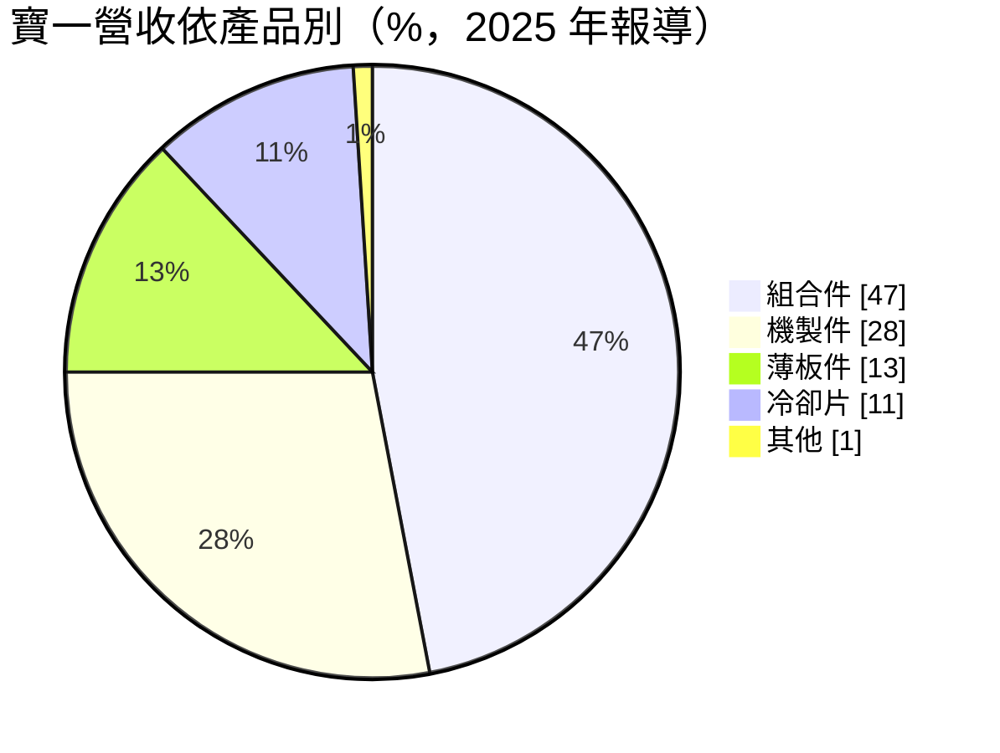
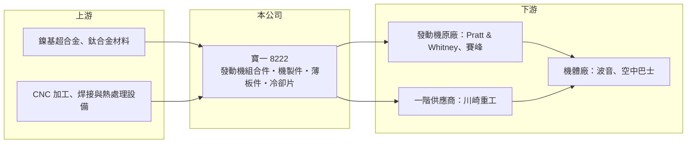

# 8222 寶一

> 上市｜[[產業索引-電機機械|電機機械]]｜上市（櫃）日期 2015/01/27

# 第一章：企業模式與商業藍圖

> [!info] 撰寫說明
> 精簡版，由 Claude 依公開資料整理，架構比照 [[2330台積電]]，資料截至 2026-10-08。來源：證交所開放資料快照（基本資料、2026 年第二季資產負債與損益、股利）、Goodinfo 經營績效頁、LINE TODAY 轉載之 2025 年個股分析文章。公開資料有限。#待校對

寶一是台灣少數以航空發動機零組件為主業的上市公司，理解它的關鍵在於：它不做整架飛機，而是替國際發動機大廠製造耐高溫合金的精密零件，營運跟著全球民航機與發動機的交機量走。

- **核心業務：** 寶一成立於 1974 年，總部位於台南新營，2015 年在證交所上市。公司的核心技術是[[超合金]]與鈦合金的成型、焊接、機械加工、熱處理與表面處理，產品是航空發動機裡的環件、鈑金件與冷卻片等零組件。發動機零件必須長時間承受高溫高壓，材料難加工、品質要求極高，因此能做的供應商不多，這是寶一存在的基礎。
- **營收結構：** 依 2025 年的報導，營收中組合件約占 47%、機製件 28%、薄板件 13%、冷卻片 11%。組合件比重最高，代表公司不只賣單一零件，而是把多個零件焊接組合後交貨，附加價值較高。報導也提到近兩年新開發的產品包括 PW1000G 發動機的葉片冷卻片、LEAP 系列發動機的鈑金環件與鈦合金真空焊接零組件，顯示公司正把產品線延伸到新一代窄體客機的主力發動機。
- **營運據點：** 公司登記地址與主要生產基地在台南新營工業區，報導提到公司已開始購置新廠土地，但投產時程尚未公布（#待校對）。航太零件需要逐件通過客戶認證，產能擴充往往以「新設備取得認證」為節奏，而不是一次性大幅擴廠。
- **長期方向：** 依同篇報導，公司規劃短期以自動化擴充產能與開發新產品，中期導入半導體、綠能等特殊產品所需的設備與製程，長期配合下一世代發動機技術調整製程。換句話說，寶一想把在航太領域累積的高溫合金加工能力，延伸到其他對材料要求嚴格的產業，以降低對單一民航週期的依賴。

# 第二章：護城河深度與競爭優勢

寶一的護城河來自航太產業特有的認證門檻與長期合約，而不是規模。

- **競爭優勢：** 航空發動機零件必須通過發動機原廠的[[適航認證]]與特殊製程認證，每一個料號從開發、試製到量產往往需要數年，一旦導入就會跟著該型發動機生產很長時間。寶一的客戶包括波音、空中巴士、Pratt & Whitney、川崎重工（KHI）與賽峰（Safran），能進入這些大廠的供應鏈本身就是一種長期資產。這種門檻讓新進者很難在短期內搶單，也讓訂單能見度比一般機械零件高。
- **主要對手：** 國內同樣從事航太零組件的業者包括 [[2634漢翔]]、[[4572駐龍]]，國際上則有大量歐美與日本的中小型精密加工廠。寶一規模小於漢翔，競爭策略是專注在發動機的鈑金、焊接與冷卻片等利基製程。由於航太零件多以長約方式議價，價格競爭不像消費性電子那麼激烈，但大客戶的議價能力仍強。
- **觀察重點：** 長期最該追蹤的是新料號（特別是 LEAP 與 PW1000G 系列）的量產進度，以及毛利率能否穩定在兩成以上。2024 年毛利率 22.5% 創新高，2025 年回落到 18.5%，2026 年上半年又回升到 26.4%，起伏顯示新設備折舊與產品組合對獲利的影響很大。新廠土地何時開始建設、是否切入半導體或綠能設備零件，也是判斷公司能否擺脫小規模的關鍵。

# 第三章：財務體質與盈利規模

資料日期：2026-10-08，表格是撰寫當時的快照；最新月營收、毛利率、累計 EPS 由自動排程寫在本筆記的屬性欄位（月營收、毛利率、累計EPS 等）。#待校對

寶一的財務呈現「疫情谷底後快速復原」的軌跡：2020 至 2021 年民航停擺時連年虧損，之後隨著交機回升，營收在五年內成長超過一倍。

| 年度 | 營收（億元） | [[毛利率]] | [[營業利益率]] | EPS（元） | [[ROE]] |
|---|---|---|---|---|---|
| 2020 | 3.97 | 8.22% | -14.40% | -0.58 | -4.45% |
| 2021 | 3.52 | -8.47% | -30.50% | -1.50 | -12.80% |
| 2022 | 4.50 | 11.50% | -6.33% | 0.28 | 2.49% |
| 2023 | 6.84 | 19.60% | 5.41% | 0.88 | 7.58% |
| 2024 | 8.24 | 22.50% | 8.80% | 1.49 | 11.70% |
| 2025 | 9.61 | 18.50% | 6.59% | 0.55 | 4.13% |

（來源：Goodinfo 經營績效頁。2026 年上半年依證交所資料：營收 4.82 億元、毛利率 26.4%、營業利益率 14.8%、EPS 0.82 元。）

- **營收規模：** 2020 至 2025 年營收由 3.97 億元增至 9.61 億元，年複合成長率約 19%（推算）。成長來自疫情後民航機交機回升與新料號放量，但起點很低，公司整體仍屬小型零件廠。營收規模小也代表單一客戶或單一料號的變化，就能明顯影響全年數字。
- **獲利：** 近五年（2021 至 2025）平均 ROE 約 2.6%（推算），被 2021 年的大虧拉低；若只看 2023 至 2025 年，平均約 7.8%。航太零件廠的固定成本（設備、認證、技術人員）占比高，具有明顯的[[營業槓桿]]：營收不足時虧損很深，營收越過損益兩平後獲利改善也很快，2026 年上半年營業利益率升到 14.8% 就是例子。
- **財務特色：** 依 2026 年第二季資料，總資產約 22.2 億元、股東權益約 9.3 億元、負債約 12.9 億元，其中非流動負債約 6.8 億元，反映近年擴充設備的資本支出部分由借款支應。2025 年度現金股利每股 0.35 元，對應 EPS 0.55 元，[[配息率]]約 64%；公司章程規定盈餘至少五成分派股東股利。自由現金流是否長期為正未查得，但從資本支出處於歷史高點判斷，近年應偏緊（推估）。
- **[[ROIC]] 與 [[WACC]]：** 以 2025 年營業利益約 0.63 億元（9.61 億元 × 6.59%）、稅率 20% 計算，稅後營業利益約 0.51 億元。有息負債未查得，投入資本以股東權益 9.3 億元到「權益加全部負債」22.2 億元為區間，ROIC 約 2.3% 至 5.4%（推算）；若以 2026 年上半年營業利益 0.72 億元年化，ROIC 約 5% 至 12%（推算）。WACC 以 [[CAPM]] 推估：無風險利率 1.75%、市場風險溢酬 6%、β 假設 1.0（中小型航太零件股常見值），權益成本約 7.75%；稅後負債成本假設 2%、負債占四成，WACC 約 5.5%（推算）。2025 年 ROIC 大致低於或接近 WACC，尚未穩定創造經濟價值；2026 年的獲利水準若能維持，才會明顯高於資金成本。

# 第四章：總體風險與地緣政治

寶一的風險集中在民航週期、客戶集中與小規模公司的擴產執行。

- **產業週期：** 航空發動機零件的需求取決於波音、空中巴士的交機量，以及發動機的維修更換需求。2020 年疫情讓全球民航幾乎停擺，寶一連續兩年虧損，說明這個產業遇到外部衝擊時下滑很劇烈。好的一面是民航機訂單積壓通常長達數年，景氣回升後的能見度也較高。
- **營運風險：** 客戶集中在少數國際發動機與機體大廠，任何一家調整採購策略、延後機種量產或要求降價，都會直接影響營收。新設備與新料號在認證期間會先產生折舊與試製成本，2025 年毛利率從 22.5% 降到 18.5%，就與產品組合及新設備導入有關（#待校對）。
- **其他風險：** 鎳基超合金與鈦合金等原料價格波動大，且供應集中在少數國家。航太產品多以美元計價，新台幣升值會壓縮以台幣計算的毛利。波音生產品質問題或發動機耐久度問題（例如 PW1000G 系列）若導致減產，也會傳導到零件供應商。

# 專有名詞解析

## 應用

- **[[適航認證]]**：航空器與零件須經主管機關與原廠驗證其安全性與製程，零件供應商的每個料號都需通過認證才能量產。

## 金融

- **[[營業槓桿]]**：固定成本占比高的公司，營收增加時利潤增幅大於營收增幅，反之亦然。
- **[[配息率]]**：現金股利占當年度每股盈餘的比例，反映公司把獲利分給股東的程度。
- **[[CAPM]]**：資本資產定價模型，以無風險利率加上 β 乘以市場風險溢酬估算股東要求報酬率。

## 產業

- **[[超合金]]**：以鎳、鈷為基礎、能在高溫下維持強度的合金，用於航空發動機燃燒室與渦輪等高溫部位，加工難度高。

# 核心供應鏈

- 上游：鎳基超合金、鈦合金板材與棒材供應商（多為歐美日特殊金屬廠），以及 CNC 加工、焊接與熱處理設備商。
- 下游／客戶：Pratt & Whitney、賽峰（Safran）等發動機原廠，川崎重工（KHI）等一階供應商，以及波音、空中巴士等機體廠。
- 同業：[[2634漢翔]]、[[4572駐龍]]、[[2645長榮航太]]（以維修為主）、[[2630亞航]]。

## 最新新聞
<!-- news:start（自動產生，請勿手動編輯此範圍） -->
- 2026-10-12 🏛️ 重訊 14:37｜本公司受邀參加由台新證券舉辦之「台新證券法人說明會」｜[觀測站](https://mops.twse.com.tw/mops/#/web/t05st01)

完整紀錄：[[8222寶一 新聞]]
<!-- news:end -->

## 相關連結
- [公開資訊觀測站](https://mopsov.twse.com.tw/mops/web/t05st03?step=1&firstin=1&co_id=8222)
- [Goodinfo](https://goodinfo.tw/tw/StockDetail.asp?STOCK_ID=8222)
- [Yahoo 股市](https://tw.stock.yahoo.com/quote/8222)
- [鉅亨網新聞](https://www.cnyes.com/twstock/8222/news)
