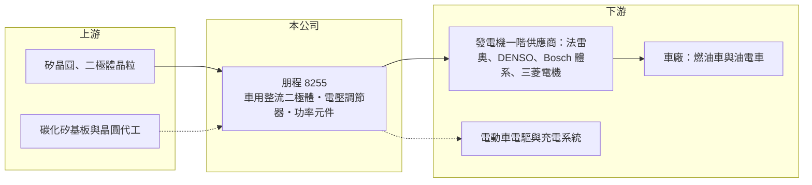

# 8255 朋程

> 上櫃｜[[產業索引-電機機械|電機機械]]｜上市（櫃）日期 2006/04/25

# 第一章：企業模式與商業藍圖

> [!info] 撰寫說明
> 精簡版，由 Claude 依公開資料整理，架構比照 [[2330台積電]]，資料截至 2026-10-08。來源：櫃買中心開放資料快照（基本資料、2026 年第二季資產負債與損益）、Goodinfo 經營績效頁、財報狗 2014 年個股分析文章；轉投資與近年布局的描述部分依記憶整理，已標註待校對。公開資料有限。#待校對

朋程是全球主要的汽車發電機整流二極體製造商，理解它的關鍵在於：它賣的是每一台燃油車與油電車發電機裡都需要的小型功率元件，市場成熟但地位穩固，而公司正試著把這套車用功率元件的能力延伸到電動車時代的碳化矽與功率模組。

- **核心業務：** 朋程成立於 1998 年，2006 年在櫃買中心掛牌，主力產品是[[整流二極體]]，也就是把汽車發電機產生的交流電轉成直流電、供電給電瓶與車上電子設備的元件。依財報狗 2014 年的整理，整流二極體占營收八成以上，另有電壓調節器、電磁閥等延伸產品。車用元件必須在高溫、震動的環境下工作十年以上，可靠度要求遠高於消費性電子。
- **營收結構：** 朋程的客戶以發電機一階供應商為主，依 2013 年年報，前三大客戶都是法雷奧（Valeo）在各地的公司，合計約占營收近五成；其他客戶包括 Bosch 體系、電裝（DENSO）與三菱電機等發電機大廠（#待校對，資料較舊）。2023 年營收由 42 億元跳升到 56.5 億元，推估與合併轉投資有關（#待校對），因此近年營收結構可能已不再是單純的整流二極體。
- **營運據點：** 總部與主要工廠位於桃園蘆竹，並在中國設有生產基地（#待校對）。依櫃買中心 2026 年第二季資料，公司[[非控制權益]]約 21.5 億元，代表合併報表中有相當比重來自非百分之百持有的子公司。
- **長期方向：** 電動車不需要傳統發電機，長期會侵蝕整流二極體的市場，因此朋程近年把重心放在[[碳化矽]]（SiC）功率元件與功率模組，並轉投資 [[2342茂矽]]（#待校對），取得晶圓製造能力。這條路的意義在於把客戶關係從燃油車的發電機，延伸到電動車的逆變器、車載充電器等新需求。

# 第二章：護城河深度與競爭優勢

朋程的護城河來自長年車規驗證與在細分市場的規模，屬於「窄而深」的類型。

- **競爭優勢：** 依財報狗 2014 年的整理，朋程在汽車發電機二極體的市占率已超過五成，是全球最大製造商。發電機一階供應商（法雷奧、DENSO、Bosch、三菱電機）合計占發電機市場七成以上，朋程與這幾家長期合作，車規驗證一旦完成就會跟著車型生產多年，[[轉換成本]]很高。規模第一也讓它在原料採購與製程良率上有成本優勢。
- **主要對手：** 傳統整流二極體的競爭者包括部分發電機大廠的自製部門，以及其他車用分離式元件廠。在碳化矽與功率元件領域，對手則換成英飛凌、意法半導體、安森美等國際大廠，以及台灣的 [[2481強茂]]、[[5425台半]]、[[3707漢磊]]。新領域的對手規模遠大於朋程，競爭邏輯完全不同。
- **觀察重點：** 長期最該追蹤的是三件事：第一，整流二極體在油電混合車普及下能維持多久；第二，碳化矽與功率模組是否開始對營收與獲利有實質貢獻；第三，[[毛利率]]能否維持在 25% 至 30% 的歷史區間。2025 年毛利率 26.8%、營業利益率 7.5%，都低於 2024 年，顯示新事業的投入仍在壓抑整體獲利。

# 第三章：財務體質與盈利規模

資料日期：2026-10-08，表格是撰寫當時的快照；最新月營收、毛利率、累計 EPS 由自動排程寫在本筆記的屬性欄位（月營收、毛利率、累計EPS 等）。#待校對

朋程的財務特徵是營收擴張很快、EPS 不低，但股東權益龐大，使 ROE 長期只有個位數。

| 年度 | 營收（億元） | [[毛利率]] | [[營業利益率]] | EPS（元） | [[ROE]] |
|---|---|---|---|---|---|
| 2020 | 30.7 | 27.4% | 7.16% | 3.10 | 3.22% |
| 2021 | 38.0 | 29.8% | 11.1% | 5.25 | 7.67% |
| 2022 | 42.0 | 28.7% | 9.43% | 6.14 | 9.35% |
| 2023 | 56.5 | 24.4% | 5.44% | 7.68 | 7.74% |
| 2024 | 75.8 | 29.6% | 10.3% | 8.24 | 8.99% |
| 2025 | 81.1 | 26.8% | 7.50% | 6.32 | 5.76% |

（來源：Goodinfo 經營績效頁。2026 年上半年依櫃買中心資料：營收 40.7 億元、毛利率 27.0%、營業利益率 6.4%、EPS 3.14 元。）

- **營收規模：** 2020 至 2025 年營收由 30.7 億元增至 81.1 億元，年複合成長率約 21%（推算），2023 年與 2024 年是兩個主要跳升年。這樣的成長速度高於全球汽車產量，推估部分來自合併轉投資而非單純本業擴張（#待校對）。
- **獲利：** 近五年（2021 至 2025）平均 ROE 約 7.9%（推算）。EPS 長期在 5 至 8 元，但每股淨值約 90 元（2026 年第二季），獲利相對於資本規模並不突出。2023 年 EPS 7.68 元高於營業利益率所能解釋的水準，顯示[[業外收入]]（投資收益、匯兌等）占獲利有一定比重。
- **財務特色：** 依 2026 年第二季資料，總資產約 174.2 億元，其中非流動資產約 120.9 億元，占比近七成，反映大量長期投資與廠房設備；股東權益約 113.4 億元（含非控制權益 21.5 億元），負債約 60.8 億元，財務結構保守。Goodinfo 統計的歷年平均現金股利約 3.95 元，以 EPS 5 至 8 元計算配息率約五成到七成（推算），配息相對穩定。自由現金流是否長期為正未查得。
- **[[ROIC]] 與 [[WACC]]：** 以 2025 年營業利益約 6.1 億元（81.1 億元 × 7.5%）、稅率 20% 計算，稅後營業利益約 4.9 億元。有息負債未查得，投入資本以股東權益 113.4 億元到「權益加全部負債」174.2 億元為區間，ROIC 約 2.8% 至 4.3%（推算）；2024 年同法約 3.6% 至 5.5%（推算）。WACC 以 [[CAPM]] 推估：無風險利率 1.75%、市場風險溢酬 6%、β 假設 1.0（車用半導體中型股常見值），權益成本約 7.75%；稅後負債成本假設 2%、負債占三成，WACC 約 6.0%（推算）。依此計算本業 ROIC 低於 WACC，但投入資本中有不少是長期投資，其報酬記在業外而非營業利益，因此這個 ROIC 低估了整體資本報酬；以 ROE 約 6% 至 9% 與權益成本相比，大致是「勉強賺回資金成本」。

# 第四章：總體風險與地緣政治

朋程的長期風險來自電動化對既有產品的替代，以及新事業的投資報酬。

- **產業週期：** 整流二極體的需求跟著全球汽車產量走，車市景氣循環與車廠庫存調整會沿著[[長鞭效應]]放大到零件端。更根本的結構性風險是純電動車不需要傳統發電機，若電動車滲透率快速上升，整流二極體市場會逐步萎縮；油電混合車仍需要發電機，是過渡期的緩衝。
- **營運風險：** 客戶集中在少數發電機一階供應商，議價能力強，任何一家調整採購或自製比例都會影響營收。碳化矽與功率模組需要大量資本支出與長時間車規驗證，對手是國際大廠，若良率與成本無法追上，投資報酬可能長期偏低。轉投資若持續虧損，也會透過合併報表或投資損益拖累獲利（#待校對）。
- **其他風險：** 產品以美元、歐元計價為主，匯率波動直接影響毛利與業外匯兌損益。中國生產據點面臨美中貿易與關稅政策變動的風險。碳化矽產業在 2024 年後出現產能過剩與降價，新進者的獲利空間受到壓縮。

# 專有名詞解析

## 半導體

- **[[整流二極體]]**：只允許電流單向通過的半導體元件，用來把交流電轉為直流電，汽車發電機需要多顆組成整流橋。
- **[[碳化矽]]**：寬能隙半導體材料，耐高壓、高溫且開關損耗低，用於電動車逆變器、充電樁與太陽能逆變器。

## 金融

- **[[轉換成本]]**：客戶更換供應商需付出的時間、驗證與風險成本，越高代表既有供應商的地位越穩固。
- **[[非控制權益]]**：子公司中不屬於母公司的股權，其分得的淨利不計入母公司股東的 EPS。
- **[[業外收入]]**：本業營運以外的收入，例如利息、投資收益、處分資產利益，持續性通常低於本業獲利。
- **[[長鞭效應]]**：終端需求的小幅變動，沿供應鏈往上游傳遞時被逐級放大，造成上游庫存與訂單劇烈波動。

# 核心供應鏈

- 上游：矽晶圓與二極體晶粒、封裝材料供應商；碳化矽基板與晶圓製造（轉投資 [[2342茂矽]]，#待校對）。
- 下游／客戶：法雷奧（Valeo）、電裝（DENSO）、Bosch 體系、三菱電機等汽車發電機一階供應商，最終進入全球各大車廠。
- 同業：[[2481強茂]]、[[5425台半]]、[[3707漢磊]]（碳化矽與功率元件），以及國際的英飛凌、意法半導體、安森美。

## 最新新聞
<!-- news:start（自動產生，請勿手動編輯此範圍） -->
- 2026-10-13 🏛️ 重訊 17:49｜公告本公司內部稽核主管異動｜[觀測站](https://mops.twse.com.tw/mops/#/web/t05st01)

完整紀錄：[[8255朋程 新聞]]
<!-- news:end -->

## 相關連結
- [公開資訊觀測站](https://mopsov.twse.com.tw/mops/web/t05st03?step=1&firstin=1&co_id=8255)
- [Goodinfo](https://goodinfo.tw/tw/StockDetail.asp?STOCK_ID=8255)
- [Yahoo 股市](https://tw.stock.yahoo.com/quote/8255)
- [鉅亨網新聞](https://www.cnyes.com/twstock/8255/news)
