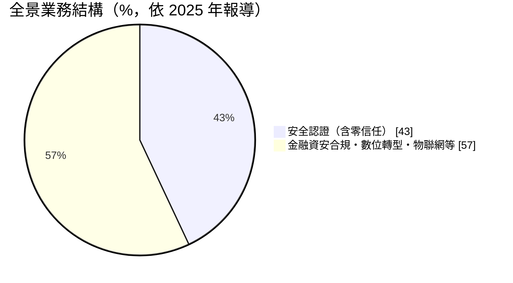
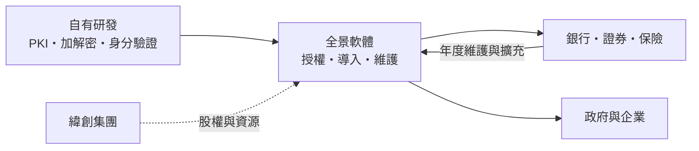
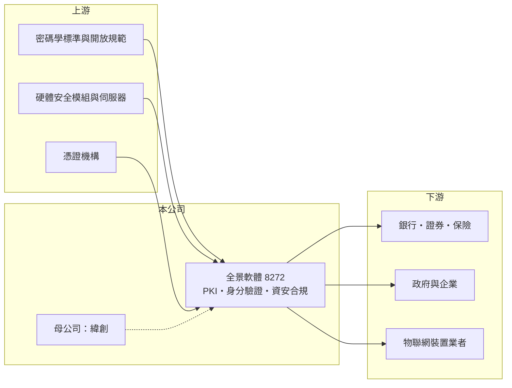

# 8272 全景軟體

> 上櫃｜[[產業索引-資訊服務業|資訊服務業]]｜上市（櫃）日期 2024/10/23

# 第一章：企業模式與商業藍圖

> [!info] 撰寫說明
> 本文由 Claude 依公開資料整理，架構比照 [[2330台積電]] 的四章研究，資料截至 2026-10-08。財務數字來源：Goodinfo 年度經營績效頁、旺得富 2025 年 10 月報導、櫃買中心開放資料（基本資料、2026 年第二季資產負債與綜合損益、本益比殖利率）；PKI 產品與金融客戶的描述部分憑記憶整理。#待校對

全景軟體（股票代號：8272，以下簡稱全景）做的是網路世界的「身分證」：替銀行、證券商與企業確認「螢幕另一端的人是誰」。本章說明這種身分認證軟體如何以七成以上的毛利率經營。

## 一、核心定位：以 PKI 為基礎的身分認證與資安軟體商

全景成立於 1998 年，2024 年 10 月在櫃買中心掛牌，實收資本額約 1.90 億元。依旺得富 2025 年 10 月報導，全景為 [[3231緯創]] 的子公司，主要業務為資訊軟體服務，其中安全認證（含[[零信任]]）約占 43%，其他包括金融科技資安合規、無紙化等數位轉型應用，以及物聯網安全。

全景的技術核心是[[PKI]]（公開金鑰基礎建設）。網路銀行轉帳、證券電子下單、電子簽章等交易，背後都需要[[數位憑證]]與加解密元件，確保交易者身分真實、內容未被竄改、事後不可否認。依記憶，台灣許多銀行與證券商的網路交易憑證元件與簽章伺服器由全景提供（待校對）。

## 二、營收結構

* **安全認證：** 憑證元件、簽章驗章伺服器、多因子驗證與零信任架構，是全景最核心的產品線。
* **金融科技資安合規：** 協助金融機構符合主管機關的資安規範，例如交易驗證、行動身分識別。
* **數位轉型與物聯網：** 無紙化文件、電子簽署流程，以及裝置身分認證。

客戶產業以銀行、證券、保險等金融業為主，其次為政府與企業（推估，具體分布未查得）。軟體授權之外的年度維護與系統服務，構成[[經常性收入]]的主體，但占比未查得。

## 三、資本轉化邏輯

全景的產品是自有軟體，邊際成本低，[[毛利率]]長期在 73% 至 77% 之間。主要成本是研發與業務人員，營業費用約占營收五成以上，因此[[營業利益率]]約二成。

## 四、長期方向

公司在 2025 年法說會提到，身分認證會在電商、銀行與證券領域走向[[無密碼驗證]]；公司也規劃 AI 代理（AI Agent）的安全認證，並關注資料保護、個資去識別化與 AI 搜尋辨識。只要網路交易需要確認身分，這個市場就會長期存在；技術形式會從實體憑證演進到裝置綁定、生物辨識與無密碼標準，全景能否跟上演進，是長期價值的關鍵。

# 第二章：護城河深度與競爭優勢

身分認證軟體的護城河來自信任與合規：金融機構不會輕易更換保護交易安全的核心元件。本章分析全景的競爭位置。

## 一、護城河的組成

* **金融業的轉換成本：** 網銀與證券下單的憑證元件深度嵌入交易系統，更換需要重新開發、測試並通過主管機關要求，風險很高。因此一旦導入，客戶傾向長期續用與擴充。
* **合規知識：** 熟悉台灣金融主管機關的資安規範，能把法規要求轉成產品功能，是國際大廠在地化不易做到的。
* **集團資源：** 作為緯創集團成員，在物聯網裝置身分與 AI 伺服器相關的資安需求上，可能取得集團內的合作機會（推估）。

## 二、主要競爭對手

| 對手 | 定位 | 與全景的比較 |
|---|---|---|
| 台灣網路認證（TWCA） | 金融憑證發行機構 | 提供憑證發行，部分業務與全景互補也互相競爭（待校對） |
| 國際身分驗證與 PKI 廠商 | 多因子驗證、零信任平台 | 產品完整，在大型企業與跨國金融客戶競爭 |
| [[6690安碁資訊]]、[[6865偉康科技]] | 資安服務與金融應用 | 在金融資安專案部分重疊 |
| 銀行自建或大型系統整合商 | 自行開發驗證機制 | 大型金融機構可能自建 |

## 三、守得住與守不住

* **守得住：** 既有金融客戶的憑證與簽章系統維護與擴充。
* **守不住：** 新技術世代的市占。無密碼驗證與國際開放標準普及後，國際平台與手機作業系統內建的驗證功能可能取代部分在地元件。
* **觀察重點：** 營收能否突破 5 億元的平台期、無密碼與 AI 代理認證的新產品收入，以及毛利率能否維持七成以上。

# 第三章：財務體質與盈利規模

資料日期：2026-10-08，表格是撰寫當時的快照；最新月營收、毛利率、累計 EPS 由自動排程寫在本筆記的屬性欄位（月營收、毛利率、累計EPS 等）。#待校對

軟體公司的財報重點是毛利率能否維持、營收能否成長，以及高毛利能否轉成高 ROE。

## 一、多年度財務表

| 年度 | 營收（新台幣） | [[毛利率]] | [[營業利益率]] | EPS（元） | [[ROE]] |
|---|---|---|---|---|---|
| 2021 | 3.81 億 | 73.4% | 22.5% | 4.38 | 21.9% |
| 2022 | 4.21 億 | 77.2% | 24.4% | 5.17 | 24.4% |
| 2023 | 4.22 億 | 77.0% | 22.4% | 4.79 | 20.9% |
| 2024 | 4.13 億 | 75.8% | 20.1% | 4.04 | 14.4% |
| 2025 | 4.78 億 | 74.6% | 21.0% | 4.66 | 14.9% |
| 2026 上半年 | 2.00 億 | 74.3% | 15.4% | 1.45 | 未查得 |

資料來源：Goodinfo；2026 上半年為櫃買中心開放資料。2020 年以前資料未查得。

* **高毛利、慢成長：** 毛利率穩定在 73% 至 77%，但 2021 至 2025 年營收年複合成長率只有約 5.8%（推算），營收長期在 4 億元上下。
* **營益率受費用影響：** 2026 上半年營業利益率降到 15.4%，主因是營收持平而研發與人事費用增加。
* **配息：** Goodinfo 統計一般平均現金股利約 2.69 元，2025 年度配發 2.8 元，以 EPS 4.66 元計算配息率約六成（推算）。

## 二、ROE 與長期指標

2021 至 2025 年平均 ROE 約 19.3%（推算），但 2024 年起降到 15% 左右，主因是掛牌後權益擴大、現金增加。2026 年第二季底權益約 5.90 億元、負債僅約 2.63 億元且幾乎沒有長期負債，財務結構非常保守。自由現金流推估長期為正（具體金額未查得）。

## 三、[[ROIC]] 與 [[WACC]]

**ROIC 推算：** 2025 年營業利益 1.01 億元，扣除 20% 稅率後約 0.81 億元。權益約 5.90 億元，有息負債推估為零（非流動負債僅約 235 萬元），投入資本約 5.90 億元，ROIC 約 13.7%（推算）。由於權益中包含相當比例的現金，若扣除超額現金，實際營運資本的報酬率會更高。

**WACC 推算：** 台灣 10 年期公債殖利率假設 1.75%、市場風險溢酬 6%、β 取軟體業常見值 0.8（同業估計值），股東權益成本約 6.55%。公司無有息負債，WACC 約 6.5%（推算）。

**結論：** 全景的 ROIC 約為 WACC 的兩倍，是典型的高毛利、低資本需求軟體公司，長期在創造價值。限制在於成長：營收若無法突破，價值主要以配息形式回饋股東。

# 第四章：總體風險與地緣政治

身分認證軟體的風險主要是技術世代交替與客戶集中。本章整理全景的長期風險。

## 一、產業週期

* **金融 IT 預算：** 金融業的資訊預算相對穩定，但大型系統更新有週期，新案集中在法規變動或系統汰換的年度。
* **法規驅動：** 主管機關的資安與身分驗證規範，是需求的主要推力；規範放寬或改採其他技術標準，會改變需求方向。

## 二、營運風險

* **技術替代：** 無密碼驗證、裝置內建生物辨識與國際開放標準，可能降低對傳統憑證元件的依賴。全景必須持續投入研發，才能在新世代維持地位。
* **客戶集中：** 若營收集中在少數大型金融機構，單一客戶的採購變化影響大（集中度未查得）。
* **規模限制：** 營收約 4 至 5 億元，研發資源有限，與國際大廠競爭新技術時處於劣勢。

## 三、其他風險

* **資安事件：** 身分認證產品若發生重大漏洞，會直接衝擊客戶信任與商譽。
* **母公司政策：** 緯創集團的策略調整，可能影響全景的資源與經營方向。
* **人才：** 密碼學與資安人才稀缺，人力成本上升會壓縮利潤率。

# 專有名詞解析

## 應用

- **[[PKI]]**：公開金鑰基礎建設，以成對的公開金鑰與私密金鑰加上憑證機構，確認網路上的身分並保護資料。
- **[[數位憑證]]**：由憑證機構簽發、證明持有人身分的電子文件，網路銀行與證券下單常用來驗證交易者。
- **[[零信任]]**：不預設信任任何使用者或裝置，每次存取都要驗證身分與權限的資安架構。
- **[[無密碼驗證]]**：以裝置綁定、生物辨識或安全金鑰取代密碼的登入方式，可降低密碼外洩與釣魚風險。

## 金融

- **[[毛利率]]**：營業毛利占營收的比例，反映產品定價能力與生產成本控制。
- **[[營業利益率]]**：扣除營業費用後的營業利益占營收的比例，衡量本業整體獲利能力。
- **[[ROE]]**：股東權益報酬率，稅後淨利除以股東權益，衡量公司運用股東資金的效率。
- **[[ROIC]]**：投入資本報酬率，稅後營業利益除以股東權益與有息負債的合計，衡量本業對所有資金提供者的報酬。
- **[[WACC]]**：加權平均資金成本，依股東權益與負債的比重加權計算的資金成本，ROIC 高於它才代表創造價值。

## 產業

- **[[經常性收入]]**：每年按合約重複收取的收入，例如軟體維護費、訂閱費，可預測性高於一次性銷售。

# 核心供應鏈

## 1. 上游：技術與設備
- 密碼學標準、國際身分驗證開放規範
- 硬體安全模組、伺服器與憑證機構

## 2. 中游：全景與同業
- 母公司：[[3231緯創]]
- 資安與金融應用同業：[[6690安碁資訊]]、[[6865偉康科技]]

## 3. 下游：客戶
- 銀行、證券與保險業的網路交易與電子簽署系統（具體客戶名單未查得）
- 政府機關、企業與物聯網裝置業者

## 最新新聞
<!-- news:start -->
<!-- news:end -->

## 相關連結
- [公開資訊觀測站](https://mopsov.twse.com.tw/mops/web/t05st03?step=1&firstin=1&co_id=8272)
- [Goodinfo](https://goodinfo.tw/tw/StockDetail.asp?STOCK_ID=8272)
- [Yahoo 股市](https://tw.stock.yahoo.com/quote/8272)
- [鉅亨網新聞](https://www.cnyes.com/twstock/8272/news)
