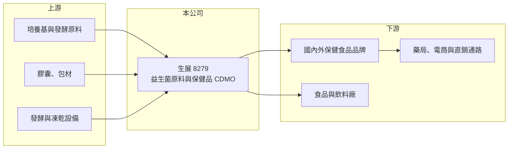

# 8279 生展

> 上櫃｜[[產業索引-生技醫療業|生技醫療業]]｜上市（櫃）日期 2016/09/26

# 第一章：企業模式與商業藍圖

> [!info] 撰寫說明
> 精簡版，由 Claude 依公開資料整理，架構比照 [[2330台積電]] 的四章研究，資料截至 2026-10-08。來源：櫃買中心開放資料（基本資料、2026 年第二季綜合損益與資產負債、每月營收）、Goodinfo 經營績效頁、nStock 公司頁。公開資料有限，產品比重、廠區與客戶型態部分憑記憶撰寫，已標「待校對」。#待校對

生展生物科技（以下簡稱生展）是台南的微生物發酵公司，以[[益生菌]]原料與保健品代工為主，本章說明它的商業模式與長期方向。

- **核心業務：** 生展成立於 1999 年，總部在台南新營，2016 年 9 月在櫃買中心掛牌。依公司章程，經營項目涵蓋微生物醫藥[[原料藥]]、生物性農藥與肥料、生化營養品的研究開發與生產銷售。實際營收主力是益生菌菌粉原料，以及替保健品牌製造膠囊、粉包等成品的代工（待校對）。
- **營收結構：** 公開資料沒有查到最新的產品別比重。生展的收入大致可分為三類：賣給國內外品牌與食品廠的益生菌與發酵原料、替客戶開發配方並生產的 [[CDMO]] 代工，以及少量自有品牌與其他微生物應用產品（待校對）。原料加代工的組合，讓生展同時賺菌種技術與製造規模兩種利潤。
- **營運據點：** 研發與生產集中在台南，擁有發酵、凍乾與成品包裝產線，可從菌種篩選一路做到最終成品（待校對）。一條龍的產線讓客戶不必分別找原料商與代工廠，縮短新品上市時間。
- **長期方向：** 營收從 2020 年的 13.1 億元成長到 2025 年的 21.4 億元，五年年複合成長約 10.3%（推算）。長期動能來自高齡化與預防保健需求，以及外銷市場的拓展；章程中的微生物原料藥與農業應用，則是公司把發酵技術延伸到藥品與農業的長期選項。

# 第二章：護城河深度與競爭優勢

益生菌產業看似進入門檻低，但菌株專利、功效研究與發酵量產能力才是真正的差異。本章分析生展的優勢與限制。

- **競爭優勢：** 第一是菌株與功效數據，具有自有專利菌株與人體試驗數據的原料，品牌商較願意支付溢價，也較難被替換。第二是發酵與凍乾的量產技術，益生菌要在製程與保存中維持足夠活菌數，良率與成本控制需要長期經驗。第三是一條龍服務，從原料到成品的整合能力，是吸引中小型保健品牌的關鍵。
- **主要對手：** 台灣同業包括 [[1707葡萄王]]、[[3164景岳]]、[[8436大江]] 等，分別在益生菌原料、保健品代工或自有品牌上與生展重疊；國際上則有丹麥、美國等大型菌種原料商。
- **護城河的限制：** [[保健食品]]的代工訂單以價格與交期為主要考量，客戶轉單成本不高；國際菌種大廠的研究資源與品牌知名度遠高於台廠，生展在高階原料市場的議價力有限。
- **觀察重點：** 自有專利菌株原料的營收占比、外銷市場的成長，以及代工產能擴充後的利用率。

# 第三章：財務體質與盈利規模

資料日期：2026-10-08，表格是撰寫當時的快照；最新月營收、毛利率、累計 EPS 由自動排程寫在本筆記的屬性欄位（月營收、毛利率、累計EPS 等）。#待校對

生展是本批公司中財務最穩定的一家：營收穩定成長、毛利率維持在 34% 至 38%、每年都有穩定的本業獲利。

| 年度 | 營收（億元） | [[毛利率]] | [[營業利益率]] | EPS（元） | [[ROE]] |
|---|---|---|---|---|---|
| 2020 | 13.1 | 37.8% | 19.8% | 7.95 | 13.8% |
| 2021 | 14.7 | 35.9% | 19.1% | 8.77 | 14.0% |
| 2022 | 19.3 | 35.6% | 18.8% | 11.85 | 17.1% |
| 2023 | 18.4 | 35.0% | 16.5% | 10.14 | 13.3% |
| 2024 | 20.1 | 36.0% | 15.1% | 8.86 | 11.0% |
| 2025 | 21.4 | 33.9% | 15.3% | 10.02 | 11.8% |
| 2026 上半年 | 10.10 | 32.1% | 12.6% | 3.81 | 未查得 |

- **獲利能力：** 營業利益率從 2020 年約 20% 緩步降到 2025 年約 15%，毛利率也從 37.8% 降到 33.9%，推估是代工比重上升、原料與人力成本增加，以及市場競爭加劇所致。2026 年上半年營業利益率再降到 12.6%，前 8 月營收年減約 5%，是近年較弱的一段。
- **長期指標：** 2021 至 2025 年平均 ROE 約 13.4%（推算），營收五年年複合成長約 10.3%（推算）。Goodinfo 統計的歷年現金股利一般平均約 2.73 元、加權平均約 3.86 元，每年都有配發，配息穩定度高。
- **財務結構：** 2026 年第二季底股東權益約 23.4 億元、負債總計 8.19 億元，其中非流動負債 1.51 億元（櫃買中心資料），非流動資產約 18.9 億元，代表公司持續投資廠房設備；有息負債金額開放資料未拆分。

**[[ROIC]] 與 [[WACC]]：** 2025 年營業利益約 3.27 億元（21.4 億元 × 15.3%），稅率 20% 後約 2.62 億元；投入資本以股東權益 23.4 億元加上有息負債（未查得，假設 0 至 1.5 億元）計，ROIC 約 10.5% 至 11%（推算）。WACC 以 CAPM 推估：無風險利率 1.75%、市場風險溢酬 6%、β 取保健食品同業常見值 0.8，權益成本約 6.55%，負債比重低，WACC 約 6.3% 至 6.6%（推算）。ROIC 比 WACC 高約 4 個百分點，代表生展長期穩定創造價值，但利差隨營業利益率下滑而收窄，是需要持續追蹤的趨勢。

# 第四章：總體風險與地緣政治

保健食品是需求穩定的民生產業，但代工與原料業務面對價格競爭與法規風險。本章整理生展的主要風險。

- **產業週期：** 保健食品需求長期向上，但品牌商會依庫存與促銷檔期調整下單，代工廠營收會出現年度起伏；2023 年營收從 19.3 億元降到 18.4 億元即為一例。
- **競爭風險：** 國內保健品代工廠眾多，中國與東南亞代工廠以低價搶單，國際菌種大廠在高階原料市場具有品牌優勢，生展兩頭都面臨壓力，毛利率逐年下滑反映了這個趨勢。
- **法規風險：** 保健食品的功效宣稱、標示與廣告受各國法規嚴格規範，外銷市場的註冊要求不同；法規收緊會增加開發與認證成本。
- **其他風險：** 原料（培養基、包材）價格上漲與人力成本上升會壓縮毛利；生產集中在台南，天災或製程汙染事件都可能影響出貨；外銷部分受匯率影響。

# 專有名詞解析

## 金融

- **[[ROIC]]**：投入資本報酬率，稅後營業利益除以投入資本（股東權益加有息負債），衡量本業創造報酬的能力。
- **[[WACC]]**：加權平均資金成本，依權益與負債比重加權的資金成本，是 ROIC 需要超越的門檻。

## 產業

- **[[益生菌]]**：對人體有益的活性微生物，常製成保健食品，用於調整腸道菌相。
- **[[CDMO]]**：委託開發暨製造服務，代工廠除了生產，也替客戶開發配方、處理法規與試驗，附加價值高於單純代工。
- **[[保健食品]]**：以維持健康為訴求的膳食補充產品，受食品與廣告法規規範。
- **[[原料藥]]**：製造藥品所需的活性成分，經製劑加工後才成為可供病患使用的藥品。

# 核心供應鏈

- 上游：培養基、糖類等發酵原料，膠囊與包材，以及發酵、凍乾設備供應商。
- 下游／客戶：國內外保健食品品牌、食品與飲料廠，產品經藥局、電商與直銷通路銷售（待校對）。
- 同業：[[1707葡萄王]]、[[3164景岳]]、[[8436大江]]。

## 最新新聞
<!-- news:start -->
<!-- news:end -->

## 相關連結
- [公開資訊觀測站](https://mopsov.twse.com.tw/mops/web/t05st03?step=1&firstin=1&co_id=8279)
- [Goodinfo](https://goodinfo.tw/tw/StockDetail.asp?STOCK_ID=8279)
- [Yahoo 股市](https://tw.stock.yahoo.com/quote/8279)
- [鉅亨網新聞](https://www.cnyes.com/twstock/8279/news)
