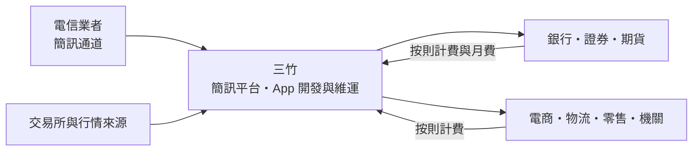
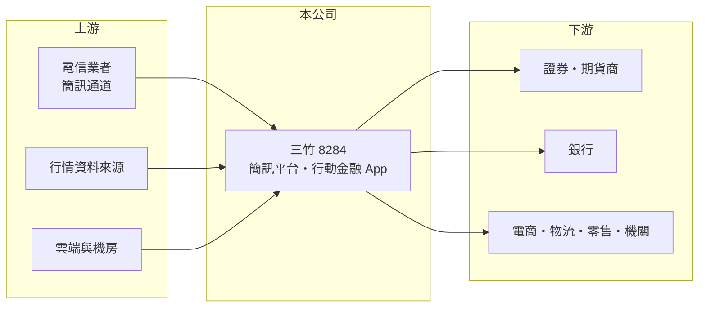

# 8284 三竹

> 上櫃｜[[產業索引-資訊服務業|資訊服務業]]｜上市（櫃）日期 2020/05/18

# 第一章：企業模式與商業藍圖

> [!info] 撰寫說明
> 本文由 Claude 依公開資料整理，架構比照 [[2330台積電]] 的四章研究，資料截至 2026-10-08。財務數字來源：Goodinfo 年度經營績效頁、nStock 公司簡介、櫃買中心開放資料（基本資料、2026 年第二季資產負債與綜合損益、本益比殖利率）；產品線與客戶描述主要憑記憶整理，營收比重未查得。公開資料有限。#待校對

三竹資訊（股票代號：8284，以下簡稱三竹）的產品，多數台灣人每天都在用卻很少意識到：銀行寄來的交易簡訊、手機上的股市行情 App，背後可能都是三竹的系統。本章說明三竹如何把「訊息傳遞」與「行動金融」做成穩定的生意。

## 一、核心定位：企業簡訊與行動金融服務商

三竹成立於 1991 年，2020 年 5 月在櫃買中心掛牌，實收資本額約 4.73 億元，董事長兼總經理為邱宏哲。登記的營業項目包括電腦設備安裝、資訊軟體服務、電子通訊器材買賣與簡訊發送業務。

依記憶，三竹的兩大主力是（待校對）：

* **[[企業簡訊]]：** 替銀行、證券、電商、物流與政府機關發送交易通知、驗證碼與行銷簡訊。三竹向電信業者批量購買簡訊通道，再透過自己的平台轉售給企業，賺取平台服務與差價。
* **行動金融 App：** 開發與維運證券商的行動行情與下單 App（例如「三竹股市」），以及銀行的行動銀行 App，收取開發費與每月維運、授權費。

## 二、營收結構與客戶

公開資料未查得三竹的營收比重。從[[毛利率]]約 22% 至 27% 判斷，營收中有相當比例是簡訊通道成本轉嫁的低毛利收入，軟體與 App 維運則是毛利較高的部分（推估）。客戶產業以金融業（銀行、證券、期貨）為核心，其次是電商、物流、零售與公部門（推估，待校對）。簡訊按則計費、App 按月維運，大部分收入都具有[[經常性收入]]的性質。

## 三、資本轉化邏輯

* **平台型、輕資產：** 三竹不需要建置電信網路，主要投資是平台系統與工程團隊，資本支出低。
* **規模經濟：** 簡訊平台與 App 架構可重複用於多家客戶，客戶越多，每一單位的平台成本越低。

## 四、長期方向

三竹的長期成長來自三股力量：金融交易數位化帶來的通知與驗證需求、證券投資人數增加帶動的行情與下單 App 使用量，以及企業把客戶溝通從簡訊延伸到 App 推播與通訊軟體。2025 年營收約 29.6 億元，2018 至 2025 年營收每年成長，顯示需求具有長期趨勢而非一次性。

# 第二章：護城河深度與競爭優勢

三竹的護城河來自金融客戶的高轉換成本與平台規模。本章分析它的競爭位置。

## 一、護城河的組成

* **金融客戶的轉換成本：** 證券與銀行 App 牽涉交易安全、主管機關規範與大量使用者習慣，更換 App 供應商需要重新開發、測試與教育使用者，金融機構很少輕易更換。
* **簡訊平台的規模與穩定度：** 交易驗證碼與通知簡訊要求高送達率與即時性，大型平台與電信業者有長期連線與議價能力，小型業者難以提供同等品質。
* **品牌 App 的使用者基礎：** 自有行情 App 累積大量散戶使用者，對證券商而言是導流管道，也提高與三竹合作的價值（推估）。

## 二、主要競爭對手

| 對手 | 定位 | 與三竹的比較 |
|---|---|---|
| [[2412中華電]]、[[3045台灣大]]、[[4904遠傳]] | 電信業者，自營企業簡訊 | 掌握通道，可直接賣給企業 |
| 其他簡訊平台業者 | 中小型企業簡訊 | 以價格競爭 |
| [[6865偉康科技]]、[[6752叡揚]] | 金融科技與企業軟體 | 在金融 App 與數位服務部分重疊 |
| 券商與銀行自建團隊、國際行情平台 | 自行開發 App | 大型金融機構可能自建 |

## 三、守得住與守不住

* **守得住：** 證券與銀行 App 的維運合約，以及交易驗證類簡訊這種高穩定度要求的需求。
* **守不住：** 行銷簡訊的價格與數量。行銷訊息可能被通訊軟體與 App 推播取代，簡訊單價也容易被比價。
* **觀察重點：** 毛利率能否維持在 25% 上下、App 維運收入占比，以及簡訊量在通訊軟體普及下的長期趨勢。

# 第三章：財務體質與盈利規模

資料日期：2026-10-08，表格是撰寫當時的快照；最新月營收、毛利率、累計 EPS 由自動排程寫在本筆記的屬性欄位（月營收、毛利率、累計EPS 等）。#待校對

三竹的財報特色是營收穩定成長、毛利率中等、配息率高。本章用多年度數字檢視它的獲利品質。

## 一、多年度財務表

| 年度 | 營收（新台幣） | [[毛利率]] | [[營業利益率]] | EPS（元） | [[ROE]] |
|---|---|---|---|---|---|
| 2021 | 22.1 億 | 23.1% | 10.4% | 4.06 | 18.1% |
| 2022 | 24.8 億 | 23.8% | 11.3% | 6.19 | 24.8% |
| 2023 | 26.5 億 | 21.6% | 8.78% | 4.21 | 15.8% |
| 2024 | 27.9 億 | 23.6% | 10.4% | 5.56 | 20.0% |
| 2025 | 29.6 億 | 22.8% | 9.15% | 4.74 | 16.2% |
| 2026 上半年 | 15.62 億 | 26.0% | 10.6% | 3.13 | 未查得 |

資料來源：Goodinfo；2026 上半年為櫃買中心開放資料。2022 年稅後淨利 2.87 億元高於營業利益 2.79 億元，推估有業外收益挹注。

* **營收穩定成長：** 2020 至 2025 年營收從 18.9 億元增加到 29.6 億元，年複合成長率約 9.4%（推算），且 2018 年以來每年成長，顯示需求穩定。
* **營益率約一成：** 營業利益率在 8.8% 至 11.3% 之間，波動不大。
* **高配息：** 2025 年度配發現金股利 4 元，以 EPS 4.74 元計算配息率約 84%（推算）；nStock 資料顯示 2024 年度配息率約 72%，近五年平均現金股利約 3.7 元。

## 二、ROE 與長期指標

2021 至 2025 年平均 ROE 約 19.0%（推算）。三竹幾乎沒有長期負債（2026 年第二季底非流動負債約 0.16 億元），高 ROE 主要來自輕資產與高配息讓權益不致膨脹，而非財務槓桿。自由現金流推估長期為正（具體金額未查得）。

## 三、[[ROIC]] 與 [[WACC]]

**ROIC 推算：** 2025 年營業利益 2.71 億元，扣除 20% 稅率後約 2.17 億元。2026 年第二季底權益約 13.36 億元，有息負債推估接近零，投入資本約 13.4 億元，ROIC 約 16%（推算）。以 2026 上半年營業利益 1.65 億元年化計算，ROIC 約 20%（推算）。

**WACC 推算：** 台灣 10 年期公債殖利率假設 1.75%、市場風險溢酬 6%、β 取資訊服務業常見值 0.8（同業估計值），股東權益成本約 6.55%。公司無明顯有息負債，WACC 約 6.5%（推算）。

**結論：** 三竹的 ROIC 是 WACC 的兩倍以上，屬於長期創造價值的公司。它的價值不在高成長，而在穩定的需求、輕資產與高配息；只要金融客戶的黏著度不變，這個利差可以維持。

# 第四章：總體風險與地緣政治

三竹的風險主要來自通訊方式的變化與客戶集中於金融業。本章整理長期風險。

## 一、產業週期

* **證券市場熱度：** 行情與下單 App 的使用量、證券商的數位預算，與股市成交量有關。股市冷清時，券商可能縮減支出。
* **金融業 IT 預算：** 銀行與證券的系統更新有週期，新 App 開發案集中在特定年度。

## 二、營運風險

* **簡訊被替代：** 通訊軟體、App 推播與電子郵件可能取代部分簡訊，尤其是行銷簡訊。交易驗證碼則可能被裝置綁定與無密碼驗證取代。
* **通道成本：** 簡訊通道向電信業者購買，電信業者調漲批發價或自行搶客，會壓縮三竹的毛利。
* **客戶集中：** 金融業是核心客戶，若少數大型金融機構改為自建或更換供應商，影響較大（集中度未查得）。

## 三、其他風險

* **資安與個資法規：** 簡訊與 App 涉及大量個資與交易資料，資安事件或法規加嚴都會提高營運成本。
* **詐騙防制規範：** 主管機關為防制簡訊詐騙，可能要求更嚴格的發送者驗證，增加成本但也可能提高門檻、淘汰小業者。
* **人才：** App 與後端工程師需求高，人力成本上升會壓縮利潤率。

# 專有名詞解析

## 應用

- **[[企業簡訊]]**：企業透過平台大量發送的交易通知、驗證碼與行銷簡訊，又稱 A2P 簡訊，按則計費。
- **[[無密碼驗證]]**：以裝置綁定、生物辨識或安全金鑰取代密碼的登入方式，可降低密碼外洩與釣魚風險。

## 金融

- **[[毛利率]]**：營業毛利占營收的比例，反映產品定價能力與生產成本控制。
- **[[營業利益率]]**：扣除營業費用後的營業利益占營收的比例，衡量本業整體獲利能力。
- **[[ROE]]**：股東權益報酬率，稅後淨利除以股東權益，衡量公司運用股東資金的效率。
- **[[ROIC]]**：投入資本報酬率，稅後營業利益除以股東權益與有息負債的合計，衡量本業對所有資金提供者的報酬。
- **[[WACC]]**：加權平均資金成本，依股東權益與負債的比重加權計算的資金成本，ROIC 高於它才代表創造價值。

## 產業

- **[[經常性收入]]**：每年按合約重複收取的收入，例如維運月費、按量計費的服務，可預測性高於一次性銷售。

# 核心供應鏈

## 1. 上游：通道與資料
- 電信業者：[[2412中華電]]、[[3045台灣大]]、[[4904遠傳]]
- 行情資料：證券交易所與期貨交易所的行情來源

## 2. 中游：三竹與同業
- 金融科技與企業軟體同業：[[6865偉康科技]]、[[6752叡揚]]
- 其他簡訊平台業者

## 3. 下游：客戶
- 證券、期貨商與銀行（具體客戶名單未查得，待校對）
- 電商、物流、零售與公部門

## 最新新聞
<!-- news:start -->
<!-- news:end -->

## 相關連結
- [公開資訊觀測站](https://mopsov.twse.com.tw/mops/web/t05st03?step=1&firstin=1&co_id=8284)
- [Goodinfo](https://goodinfo.tw/tw/StockDetail.asp?STOCK_ID=8284)
- [Yahoo 股市](https://tw.stock.yahoo.com/quote/8284)
- [鉅亨網新聞](https://www.cnyes.com/twstock/8284/news)
