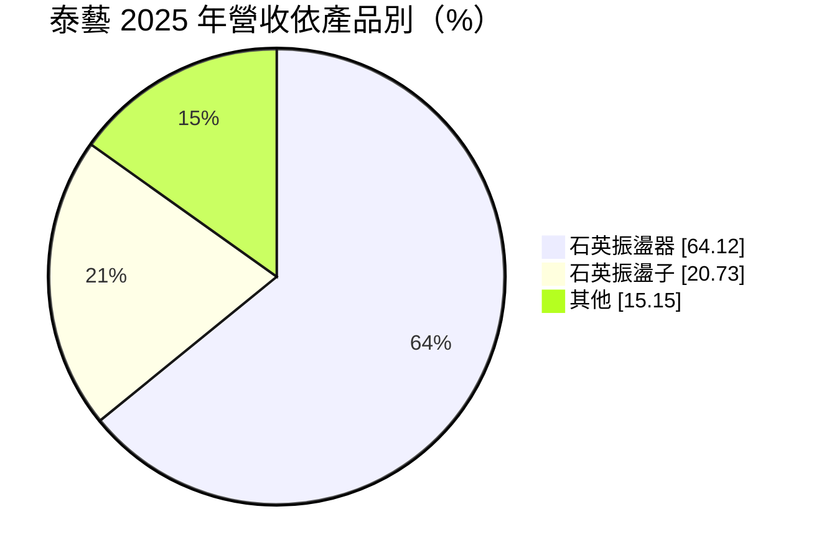
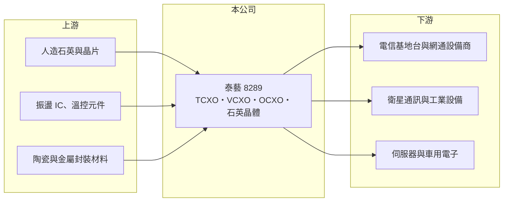

# 8289 泰藝

> 上櫃｜[[產業索引-電子零組件業|電子零組件業]]｜上市（櫃）日期 2008/04/24

# 第一章：企業模式與商業藍圖

> [!info] 撰寫說明
> 精簡版，由 Claude 依公開資料整理，架構比照 [[2330台積電]]，資料截至 2026-10-08。來源：櫃買中心開放資料快照（基本資料、2026 年第二季資產負債與損益、本益比殖利率）、Goodinfo 經營績效頁、MoneyDJ 個股基本資料（2025 年營收比重）、2025 年 12 月法說會相關報導標題（Yahoo 股市、富果）。據點與客戶描述部分依記憶整理，已標註待校對。#待校對

泰藝電子（以下簡稱泰藝）是一家以[[石英振盪器]]為主的頻率元件廠，理解它的關鍵在於：它刻意避開量大價低的標準晶體，專攻通訊基礎建設、衛星與工業用的高精度振盪器，例如具備恆溫控制的 [[OCXO]]。

- **核心業務：** 泰藝成立於 2000 年，2008 年在櫃買中心掛牌，總部位於新北樹林，實收資本額約 6.83 億元，董事長為宋勝泰、總經理為宋佳欣。公司產品包括溫度補償型（TCXO）、壓控型（VCXO）與恆溫型（OCXO）振盪器，以及[[石英晶體]]（石英振盪子）。高精度振盪器負責提供基地台、網通設備與衛星系統的精準時脈，頻率稍有偏移就會造成通訊中斷。
- **營收結構：** 依 MoneyDJ 資料，2025 年石英振盪器約占 64%、石英振盪子約 21%、其他約 15%。振盪器比重高，使泰藝的產品單價與技術門檻都高於以晶體為主的同業。應用別比重未查得，依記憶以電信基礎建設、網通、工業與衛星為主（待校對）。
- **營運據點：** 台灣為研發與高階產品生產基地，並在中國設有生產據點、在美國設有銷售子公司（待校對）。美國是高精度時脈元件的重要市場，就近服務有助於取得電信與國防相關客戶。
- **長期方向：** 依 2025 年 12 月法說會相關報導，公司看好 2026 年車用、伺服器與衛星通訊需求，並認為美國內需市場可期。[[低軌衛星]]、5G 與資料中心的時間同步需求，都需要更穩定、更低相位雜訊的振盪器，這是泰藝長期的成長方向。

# 第二章：護城河深度與競爭優勢

泰藝的護城河來自高精度振盪器的設計與溫控技術，以及電信與衛星客戶的長期認證。

- **競爭優勢：** OCXO 需要把晶體放在恆溫槽中精密控溫，設計與調校經驗難以短期複製，全球能量產的廠商不多。電信基礎建設與衛星客戶對可靠度要求極高，認證期長、一旦採用就會使用多年，形成轉換成本。泰藝在 2022 年毛利率達 34.3%、營業利益率 17.8%，說明景氣好時高階產品具備訂價能力。
- **主要對手：** 國際上有紐西蘭 Rakon、美國 Microchip、SiTime（以 MEMS 時脈元件競爭）以及日本電波工業等；台灣同業 [[3042晶技]]、[[8182加高]] 與 [[3221台嘉碩]] 以晶體與一般振盪器為主，在高階 OCXO 上與泰藝的重疊較少。MEMS 振盪器在部分應用上取代石英，是長期的替代威脅。
- **觀察重點：** 長期要追蹤電信設備投資循環回升後，毛利率能否回到三成以上，以及衛星與伺服器等新應用能否成為穩定的營收來源。2024 至 2025 年營業利益率接近零，代表低谷期的固定成本負擔很重。

# 第三章：財務體質與盈利規模

資料日期：2026-10-08，表格是撰寫當時的快照；最新月營收、毛利率、累計 EPS 由自動排程寫在本筆記的屬性欄位（月營收、毛利率、累計EPS 等）。#待校對

泰藝的財務高度跟著電信設備投資循環走：2022 年是高峰，2024 至 2025 年跌到損益兩平附近，2026 年上半年開始回升。

| 年度 | 營收（億元） | [[毛利率]] | [[營業利益率]] | EPS（元） | [[ROE]] |
|---|---|---|---|---|---|
| 2021 | 22.7 | 28.7% | 13.3% | 3.12 | 15.2% |
| 2022 | 23.7 | 34.3% | 17.8% | 5.25 | 22.0% |
| 2023 | 15.8 | 27.0% | 5.15% | 1.29 | 5.31% |
| 2024 | 15.0 | 22.6% | -0.45% | 0.40 | 1.72% |
| 2025 | 17.4 | 23.5% | 1.13% | 0.04 | 0.18% |
| 2026 上半年 | 9.54 | 23.9% | 5.3% | 0.63 | 未查得 |

（來源：Goodinfo 經營績效頁；2026 上半年取自櫃買中心開放資料推算。2020 年營收 15.8 億元、EPS 0.06 元。）

- **營收規模：** 2020 至 2025 年營收由 15.8 億元增至 17.4 億元，年複合成長率約 1.9%（推算），但中間經歷 2021 至 2022 年的高峰與 2023 至 2024 年的低谷。2026 年上半年營收約 9.54 億元，年化後接近 19 億元，處於回升階段（推估）。
- **獲利：** 2021 至 2025 年平均 ROE 約 8.9%（推算），但分布極不平均：2022 年 22%，2025 年僅 0.18%。2026 年上半年營業利益率回到 5.3%、EPS 0.63 元，已超過 2024 與 2025 年全年。這種大起大落是高階零件廠營運槓桿的特性。
- **財務特色：** 依 2026 年第二季資料，總資產約 25.6 億元、股東權益約 16.4 億元、負債約 9.2 億元，財務結構穩健。最近一次現金股利每股 0.15 元，高於 2025 年 EPS 0.04 元，代表公司在獲利低谷時動用保留盈餘維持小額配息。自由現金流是否長期為正未查得。
- **[[ROIC]] 與 [[WACC]]：** 以 2025 年營業利益約 0.20 億元（17.4 億元 × 1.13%）、稅率 20% 計算，稅後營業利益約 0.16 億元，投入資本以股東權益 16.4 億元到「權益加全部負債」25.6 億元為區間（有息負債未查得），ROIC 約 0.6% 至 1.0%（推算）；2026 年上半年年化後約 3.2% 至 5.0%（推算）；2022 年高峰期稅後營業利益約 3.4 億元，對照當年 ROE 22%，ROIC 推估明顯高於一成（推算）。WACC 以 CAPM 推估：無風險利率 1.75%、市場風險溢酬 6%、β 假設 1.0（電子零件同業常見值），權益成本約 7.8%；稅後負債成本假設 2%、負債占兩成，WACC 約 6.6%（推算）。ROIC 只在電信投資高峰年度明顯超過 WACC，整個循環平均下來大致與資金成本相當。

# 第四章：總體風險與地緣政治

泰藝的風險集中在電信投資循環、技術替代與地緣政治。

- **產業週期：** 高精度振盪器的需求高度依賴電信營運商與網通設備商的資本支出，5G 建設高峰過後，2023 年營收由 23.7 億元降到 15.8 億元。衛星、伺服器與車用能分散風險，但這些新應用的規模仍在建立中。
- **營運風險：** 營收規模不大，研發與製造的固定成本高，營收一下滑就容易接近虧損。MEMS 振盪器在體積、抗震與交期上有優勢，若在中高階市場持續取代石英，會壓縮泰藝的市場空間。
- **其他風險：** 美國市場比重高，關稅與出口管制政策會影響出貨；高階時脈元件可能涉及國防與基礎建設，受各國供應鏈安全規範影響。新台幣升值也會壓縮獲利。

# 專有名詞解析

## 應用

- **[[石英振盪器]]**：把石英晶體與振盪電路封裝在一起的主動元件，可直接輸出穩定時脈，精度與單價高於晶體。
- **[[低軌衛星]]**：在距地面約 500 至 2,000 公里軌道運行的通訊衛星群，用於全球寬頻上網，帶動地面接收設備需求。

## 產業

- **[[石英晶體]]**：利用石英的壓電效應產生固定頻率的被動元件，需搭配外部電路才能起振。
- **[[OCXO]]**：恆溫控制石英振盪器，把晶體置於恆溫槽中維持固定溫度，頻率穩定度最高，用於基地台與衛星。

# 核心供應鏈

- 上游：人造石英晶棒與晶片、振盪與溫控 IC、陶瓷與金屬封裝材料；實際供應商未查得，#待校對。
- 下游／客戶：電信基地台與網通設備商（例如 [[2345智邦]]、[[2314台揚]] 所在的網通產業）、衛星通訊設備（例如 [[3491昇達科]] 所在的產業），以及伺服器與車用電子；是否為泰藝客戶未查得，#待校對。
- 同業：[[3042晶技]]、[[8182加高]]、[[3221台嘉碩]]，國際上有 Rakon、Microchip、SiTime、日本電波工業。

## 最新新聞
<!-- news:start -->
<!-- news:end -->

## 相關連結
- [公開資訊觀測站](https://mopsov.twse.com.tw/mops/web/t05st03?step=1&firstin=1&co_id=8289)
- [Goodinfo](https://goodinfo.tw/tw/StockDetail.asp?STOCK_ID=8289)
- [Yahoo 股市](https://tw.stock.yahoo.com/quote/8289)
- [鉅亨網新聞](https://www.cnyes.com/twstock/8289/news)
