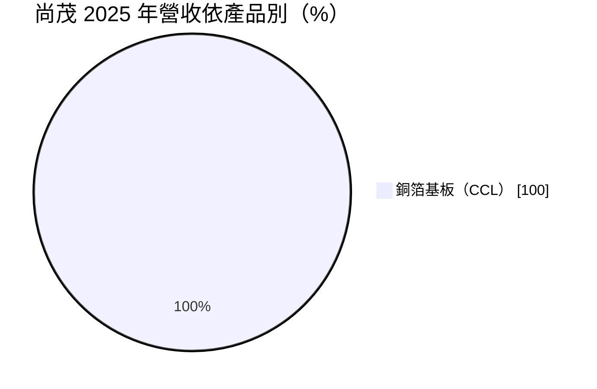
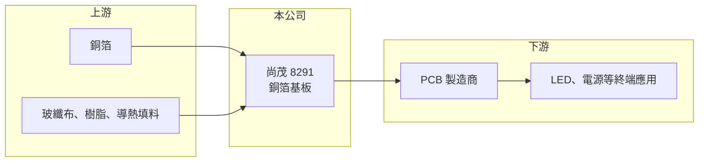

# 8291 尚茂

> 上櫃｜[[產業索引-電子零組件業|電子零組件業]]｜上市（櫃）日期 2011/11/29

# 第一章：企業模式與商業藍圖

> [!info] 撰寫說明
> 精簡版，由 Claude 依公開資料整理，架構比照 [[2330台積電]]，資料截至 2026-10-08。來源：櫃買中心開放資料快照（基本資料、2026 年第二季資產負債與損益、本益比殖利率）、Goodinfo 經營績效頁、MoneyDJ 個股基本資料（2025 年營收比重）。公開資料有限，產品特性部分依記憶整理，已標註待校對。#待校對

尚茂電子材料（以下簡稱尚茂）是一家規模極小的[[銅箔基板]]廠，理解它的關鍵在於：公司營收在過去五年幾乎歸零、持續虧損，目前的重點不是產業地位，而是公司能否重整營運、延續經營。

- **核心業務：** 尚茂成立於 1997 年，2011 年在櫃買中心掛牌，工廠位於桃園大園，實收資本額約 1.75 億元，董事長兼總經理為佐佐木Beji。依 MoneyDJ 資料，2025 年營收全部來自銅箔基板（CCL），也就是製作 [[PCB]] 的基礎板材。依記憶，尚茂過去以 LED 與電源用的高導熱基板等特殊材料為主，而非大宗的 FR-4 板材（待校對）。
- **營收結構：** 營收由 2020 年的 2.19 億元一路降到 2025 年的約 300 萬元，2026 年上半年僅約 255 萬元。這種規模已不足以支撐工廠的固定成本，代表原有產品線幾乎停擺。營收結構因此沒有太大分析意義。
- **營運據點：** 公開資料僅見桃園大園的工廠與總部，海外據點未查得。
- **長期方向：** 基本資料顯示公司有約 722 萬股[[私募]]股份，約占已發行股數的四成，董事長為日籍人士，推估公司已由新的策略投資人主導（推估）。新經營團隊的轉型方向與時程，公開資料未查得；網路上部分自動產生的快訊稱業務成長，但與財報數字不符，不予採用。

# 第二章：護城河深度與競爭優勢

以目前的營收規模，尚茂談不上護城河，本章重點在說明它在產業中的處境。

- **競爭優勢：** 特殊用途基板若通過客戶認證，理論上可以在小眾市場維持穩定訂單，這曾是尚茂的定位（待校對）。但連續多年營收萎縮，顯示既有客戶與產品已大量流失，任何優勢都需要重新建立。
- **主要對手：** 銅箔基板產業由大廠主導，台灣有 [[2383台光電]]、[[6274台燿]]、[[6213聯茂]]，國際上有日本、韓國與中國的大型材料廠（例如生益科技、建滔積層板）。大廠在規模、材料研發與客戶認證上都遠超尚茂，小廠只能在極少數利基產品中生存。
- **觀察重點：** 長期唯一重要的問題是公司能否找到新的產品或業務，讓營收回到足以涵蓋固定成本的規模。在看到營收實際回升之前，任何轉型說法都只能視為計畫。

# 第三章：財務體質與盈利規模

資料日期：2026-10-08，表格是撰寫當時的快照；最新月營收、毛利率、累計 EPS 由自動排程寫在本筆記的屬性欄位（月營收、毛利率、累計EPS 等）。#待校對

尚茂的財務呈現典型的經營困境：營收萎縮、毛利為負、淨值持續侵蝕。

| 年度 | 營收（億元） | [[毛利率]] | [[營業利益率]] | EPS（元） | [[ROE]] |
|---|---|---|---|---|---|
| 2021 | 2.02 | -2.8% | -17% | -0.66 | -20.1% |
| 2022 | 1.00 | -29.5% | -57.4% | -1.25 | -43.7% |
| 2023 | 0.37 | -123% | -177% | -1.50 | -97.5% |
| 2024 | 0.10 | -448% | -653% | -1.22 | -96.8% |
| 2025 | 0.03 | -449% | -1045% | -1.95 | -37.5% |
| 2026 上半年 | 0.03 | 毛損 | 營業損失 | -0.91 | 未查得 |

（來源：Goodinfo 經營績效頁；2026 上半年取自櫃買中心開放資料。2020 年營收 2.19 億元、EPS -1.44 元。）

- **營收規模：** 2020 至 2025 年營收由 2.19 億元降到約 0.03 億元，萎縮超過九成八。營收這麼小時，毛利率與營業利益率的百分比已失去比較意義，重點是每年的虧損金額：2025 年稅後虧損約 0.34 億元，2026 年上半年稅前虧損約 0.16 億元。
- **獲利：** 2020 年以來每一年都虧損，ROE 長期為負。由於分母（股東權益）不斷變小，ROE 的負值看起來忽大忽小，實際上是虧損持續侵蝕資本。
- **財務特色：** 依 2026 年第二季資料，總資產約 3.53 億元、股東權益僅約 0.58 億元、負債約 2.95 億元；流動負債約 2.72 億元，高於流動資產約 1.41 億元，短期償債壓力大。保留盈餘為負約 1.17 億元，屬[[累積虧損]]狀態，每股淨值約 3.32 元，虧損已超過實收資本額的一半，依公司法董事會須向股東會報告。未配發股利。
- **[[ROIC]] 與 [[WACC]]：** 2025 年營業虧損約 0.31 億元（0.03 億元 × -1045%），2026 年上半年營業虧損約 0.12 億元，ROIC 為大幅負值；投入資本以股東權益 0.58 億元到「權益加全部負債」3.53 億元計算，2026 年上半年年化後約 -7% 至 -43%（推算，虧損不扣稅）。WACC 以 CAPM 推估：無風險利率 1.75%、市場風險溢酬 6%、β 假設 1.2（小型虧損股風險較高），權益成本約 9.0%；稅後負債成本假設 3%、負債占五成，WACC 約 6%（推算）。ROIC 遠低於 WACC，公司目前持續消耗資本，不具備創造價值的條件。

# 第四章：總體風險與地緣政治

尚茂最大的風險是經營延續性，產業循環反而是次要因素。

- **產業週期：** 銅箔基板需求跟著 PCB 產業循環走，AI 伺服器帶動高階材料需求，但這波成長主要由大廠吸收，小廠難以分享。若公司轉型仍在材料領域，必須面對大廠的規模與價格競爭。
- **營運風險：** 營收幾乎歸零、淨值偏低、流動負債高於流動資產，若無新資金挹注或新業務，營運資金可能不足。每股淨值偏低時，股票在信用交易等方面也會受到限制。私募股東主導的轉型若失敗，既有股東權益可能進一步被稀釋或減損。
- **其他風險：** 銅價與樹脂、玻纖布等原物料價格波動；小型股流動性低、股價易受消息影響，網路上的自動生成快訊與財報實況不一致，投資人須以官方財報為準。

# 專有名詞解析

## 金融

- **[[私募]]**：公司向特定人募集股票或債券，不需公開發行，常用於引進策略投資人或在財務困難時籌資，私募股票有轉讓限制。
- **[[累積虧損]]**：歷年虧損累積後尚未彌補的金額，依公司法須先彌補完畢才能分配盈餘。

## 產業

- **[[銅箔基板]]**：由銅箔、玻纖布與樹脂壓合而成的板材，是 PCB 的主要原料。
- **[[PCB]]**：印刷電路板，用銅線路連接電子元件的基板，是所有電子產品的骨架。

# 核心供應鏈

- 上游：銅箔（例如 [[8358金居]]）、玻纖布（例如 [[1802台玻]]、[[5475德宏]]）與樹脂；實際供應商未查得，#待校對。
- 下游／客戶：PCB 製造商，以及 LED 照明、電源等使用特殊基板的終端應用（待校對）。
- 同業：[[2383台光電]]、[[6274台燿]]、[[6213聯茂]]，國際上有生益科技、建滔積層板。

## 最新新聞
<!-- news:start（自動產生，請勿手動編輯此範圍） -->
- 2026-10-16 🏛️ 重訊 13:41｜公告本公司減資辦理資本額變更登記完成｜[觀測站](https://mops.twse.com.tw/mops/#/web/t05st01)

完整紀錄：[[8291尚茂 新聞]]
<!-- news:end -->

## 相關連結
- [公開資訊觀測站](https://mopsov.twse.com.tw/mops/web/t05st03?step=1&firstin=1&co_id=8291)
- [Goodinfo](https://goodinfo.tw/tw/StockDetail.asp?STOCK_ID=8291)
- [Yahoo 股市](https://tw.stock.yahoo.com/quote/8291)
- [鉅亨網新聞](https://www.cnyes.com/twstock/8291/news)
