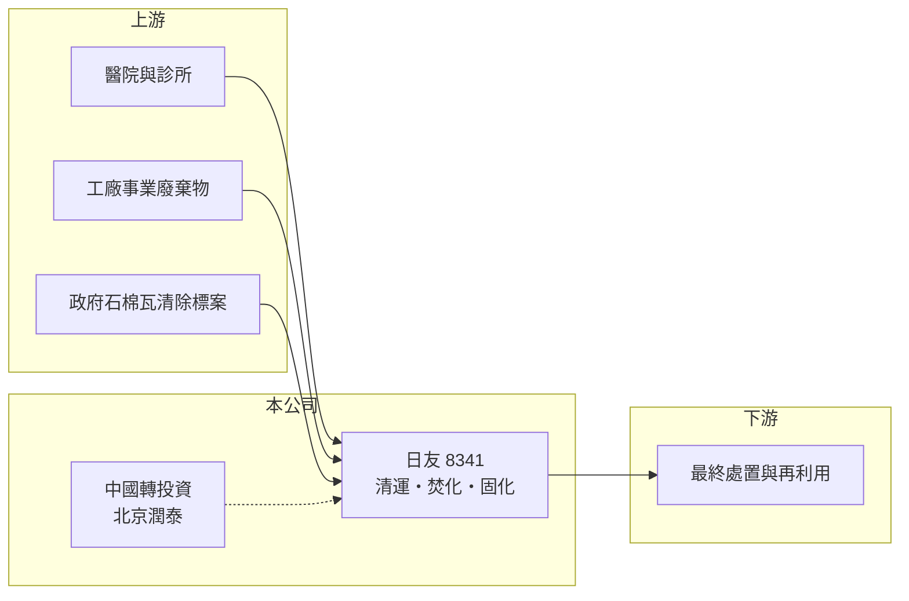

# 8341 日友

> 上市｜[[產業索引-綠能環保|綠能環保]]｜上市（櫃）日期 2015/03/23

# 第一章：企業模式與商業藍圖

> [!info] 撰寫說明
> 精簡版，由 Claude 依公開資料整理，架構比照 [[2330台積電]]，資料截至 2026-10-08。來源：Goodinfo 台灣股市資訊網與 MoneyDJ 理財網年度財務資料（2020 至 2025 年）；優分析 UAnalyze 2025 年報導；證交所開放資料快照（基本資料、2026 年上半年資產負債與損益、2025 年度股利）。處理廠位置、處理量與營收比重這次未查得，部分業務描述憑記憶整理，已標「待校對」。#待校對

日友環保科技成立於 1994 年 11 月、2015 年 3 月上市，總部與主要廠區在雲林縣元長鄉，董事長兼總經理為張芳正，實收資本額 13 億元。日友是台灣醫療廢棄物處理的代表業者，商業模式是向醫院與工廠收取清運與處理費，屬於需求穩定、受法規保護的環境服務業。

- **核心業務：** 日友的本業是醫療廢棄物與[[事業廢棄物]]的清除與處理，處理方式以高溫焚化為主，並延伸到固化等有害廢棄物處理（處理工法細節待校對）。醫療廢棄物具感染性，法規要求必須由合格業者清運並妥善處理，醫院不能自行丟棄，因此需求與醫療服務量同步，景氣循環的影響很小。
- **營收結構：** 這次未查得業務別比重。依報導，台灣事業廢棄物是近年的成長來源，2024 年第三季因石棉瓦新增訂單，固化稼動率由 45% 提升到 61%，台灣事廢營收季增 13%。另外在中國經營醫療廢棄物處理的轉投資（北京潤泰等）占一部分營收（比重未查得）。
- **營運據點：** 雲林元長廠是集團核心處理設施；中國有北京潤泰，並轉投資山東日照的處理事業。2024 年第四季北京潤泰對山東日照的轉投資認列 8,142 萬元商譽減損，顯示中國事業的經營風險。
- **長期方向：** 日友的長期動能來自兩方面：一是台灣法規趨嚴與都市更新帶動的石棉瓦等有害廢棄物處理需求，這類標案毛利較高；二是中國事業在減損後能否穩定獲利。由於焚化與固化設施取得許可困難，既有產能本身就是長期資產。

# 第二章：護城河深度與競爭優勢

日友的護城河來自處理設施的許可門檻與醫療客戶的長期合約，是典型的「特許型」環境服務。

- **競爭優勢：** 焚化與有害廢棄物處理廠需要環評與處理許可，地方居民接受度低，新廠很難設立，既有業者的產能因此具有稀缺性。醫院與工廠需要穩定、合法的處理管道，一旦簽約通常不會輕易更換，讓日友的收入具有長期重複性。
- **主要對手：** 有害事業廢棄物處理同業有 [[8422可寧衛]]，大型焚化與環境服務有 [[6803崑鼎]]，以及各地區的中小型醫療廢棄物處理業者。中國市場則面對當地國營與民營環保集團的競爭。
- **觀察重點：** 2020 至 2022 年[[營業利益率]]在 30% 至 43%，2023 年降到 18.5%，主因中國事業轉弱與成本上升；2025 年回升到 23.8%。長期要看台灣有害廢棄物標案能否延續，以及中國轉投資是否還有減損。

# 第三章：財務體質與盈利規模

資料日期：2026-10-08，表格是撰寫當時的快照；最新月營收、毛利率、累計 EPS 由自動排程寫在本筆記的屬性欄位（月營收、毛利率、累計EPS 等）。#待校對

日友在 2020 至 2022 年屬於高獲利期，2023 年起獲利腰斬，近兩年逐步回升，但仍遠低於高峰。

| 年度 | 營收（億元） | [[毛利率]] | [[營業利益率]] | EPS（元） | [[ROE]] |
|---|---|---|---|---|---|
| 2021 | 33.5 | 52.2% | 35.9% | 8.47 | 28.7% |
| 2022 | 38.4 | 46.5% | 30.1% | 7.72 | 25.5% |
| 2023 | 32.6 | 41.2% | 18.5% | 3.40 | 9.76% |
| 2024 | 37.0 | 42.4% | 19.4% | 3.69 | 10.2% |
| 2025 | 39.9 | 43.2% | 23.8% | 4.48 | 12.0% |

註：資料取自 Goodinfo 與 MoneyDJ 合併報表；2020 年營收 29.1 億元、EPS 8.91 元、ROE 31.6%。2026 年上半年營收 22.12 億元、毛利率 47.14%、EPS 2.97 元（證交所資料）。

- **長期指標：** 2020 至 2025 年營收年複合成長率約 6.5%（推算），2021 至 2025 年平均 ROE 約 17.2%（推算），但後三年只有 10% 至 12%。2025 年度現金股利 4 元，配息率約 89%（4 ÷ 4.48），屬高配息政策。MoneyDJ 每股現金流量 2021 至 2025 年皆為正（7.08 至 14.62 元），營業現金流穩定。
- **[[ROIC]] 與 [[WACC]]：** 2025 年營業利益約 9.5 億元（39.9 億元 × 23.8%），稅後約 7.6 億元；投入資本約 84 億元（2026 年第二季權益總計 58.14 億元，加上以非流動負債 26.26 億元推估的有息負債），ROIC 約 9.0%（推算）。WACC 約 4.7%（推算：無風險利率 1.75%、市場風險溢酬 6%、β 取環境服務業常見值 0.7，股東權益成本 5.95%；稅前負債成本 2.5%、稅率 20%，負債占資本約 31%）。ROIC 高於 WACC 約 4 個百分點，仍在創造價值，但利差已比 2021 年前明顯縮小。
- **財務特色：** 2026 年第二季負債比率約 43%（負債 44.05 億元 ÷ 資產 102.19 億元），非流動資產 82.2 億元占總資產八成，反映焚化與處理設施的重資產特性。毛利率長年在 40% 以上，屬環保業中的高毛利公司。

# 第四章：總體風險與地緣政治

日友的風險集中在法規、成本與中國轉投資，景氣循環的影響相對小。

- **產業週期：** 醫療廢棄物量與醫療服務量同步，屬防禦型需求；事業廢棄物量則會隨製造業景氣起伏。石棉瓦等專案型標案有年度差異，營收可能出現高基期效應。
- **營運風險：** 焚化設施的維修停爐會直接影響處理量；電價、燃料與人力成本上升會壓縮毛利。中國轉投資已出現商譽減損，未來若當地政策或價格改變，仍可能再提列損失。
- **其他風險：** 環保法規變動會改變處理價格與許可條件；處理設施若發生污染或安全事故，可能被要求停工。中國事業另面臨匯率與地方政府政策風險。

# 專有名詞解析

## 金融

- **[[ROIC]]**：投入資本報酬率，稅後營業利益除以股東權益加有息負債，衡量本業運用資本的效率。
- **[[WACC]]**：加權平均資金成本，股東與債權人要求報酬率的加權平均，是 ROIC 要超越的門檻。

## 產業

- **[[事業廢棄物]]**：工廠、醫院等事業機構產生的廢棄物，依法須委託合格業者清除處理，分為一般與有害兩類。
- **[[醫療廢棄物]]**：醫療機構產生、可能具感染性的廢棄物，法規要求專業清運與高溫焚化等處理。

# 核心供應鏈

- 上游（廢棄物來源）：醫院、診所與工廠等事業機構，以及政府石棉瓦清除標案。
- 下游／客戶：灰渣最終處置與再利用業者（名單未查得）。
- 同業：[[8422可寧衛]]、[[6803崑鼎]]。

## 最新新聞
<!-- news:start -->
<!-- news:end -->

## 相關連結
- [公開資訊觀測站](https://mopsov.twse.com.tw/mops/web/t05st03?step=1&firstin=1&co_id=8341)
- [Goodinfo](https://goodinfo.tw/tw/StockDetail.asp?STOCK_ID=8341)
- [Yahoo 股市](https://tw.stock.yahoo.com/quote/8341)
- [鉅亨網新聞](https://www.cnyes.com/twstock/8341/news)
